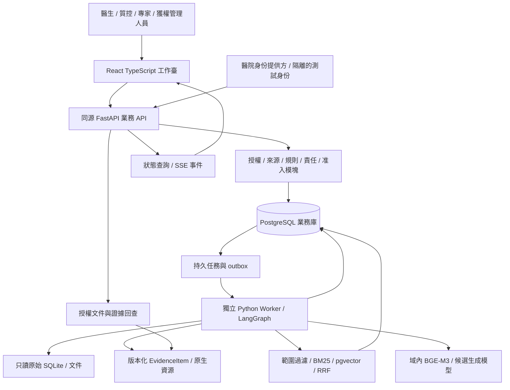
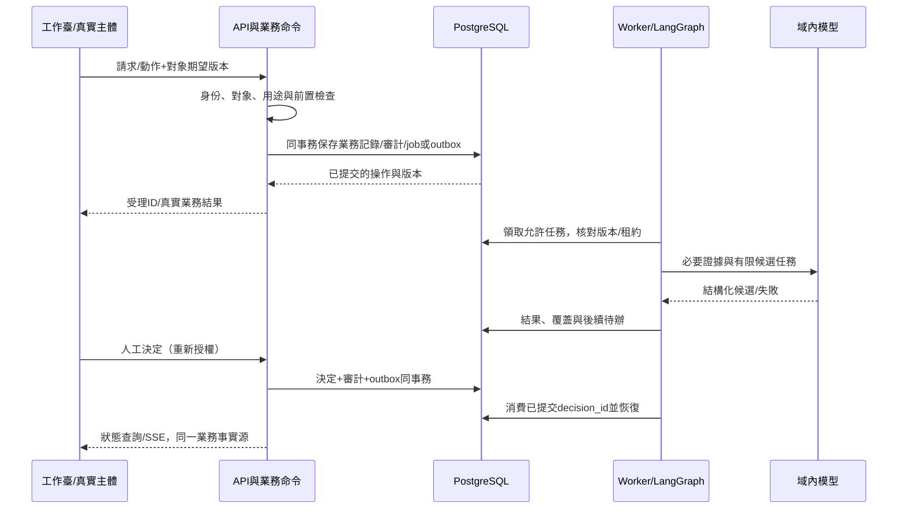

# FF - 醫療病歷質控：基礎架構與技術設計基線

本輪根據用戶要求，結合現有數據、一期需求、20 項代表性研究及官方工程資料，確定可實施的技術結構。**本地工程架構已實現並完成代表性驗證。** 精確依賴由鎖文件和資源 manifest 固定，運行方式見[運行手冊](../development-runbook.md)，實際文件、驗證與剩餘組合見[開發報告](../verification/development-report.md)。專業效果和生產責任仍未通過，不能由架構 confirmed 推導臨床准入。

研究依據與適用限制見[論文和方案對照](../research/medical-quality-architecture-evidence.md)。業務事實源仍為 [PRD](../PRD.md)、[Product Spec](../specs/product-spec.md)和 [Feature Map](../specs/feature-map.md)；本輪不擴展診斷、治療、HIS 回寫或一期病種/科室。

## 1. 應採用的基礎架構

採用 **模塊化單體 + 獨立持久任務 Worker + 域內模型運行端點**。同一後端代碼庫按 F001～F011 的業務職責分模塊，API 與 Worker 可作為不同進程運行；模型進程負責推理。模塊邊界不等同微服務，不先增加跨服務分佈式業務事務、消息中間件或圖數據庫。

這套業務主要難在來源/版本、可核查證據、長時人工責任和高風險失敗，而不是多 Agent 自由規劃。事務數據庫承接真實狀態；Worker 承接慢任務；LangGraph 承接執行控制；模型只做被允許的候選處理。

### 組件與責任

瀏覽器不直連原始庫、模型、向量庫或 checkpoint。查詢、下載、列表計數、事件與模型上下文均受同一授權範圍約束；資料正文和檢索文本不能成為執行指令。

## 2. 現有數據決定哪些能力能先做

以下規模沿用數據 README 和已有核對，未重新掃描內容或讀取參考答案。新架構不會使資料自動具有生產許可或臨床代表性。

| 數據與已知邊界 | 當前可支撐 | 必須限制的推論 |
| --- | --- | --- |
| 原始 SQLite：68 業務/參考表加 table_catalog，約 601 萬源記錄；字段多為 TEXT | 結構/字段讀取、限定病例/就診/檢查的有據映射與查詢 | 錶行不是患者數；未聲明外鍵不等於關係已驗證；不將全部源行復制進業務庫或向量庫 |
| 中文 CMQCIC：785 任務記錄、644 種文本；參考標註獨立 | 中文讀取、規則分解/事實定位的有限研究樣本 | 不是本項目 8 條文書規則的專家金標準；同文多任務不能跨調試/驗證集合洩漏 |
| PMC-Patients V2：250,294 文獻病例敘述，英文為主 | 長文本/跨語言檢索與來源定位研究 | 文獻患者摘要不是完整住院病歷，也不等於真實生產流程記錄 |
| XML 報告、7,470 PNG 與術語 XLSX | 段落/術語/圖文附件關聯與引用驗證 | 不自動診斷影像；術語層級不能自動確認醫學實體等同 |
| 659 組 WFDB 及索引 | 附件/頭信息、單位與通道來源 | 本期不做波形診斷；患者級關聯不補造某次住院歸屬 |
| 2016 規範 PDF、98 項參考規則 | 帶版本的參考依據、解析/檢索驗證 | 生效/地區/客戶適用性未凍結；參考文件存在不代表正式規則已批准 |
| 無真實複核/申訴/整改/簽字與上線記錄 | 可以用標記的合成夾具驗證軟件流程 | 不可宣稱已經有真實閉環效果、收益或生產責任接受 |

一期落地需要獲准的中文成人肺炎住院文書代表集、該病區的文書清單與規則責任人，才能驗證缺項/矛盾和實際工作流。現有公開材料先承擔工程驗證；缺資料時系統須準確表示“不足以判斷”。

## 3. 最終選定的技術結構與理由

“選定”指本次實施設計方向。包的確切補丁、鏡像 digest、模型 revision 和配置在首次構建時鎖定；本輪不創建虛假的 lockfile。

| 決定 | 選定技術 / 承接內容 | 選擇理由與邊界 |
| --- | --- | --- |
| FA-01 應用形態 | 模塊化單體，同一代碼庫的 API + Worker | 多人業務一致性可集中控制，模塊可獨立測試；目前沒有必要先拆微服務 |
| FA-02 前端 | React 19 系列 + TypeScript + Vite SPA；複用現有品牌/CSS設計與旅程 | 複雜列表、原文對照、任務狀態和返回上下文有清晰組件邊界；一期無需 SSR，原靜態原型仍獨立保留 |
| FA-03 API 與數據合同 | Python 3.12、FastAPI、Pydantic 2、OpenAPI；內部 REST + 狀態查詢/SSE | 與已有 Python 數據/模型模塊一致；結構校驗和業務授權分開，API 不運行長時模型計算 |
| FA-04 正式業務存儲 | PostgreSQL 17 系列；SQLAlchemy 2 + Alembic；普通服務角色非超級用戶/owner | 承接任務、版本、審計、唯一約束、併發比較和 outbox；源 SQLite 完全只讀，不開發雙業務數據庫兼容層 |
| FA-05 異步執行 | 同庫 job/outbox 表、租約/心跳/有界嘗試、獨立 Worker；LangGraph 固定圖 | 任務隨進程重啟可恢復；API 內 BackgroundTasks 不承擔持久質控。初期不增加 Redis/Celery/Kafka |
| FA-06 執行檢查點 | LangGraph PostgreSQL checkpointer，獨立 schema/服務權限 | 執行與業務狀態分離；物理同庫也不假定同一事務。業務決定/審計/outbox 同事務，圖消費已提交決定 |
| FA-07 檢索 | 規則 ID 直達、rank-bm25/jieba、BGE-M3 dense、pgvector 精確相似度、RRF | 結構化查詢與語義檢索分流；同權限/版本集合召回；無需獨立向量服務。HNSW 只在規模測試需要後引入 |
| FA-08 語義與規則 | 一期必需的醫療質控應用本體：OWL 2 EL 定義、術語/映射、SHACL；ROBOT/ELK 與 RDFLib/pySHACL 離線核對，PostgreSQL 語義只讀投影；臨床斷言與三值規則分工 | 用戶明確必須接入；限定當前概念/關係/約束，不做全量醫學百科或自動診斷；[詳細清單與策略](../data-preparation/governance-cleaning-handoff.md#ontology) |
| FA-09 模型邊界 | 保留 Qwen3-4B-GGUF Q4_K_M / llama.cpp 工程聯調基線；域內統一候選接口 | 該模型只作為未驗證基線，不能寫成已定型的臨床能力；代表樣本及專家評測通過後才凍結真實語義運行模型/量化/提示配置 |
| FA-10 原件與派生產物 | 原 Data 保持正式輸入；內容尋址/版本化派生資源 + PostgreSQL 元數據與 manifest；授權流式回查 | 原文與解析/規範化/模型結果分開，避免巨型數據庫 BLOB 或再複製整套源庫；生產備份/留存須按域驗證 |
| FA-11 身份與訪問 | 醫院 OIDC 身份對接 + 服務端 RBAC/對象屬性/用途校驗；RLS 作數據庫縱深限制 | 不信瀏覽器角色、thread_id 或模型自報權限；OIDC 提供方/真實簽署方式為目標醫院配置條件 |
| FA-12 評測與運行觀測 | 版本化任務/證據/運行記錄，結構化指標與脫敏日誌；既有 evals 按真實入口綁定 | 解析、檢索、模型、人工流程和門禁分別測；不默認啟用外部遙測或用平均分取代高風險否決 |

[React 官方版本](https://react.dev/versions)、[Vite](https://vite.dev/guide/)、[FastAPI](https://fastapi.tiangolo.com/features/)、[SQLAlchemy 事務](https://docs.sqlalchemy.org/en/20/orm/session_transaction.html)、[Alembic](https://alembic.sqlalchemy.org/en/latest/)支持這些實現選擇；選擇的適配性來自本項目需要，官方功能聲明不等於項目已通過運行測試。

### 對之前決定的明確修訂

此前 KD-03/05/07 和 AG-02/03 以應用 SQLite、NumPy 文件向量和 SQLite saver 作為輕量驗證設想。本次正式多人工作臺統一改為 PostgreSQL + pgvector + PostgreSQL checkpoint；原始輸入 SQLite 不變，NumPy 可用於離線數學對照。沒有已實現業務庫需要遷移，也不同時維護兩套業務持久層。檢索算法、EvidenceItem 和人工責任語義保持不變。

FA-09 不擅自換一個更大模型冒稱更好；它修正“工程基線”與“臨床已驗證模型”的資格表述。選定結構與臨床能力凍結屬於不同階段。

2026-10-13 用戶進一步明確必須接入醫療本體，FA-08/KD-03/TP-02 因此從僅最小映射升級為限定應用本體及版本化消費。詳細定義、標準/開源比較、語義包與檢查位於[本體專項](../data-preparation/governance-cleaning-handoff.md#ontology)。這是設計修訂，未安裝工具、導入詞表或部署本體。

## 4. 數據、業務與模型的分工

| 層 | 事實源 / 產物 | 責任與消費 |
| --- | --- | --- |
| 原始證據 | 源文件/原庫版本、許可、原文與字段 | F002 固定來源，F003 只讀解析；不把清洗結果替代原件 |
| 解析與覆蓋 | EvidenceItem、locator、原生結果、讀取範圍/缺口 | F003；上游失敗傳遞到所有下游，不從分母消失 |
| 病例與語義 | 病例/就診/文書/事件、斷言語境、映射和版本 | F004；只建立有據關係，不把未提及當陰性或未實施 |
| 規則與知識 | 獨立版本、適用範圍、批准狀態、索引和引用 | F005；索引就緒不等於規則生效 |
| 機器結果 | 規則條件結果、模型候選、引用支持/未判斷及配置 | F006；不能替代專業決定或寫回病歷 |
| 人工責任 | 意見、申訴、裁決、整改版本、簽字和真實主體 | F007；權威業務庫保存，checkpoint/記憶不作事實源 |
| 評測與准入 | 獨立原判、仲裁、分層指標、批准範圍與責任接受 | F008/F009；公開/合成材料不直接證明生產放權 |

臨床斷言、完整性證明、事務/數據表及運行要求見 [TP-13～16](technical-points/platform-and-clinical-contracts.md)。

## 5. 部署與進程邊界

首個可驗證部署由四種職責組成：靜態前端與同源業務 API、PostgreSQL、獨立 Worker、域內模型端點。開發可用 Compose 管理依賴並在宿主運行 Python/前端；這只是擬部署方式，本輪沒有啟動容器或讀取現有數據庫。

- API 承接認證、查詢與業務命令，快速提交 job 或決定；耗時 OCR/嵌入/模型在 Worker 中執行，不佔住 HTTP 請求等待真人。
- Worker 只讀取其被派發的來源與版本，具有限工具和模型端點；文檔解析過程禁用不必要網絡/外部實體，資源/超時限制實際測定。
- 模型端點不直連業務數據庫，沒有簽字或任意 shell 權限；在本機/內網運行均需驗證真實網絡和遙測去向。
- PostgreSQL 存業務事實、範圍元數據、向量與獨立 checkpoint schema；原文件與原 SQLite 不隨業務庫變更遷寫。
- 源資產不作為公開靜態目錄發佈；通過授權 API 按版本與實際定位精度查看，文件名/URL/範圍不授權時同樣不洩漏。

只有規模或故障隔離證據要求時才拆服務/增隊列/ANN。該架構可支持限定內網試點的設計，不宣稱當前機器已具備生產配置。

## 6. 啟動、執行與人工恢復

請求受理、模型完成、業務提交、人工確認、雙崗簽字是不同事實。Job 是運行任務，業務 task 是責任待辦，LangGraph thread 是執行遊標；不混用一個狀態字段。具體冪等、租約、搶佔和響應語義見 TP-13/14。

## 7. 為什麼保留規則、RAG 與人工的組合

本項目需要同時回答三種問題：某字段/記錄是否存在且屬於該就診；哪份規則在當前範圍可用；跨段表述是否存在需解釋的矛盾。它們分別由結構化查詢/完整性檢查、受限知識檢索和語義候選處理。將三者都放進自由對話會丟失分母、資格與責任。

BM25+dense/RRF 保留為需實測的檢索策略；原文需要的全部證據不由固定 top-k 保證。模型上下文的截斷、來源角色和臨床斷言一起影響可判斷範圍。本體提供必須的定義、映射和約束，圖查詢只服務有據關係；全庫社區摘要與全域醫學本體仍無當前任務上的必要性。

論文提醒長上下文、檢索和引用仍可能出錯；這裡據此設置分層證據和驗證，而不套用論文準確率。[Lost in the Middle](https://arxiv.org/abs/2307.03172)、[ALCE](https://arxiv.org/abs/2305.14627)、[RAGTruth](https://arxiv.org/abs/2401.00396)

## 8. 實施順序與分工

1. F001/F002 先確定身份/範圍、來源與版本輸入；正式庫、遷移、授權和 API 合同按 TP-13/14 落實。相關 Feature 的詳細計劃現已展開；正式接口/部署見[實施合同](implementation-contracts.md)，文檔不代表任務完成。
2. F003 接有限樣本並證明結構/定位/覆蓋；F004 加斷言語境與受限查詢，不先索引全部公開材料。
3. F005 用獲准規則/知識比較詞法基線與混合結果，固定版本和撤權/更新路徑。
4. F006 先跑確定性條件、失敗與引用核對，再對需要的語義項接工程基線；臨床資格按獨立評測取得。
5. F007 打通真人決定與恢復，F008/F009 完成專家/人因/影子驗證和責任接受，再考慮任何放權。
6. F010 只打包獲准的固定資產，不默認攜帶原始病歷或擴大數據許可。

U06/U08 原十個 Feature 的規劃保留；U09 明確新增 F011 知識圖譜，原編號不變，新增 REQ-020、PSC-014、AC-027～029。圖譜主責顯示/候選接入，不增加獨立圖數據庫或替換正式語義事實源；業務代碼仍未實現。

## 9. 資源、運維與失敗條件

本輪只讀檢查發現 macOS arm64，默認 Python 3.9.6、另有已知 Python 3.12；PATH 可發現 Docker、PostgreSQL 17 的 psql、Node/npm/uv。這隻說明入口存在，未檢查守護進程、數據庫連接、賬號或服務器可用性。當前工作盤剩餘約 8.26 GiB，不能直接安排大規模模型/依賴下載。

原數據約 2.24 GiB；若有 N 個 1024 維 float32 向量，向量裸載荷約為 N×4096 字節，50,000 個約 195 MiB，不含索引、數據庫、元數據、原生解析、模型和備份。一個文檔往往多個塊，不能用文檔數直接承諾容量或速度。

首次實現凍結樣本規模、最大上下文、併發與保留範圍，測峰值內存/磁盤、查詢/排隊/模型耗時及恢復；沒有量測不承諾 SLA。當前本機可用於有界驗證，院內試點算力和資源由實際工作負載測定。模型/索引不可用時保留已經可用的人工/確定性能力並顯式受限，不偷偷改雲服務。

## 10. 設計確認與仍須驗證的事項

| 已確定設計 | 實施/業務驗證仍缺 |
| --- | --- |
| 模塊化單體、React/TypeScript、FastAPI、PostgreSQL/pgvector、Worker、LangGraph | 固定包/鏡像/模型 revision、安裝與兼容、實際接口、持久故障和併發測試 |
| 原始庫只讀、EvidenceItem、版本化語義/規則/責任 | 中文成人肺炎文書適配、業務鍵/關聯、規則專業資格、真實文書清單 |
| 否定/主體/時間/假設、完整性與來源角色分層 | 中文/長尾/跨段樣本及雙人專家核對，模型/提示/量化的目標範圍表現 |
| OIDC 接入與服務端權限、RLS 縱深限制 | 目標醫院 IdP、實際角色映射、簽署方式、留存/備份/保全與責任人 |
| 分層評測、獨立原判與高風險否決 | 樣本量/口徑、非否決類閾值、影子運行及關鍵崗位責任接受 |

不能因為設計可以確定就捏造這些驗證結論，也不因為尚無臨床樣本而把所有工程選擇一直留空。開工條件按對應 Plan 關閉；整體 draft 不代表源材料或產品需求未收斂。

## F003 局部架構與決策邊界

依據[數據工作流](../data-preparation/workflow.md)和本輪 Feature 規劃授權，明確以下設計。它們不決定應用 Web 框架、生產數據庫、隊列或部署拓撲。

| 決策 | 本次設計 | 實施邊界 |
| --- | --- | --- |
| AD-F003-01 原生讀取與模塊位置 | F003 採用 Python 3.12 的本地處理模塊，計劃位於 `backend/medical_quality/structured_evidence/`，由產品工程單獨管理依賴 | 當前 Python 3.12 可用但項目環境為空；3.9 中可發現的包不視為 3.12 已安裝。無需為此先建 Web 服務、消息隊列或圖數據庫 |
| AD-F003-02 對接方式 | 消費 F002 提供的來源版本、讀取範圍、結構目錄和有效授權結果；以內部模塊調用及受限本地驗證入口交付分片結果與 manifest | F002 / F004 尚無實現，先用顯式測試夾具描述預期合同；替身通過不代表正式授權或消費者集成通過，不新增外部 API/SDK 產品形態 |
| AD-F003-03 分流 | SQLite、CSV、JSON/GZ、Markdown 原生讀取；已知 XML/XLSX 可作受限原生適配；圖像/波形保留附件與實際讀到的元數據 | 完整影像解釋、全量波形解碼、Office 通用解析不在本期承諾；無法讀取的部分如實給出覆蓋缺口 |
| AD-F003-04 文檔解析 | 數字 PDF 原生文字/座標；掃描/混合採用 Docling standard＋RapidOCR ONNX（顯式 PP-OCRv4 中英模型），中文複雜結構備選域內 PP-StructureV3 | [掃描定案](../data-preparation/governance-cleaning-handoff.md#pdf-scan-decision)已明確主備/模式/輸出；六頁現有文件為全頁文字/版式初查，OCR/精確依賴/資源仍待 T002 驗證，不因此將 Plan 標 ready |
| AD-F003-05 統一與保真 | 使用 Skill 中 EvidenceItem 1.0 Schema 作為當前交接基線，保留原生產物引用；小對象 JSONL，大表按實際需要使用類型化 payload | 正式實現時把經核對的合同納入產品包並記錄 Skill 基線摘要，Skill 不成為生產運行時依賴；兩個副本的職責是通用基線與產品版本，禁止隱式聯動 |
| AD-F003-06 運行結果 | 初次本地驗證採用文件型、單寫入者運行目錄；分片先臨時寫入，核對完成後登記為已發佈結果；重試複用未變輸入/配置對應的有效輸出 | 擬用 `artifacts/data-preparation/<run_id>/`，生成前加忽略規則；無完整提交標記的臨時內容不供下游消費。源文件原地引用，生產持久化另行確定 |
| AD-F003-07 質量與交接 | 對象結構檢查、原值/位置回放和覆蓋核對各有職責；建模清單隻包含准許消費的範圍 | 標註/驗證/留出數據隔離。F004 決定醫療關係，F005 決定規則資格，F006 決定質控阻斷；F003 輸出缺口，不替這些模塊做醫學結論 |

F003 的規格、實施階段、文件影響與任務見 [Spec](../specs/F003-structured-evidence/spec.md)、[Plan](../specs/F003-structured-evidence/plan.md)、[Tasks](../specs/F003-structured-evidence/tasks.md)。這些是待實施設計；本輪沒有建立上述代碼目錄、產物目錄或運行環境。

## 技術專題與來源

- [模塊實施合同](implementation-contracts.md)：F001～F011 的字段、版本、錯誤、事務和消費者；[全項目評估](../evaluation-plan.md)給出完整需求/驗收追蹤。

- [逐需求解決方案與技術落地詳解](requirement-solution-design.md)：以 20 個 REQ 和 6 個 NFR 展開現狀、備選、理由、處理步驟、數據輸出、異常和驗收；解釋本架構與既有 Feature 的落實關係。
- [TP-01/02](technical-points/semantic-query.md)：源結構、受限 SQL 與語義映射。
- [TP-03～06](technical-points/hybrid-retrieval.md)：資格、分塊、BM25/dense/RRF 與索引版本。
- [TP-07～09](technical-points/quality-orchestration.md)：規則/模型/證據與失敗關閉。
- [TP-10～12](technical-points/agent-orchestration.md)：執行圖、人工決定與持久恢復。
- [TP-13～16](technical-points/platform-and-clinical-contracts.md)：應用 API、PostgreSQL 事務/權限、臨床斷言與分層評測/運維。
- [知識檢索決定](knowledge-retrieval.md)、[Agent 決定](agent-runtime.md)：其機制繼續有效，存儲/前後端選擇按本次 FA 決定修訂。
- [研究依據](../research/medical-quality-architecture-evidence.md)：20 項論文、成熟工具及適用邊界。

正式運行源碼、依賴、容器/數據庫與模型均未在本輪建立。資料只讀，未外發病歷、讀取憑據或調用模型。

## FA-13 原生知識圖譜與醫療產品接入

依據 U09，採用固定 Ontology-Playground 原生 React 工作臺，保留 Cytoscape/fCoSE、Designer、格式與探索能力；前端原生源碼加醫療適配，後端複用受權 PostgreSQL 語義/業務投影。整體簡潔、詳細圖譜佔主要工作空間。完整比較、版本、OP 清單、TP-17 顯示投影/接口、TP-18 格式/候選邊界見[原生集成決定](ontology-playground-integration.md)，實施歸 F011，正式語義發佈仍歸 F004。選中圖節點/有向路徑不構成新的醫學推理。本決定尚未實現。
