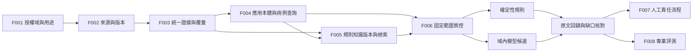

# 一期知識檢索與聯合質控技術決定

> 2026-10-14 實施更新：本地正式應用、原生圖譜、數據/模型/本體工具與責任流程已落地。本文保留設計和研究依據，設計當日的“尚未實現/未實測”不再代表當前狀態；實際文件、已驗證範圍及仍缺的專業/完整驗收見[開發報告](../verification/development-report.md)。

日期：2026-10-13。依據：用戶要求按已討論技術選型落盤，並補充對應 Feature 與技術細節。本文固定一期離線驗證的實現方向，不代表包/模型已安裝、檢索效果已驗證或生產准入已通過。

本次全面架構複核後，應用/存儲以[總體架構 FA-01～12](architecture.md)為當前基線：React/FastAPI、PostgreSQL/pgvector 與 PostgreSQL checkpoint。下表已同步修訂，原始 SQLite 來源只讀不變；沒有已實現業務庫需要遷移。

## 選定方案與職責

採用 **受控結構化查詢 + BM25 / 稠密向量混合檢索 + 必需的醫療質控應用本體 + 確定性規則與有證據的模型候選**。查詢從明確業務動作觸發，不建設全用途聊天機器人。

| 決策 | 具體選擇 | 對應業務需要 | 負責 Feature / 技術點 |
| --- | --- | --- | --- |
| KD-01 運行組織 | Python 3.12 + FastAPI 模塊化單體、獨立 Worker；React/TypeScript 工作臺 | 保持讀取、追溯與判斷責任清楚，承接多人流程 | F004～F006；應用與任務合同見 FA/TP-13 |
| KD-02 數據查詢 | 標準庫 sqlite3 只讀源庫；版本化允許查詢模板、參數與範圍，禁止模型提交任意 SQL | 準確取得病例/就診/檢查記錄及工作臺集合，不用 top-k 估計完整列表 | F004 / [TP-01](technical-points/semantic-query.md#tp-01) |
| KD-03 業務語義 | 必需的版本化應用本體包：OWL 定義、術語/映射/值集、SHACL 與數據綁定；離線核對後生成 PostgreSQL 語義只讀投影，病例實例/斷言分開 | 明確術語定義/關係/約束並接入查詢、RAG、規則與 Agent；[詳見專項](../data-preparation/governance-cleaning-handoff.md#ontology) | F004 / [TP-02](technical-points/semantic-query.md#tp-02)、[TP-15](technical-points/platform-and-clinical-contracts.md#tp-15) |
| KD-04 關鍵詞路線 | rank-bm25 的 BM25Okapi；中文采用固定 jieba 詞典/配置，英文詞項及規則號專門保留 | 精確規則號、縮寫、專業詞與原文查找 | F005 / [TP-03](technical-points/hybrid-retrieval.md#tp-03) |
| KD-05 稠密路線 | 本地 BAAI/bge-m3 dense；PostgreSQL/pgvector 在授權範圍內精確相似度檢索，NumPy 僅作數學對照 | 中文問法變化與中英材料的語義候選召回 | F005 / [TP-04](technical-points/hybrid-retrieval.md#tp-04) |
| KD-06 結果組合 | 兩路在同一允許語料集檢索，用 RRF 融合；規則 ID 直達獨立處理 | 保留編號命中，同時補充語義候選 | F005 / [TP-05](technical-points/hybrid-retrieval.md#tp-05) |
| KD-07 索引與版本 | PostgreSQL 統一元數據/規則知識/pgvector/manifest，原生大資產保留受控文件引用；不引入獨立圖/向量服務 | 支持業務事務、索引版本和限定多人訪問 | F005 / [TP-06](technical-points/hybrid-retrieval.md#tp-06)、[TP-14](technical-points/platform-and-clinical-contracts.md#tp-14) |
| KD-08 質控編排 | 固定任務分流與檢查依賴；確定性條件用 Python 規則處理，跨段疑點才調用模型；執行採用後續選定的 LangGraph 顯式圖 | 檢索、規則、模型與專家職責分層 | F006 / [TP-07](technical-points/quality-orchestration.md#tp-07)、[TP-10](technical-points/agent-orchestration.md#tp-10) |
| KD-09 語義候選模型 | Qwen/Qwen3-4B-GGUF Q4_K_M / llama.cpp 保留作工程聯調與故障驗證基線，臨床資格未確認 | 先驗證接口/證據/失敗，再以獨立樣本決定真實語義運行模型 | F006 / [TP-08](technical-points/quality-orchestration.md#tp-08) |
| KD-10 證據與恢復 | 複用 F003 EvidenceItem，另存檢索命中/計算/模型輸出；固定版本和缺口，失敗關閉 | 醫生與質控人員能檢查同一原文；整改後只重核受影響範圍 | F004～F006 / [TP-09](technical-points/quality-orchestration.md#tp-09) |

這些選擇是待驗證的實施基線，具體 Python 依賴鎖定版本、模型 revision/文件摘要及可行資源參數在首次實施中記錄。BGE-M3 多語言能力和 Qwen 可本地運行只是候選能力依據，尚無本項目召回或醫學判斷質量結論。

後續 [Agent 編排決定](agent-runtime.md) 只具體化執行、暫停/恢復和人工接續，不更換本文檢索與模型。F007 的業務狀態/責任事務見 TP-11，不能由模型上下文或 runtime 工具批准代替。

## 為什麼選擇這個組合

| 當前業務痛點 / 來源 | 採用的能力 | 暫不增加的複雜度及重新考慮條件 |
| --- | --- | --- |
| 病例標識、事件和原表達散落；REQ-003、NFR-002 | 有證據的語義映射與受控查詢 | 不將所有業務記錄向量化；結構查詢已能保證精確範圍 |
| 規則編號與自然語言表達同時存在；REQ-005/006/007 | 編號直達、BM25、dense 與融合 | 不默認加獨立 reranker；只有召回已覆蓋而排序仍不足時按同樣本增益決定 |
| 問題不能回到同版本原文；REQ-007 | EvidenceItem ID/locator 回鏈與分層結果 | 不用生成摘要替代原始證據 |
| 未覆蓋、衝突和模型失敗被誤當通過；REQ-008 | 三值規則結果、覆蓋清單與受影響範圍阻斷 | 不用 Agent 無限重試獲得想要的答案 |
| 文書/事件需要正式術語定義與約束，用戶明確必須接入本體 | OWL 2 EL 應用本體、SHACL、批准映射與 PostgreSQL 投影；詳細見 TP-02 | 不部署全域圖譜/社區摘要；evo-semantic 為可選建設 adapter，不能把五類 JSON 冒充完整 OWL |
| 現有資料跨來源、英文較多且適配未完成 | 限定樣本/知識範圍及語言能力檢查 | 不將現有全部 68 張表和 250,294 條文獻病例直接建成一期生產知識庫 |

本次沒有增加新的業務 Feature 或改變一期病區、病種與 8 條規則範圍。已有索引尚不存在，也沒有需要遷移/刪除的運行庫。

## 數據與組件鏈

擬實現位置均相對於 `MedicalQuality/`，本輪未創建運行代碼：

- `backend/medical_quality/clinical_context/`：F004 語義映射、受控查詢與病例上下文。
- `backend/medical_quality/knowledge/`：F005 規則/知識版本、分塊、詞法/向量檢索、融合及索引生命週期。
- `backend/medical_quality/quality/`：F006 運行版本凍結、規則執行、模型候選、證據核對與重核。
- `backend/medical_quality/contracts/`：共享請求/結果技術合同；業務含義沿用 Product Spec，各 Feature 不定義互相沖突的副本。
- `frontend/`：後續正式工作臺消費相同結果；原型文件保持獨立，不能把 sessionStorage 當運行事實源。

Feature 內的 `contracts.py` 只引用共享類型並做本模塊輸入/消費校驗，不再次定義同名對象 Schema。F005 的持久知識索引只保存允許用途的規則/知識；病例原文由 F004 限定範圍提供，F006 在該範圍選擇證據，即使複用檢索算法也不把病例混入全局規則知識索引。

## 共同內部接口

下表為技術字段草案，服務內部模塊/工作臺，不代表新增外部醫院 API/SDK。實現時生成可校驗合同，映射 PSC-001～005、PSC-008/009；未知不能補造。

| 對象 | 必須表達的字段與語義 | 生產者 / 消費方 |
| --- | --- | --- |
| ContextRequest | request_id、主體/授權決定引用、用途、來源命名空間、病例/就診、source/evidence/context 版本、讀取範圍 | 工作臺/F006 → F004 |
| CaseContext | case/encounter、document_versions、原始與規範化字段、事件/關係及 evidence_refs、unknown/unlinked/conflicts、coverage、語義版本 | F004 → F006 / 工作臺 |
| KnowledgeRequest | query_id、明確意圖/規則 ID、case scope 或知識範圍、purpose、適用時間口徑、允許域、要求的規則/知識版本 | F006 / 規則頁 → F005 |
| RetrievalResult | 實際模式、固定語料/索引/模型版本、hit 列表（evidence_id、source_version、locator、parent_ref、原生分數與名次）、資格依據、coverage、狀態與缺口 | F005 → F006 / 依據詳情 |
| QualityRun | run/attempt、冪等請求、病例/文書/規則/知識/語義/解析/模型配置版本、範圍、逐檢查結果、問題候選、coverage、blockers | F006 → F007 / F008 / F004 |

不能把 `source.version`、解析運行版本、索引版本和規則業務生效版本合併為一個“最新”。無命中、讀取失敗、模型未運行與規則條件成立/不成立分別表示。

## 驗證安排與准入

| 階段 | 需要取得的真實證據 | 負責與記錄 |
| --- | --- | --- |
| 源映射核查 | 數據粒度、鍵/重複與關聯覆蓋、單位/時間依據；本輪僅檢查四表結構，未讀業務行 | F004；TP-01/02 |
| 詞法與向量比較 | 固定題目/知識版本，編號、改寫問法、否定/例外、舊版本、無答案、越權樣本；基線與混合差異 | F005；TP-03～06 |
| 模型能力核查 | Qwen 配置、輸入長度/資源、結構輸出、主張是否有證據、矛盾與棄答；模型失敗不給通過結論 | F006；TP-08/09 |
| 組合驗收 | F001～F006 真路徑固定版本、範圍、權限與引用；F007/F008 具備後完成責任與專業評測 | product 套件及對應 Feature 用例 |

首批範圍採用經允許的代表材料，合成夾具與真實樣本分開。參考標註/驗證/留出正文不加入建設或檢索語料。沒有實際參照時不填 Recall/準確率；沒有驗收閾值時報告差異，不自行發明生產門檻。已有高風險漏報否決與人工責任邊界繼續適用。

## 環境、版本與存儲條件

當前已知環境：macOS arm64，16 GiB 內存，Python 3.12 可用；沒有產品虛擬環境、模型緩存或已驗證服務。上次探測剩餘磁盤僅約 7 GiB，是歷史快照；不能據此斷言兩個模型、運行依賴和索引可同時容納，實施下載前重新核對。

模型/依賴目標由本決定選定，但具體 revision、摘要、體積、內存、速度及專業適用性尚未實測。初次運行先小樣本，必要時串行加載嵌入與候選模型；若資源/效果不能滿足，保留已驗證的 SQL/詞法能力，並將語義分支明確標不可用，不宣稱混合或模型質控已跑通，也不自動切到雲端。

原生/調試派生產物擬放 `artifacts/retrieval/<index_version>/`、`artifacts/quality/<run_id>/`，模型放 `.models/`；正式元數據/業務狀態/向量及 manifest 使用 PostgreSQL，絕不寫入外層原始醫療庫。生成前加忽略規則。模型固定來源版本，索引由證據與配置重建；來源仍可用且無下游保留引用時才可清理派生緩存。業務結果與責任記錄的保留/備份按 TP-14/16 和 PRD OQ-006，不按緩存刪除。

## 官方依據與採用限制

- [sqlite3](https://docs.python.org/3/library/sqlite3.html)、[SQLite authorizer](https://www.sqlite.org/c3ref/set_authorizer.html)：實現只讀連接、參數綁定、訪問動作限制；授權範圍與業務口徑仍由產品提供。
- [rank-bm25](https://github.com/dorianbrown/rank_bm25)、[jieba](https://github.com/fxsjy/jieba)：前者接收已分詞輸入、不內置文本預處理；本項目必須固定查詢/文檔一致的分詞策略。
- [BGE-M3](https://huggingface.co/BAAI/bge-m3)：官方支持多語言及多種表徵；本方案只採用其 1024 維 dense 路線，並通過官方 FlagEmbedding 適配核驗。其他能力不隨模型名自動啟用。
- [RRF](https://www.elastic.co/docs/reference/elasticsearch/rest-apis/reciprocal-rank-fusion)：參考融合算法；本方案以小型本地模塊實現，不因此引入 Elasticsearch 服務。
- [Qwen3-4B-GGUF](https://huggingface.co/Qwen/Qwen3-4B-GGUF)、[llama.cpp server](https://github.com/ggml-org/llama.cpp/tree/master/tools/server)：選定離線模型與運行路徑；結構輸出支持不能保證醫學正確性，實際服務默認配置也不能替代數據域核驗。

資料核查於 2026-10-13。未下載模型、未複製上游代碼、未調用外部推理服務，部署和具體許可履行在採用固定版本時核對。
