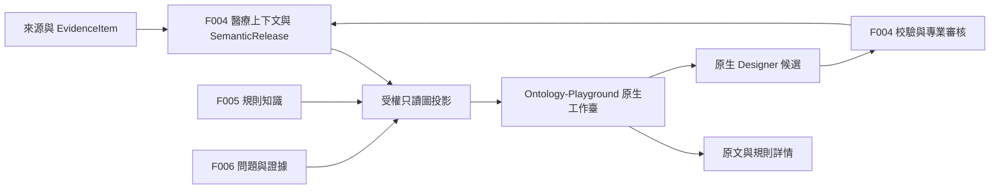

# Ontology-Playground 原生集成與醫療知識圖譜工作臺

> 2026-10-14 實施更新：本地正式應用、原生圖譜、數據/模型/本體工具與責任流程已落地。本文保留設計和研究依據，設計當日的“尚未實現/未實測”不再代表當前狀態；實際文件、已驗證範圍及仍缺的專業/完整驗收見[開發報告](../verification/development-report.md)。

## 1. 已確定的決定與交付邊界

用戶指定完整採用 [microsoft/Ontology-Playground](https://github.com/microsoft/Ontology-Playground) 的原生知識圖譜實現與渲染，不能只模仿截圖、只安裝同名圖引擎或交付刪減交互的圖。採用**固定上游源碼的原生工作臺集成**，保留瀏覽器、設計器及其圖譜相關能力，在同一醫療產品中增加詳細知識圖譜模塊。總體外殼沿用 Apple 式簡潔視覺，圖譜保留原生的空間表現、層次、選中與路徑反饋。

新增 [F011 知識圖譜工作臺](../specs/F011-knowledge-graph-workbench/spec.md)，主責查看、探索、證據聯動及本體候選編輯體驗；F004 繼續主責正式本體與醫療上下文，F005 管規則知識版本，F006 管質控結論，F007 管整改責任。圖譜不能創建第二套病例事實、專業審批或生產語義發佈流程。

本輪是設計和開發交接：未下載完整源碼、未安裝上游依賴、未修改現有靜態原型、未實現正式應用。上游源碼通過 GitHub API/raw 只讀核查；內置瀏覽器啟動報 Node runtime 缺失，因此**沒有完成上游頁面視覺或交互實測**。以下“原生能力”來自固定源碼，不表示本項目已跑通。

## 2. 上游基線與實際能力

調研日期：2026-10-13。固定提交 [`defb487b133786c826eab60b99fcef9b8d3c6fbd`](https://github.com/microsoft/Ontology-Playground/tree/defb487b133786c826eab60b99fcef9b8d3c6fbd)，提交時間 2026-10-12T13:20:15Z。倉庫標為 Preview，不能據 Microsoft 名稱推定醫療適用性或穩定性認證。源碼 MIT；實際集成時保留完整 LICENSE、版權及各依賴通知，不把 MIT 許可延伸到患者數據或外部醫學詞表。

下表是原生能力保留清單 OP-01～14。開發驗收應逐項對照固定上游與集成版本；新增醫療能力另外列出，不混稱上游自帶。

| ID | 原生實現及核查入口 | 本項目保留與接入方式 |
| --- | --- | --- |
| OP-01 | [OntologyGraph](https://github.com/microsoft/Ontology-Playground/blob/defb487b133786c826eab60b99fcef9b8d3c6fbd/src/components/OntologyGraph.tsx)：Cytoscape.js、fCoSE、帶圖標/顏色/標籤節點、箭頭與 subclass 邊樣式 | 複用原組件和渲染配置；中文標籤及醫療語義樣式通過明確適配增加。禁止重畫成幾張卡片或靜態 SVG 冒稱採用 |
| OP-02 | 同組件：拖動、平移、縮放、適配畫布、重置佈局、選中節點/邊、相鄰關係弱化/強調、焦點鄰域、PNG 導出 | 控件和實際反饋保留；拖動只改變視圖，不能改變醫學關係；PNG 走當前權限與審計後執行本地原生導出 |
| OP-03 | [SearchFilter](https://github.com/microsoft/Ontology-Playground/blob/defb487b133786c826eab60b99fcef9b8d3c6fbd/src/components/SearchFilter.tsx)：實體/關係搜索與選擇聯動 | 保留原搜索和高亮，增加中文術語/批准同義詞；患者檢索不能混用概念搜索 |
| OP-04 | [InspectorPanel](https://github.com/microsoft/Ontology-Playground/blob/defb487b133786c826eab60b99fcef9b8d3c6fbd/src/components/InspectorPanel.tsx)：屬性類型、關係方向、基數、類層級、數據綁定 | 保留原檢查器並增加定義、版本、出處、證據、斷言語境和約束報告；基數未知不能顯示成默認 one-to-many |
| OP-05 | [PathFinder](https://github.com/microsoft/Ontology-Playground/blob/defb487b133786c826eab60b99fcef9b8d3c6fbd/src/lib/pathFinder.ts)：按有向邊做 BFS 最少跳數路徑；[面板](https://github.com/microsoft/Ontology-Playground/blob/defb487b133786c826eab60b99fcef9b8d3c6fbd/src/components/PathFinderPanel.tsx)呈現步驟和高亮 | 保留方向及逐步路徑；標明當前已加載子圖範圍。“未找到路徑”不表示醫學上不存在聯繫，最短路徑不表示因果或診斷依據 |
| OP-06 | [OntologyStatsPanel](https://github.com/microsoft/Ontology-Playground/blob/defb487b133786c826eab60b99fcef9b8d3c6fbd/src/components/OntologyStatsPanel.tsx)、圖例、[CommandPalette](https://github.com/microsoft/Ontology-Playground/blob/defb487b133786c826eab60b99fcef9b8d3c6fbd/src/components/CommandPalette.tsx)及 Help | 保留統計、圖例、⌘K/Ctrl+K、快捷鍵幫助；統計分清當前子圖、加載數和獲授權範圍，不洩漏域外總數 |
| OP-07 | [OntologyDesigner](https://github.com/microsoft/Ontology-Playground/blob/defb487b133786c826eab60b99fcef9b8d3c6fbd/src/components/OntologyDesigner.tsx)、designer/、[designerStore](https://github.com/microsoft/Ontology-Playground/blob/defb487b133786c826eab60b99fcef9b8d3c6fbd/src/store/designerStore.ts)：分欄編輯、實體/屬性/關係、圖標/顏色/基數、撤銷重做、驗證、實時預覽 | 完整候選設計器；50 層撤銷/重做按固定上游迴歸。只准編輯本體候選，不能通過拖線/刪除概念修改病歷事實；候選提交接 F004 |
| OP-08 | [DesignerPreview](https://github.com/microsoft/Ontology-Playground/blob/defb487b133786c826eab60b99fcef9b8d3c6fbd/src/components/designer/DesignerPreview.tsx)：圖/RDF 切換、增量同步節點邊並儘量保留位置 | 保留雙視圖及編輯反饋；全量正式包另有受控查看入口，不能用預覽 RDF 替換原 OWL/SHACL |
| OP-09 | [RDF parser](https://github.com/microsoft/Ontology-Playground/blob/defb487b133786c826eab60b99fcef9b8d3c6fbd/src/lib/rdf/parser.ts)、[serializer](https://github.com/microsoft/Ontology-Playground/blob/defb487b133786c826eab60b99fcef9b8d3c6fbd/src/lib/rdf/serializer.ts)、[ImportExportModal](https://github.com/microsoft/Ontology-Playground/blob/defb487b133786c826eab60b99fcef9b8d3c6fbd/src/components/ImportExportModal.tsx)：原生 JSON、RDF/XML 子集、內部 subclass | 保留支持子集的導入/導出與源代碼查看；Turtle 明確不支持直接導入。正式包由後端適配，不把任意 RDF/XML 可解析誤說成 OWL 語義完整往返 |
| OP-10 | [appStore](https://github.com/microsoft/Ontology-Playground/blob/defb487b133786c826eab60b99fcef9b8d3c6fbd/src/store/appStore.ts)、主題 CSS：dark/light/aurora/crimson，顏色隨主題更新 | 保留圖譜主題選項；按 2026-10-14 用戶反饋，外殼與圖譜均默認淺色，白色畫布/淺灰面板保持一致。既有上游深色緩存遷移到醫療端淺色默認，之後的主動選擇獨立保存；其他原生主題可手動切換 |
| OP-11 | [ontologyScale](https://github.com/microsoft/Ontology-Playground/blob/defb487b133786c826eab60b99fcef9b8d3c6fbd/src/lib/ontologyScale.ts)：節點加邊達到 1,000 使用 fast grid；部分列表上限 100 並提示剩餘 | 保留原生規模策略，明確顯示佈局模式和隱藏數量；增加檢索/加載入口使授權對象可到達。不能聲稱原生自動聚類、無限圖或大圖仍全量力導向 |
| OP-12 | [queryEngine](https://github.com/microsoft/Ontology-Playground/blob/defb487b133786c826eab60b99fcef9b8d3c6fbd/src/data/queryEngine.ts)、QueryPlayground：當前本體名稱/關係匹配，含專用示例回答 | 保留圖譜查詢與高亮，醫學工作區只對當前真實投影回答；隔離示例回答。中文確定性查找由適配擴展；未識別即說明範圍，不能稱為數據庫執行、RAG 或醫學推理 |
| OP-13 | Catalogue、[GalleryModal](https://github.com/microsoft/Ontology-Playground/blob/defb487b133786c826eab60b99fcef9b8d3c6fbd/src/components/GalleryModal.tsx)、[shareCodec](https://github.com/microsoft/Ontology-Playground/blob/defb487b133786c826eab60b99fcef9b8d3c6fbd/src/lib/shareCodec.ts)：目錄、深鏈接、載荷壓縮進 URL | 內部目錄接固定語義版本；業務深鏈接只帶不透明對象/視圖標識，服務端重新鑑權。保留上游源碼，不在病歷模式啟用把數據寫入 URL 的分享動作 |
| OP-14 | [FabricExportModal](https://github.com/microsoft/Ontology-Playground/blob/defb487b133786c826eab60b99fcef9b8d3c6fbd/src/components/FabricExportModal.tsx)、[SubmitCatalogueModal](https://github.com/microsoft/Ontology-Playground/blob/defb487b133786c826eab60b99fcef9b8d3c6fbd/src/components/designer/SubmitCatalogueModal.tsx)：特定平臺導出與 GitHub 貢獻 | 保留原生擴展及格式能力；醫療產品不接 GitHub OAuth/公共提交。普通本體候選提交轉內部審核，不將“提交”偽裝為公共 PR；Fabric 格式只在兼容性通過且具導出權時提供，不要求採購 Fabric |

“完整採用”要求保留原生圖譜與設計能力的功能深度；域內授權、公開提交隔離、業務路由、中文標籤和專業發佈控制是明確醫療適配，不得借適配刪減圖譜。上游 School、Quest、積分和 Coffee 演示留在來源代碼中，不作為醫療平臺的一級導航或實際醫學數據。

## 3. 為什麼採用源碼集成

| 方案 | 能力與代價 | 決定 |
| --- | --- | --- |
| iframe 指向上游公共站 | 很快顯示原站，但業務身份、證據、共享狀態不可控，資料可能出域 | 不採用；不得把病歷發到公共站 |
| 僅官方 embed widget | 自包含、圖+檢查浮層+RDF；[官方指南](https://github.com/microsoft/Ontology-Playground/blob/defb487b133786c826eab60b99fcef9b8d3c6fbd/docs/embed-guide.md)未提供完整 Designer/工作臺 | 不作為 F011 主模塊；不能以 widget 驗收替代全模塊 |
| 用 Cytoscape 從零畫相似效果 | 需要重寫原生行為、容易縮水 | 不採用，用戶要求實際使用該項目 |
| 固定源碼＋原生模塊＋醫療適配 | 原有 React/TS/Vite 相容；可以保留依賴、樣式、圖譜/Designer/測試，並明確改動 | **採用**；先復現固定基線，再對照 OP 清單逐項驗收 |

擬落盤位置：`frontend/src/vendor/ontology-playground/` 保存圖譜工作臺及其依賴閉包（components、store、lib、data/types、必要主題資源、相關測試與來源說明）；`frontend/src/features/knowledge-graph/` 保存醫療適配和入口。源代碼一份，不長期並存完整獨立應用與複製組件兩套維護源。引入時記錄 upstream SHA、路徑清單、內容摘要、MIT、原生測試與補丁差異；未接入的教學/公共貢獻入口留有去向說明。自動下載包、node_modules、構建結果不進普通 Git。

開發先建立未經醫療改動的對照運行，證明原組件可用；隨後同一 React 應用接入，不保留另一份生產服務。對照構建放忽略的臨時目錄，驗證結果完成且原始版本可從 SHA 恢復後清理。當前不創建這些目錄。

依賴核查以該提交的 [package.json](https://github.com/microsoft/Ontology-Playground/blob/defb487b133786c826eab60b99fcef9b8d3c6fbd/package.json) 和 [lockfile](https://github.com/microsoft/Ontology-Playground/blob/defb487b133786c826eab60b99fcef9b8d3c6fbd/package-lock.json) 為準：鎖定快照含 React/ReactDOM 19.2.4、Cytoscape 3.33.1、cytoscape-fcose 2.2.0、Zustand 5.0.10、Framer Motion 12.29.2、Vite 8.0.16、TypeScript 5.9.3。它們是復現候選版本，不是已安裝或經安全/兼容驗證的本項目 lockfile。開發時先核對 Node 引擎和依賴通告，再生成統一正式應用鎖文件；若需升級，記錄原因並重新跑受影響原生能力。

## 4. 本體、病例圖與原生對象的適配

上游 [Ontology 數據類型](https://github.com/microsoft/Ontology-Playground/blob/defb487b133786c826eab60b99fcef9b8d3c6fbd/src/data/ontology.ts)以 `entityTypes` 和 `relationships` 表達類型圖。不能把每個病人當成 OWL 類，也不能把可視化連線當已確認事實。本項目分為三個視圖，共用原生渲染器與檢查器基礎：

| 視圖 | 來自哪裡 | 節點/邊及邊界 |
| --- | --- | --- |
| 本體與術語 | F004 的固定 SemanticRelease、定義/映射/值集/形狀、許可和審批狀態 | 類、屬性、批准術語關係；區分明確公理、離線推導和候選映射；可看歷史與候選，但標籤和用途分開 |
| 病例證據 | F004 版本上下文＋F003 EvidenceItem＋F006 固定問題；F007 狀態僅由其事實源讀取 | 就診、文書、段落/字段、帶語境斷言、問題、規則版本、意見。只加載一個獲授權病例的選定範圍；類型圖與實例圖切換清楚 |
| 規則影響 | F005 規則/依據版本＋F004 語義綁定＋F006 實際引用記錄 | 規則→約束/概念→字段/證據→已有問題；沒有運行記錄時顯示“尚無檢查結果”，不算預測醫學影響 |

沿用 EvidenceItem 1.0 原合同和 OWL/SHACL/SemanticRelease 事實源；新增 `GraphViewEnvelope v1` 是**顯示投影合同**，不改寫證據、不成為推理輸入。正式本體的 Turtle、映射、SHACL 和醫學定義仍由既有後端處理。一次圖請求固定 `semantic_release_id`、上下文/文書/規則/質控版本；服務器校驗它們的引用關係，不用 `latest` 拼出混合版本。

### TP-17 · 圖投影合同

| 字段組 | 擬定字段與規則 |
| --- | --- |
| 範圍 | `schema_version, view_id, view_kind, scope_ref, version_refs, projection_digest`；只有服務端授權後的對象與計數進入響應，`scope_ref` 不能替代鑑權 |
| 原生載體 | `ontology:{name,description,entityTypes,relationships}, bindings:[]`；保留原生形狀以直接驅動組件，內部 ID 使用不透明穩定鍵，顯示名走業務標籤 |
| 節點語義附錄 | `node_meta[id]`：`semantic_kind`（class/concept/instance/assertion/evidence/rule/finding/decision）、`source_ref, label_zh, aliases, original_iri, approval_status, source_role`；原生載體中的元素只是繪圖節點，kind 才決定類型和允許動作 |
| 關係語義附錄 | `edge_meta[id]`：`predicate_ref, direction, assertion_layer, derivation_ref, support_refs, cardinality_status`；關係必須有已登記的依據或推導記錄。基數未知時不渲染默認值，不能作為專業約束導出 |
| 醫療語境 | 斷言的主體、否定、時間、確定性、條件、原值與規範值來自已有 ClinicalAssertion；圖中“無藥物過敏史”與“青黴素過敏”保留為兩條來源斷言及衝突提示，不覆蓋成一條患者事實 |
| 證據 | 只傳最小預覽和 `evidence_ref/locator_ref`；詳情取固定 EvidenceItem 和源版本。原文片段不常駐所有節點 tooltip，不復制全病歷到瀏覽器圖狀態 |
| 覆蓋 | `loaded_counts, authorized_total? , has_more, cursor?, gaps[], loss_report[]`；不知道總數即省略；過濾後無邊不推導“無聯繫”。對象範圍外不存在可讀鄰居計數 |
| 運行能力 | `capabilities` 描述允許顯示的動作，不代替服務端執行時複核；瀏覽、候選編輯、導出、發佈分別授權 |

原生 `cardinality` 枚舉和 `EntityType` 無法完整承載臨床實例語義，適配層必須保留附錄，Inspector 用其決定標題、方向、層次和基數。不能在未知基數時沿用 parser 默認 one-to-many 展示為事實。患者實例圖禁止通過原生 RDF 序列化變成一批 OWL Classes；僅允許受控的“顯示投影 JSON/圖像”導出，正式本體導出走類型視圖和已有正式包服務。

映射規則：源命名空間＋固定對象版本產生穩定鍵；不是中文名稱散列合併實體。同名異義、類/實例、等價/近似、方向和單位分開；孤立節點、空值、無證據、推導依據缺失都進入可見缺口。字段映射 `bindings` 展示來源表/字段及批准映射，不讀上游 sampleBindings，不顯示連接串或未授權庫結構。

### TP-18 · 導入、編輯與正式發佈

1. 原生 JSON/RDF/XML 導入進入隔離候選；限制體積和結構複雜度，禁止外部實體/網絡取回。保留原件摘要與來源，逐項報告重複 ID、懸空邊、基數不明、不支持公理和語義損失。
2. 正式 `.ttl` 包由已有後端 RDFLib 路線解析、映射為原生類型視圖＋附錄；不把擴展名改成 `.rdf` 繞過校驗。複雜公理、SHACL 條件、外部 IRI 和語言標籤不能表達時，詳情仍回查原文並顯示 loss_report。存在影響判斷的缺口不能靜默覆蓋正式版本。
3. 源碼 Fabric IQ 驗證對實體/屬性名使用 1～26 字符 ASCII 規則。醫療中文顯示名與穩定機器名分離；圖上顯示“過敏記載”等業務名，原始 IRI 不改寫。原生 Fabric 檢查保留為該導出格式的專項結果，不作為中文醫學本體通用合法性判定，不為兼容而造患者標識屬性。
4. 原生 Designer 編輯候選，撤銷/重做與實時預覽都保留。新增中文 label/定義、出處和約束詳情由醫療側承接。保存必須帶基線與樂觀併發版本；過期編輯提示差異與重新核對，不 last-write-wins。
5. “應用到預覽”只改變候選視圖；“提交審核”把變更集交 F004 原有語義建設/專業核對管線。ROBOT/ELK、pySHACL、CQ、映射/許可及責任審核仍是正式發佈前置。原生 Validate、Save、loadOntology 或 active 狀態均不等於批准 SemanticRelease。
6. 三種導出標籤明確：原生可交換子集、顯示投影、完整正式本體包。子集往返只承諾清單中可表達語義；完整包保留所有正式資源。實例圖不提供誤導的“完整 OWL 導出”。

## 5. 應用接入、狀態與服務邊界

擬實現於 FastAPI 的 `knowledge_graph` 模塊，複用 PG 語義投影與固定索引。無需為渲染增加 Neo4j、SPARQL 服務或另一套本體推理引擎。瀏覽器不持有數據庫訪問憑據。

| 擬定接口 | 輸入與輸出 | 執行條件 |
| --- | --- | --- |
| `GET /api/v1/knowledge-graphs/views` | `view_kind, scope_ref, version_refs, filters, cursor` → GraphViewEnvelope | F001 當前主體/對象/目的校驗；返回已獲准的圖範圍。大請求按有意義的對象範圍限制，不能偷偷截斷後標全量 |
| `GET /api/v1/knowledge-graphs/elements/{id}` | `view_id, projection_digest` → 類型/關係/出處/證據/版本詳情 | 按固定視圖解析並再次鑑權；元素未在授權範圍不洩漏名稱、存在性或度數 |
| `POST /api/v1/knowledge-graphs/drafts` | 已批准基線或可讀候選＋導入物引用 → 新草稿引用 | F004 候選存儲事實源；冪等鍵、目的和導入範圍必需，不能直接發佈 |
| `PATCH /api/v1/knowledge-graphs/drafts/{id}` | 原生編輯增量＋醫療附錄＋期望版本 → 候選新版本 | 樂觀併發、變更與審計同事務；覆蓋衝突 409，保留當前輸入供核對 |
| `POST /api/v1/knowledge-graphs/drafts/{id}/submit` | 候選版本＋理由 → F004 審核任務引用 | 已有發佈流程承接，不能另造瀏覽器審批流程 |
| `POST /api/v1/knowledge-graphs/export-authorizations` | 固定視圖摘要＋導出種類/用途 → 短期許可引用或拒絕 | F001 當前權限/許可與審計成功後，才調用原生 PNG/子集導出；完整正式包複用已有導出服務 |

以上為待實現合同，不表示 API 已存在。錯誤按既有錯誤信封返回：401/403 拒絕、404 不可見、409 版本衝突、422 格式/映射不成立、503 暫不可用；不把所有空圖混成成功。

Zustand 的原生 store 保留圖譜選擇/高亮/Designer 行為，通過產品適配作用域隔離當前視圖；切換身份、病例或授權失效時清除圖、路徑、Inspector、查詢結果和導出緩衝。主題等非敏感偏好可持久化，病例正文、整張實例圖和草稿醫學內容不得直接持久化到 localStorage 或 URL fragment。草稿保存到受權後端；視口/篩選僅保存最小瀏覽狀態，重進時重新鑑權並檢查版本。

已在合法授權下交給瀏覽器的數據無法靠撤權“收回截圖”；合同承諾立即限制後續讀取/導出及清除應用可控緩存，不作不可兌現的終端防拷貝承諾。服務端篩選必須發生在圖響應前，不能發送全院圖後由 CSS 隱藏。

## 6. 產品設計落實

頁面、尺寸、入口和故事板的唯一設計源見 [design.md 圖譜增量](../03_prototype-design/design.md#knowledge-graph-design)。主導航增加“知識圖譜”，病例問題提供“查看證據關係”，規則詳情提供“查看規則關聯”。同一對象使用同一病例/規則/版本和中文名稱；返回保留原列表、頁籤及滾動。

本體視圖側重概念定義與映射，病例視圖側重問題到原文，規則視圖側重適用依據。Designer 是授權知識維護者的全屏編輯模式，不把所有醫生都帶進建模表單。Inspector 中定義、證據、約束、版本可逐項核查；常用證據與圖並列顯示，不用層層彈窗。

視覺表現採用原生 fCoSE 空間佈局、顏色/圖標、箭頭、鄰域弱化、路徑高亮和主題；用戶觸發重排保留 500ms 原生動畫並支持減少動態效果。選中/主題切換不無故重排整圖。上游默認是二維圖，沒有已核實的 3D/WebGL 地球、粒子或無限動態圖能力；本期不另換渲染引擎追求裝飾。

## 7. 規模、性能與異常

保留原生 `節點數＋邊數 >= 1000 → grid` 和列表限制。以 999/1000/1001 元素邊界、1,000 節點＋2,000 邊及長中文標籤/多重邊/孤立節點建立合成工程樣本；它們是測試尺寸，不是本院數據量聲明。大圖先給批准本體或單病例/單規則工作範圍；漸進加載後的總數、範圍、路徑覆蓋和缺口必須可見。

測量冷啟動到可交互、點擊到 Inspector、搜索高亮、佈局耗時、主題切換、峰值內存和反覆切換後的內存釋放。記錄設備、瀏覽器、視口、節點/邊數、標籤長度、主題、原生/集成版本及 p50/p95。性能閾值在相同環境基線復現後凍結，不憑源碼寫成達標；保留完整原生能力與可讀性是不能用“優化”換掉的條件。

圖渲染失敗時顯示恢復入口與可訪問的結構化對象列表，維持可讀原文/人工流程；這僅是故障恢復，不能作為完成 F011 原生圖譜驗收的替代。加載中不閃現上一個病例。無權限、不存在、空結果、部分覆蓋、版本不可用、導入損失分別解釋；已授權缺口可看具體原因，未授權對象不透露內容。

## 8. 驗收、依賴與開發入口

驗收標準和任務的唯一編號見 [F011 Spec](../specs/F011-knowledge-graph-workbench/spec.md)、[Plan](../specs/F011-knowledge-graph-workbench/plan.md)、[Tasks](../specs/F011-knowledge-graph-workbench/tasks.md)；[F011 用例](../../evals/F011.json)包含原生完整性、醫療語義、導入損失、角色/外發、規模和產品操作。組合 PG-006 從實際病例/規則進入圖，回到固定原文，確認新版本/撤權不造成錯證據。

最先完成的開發前置是固定上游版本復現、許可證和依賴核對、中文/Fabric 衝突適配試驗、F004/005/006 投影接口樣本；只用明確標為合成的夾具驗證工程能力。後續需正式應用路由、API/BFF、授權、業務版本、原文定位和候選存儲實際可用。以上尚未實施，Plan 保持 draft，不能把這份完整計劃當作原型已經展示了該模塊。

Skill 應用依據：[build-frontend-prototype](../../../.agents/skills/build-frontend-prototype/SKILL.md)及其[產品設計指引](../../../.agents/skills/build-frontend-prototype/references/product-design.md)，用於業務對象、入口/返回、空間與操作設計；[feature-spec-planning](../../../.agents/skills/feature-spec-planning/SKILL.md)、[project-evals](../../../.agents/skills/project-evals/SKILL.md)用於增量規格與用例。用戶明確不簡化原生圖譜，優先於原型 Skill 的一般“實現可以簡化”建議；本輪不修改通用 Skill 或擴展到實現。
