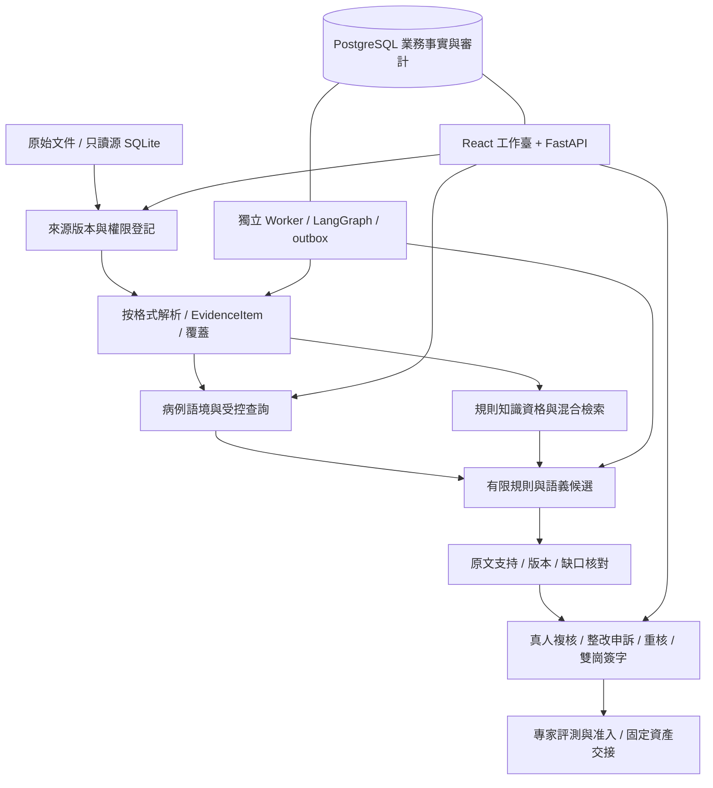
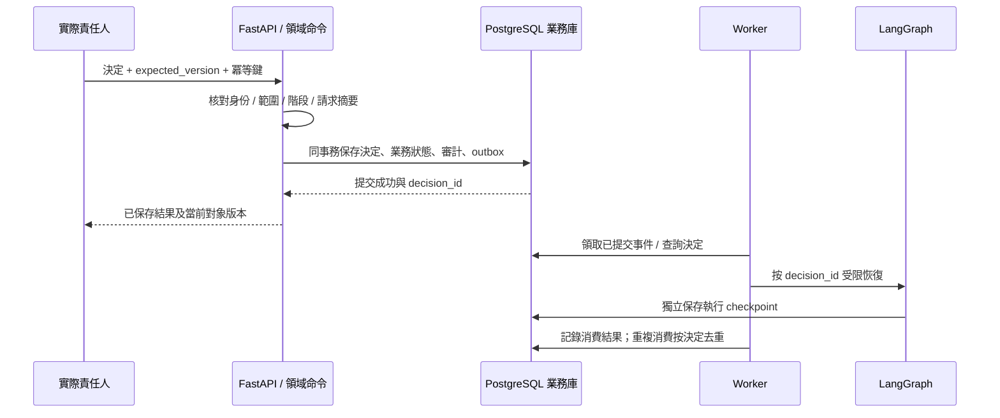

# 一期逐需求解決方案與技術落地詳解

> 2026-10-14 實施更新：本地正式應用、原生圖譜、數據/模型/本體工具與責任流程已落地。本文保留設計和研究依據，設計當日的“尚未實現/未實測”不再代表當前狀態；實際文件、已驗證範圍及仍缺的專業/完整驗收見[開發報告](../verification/development-report.md)。

本文回答：**每個需求為什麼需要做、當前缺什麼、比較過哪些辦法、為什麼選現在的方案、數據如何形成、由什麼組件承接、失敗怎樣處理、最後怎樣驗收。**

這是當前一期方案的解釋與實施設計彙總，覆蓋 20 個功能需求及 6 個非功能要求，聚焦已收斂的數據準備、基礎架構、檢索/語義、Agent 執行和人工責任鏈。它不新增需求、重排 Feature，也不替代正式規格：業務含義以 [PRD](../PRD.md) / [Product Spec](../specs/product-spec.md)為準，技術決定以 [FA-01～12](architecture.md) / 各 TP 為準，任務以對應 Plan/Tasks 為準。本文中的 REQ/AC 都是對既有編號的引用。

方案比較屬於已有資料、論文、接口與業務約束上的設計比較；除明確列出的探測和文檔檢查外，沒有完成解析器/模型/框架的效果實測比較。本文件將“已經選擇”“具備有限觀察”“尚待實施或驗收”分開，不把推薦寫成實測勝出。

## 閱讀導航

- [當前事實與差距](#baseline)：資料、軟件、模型和業務責任現在分別到哪一步。
- [整體解決結構](#overall)：為什麼這樣組合前端、API、數據庫、Worker、檢索和 Agent。
- [數據怎樣處理與保存](#data-design)：每種原格式的處理方式、最終對象、位置和存儲。
- [共同對象與版本](#contracts)：上游證據怎樣變成下游可消費結果。
- [逐需求方案](#requirements)：REQ-001～020 的逐項分析、對比、步驟和驗收。
- [貫穿全流程的非功能約束](#nfr)：NFR-001～006 的實際落實。
- [端到端示例與故障](#walkthrough)：一次處理如何形成證據、候選、決定和簽字。
- [實施順序與待驗證條件](#implementation)：已定內容、不能偽造的缺項和下一步可交付結果。
- [完成核對](#document-verification)：這份文檔的覆蓋、引用和示例檢查範圍。

<a id="baseline"></a>
## 1. 當前事實與差距

### 1.1 產品目標及使用方式

產品定位是“病歷質控、證據定位與整改協同 Copilot”。一期為單一內科病區、成人肺炎住院病歷的有限文書質控，採用獨立工作臺，圍繞 8 條候選規則貫通疑似問題、人工複核、整改/申訴、再次核驗和責任簽字。

一期的病種標籤用於限定資料與規則，不讓系統據此自動診斷。公開記錄、文獻病例、合成測試和真實生產來源分別標識；沒有自動 HIS 回寫、影像/心電診斷、全院全病種擴展，也不把每一處語義差異都認定成醫療錯誤。

主要使用者有不同任務：醫生解釋並處理自己的文書；質控人員複核和接續事項；專家處理爭議和獨立評測；信息科負責身份/接入/運行邊界；管理者查看獲准彙總和責任接受。供應商支持不因能維護軟件就自動獲得病例正文或專業簽署權限。

### 1.2 數據現狀

規模與性質沿用[數據說明](../../../Data/醫療病歷質控/README.md)和[預處理調查](../data-preparation/workflow.md)，不是本輪重新進行全量業務讀取的結果。

| 現有數據 | 當前可用事實 | 對設計的直接影響 |
| --- | --- | --- |
| 醫院結構化 SQLite | 68 張業務/參考表加 table_catalog，約 601 萬源行；源字段多為 TEXT | 保留原值與編號；區分結構/記錄及粒度；業務表/患者/就診/事件不能混為同一種數量 |
| 兩份 JSONL.GZ | 中文 CMQCIC 785 條任務、644 種文本；PMC-Patients V2 250,294 條文獻病例敘述 | 流式讀取既有封裝和身份；同文不同任務不直接刪重；英文敘述不等於中文完整住院文書 |
| 規則、參考標註與 PDF | 98 項上游參考規則、獨立參考標註、2016 年規範 PDF；本項目另有 8 條候選規則 | 參考、執行規則、專家參照分開；文件存在不說明已審核或當前適用 |
| XML、PNG、XLSX | 3,955 份影像報告、7,470 張圖像、關聯索引和術語表 | XML 保留段落語義；圖像先作附件；術語映射是來源主張，不自動成為全局等價關係 |
| WFDB | 659 組 HEA/DAT，另有記錄索引 | 先保留頭/信號配對與實際元數據；不把二進制隨意當數值數組或診斷 |
| Markdown、CSV、許可說明 | 項目資料、數據字典和路徑索引 | 它們有結構和導航用途，不全部作為患者臨床事實進入知識庫 |

已核對的代表結構不等於全部內容乾淨：PDF 已補全六頁文字層/版式初查，但未運行掃描 OCR；PNG 頭讀取不等於全部像素完整；WFDB 頭信息不等於信號已解碼。四張 MIMIC 示例表只讀結構檢查顯示聲明主鍵是內部源記錄號，業務列為 TEXT、未聲明外鍵；字段名能提出關聯候選，但仍需實際完整性/粒度核查。

關鍵缺口是：尚無本項目獲准的中文成人肺炎完整文書代表集、專家確認的規則/真值和真實整改/申訴/簽字/上線記錄。現有數據可以檢驗工程路徑，不能單獨證明生產業務效果。

### 1.3 軟件、合同與驗證現狀

| 層次 | 當前狀態 | 不能據此推導 |
| --- | --- | --- |
| 產品與原型 | PRD、Product Spec、Feature Map 已形成確認基線；有可點擊原型 | 原型角色切換、會話狀態不是實際認證、持久業務或簽字 |
| Feature 文檔 | F001～F011 已全部展開；Spec ready、Plan draft、Tasks planned；108 條局部 AC、119 項任務 | 規劃齊備不等於運行/專業前置已通過 |
| 後端/正式前端 | 後端暫無業務實現；正式前端僅有品牌資源 | 不能列出“已跑通”的應用安裝/啟動/構建命令 |
| 數據準備工具 | 有受限探測、EvidenceItem Schema/校驗器及先前輔助測試 | 工具測試不等於醫療數據全量轉換或來源位置全部驗證 |
| 檢索/模型/執行 | 設計已選定，模型和運行框架未在工程安裝、未實際構建索引 | 沒有可宣稱的檢索召回、模型質量、吞吐或恢復成功率 |
| 驗收定義 | 103 條局部用例和 14 條組合用例，共 117 條均未綁定執行 | 用例定義覆蓋全部 PRD AC/PSC；結構通過不等於業務通過 |

“Plan draft”在這裡表示實施與業務條件尚需證據，不表示技術方向仍空白。已選的方向下文給出；需要實際樣本、身份或運行測試才能解決的問題不會被寫成已完成。

<a id="overall"></a>
## 2. 整體解決結構與選擇理由

### 2.1 技術結構



| 承接內容 | 最終採用的設計 | 選擇視角 | 比較過但當前未採用 |
| --- | --- | --- | --- |
| 應用組織 | 同一後端代碼庫的模塊化單體，API 與 Worker 獨立進程 | 當前規模有限，事務與責任邊界更重要；模塊按 Feature 可獨立檢查 | 先拆大量微服務會增加跨服務一致性與運維面；僅寫一個長腳本難以承接多人/長期責任 |
| 工作臺 | React 19 系列、TypeScript、Vite，複用原型體驗/品牌 | 多頁列表、原文對照和表單狀態需要穩定組件與類型合同 | 原型 HTML/sessionStorage 只能體驗驗證；一期沒有 SSR 需求 |
| API 與合同 | Python 3.12、FastAPI、Pydantic 2、OpenAPI | 與數據/模型模塊同語言，結構校驗和業務檢查分工明確 | 將模型當對外 API 或長任務塞進單個 HTTP 請求，難以表達真正的狀態與恢復 |
| 業務事實源 | PostgreSQL 17 系列、SQLAlchemy 2、Alembic | 併發版本、責任記錄、唯一操作及 outbox 同事務 | 應用 SQLite 是前期輕量設想；正式多人閉環不維護兩套數據庫兼容實現 |
| 源數據讀取 | 原 SQLite 只讀、文件原生讀取器 | 保留原件/原值、範圍和版本；無需先複製整個大庫 | 不把所有結構化行變成長篇文本再向量化 |
| 檢索存儲 | PostgreSQL/pgvector，首批精確相似度；BM25 保留獨立詞項邏輯 | 與資格/版本元數據共同管理，先證明質量再考慮 ANN | 獨立向量集群、全量圖數據庫、過早 HNSW 當前沒有規模/任務證據 |
| RAG 方式 | 規則 ID 直達 + BM25/BGE-M3 dense + RRF，按業務任務分流 | 編號/專名與改寫問法互補，保持來源和適用範圍 | 純向量不適合精確全量統計；社區 GraphRAG 不直接解決患者級責任任務 |
| 語義表示 | 一期必需的醫療質控應用本體、臨床斷言和有據病例關係 | 用正式定義/映射/約束解釋身份、粒度、單位、主體/否定/時間/條件 | 不靠關鍵詞或無據實體合併；本體範圍和工具鏈見[專項](../data-preparation/governance-cleaning-handoff.md#ontology) |
| 質控執行 | Python 確定性處理器 + LangGraph 顯式圖 + 必要模型候選 | 規則不能被模型跳過，失敗路徑、版本和恢復可觀察 | 不以自由 Agent 工具循環或多 Agent 投票替代業務門檻 |
| 候選模型 | 既有 Qwen3-4B-GGUF Q4_K_M / llama.cpp 工程基線 | 先驗證接口、結構輸出與故障；真實語義資格單獨評測 | 不因參數更多、榜單更高或服務可調用就宣稱臨床可用 |
| 人工交接 | 真實身份的 BusinessDecision + 業務事務 + outbox，再恢復執行圖 | 簽字/複核是責任事實，不能由運行記憶或工具批准產生 | 裸 resume=true、瀏覽器角色、聊天確認和 checkpoint 均不足以構成業務批准 |

以上按 [FA](architecture.md)、[檢索 KD](knowledge-retrieval.md)與[執行 AG](agent-runtime.md)維護。本文不重新發明第二套技術選擇。

### 2.2 如何區分“選型已定”與“能力已驗證”

當前已定：組件職責、技術系列、數據對象語義、權限/版本邊界、失敗出口和驗證方法。未定型：依賴補丁及鏡像/model revision、真實病區身份/規則資格/留存參數、模型臨床性能、生產容量與 SLA。

實施時應固定真實版本和配置，再運行對應檢查。結果不足時保留失敗及原因，可以按變更依據調整方案，不能把未測項填成數值或為了保住選型而降低驗收條件。Qwen 4B 明確是工程基線，不是“已經確認足以完成醫療質控”的承諾。

### 2.3 為什麼這些選擇適合當前數據與責任範圍

本期同時有“精確結構化查詢”“取得適用條款”和“跨段表述候選”三種任務。第一種要正確粒度與完整集合，第二種要版本/資格和回查，第三種要主體、時間和語境。它們共享證據合同，但不應使用同一種相似度來做全部判斷。

當前數據尚未形成真實責任閉環，最先要證明的是來源不丟失、未知不會變成通過、真人動作在中斷/併發時仍可追溯。結構化存儲和顯式狀態流程能直接承接這些要求。論文對檢索、引用、臨床語境和自動化偏差的發現，支持這些驗證方向，不能替代當前病區的實際數據/專家結果；詳見[研究對照](../research/medical-quality-architecture-evidence.md)。

<a id="data-design"></a>
## 3. 數據到底處理成什麼形式

讀取、清洗與建模交接的完整細節見[醫療數據治理專題](../data-preparation/governance-cleaning-handoff.md)：結合實際數據和論文/開源項目，逐項明確缺失、數值/單位/時間、重複、臨床語境、質量記錄與 SQL/RAG/本體消費。下文保留整體對象關係，專項策略以該專題為準。

### 3.1 五層產物及各自用途

| 層 | 處理後形式 | 放在哪裡 | 為什麼需要保留 |
| --- | --- | --- | --- |
| 原始來源 | 原 SQLite/文件、說明與許可；來源清單固定 ID、版本、用途、讀取範圍 | 外層 Data 保持原件；登記元數據進入業務庫 | 任意下游解釋可回到真實輸入，不靠新文本副本充當原件 |
| 原生解析結果 | 數據庫結構/原記錄、文檔樹、頁框/表格、XML 樹、工作表單元格、資產頭信息 | 必要派生文件與受控引用；manifest 記錄範圍/變換 | 通用對象不能表達全部原生細節，不能因統一而丟表格跨度、屬性或單位 |
| 共同證據 | 分型 EvidenceItem；小對象可用 JSONL 分片交接，大載荷引用；正式元數據持久化到 PostgreSQL | 受控對象/資源域及業務元數據 | 下游統一訪問身份、來源、定位、內容和質量，不必理解每個解析器 |
| 業務解釋 | CaseContext、clinical_assertion、語義映射、規則/知識版本、檢索命中和運行結果 | PostgreSQL；向量進入 pgvector；大原件仍用引用 | 原值與解釋分開、資格與索引分開、候選與專業結論分開 |
| 責任與評測 | 決定、文書版本、簽字、審計、評測批次、獨立原判/仲裁、准入與交付 manifest | 權威業務庫及獲准版本化交付 | 不可從模型聊天/摘要/臨時 checkpoint 重新猜造業務歷史 |

JSONL 是流式交換/中間產物形式，不等於用文本文件代替業務數據庫；PostgreSQL 也不意味著要把胸片像素、整個 PDF 或全部原庫再存成巨型 BLOB。對象身份、內容版本和位置在兩種承載之間保持映射。

### 3.2 每類來源的具體處理路線

| 原格式 | 讀取與處理 | 統一內容種類 / 最終數據形式 | 定位與策略 | 決定依據及未驗證點 |
| --- | --- | --- | --- | --- |
| SQLite 表結構 | 只讀 URI、PRAGMA，登記表/列/已聲明鍵、實際查詢範圍 | schema 對象；結構目錄與字段映射 | table/column；元數據不是患者記錄 | 數據已結構化，不再 OCR/LLM 解析；未聲明外鍵保持未知 |
| SQLite 記錄 | 白名單查詢與參數綁定、按限定範圍流式取記錄 | record，保留 TEXT 原值；有依據才另存規範化值 | 聲明鍵，或同快照的記錄號/查詢身份；原 CSV 源記錄號口徑另保留 | 編號前導零和空白不能靠自動類型推斷改寫；關聯/粒度需樣本核驗 |
| CSV 目錄/索引 | 明確編碼/分隔符/表頭，按邏輯記錄讀取 | record/table；原字符串和字段路徑 | 邏輯記錄號/字段，不是物理換行號 | 帶引號換行、空值、前導零和路徑基準是直接風險；大表分析才需要列式派生 |
| JSON / JSONL.GZ | json/gzip 按完整記錄流式讀，不先全量解壓；精確數值採用顯式保真策略 | record 或有依據的 text/子結構；保留 doc_id、origin、text_sha256 等源字段 | JSON Pointer、數組位置和解壓邏輯記錄號，綁定原壓縮文件版本 | 已有結構不經 LLM 重寫；同一文本對應不同任務不能合併業務身份 |
| Markdown | 保留原文並建立 Token/語法結構 | text/table + 標題/段落/列表/代碼語義 | 原文行範圍，能驗證時才給字符映射 | 單靠標題正則不等於完整 AST；查詢/切片不破壞代碼或表格 |
| 數字文本 PDF | pypdf 初篩、pdfplumber 等取得實際文字/位置，逐頁核對範圍 | text/table + 頁/框及原生引用 | 頁碼、座標單位/原點/尺寸；頁級與片段級精度明確 | 現有六頁已初查可提字，未逐字/座標驗收；數字頁成功不證明掃描效果 |
| 掃描/混合/複雜 PDF | 主選 Docling standard＋RapidOCR ONNX；明確缺口才用本地 PP-StructureV3 備選 | OCR/版面原生 JSON、表格單元格、圖片關聯，再適配 EvidenceItem | OCR 座標映射回原頁；不要把 OCR 字符偏移當原文件偏移 | 主備已定，掃描效果尚未實測；參數/模型與切換見[掃描定案](../data-preparation/governance-cleaning-handoff.md#pdf-scan-decision) |
| eCitation XML | 安全 XML 讀取，禁外部實體/網絡；保留屬性與混合內容 | 段落 text/record、標籤樹和許可證出處 | XPath 與命名空間，COMPARISON/INDICATION/FINDINGS/IMPRESSION 保留 | 不當作任意 JATS 文檔；缺段仍缺段，不將 IMPRESSION 自動升級為本項目診斷 |
| XLSX | openpyxl 讀取原工作表/單元格、公式和已有緩存 | table / 術語參考；原單元格類型與合併/隱藏狀態 | 工作表名+A1 範圍 | 不靠導出一個 CSV 丟掉其他表；讀取成功不證明公式已計算或同義關係成立 |
| PNG | 原圖+元數據/實際解碼檢查，按圖文 CSV 建有來源關聯 | image + metadata/native_refs | 幀號、尺寸/位深/色彩、關聯索引記錄 | 胸片不是文檔照片，默認不 OCR/診斷；PNG 不補造 DICOM 元信息 |
| WFDB HEA/DAT | 原生頭讀取、配對與通道/單位核對；本期以元數據/附件為主 | waveform + metadata/native_refs，明示 values_decoded=false | 記錄、通道、採樣區間/頻率，頭與信號共同回鏈 | DAT 不能直接按任意數組解釋；數值解碼須有實際消費需求及原生校準 |
| 參考標註/留出數據 | 普通建設流程只登記邊界，不探讀正文 | evaluator_only/restricted 的來源登記 | 原路徑和獲准評測範圍由 Evaluator 管理 | 不能把答案混進檢索庫、映射或提示以獲得更高測試分數 |

圖文關聯的相對路徑以 `Data/醫療病歷質控/` 為基準；心電索引以其 `05_心電圖/` 為基準。把二者統一按工作區根解釋會造成假缺失或錯誤回鏈。數據庫 `source_member` 的歷史包內位置也不能當成本地文件入口。

### 3.3 保真、去重、切分與類型策略

- **保真先於規範化。** 原表達、原類型、空白/null/缺失與業務解釋分開。不能從“空字符串”直接推成數值 0 或“未發生”。
- **身份先於文本去重。** 文本摘要可用於提示重複或緩存相同計算，但不能合併不同患者、來源、文書版本或指標任務。評測分組反而要識別同文/近重複，防止跨組洩漏。
- **結構優先切分。** 規則按條款、病例按文書/段落/事件語境切；長內容再拆，保留 parent_ref 和邊界。否定詞、單位、表頭和例外條件不能切斷後被當作完整事實。
- **版本可重現。** 源內容、解析器配置、分塊、分詞、嵌入、語義映射、規則及運行各有版本，不能只用一個“最後更新時間”代替。
- **範圍可說明。** 每個批次固定輸入單元和計數口徑；文件、頁、邏輯記錄、患者、就診與檢查不是可互加的分母。
- **失敗可消費。** 未讀/損壞/不支持/缺定位保留在清單，明確允許使用的部分；補齊以後只重處理受影響範圍，影響無法可靠計算時重核聲明全範圍。

<a id="contracts"></a>
## 4. 數據對象與接口如何銜接

### 4.1 共同封裝不是最終本體

EvidenceItem 統一的是證據身份、位置和使用邊界；CaseContext 才解釋病例/事件關係；檢索結果再描述本次命中；QualityRun 表示本次判斷；BusinessDecision 表示實際人的責任動作。不能把同一個 JSON 的存在當作以上各層都已成立。

| 對象 | 最少要傳遞的語義 | 誰產生 / 誰消費 | 不允許的簡化 |
| --- | --- | --- | --- |
| SourceVersion | source_id、namespace、原格式、內容/快照版本、用途/許可/角色、路徑基準、讀取範圍 | F002 → F003及所有回查 | 原文件名或時間戳代替固定內容身份 |
| EvidenceItem | schema_version、id/kind、source、locator、content、native_refs、provenance、quality | F003 → F004/F005/F006 | 全部展平成 text，丟掉表格/類型/原生結構 |
| CaseContext | case/encounter、文書版本、原值/規範化、事件/斷言、關係證據、unknown/conflicts、coverage | F004 → F006/工作臺 | 把相似度當患者身份、遺漏語境和讀取缺口 |
| Rule/KnowledgeVersion | 規則/知識身份、來源、用途、適用時間/範圍、批准與生效狀態 | F005 → F006/F008/F009 | 索引已生成就認定已生效 |
| RetrievalResult | query/route、範圍、索引/模型/規則版本、命中證據/父塊、原生分數/名次、資格與缺口 | F005 → F006/依據詳情 | 只返一句答案或把相似度變成可信概率 |
| QualityRun/CheckResult | 凍結版本、檢查範圍、適用性、執行/覆蓋、三值條件結果、候選及 blockers | F006 → F007/F008/F004 | “運行完成”變成“病歷合格” |
| BusinessDecision | 真實主體、動作、task/scope、expected_version、文書/運行版本、理由、冪等鍵與結果 | F007應用命令 → 業務庫/執行恢復 | 接受客戶端角色或裸 resume=true 作簽署依據 |
| Audit/Outbox | 操作/決定身份、前後狀態、責任證據、待投遞事件/狀態 | 應用事務 → 審計查詢/Worker | 只寫普通日誌，業務已變但責任記錄丟失 |
| EvaluationBatch/Gate | 固定輸入和口徑、獨立原判/仲裁、覆蓋/分母、否決/准入範圍 | F008/F009 → 責任人/資產交接 | 自動評分或零次觀察漏報替代專業責任 |

### 4.2 EvidenceItem 結構示例

下例是**合成的接口示例**，URI 不指向真實病歷，不能當作已經解析或已驗證的臨床成果。字段符合現有 [EvidenceItem Schema](../../../.agents/skills/prepare-business-data/references/evidence-item.schema.json) 的封裝；success 只表示示例聲明的文字提取範圍，不表示臨床正確。

<!-- evidence-item-example -->
```json
{
  "schema_version": "1.0",
  "id": "EV-DEMO-001",
  "kind": "text",
  "source": {
    "id": "SOURCE-DEMO-001",
    "uri": "example://medical-quality/demo-note.md",
    "version": "example-v1",
    "format": "markdown",
    "data_role": "business_evidence",
    "data_kind": "synthetic",
    "authorized_use": "contract-example-only"
  },
  "locator": {
    "type": "text",
    "line_start": 1,
    "line_end": 1
  },
  "content": {
    "text": "患者父親有藥物過敏史。",
    "metadata": {
      "document_id": "DOC-DEMO-001",
      "section": "家族史"
    }
  },
  "provenance": {
    "tool": "example-authoring",
    "tool_version": "1",
    "run_id": "DEMO-RUN-001",
    "transformations": []
  },
  "quality": {
    "status": "success",
    "issues": [],
    "modeling_access": "allowed",
    "usable_scope": "合成示例的第1行文字"
  }
}
```

下游不能因為提到了“藥物過敏”就填入“患者當前過敏”。F004 應保留主體為家屬、段落為家族史、主張來自該原文，以及解釋/抽取是否仍為候選。沒有患者自身狀態的證據，便不能從這條記錄補出患者的肯定或否定結論。

### 4.3 三個不能合併的質量維度

| 維度 | 值的含義 | 例子 |
| --- | --- | --- |
| 規則適用性 | 適用、不適用、未確定 | 本病區/語言/版本條件不明時，不執行成“通過” |
| 執行和覆蓋 | 完成、部分、失敗、未執行及分母 | 一個 PDF 的兩頁成功不表示整份文書已處理 |
| 條件判定 | 成立、不成立、無法判斷及證據 | 規則要求的文書清單未配置，不能從無命中判缺項或判合格 |

這些維度通過已有狀態/原因表達，不增加新的醫療終態。模型輸出為合法 JSON 只完成結構層校驗；引用 ID 存在、定位回放正確、原文支持主張還需分別檢查。

### 4.4 接口與運行形式

工作臺經同源 FastAPI 訪問允許對象；模型/原件/數據庫不直接暴露給瀏覽器。長任務以持久 job/run ID 受理，再由獨立 Worker 執行；狀態查詢或 SSE 返回進度，事件丟失/斷線時仍能讀到數據庫裡的權威狀態。

接口和擬議字段詳見 [TP-13/14](technical-points/platform-and-clinical-contracts.md#tp-13)。202 僅表示受理，模型完成不表示業務寫入成功，業務寫入成功不表示真人已複核，單方簽署也不表示雙簽完成。

<a id="requirements"></a>
## 5. 逐需求方案與技術落點

每節採用同一順序：需求/現狀 → 比較 → 採用理由 → 處理與輸出 → 異常 → 落地/驗收。具體字段名是已定語義的實現設計，正式代碼仍需按目標版本生成 Pydantic/數據庫約束；本文不聲稱這些服務或表已經存在。


| 需求 | 本節說明 | Feature | 合同與驗收 |
| --- | --- | --- | --- |
| [REQ-001](#req-001) | 登記業務來源與資料版本 | F002 | PSC-001 / PSC-008 / PSC-009；PRD AC-001、AC-026；TP-13 / TP-14 |
| [REQ-002](#req-002) | 多格式讀取並輸出統一證據對象 | F003 | PSC-001 / PSC-002 / PSC-008；PRD AC-002、AC-003、AC-026；TP-01 / TP-13～15 |
| [REQ-003](#req-003) | 建立可回查的病例與醫療上下文 | F004 | PSC-001 / PSC-003；PRD AC-004；TP-01 / TP-02 / TP-15 |
| [REQ-004](#req-004) | 定位和連續處理質控工作 | F004 | PSC-003 / PSC-013；PRD AC-005、AC-025；TP-01 / TP-13 / TP-14 |
| [REQ-005](#req-005) | 治理規則、指南與適用版本 | F005 | PSC-001 / PSC-004 / PSC-012；PRD AC-006；TP-03～06 / TP-14 |
| [REQ-006](#req-006) | 按確定性和責任分工執行聯合質控 | F006 | PSC-004 / PSC-005 / PSC-008；PRD AC-007；TP-07 / TP-08 / TP-10 / TP-15 |
| [REQ-007](#req-007) | 為每條問題提供可追溯證據與解釋 | F006 | PSC-001 / PSC-005；PRD AC-008；TP-09 / TP-15 |
| [REQ-008](#req-008) | 證據或條件不足時停止自動推進 | F003 / F006 | PSC-002 / PSC-005；PRD AC-003、AC-009；TP-09 / TP-12 / TP-15 |
| [REQ-009](#req-009) | 質控複核與有理由駁回 | F007 | PSC-006 / PSC-009；PRD AC-010、AC-024；TP-11 / TP-14 |
| [REQ-010](#req-010) | 醫生整改與申訴的獨立入口 | F007 | PSC-006 / PSC-007 / PSC-009；PRD AC-011、AC-012、AC-024；TP-11 / TP-14 |
| [REQ-011](#req-011) | 專家爭議裁決與升級 | F007 | PSC-005 / PSC-006 / PSC-009；PRD AC-012、AC-009；TP-11 / TP-12 / TP-14 |
| [REQ-012](#req-012) | 新版本再次核驗與人工確認分離 | F007 / F006 | PSC-005 / PSC-006 / PSC-007 / PSC-009；PRD AC-013、AC-024；TP-10 / TP-11 / TP-13 / TP-15 |
| [REQ-013](#req-013) | 雙崗位責任簽字與版本凍結 | F007 | PSC-007 / PSC-008 / PSC-009；PRD AC-014、AC-015、AC-024；TP-11 / TP-14 |
| [REQ-014](#req-014) | 責任人、期限、改派與連續處理 | F007 / F004 | PSC-006 / PSC-009 / PSC-013；PRD AC-018、AC-005、AC-025；TP-11 / TP-13 / TP-14 |
| [REQ-015](#req-015) | 角色與對象範圍共同授權 | F001 | PSC-008；PRD AC-016、AC-026；TP-12 / TP-14 |
| [REQ-016](#req-016) | 操作審計、責任記錄與一致性 | F001 | PSC-009；PRD AC-017、AC-024；TP-11 / TP-13 / TP-14 |
| [REQ-017](#req-017) | 專家評測、雙人原判與風險指標 | F008 | PSC-010 / PSC-011；PRD AC-019、AC-020、AC-021；TP-16 |
| [REQ-018](#req-018) | 分階段准入、輔助放權與回退 | F009 | PSC-008 / PSC-011；PRD AC-021、AC-022、AC-026；TP-16 |
| [REQ-019](#req-019) | 沉澱可複用交付資產 | F010 | PSC-008 / PSC-012；PRD AC-023、AC-024；TP-14 / TP-16 |

<a id="req-001"></a>
### REQ-001 · 登記業務來源與資料版本

歸屬：[F002](../specs/feature-map.md#f002)。實施入口：[F002 詳細計劃](../specs/F002-source-registration/plan.md)，配套規格/任務/用例已補齊，尚未實現。  
合同追溯：PSC-001 / PSC-008 / PSC-009；PRD AC-001、AC-026；TP-13 / TP-14。

#### 需求問題與當前情況

**需要解決的問題。** 質控結論如果只知道“來自某個文件夾”，無法回答當時讀了哪一版、用了哪些記錄、是否有權使用，也無法判斷補傳文件後哪些結論需要重做。來源登記因此是後續證據成立的前提，而不是一個文件上傳按鈕。

**當前情況。** 已有正式 Data 目錄、來源/許可 README、部分字段目錄與相對路徑說明；沒有產品裡的來源登記服務、授權來源目錄、版本/覆蓋數據庫或實際上傳審計。F002 已補齊規格/計劃/任務和用例，尚無正式接入實現，不能把本地文件已複製當作接入能力已實現。

#### 方案比較與採用結論

| 方案 | 能夠解決什麼 | 取捨 |
| --- | --- | --- |
| 僅存路徑/文件名 | 實現簡單，可用於臨時定位 | 文件內容可變、同名/重命名和範圍不明確，無法固定歷史結論，不採用為正式身份 |
| 複製全部原庫/文件到業務數據庫 | 訪問入口似乎統一 | 重複大資產、擴大權限/留存與備份面；來源與副本關係仍需解決，不作默認 |
| 來源註冊＋不可混淆的版本＋受限讀取範圍 | 多一道元數據，但每次讀取可追溯 | 採用；原件不動，產品管理其身份、用途、資格與實際消費範圍 |

**最終採用。** F002 在 PostgreSQL 建立來源及來源版本元數據；文件優先用內容摘要固定版本，源數據庫固定其實際快照/一致性條件、表結構與查詢範圍。只允許服務端登記過的數據根或 adapter，客戶端不能交任意服務器路徑/URL 讓系統直接讀取。

選擇依據：

- 下游可以綁定同一 source_version，而不是在需要解釋時打開已被替換的“最新文件”。
- 源結構和業務記錄分開，讀過表目錄不被當成讀過全庫患者資料。
- 用途、許可、業務/規則/術語/評測角色從入口傳遞，避免後期再猜一條記錄是否能用於建模或生產。

#### 具體處理步驟

1. 從實際授權、數據說明及指定路徑生成 SourceVersion；未明確角色/版本/範圍時返回待確認或受限，不自動歸為生產病歷。
2. 登記 namespace、原格式、實際路徑基準、內容/快照版本、許可/用途與允許範圍；結構目錄記錄字段和已聲明約束，不能從列名製造外鍵。
3. 對文件做允許範圍內的可讀性/類型核對；路徑解析保持在已授權根內，圖文與心電索引各自使用原路徑基準。
4. 解析請求引用已登記 source_version；Worker 讀取前核對仍匹配。發現變化時登記新版本，不用舊版本 ID 包裝新內容。
5. 記錄接入成功、未讀、失敗與未知數量；同內容提示關聯但不跨來源/任務靜默合併。

#### 數據輸出與消費方式

| 產物 | 主要內容 | 用於什麼 |
| --- | --- | --- |
| SourceVersion | 來源 ID/版本、namespace、格式、角色/性質、用途/許可、路徑基準、讀取範圍 | F003 據此讀取，所有證據據此回查 |
| 結構目錄 | 實際表/字段/類型、聲明鍵和未知項 | F004 進行語義映射；不等於已確認患者關係 |
| 接入結果 | 實際覆蓋、失敗/拒絕原因及 request/audit 引用 | 信息科定位問題並受限重試 |

#### 異常、限制與恢復

- 版本不符時阻斷受影響請求；不能讀取新內容後仍聲稱完成舊版本任務。
- 權限過期、路徑越界或來源不可讀時拒絕；重複請求按操作身份核對，不能重複登記同一有效結果。

#### 承接位置與驗收方法

擬由 backend/medical_quality/sources/、access/ 和共享 contracts 承接；讀取原 SQLite 仍用只讀連接，正式來源元數據用 PostgreSQL。F002 的詳細三件套已展開；模塊字段、來源句柄與事務見[實施合同](implementation-contracts.md#contracts-source)，尚未落運行代碼。

**驗收方法。** 用同名不同內容、同內容不同來源、表結構與記錄分離、權限過期和範圍變化樣本驗證 source_version、原件不變及覆蓋清單；實際入口存在後綁定 AC-001/026。

<a id="req-002"></a>
### REQ-002 · 多格式讀取並輸出統一證據對象

歸屬：[F003](../specs/feature-map.md#f003)。實施入口：[F003 詳細計劃](../specs/F003-structured-evidence/plan.md)。  
合同追溯：PSC-001 / PSC-002 / PSC-008；PRD AC-002、AC-003、AC-026；TP-01 / TP-13～15。

#### 需求問題與當前情況

**需要解決的問題。** 不同文件的同一句話、同一數值和同一表格並不具有同一種位置語義。若全部轉為一大段 Markdown，編號、單元格、段落標籤、頁框與單位可能丟失，下游也無法說明結論究竟來自哪裡。

**當前情況。** 已經有按格式路由工作流、有限探測、EvidenceItem Schema 與輔助校驗；只有有限樣本觀察，尚未實施正式適配器、完整批次解析或真實 locator 回放。文本/掃描 PDF 的實際效果與資源仍待樣本比較。

#### 方案比較與採用結論

| 方案 | 能夠解決什麼 | 取捨 |
| --- | --- | --- |
| 全部 OCR/LLM 轉 Markdown | 閱讀入口統一 | 已結構化輸入被重複解釋，原類型和定位容易丟失；不採用為唯一事實產物 |
| 各解析器保留各自格式，下游分別接入 | 原生細節能保留 | 每個消費者重複適配，質量/錯誤狀態不一致；不能單獨滿足共同接口 |
| 原生分流＋原生結果保留＋EvidenceItem | 既保留差異又共享訪問語義 | 採用；輸出類型、原值/引用、locator、過程和質量共同約定 |

**最終採用。** 按照第 3 節分流：結構化數據原生讀取，PDF 按可提取文本/掃描/佈局分支處理，影像與心電先交付實際附件/元數據能力。輸出分型 EvidenceItem、原生產物引用和覆蓋 manifest，不把數據成功裝進 JSON 當作解析成功。

選擇依據：

- 統一應發生在身份、來源、位置和狀態層，而不是消滅格式差異。
- 原件與原生結果讓適配錯誤可以複查，消費者無需重新運行所有解析器。
- 每種輸入能獨立改進，契約變化可顯式版本化，不把一個解析器的行為變成全產品隱含假設。

#### 具體處理步驟

1. 按來源角色挑選代表輸入，聲明本次文件/頁/記錄範圍；參考標註與留出不進入普通建設探測。
2. 原生讀取原值、層級和位置；需要清洗/規範化時記錄變換映射，數字精度和空值按來源保留。
3. 保留必須的原生結果：數據庫結構、JSON 嵌套、XML 屬性、表格跨度、PDF 頁框、圖像/波形資產等。
4. 映射為六種 kind 和對應 locator；大表/圖像/波形通過 payload/native 引用承載，不寫成一個巨型 JSON。
5. 結構檢查和位置回放分開執行；缺定位/未支持/失敗保留原因與受影響範圍，不能補造座標。
6. 小對象按聲明範圍分片，臨時結果核驗後提交 manifest；失敗重試只處理受影響單元並保持舊來源只讀。

#### 數據輸出與消費方式

| 產物 | 主要內容 | 用於什麼 |
| --- | --- | --- |
| EvidenceItem | 來源/定位/內容類型/原值或引用/過程/質量 | F004/F005 統一消費 |
| 原生結構/資產引用 | 可重放的頁、表格、樹、原圖、頭/信號等 | 精確複核和更換適配器時回查 |
| ParseRun / manifest | 輸入範圍、計數單位、成功/部分/失敗/未讀與未知總數 | 後續判斷是否擁有足夠材料 |

#### 異常、限制與恢復

- 部分頁成功不能變成整份成功；圖片頭可讀不能等於像素完整，WFDB 頭可讀不能等於信號解碼。
- 解析失敗不自動上傳到在線 API；本地工具/模型缺失時報告缺項，保留其他可用結果。

#### 承接位置與驗收方法

backend/medical_quality/structured_evidence/；適配代碼和產品合同由工程管理，不從 Skills 目錄動態 import 生產邏輯。按已定 Docling＋RapidOCR 主線及 PP-StructureV3 受限備選實施，固定依賴/模型與效果仍待驗證；在線 Paddle Skill 不冒充離線管線。

**驗收方法。** 覆蓋核心格式的原值、結構、定位和損壞/截斷場景；結合 F003 的 12 條局部用例檢查權限、覆蓋、重試和下游交接，不能只檢查文件生成或 Schema 合法。

<a id="req-003"></a>
### REQ-003 · 建立可回查的病例與醫療上下文

歸屬：[F004](../specs/feature-map.md#f004)。實施入口：[F004 詳細計劃](../specs/F004-clinical-context/plan.md)。  
合同追溯：PSC-001 / PSC-003；PRD AC-004；TP-01 / TP-02 / TP-15。

#### 需求問題與當前情況

**需要解決的問題。** 規則和模型需要的是“誰在何次就診、什麼文書、什麼時間語境下記載了什麼”，而不僅是相似句子。主體、否定、歷史和條件一旦丟失，會把家屬情況、既往疑點或計劃誤當患者當前事實。

**當前情況。** 現有結構字段和報告段落可提供線索；代表表只有內部記錄號聲明主鍵，業務關係尚需數據完整性核對。沒有正式病例關聯、語義映射、斷言表或可用 CaseContext 服務；中文完整文書適配仍是前置。

#### 方案比較與採用結論

| 方案 | 能夠解決什麼 | 取捨 |
| --- | --- | --- |
| 按同名 ID、近似日期或文本相似度自動合併 | 快速得到“統一病例” | 來源間編號可能碰撞、日期可能偏移；無證據合併風險高，不採用 |
| 先建設完整醫學本體/全量圖數據庫 | 表達力強 | 當前關鍵缺口是來源、身份和語境，全面建模成本高且缺證據，不作為一期前置 |
| 限定應用本體＋有據映射＋臨床斷言 | 定義、關係、約束、版本與原文共同可查 | 採用；本體為一期必需，OWL/SHACL 發佈包經離線核對後生成 PostgreSQL 語義投影 |

**最終採用。** F004 建設並接入[醫療質控應用本體](../data-preparation/governance-cleaning-handoff.md#ontology)，固定定義、術語/映射、SHACL 約束和批准發佈版本，並在 PostgreSQL 管理語義只讀投影及 namespace 下的病例/就診/文書/事件關聯。CaseContext 固定本體、映射、形狀/值集與輸入版本，保留 unknown/unlinked/conflicts/coverage；原值和臨床斷言仍由 EvidenceItem 回查。

選擇依據：

- 顯式 namespace 防止 MIMIC/eICU/文獻等相同編號誤合併，源記錄號也不冒充患者 ID。
- subject、polarity、temporality、condition 與 section/span 共同決定一句話的解釋，關鍵詞或 embedding 不能承擔全部語義。
- 用戶明確要求接入本體；採用有範圍的正式定義和約束，不擴大為完整醫學百科。沒有可靠依據的概念/映射保留候選或缺口，不激活。

#### 具體處理步驟

1. 先按源字典/代表樣本核查鍵、粒度、重複與缺失關聯；字段名只是候選，不等於數據庫或醫學關係已確認。
2. 保留患者/就診/文書/記錄/證據各自身份，只有有據關聯才進入上下文；無 hadm_id 的事件不憑日期猜住院。
3. 規範化日期、數值、單位或術語時另存結果、解釋依據和版本，原表達不覆蓋；不可比較的時間保留限制。
4. 對正文保留患者/家屬/其他/未知主體、肯定/否定/不確定/假設、歷史/當前/計劃和段落上下文；自動抽取標候選。
5. 同一概念的跨段差異先比較主體、時段、條件與文書用途，再形成待核實衝突，不直接認定醫療錯誤。
6. 發佈新的 context_version，向 F006 交固定快照和回查方式；舊運行繼續回到舊解釋版本。

#### 數據輸出與消費方式

| 產物 | 主要內容 | 用於什麼 |
| --- | --- | --- |
| CaseContext | 固定病例/就診範圍、文書版本、字段、事件、覆蓋與限制 | F006 計算必要條件，工作臺展示 |
| ClinicalAssertion | 原文主張、主體/極性/時間/條件、span、解釋/抽取版本 | 跨段對照與專業複核 |
| 關係/映射證據 | 關聯含義、源字段/原文、可信範圍與未解項 | 禁止無依據實體同一化 |

#### 異常、限制與恢復

- 原文沒記載不等於否定，文書缺失不等於臨床沒實施；資料不完整時下游不得用空集合證明不存在。
- 映射/來源改變產生新上下文，舊簽字/運行不隨當前數據重算而漂移。

#### 承接位置與驗收方法

backend/medical_quality/clinical_context/ 的 identity/mapping/normalize/timeline/context，事務與 API 按 TP-13/14；本體包/服務按專項落實，evo-semantic 保留為可選建設 adapter，未安裝或發佈。

**驗收方法。** 以一人多住院、同號異源、缺就診號、患者/家屬、否定/假設、相對時間及單位衝突驗證原值回查和未知保留；F004 AC-001/002/006/007/008 承接。

<a id="req-004"></a>
### REQ-004 · 定位和連續處理質控工作

歸屬：[F004](../specs/feature-map.md#f004)。實施入口：[F004 詳細計劃](../specs/F004-clinical-context/plan.md)。  
合同追溯：PSC-003 / PSC-013；PRD AC-005、AC-025；TP-01 / TP-13 / TP-14。

#### 需求問題與當前情況

**需要解決的問題。** 醫生和質控人員需要找到獲派事項，進入證據詳情後繼續原工作。若列表、計數、詳情和返回狀態各自維護，容易出現看得到卻打不開、處理完仍待辦、翻頁漏項或返回丟失篩選。

**當前情況。** 可點擊原型已經表達主要工作路徑和 Apple 風格；正式 React 頁面、FastAPI 查詢、服務端分頁與持久狀態尚未實現。原型固定分頁與 sessionStorage 不能證明真實規模和崗位接續能力。

#### 方案比較與採用結論

| 方案 | 能夠解決什麼 | 取捨 |
| --- | --- | --- |
| 瀏覽器載入全部病例並過濾 | 原型實現快 | 授權/計數/大列表與數據更新易不一致，不作正式全量方案 |
| 每個頁面分別維護狀態 | 頁面之間開發獨立 | 相同任務可能出現不同結果/責任，不採用 |
| 服務端同源查詢＋可重建瀏覽狀態 | 範圍和業務狀態集中 | 採用；列表/詳情/計數共用條件，瀏覽器只保留 UI 條件 |

**最終採用。** React/TypeScript/Vite 工作臺經 FastAPI 調用受控病例/任務查詢。過濾、排序、計數與遊標綁定同一授權範圍及查詢口徑，詳情消費固定對象/版本；處理狀態由 F006/F007 的已保存結果投影。

選擇依據：

- 工作臺是業務事實的視圖，不是第二個狀態機；不能靠樂觀顯示把失敗動作變成完成。
- 患者數、就診數、問題數、任務數有不同粒度，列表計數必須與界面聲明一致。
- 返回只恢復仍有效的瀏覽條件；記錄已因處理退出篩選時，給出真實可定位反饋。

#### 具體處理步驟

1. 驗證當前身份/對象範圍，限制可查詢字段/排序項；結果、數量、詳情和原文執行同一數據域策略。
2. 使用穩定排序及分頁/等價瀏覽，在一致範圍得到列表和計數；不拿向量 top-k 估計數量。
3. 進入詳情保留來源對象和有效瀏覽上下文，加載證據/版本/責任狀態；空、無權限、處理中和失敗明確呈現。
4. 動作提交後以服務端真實結果更新詳情與列表；沒有確認提交前不得顯示已簽字或已完成。
5. SSE 僅提供可恢復事件提示；斷線重新授權並讀權威狀態，不能依賴一段內存流恢復業務。
6. 核驗 1280×800 與 1440×1000 的原文對照、長內容、按鈕/禁用原因和返回路徑。

#### 數據輸出與消費方式

| 產物 | 主要內容 | 用於什麼 |
| --- | --- | --- |
| 病例/任務結果集 | 對象 ID、當前版本、狀態、責任節點、範圍計數與穩定分頁 | 連續工作入口 |
| 瀏覽上下文 | 可重建篩選/排序/位置；敏感文本不寫普通日誌 | 詳情返回及刷新恢復 |
| 詳情/處理反饋 | 實際已保存結果、過期或拒絕原因 | 避免頁面假成功 |

#### 異常、限制與恢復

- 授權變化後舊列表/事件遊標不能繼續洩漏對象；遊標過期重新定位有效範圍。
- 處理後不匹配原篩選，記錄可以退出結果集，但仍給出本次已處理對象與新狀態的合理反饋。

#### 承接位置與驗收方法

frontend/src/ 中正式病例工作臺與 backend/medical_quality/clinical_context/ 的查詢/狀態投影；原靜態原型保留供對照，不用它存真實業務。

**驗收方法。** 跨多頁搜索/篩選/排序→詳情→允許動作→返回，同時核對統計和責任；覆蓋無結果、權限撤銷、過期版本及雙視口，承接 F004 AC-003/004/005。

<a id="req-005"></a>
### REQ-005 · 治理規則、指南與適用版本

歸屬：[F005](../specs/feature-map.md#f005)。實施入口：[F005 詳細計劃](../specs/F005-rule-knowledge-governance/plan.md)。  
合同追溯：PSC-001 / PSC-004 / PSC-012；PRD AC-006；TP-03～06 / TP-14。

#### 需求問題與當前情況

**需要解決的問題。** 一條建議即使能找到依據，也可能用了舊版本、錯人群或未批准規則。需要把“文檔可讀”“檢索命中”“本次用途可用”“生產生效”分開，並能說明當時為什麼採用該依據。

**當前情況。** 有 2016 年 PDF、98 項上游參考與本項目 8 條待專業審核的規則；沒有正式醫院批准的完整知識/執行基線，尚無索引或資格服務。不能把這些集合因相近文字自動合成一個生效規則庫。

#### 方案比較與採用結論

| 方案 | 能夠解決什麼 | 取捨 |
| --- | --- | --- |
| 所有文檔進一個向量庫，返回最近結果 | 查詢接口簡單 | 相似度不處理版本/批准/範圍；錯誤依據可能排得很高，不採用為資格判斷 |
| 僅精確條號/全文 | 編號和已知詞可靠，適合作基線 | 問法變化與中英術語可能漏檢，需要實際對照 |
| 版本/資格先過濾，編號直達＋混合檢索 | 資格和相關性分別負責 | 採用；BM25 與 dense 在同一允許集合召回，再做可解釋融合 |

**最終採用。** PostgreSQL 管理規則/知識與索引的獨立版本和資格，規則號走精確定位。自然語言依據查詢用 BM25Okapi/jieba 與本地 BGE-M3 dense；pgvector 初期精確相似度搜索，再按名次 RRF 融合，保留原文和父條款。

選擇依據：

- 版本、用途、發佈/批准/生效/加載時間是業務條件，不能交給模型或排序自動推定。
- 詞法與語義互補適合當前編號/縮寫/改寫並存的資料，但最終增益仍須同樣本證明。
- 同庫元數據與向量減少獨立服務面；不先加 ANN、reranker 或社區圖，避免增加未證明收益的複雜度。

#### 具體處理步驟

1. 登記 rule_id/version 與 knowledge_id/version、來源、角色/許可、適用條件、審核記錄及變更理由；索引狀態單獨記錄。
2. 按主體、用途、實際規則/知識版本和適用時間篩選；不明確或衝突則返回限制，不能默認最新版適用所有歷史病例。
3. 按條款/標題/表格切分，長條款保留 parent_ref、原文映射和例外/否定；中文詞典/英文詞項/規則號處理策略版本化。
4. 按同一允許範圍執行關鍵詞和向量召回，查詢/文檔的嵌入模型與分詞一致；零向量/失敗不加入有效集合。
5. RRF 用各路名次而非直接相加原分數；保留原生分數/名次與配置。k=60、每路20/融合8只是已有實驗起點，不是質量保證。
6. 發佈候選索引前核對 manifest、ID順序/版本/覆蓋；權限/規則失效先限制消費，再重建或清理相應緩存。

#### 數據輸出與消費方式

| 產物 | 主要內容 | 用於什麼 |
| --- | --- | --- |
| 規則/知識資格記錄 | 身份、用途、範圍、生效/失效條件、來源和專業審核狀態 | F006 決定能否執行/引用，F009 檢查准入 |
| RetrievalResult | 實際模式、允許範圍、命中證據/父塊/資格、原生名次/分數、coverage | 問題解釋和專家複核 |
| IndexManifest | 證據、分塊/詞典/模型版本、發佈狀態、失敗/未覆蓋 | 重建與舊結果回查 |

#### 異常、限制與恢復

- 無相關內容、無合格版本、向量不可用和部分檢索是不同出口。允許的詞法查看可返回 lexical_only，但需要語義覆蓋的檢查仍受限。
- 舊索引回退不能重新暴露撤權內容或失效規則；歷史可回查也仍須當前授權。

#### 承接位置與驗收方法

backend/medical_quality/knowledge/：versions/eligibility/chunks/lexical/dense/fusion/index_versions；PostgreSQL/pgvector 管理正式結果，F005 不把患者原文混入全局規則知識索引。

**驗收方法。** 同固定版本的規則集比較精確/詞法基線與混合路線，覆蓋條號、改寫、中文/英文、否定/例外、舊版、無答案、撤權與更新；資格正確與召回效果分別判定，F005 全部8條AC承接。

<a id="req-006"></a>
### REQ-006 · 按確定性和責任分工執行聯合質控

歸屬：[F006](../specs/feature-map.md#f006)。實施入口：[F006 詳細計劃](../specs/F006-quality-evidence-review/plan.md)。  
合同追溯：PSC-004 / PSC-005 / PSC-008；PRD AC-007；TP-07 / TP-08 / TP-10 / TP-15。

#### 需求問題與當前情況

**需要解決的問題。** 文書缺失、身份不一致和跨段疑點的性質不同。全部交 LLM 會讓規則、推斷與責任混在一起；只用字符串規則又無法合理處理跨段語義，因此要明確每一類判斷的承接方式。

**當前情況。** 8 條候選規則的主題/邊界已明確，有技術基線和原型路徑，但沒有正式規則處理器、已批准規則包或已跑通語義模型。Qwen 4B 尚未獲得本項目臨床質量結論，LangGraph 也未實際運行。

#### 方案比較與採用結論

| 方案 | 能夠解決什麼 | 取捨 |
| --- | --- | --- |
| 單個提示詞一次讀全部資料並打分 | 易於形成演示 | 無完整分母、過程/依據不清，可能跳過條件或補事實，不採用為完整質控 |
| 全部確定性正則/枚舉 | 條件清楚時可核查 | 不能覆蓋所有語境和跨段差異；作為必要子能力而非全部方案 |
| 規則＋檢索＋有限模型候選＋專家 | 可按錯誤性質分工 | 採用；顯式圖控制順序與停止，業務門檻不交模型決定 |

**最終採用。** F006 在 LangGraph StateGraph 中調用普通 Python 規則/檢索/模型模塊，固定必要輸入與依賴。模型只在確需語義處理的檢查中輸出候選；Qwen/llama.cpp 作為工程聯調基線，真實語義能力經獨立樣本與專家核驗後才能啟用相應範圍。

選擇依據：

- 能枚舉的條件由代碼做，能減少模型任意性並留下直接可檢查依據。
- 檢索解決取依據，不能批准規則；模型解決語義候選，不能決定診斷/處方或代簽。
- 顯式圖承接狀態和恢復，多 Agent 並不是多名獨立專家，也不是必需的臨床責任實現。

#### 具體處理步驟

1. 凍結病例/文書、證據、語義、規則/知識、索引、模型/提示/量化與運行配置，核對授權和用途。
2. 檢查規則適用性與必要輸入；缺文書清單/完整覆蓋/可靠身份/可比較時間時先表達無法判斷。
3. 按 rule_id 註冊表執行確定性條件，併為需要語義的項目收集限定病例內的必要片段與合格依據。
4. 對模型輸入保留主體、否定、時間、假設/例外及父上下文；必要內容被截斷時不強行判斷。
5. 模型輸出接受結構、引用歸屬、同版本定位與主張支持核對；非法引用不能作為有效問題發佈。
6. 保存逐檢查的適用/執行/條件結果和覆蓋，再形成可交 F007/F008 的固定結果；節點恢復不重複發佈有效結果。

#### 數據輸出與消費方式

| 產物 | 主要內容 | 用於什麼 |
| --- | --- | --- |
| QualityRun | 全部影響判斷的版本、範圍、run/attempt、coverage及blockers | 工作臺、人工閉環與評測 |
| CheckResult | 適用性、執行/覆蓋、條件成立/不成立/無法判斷、依據 | 不能與臨床合格混用 |
| 候選問題/建議 | 產生環節、支持/限制、建議嚴重度與待確認內容 | 人工複核而非自動改病歷 |

#### 異常、限制與恢復

- 模型超時或未安裝時，已完成確定性結果仍可按範圍查看，語義項保持未運行/無法判斷，不把空輸出當無問題。
- 模型循環、自評或高分不能沖掉衝突；更換輸入/提示/模型會改變運行版本並需要受影響驗證。

#### 承接位置與驗收方法

backend/medical_quality/quality/ 的規則註冊、顯式圖、model_client、evidence_review、coverage 與 runs；F004/F005 保持各自查詢/檢索責任，不復制另一套知識批准或索引。

**驗收方法。** 逐規則驗證正常/不適用/缺輸入及否定/主體/時間/假設反例，獨立檢查結構與證據支持；F006 AC-001/002/003/007/009 對應權限、規則、候選、重核與邊界。

<a id="req-007"></a>
### REQ-007 · 為每條問題提供可追溯證據與解釋

歸屬：[F006](../specs/feature-map.md#f006)。實施入口：[F006 詳細計劃](../specs/F006-quality-evidence-review/plan.md)。  
合同追溯：PSC-001 / PSC-005；PRD AC-008；TP-09 / TP-15。

#### 需求問題與當前情況

**需要解決的問題。** 一句“存在問題”或一段流暢理由不足以讓醫生複核。需要知道具體哪條規則、哪一版病歷、哪些原文/字段支持結論，哪些只是模型推斷，哪些已經由專家承擔責任。

**當前情況。** EvidenceItem 語義、原型對照體驗及問題最小證據字段已有設計；真實來源回放、主張支持檢查和正式頁面尚未實現。現有上游參考標註的文本不一定可逐字匹配，不能據此自動生成精確偏移。

#### 方案比較與採用結論

| 方案 | 能夠解決什麼 | 取捨 |
| --- | --- | --- |
| 僅保存最終說明/整改建議 | 展示簡單 | 無法檢查依據和版本，也難以申訴，不採用 |
| 附文件鏈接或若干引用 ID | 可找到一份來源 | 不能證明片段支持主張或定位精度充分，僅是必要條件的一部分 |
| 分層問題對象＋可回放證據＋限制 | 能由業務人員複核 | 採用；事實、規則、模型和專家層次保持獨立 |

**最終採用。** 每個 Issue 綁定 QualityRun 和明確病例/文書/規則範圍，保留類型、建議嚴重度/人工確認值、規則/知識版本、產生環節、理由、待確認建議、evidence_refs 與缺失原因。前端並列展示問題、原文與依據，而非只顯示模型回答。

選擇依據：

- 原文證據與知識依據分別回鏈，避免把規則說明當患者事實。
- 不把檢索高分或模型自報 confidence 變成醫學可靠性，分流信號需單獨校準資格。
- 把缺失作為可見字段/原因能讓複核圍繞真實材料進行，不為填表偽造來源。

#### 具體處理步驟

1. 從實際參與判斷的輸入收集引用，不允許模型生成一個不在允許集合裡的證據 ID 或外部指南。
2. 確認 source/document/rule/knowledge 版本匹配；按 locator 實際回放，清洗後偏移必須映射回原文。
3. 逐主張檢查所引材料是否支持相應描述，包括主體、時間、否定和範圍；無法可靠自動判定的語義支持保留待人工。
4. 分別標明來源主張、規則處理器結果、模型候選與人工/專家決定；後層不能覆蓋前層歷史。
5. 以實際定位粒度展示；只有頁級就顯示頁級，引用失效或缺口明確說明，不能畫一個偽精確高亮。

#### 數據輸出與消費方式

| 產物 | 主要內容 | 用於什麼 |
| --- | --- | --- |
| Issue / EvidenceLink | 問題身份、固定範圍、產生者、rule/knowledge版本、證據ID/定位與支持關係 | 醫生複核、申訴與仲裁 |
| 展示模型 | 原表達對照、建議/確認區別、限制與實際狀態 | 不把未知字段隱藏成已確認 |
| 回放結果 | 同版本字段/原文、實際粒度或失效原因 | 驗證引用是否真實支持 |

#### 異常、限制與恢復

- 來源撤權後不能因歷史引用仍存在而返回正文；保留歷史引用身份和當前不可讀原因。
- 無支持/錯位/過期引用使受影響判斷受限，不靠附一個整份文件鏈接補成精確證據。

#### 承接位置與驗收方法

F006 issues/evidence_review 與 F003 locator/F004上下文/F005知識查詢協作；正式 React 證據頁消費同一結果，不能再造一套頁面計算結論。

**驗收方法。** 分別測試 ID存在、定位可回放、原文支持主張三層；加入錯主體、舊版本、頁級代片段、假引用和不能逐字匹配參照，F006 AC-004/008 為主要落點。

<a id="req-008"></a>
### REQ-008 · 證據或條件不足時停止自動推進

歸屬：[F003](../specs/feature-map.md#f003) / [F006](../specs/feature-map.md#f006)。實施入口：[F003 詳細計劃](../specs/F003-structured-evidence/plan.md)、[F006 詳細計劃](../specs/F006-quality-evidence-review/plan.md)。  
合同追溯：PSC-002 / PSC-005；PRD AC-003、AC-009；TP-09 / TP-12 / TP-15。

#### 需求問題與當前情況

**需要解決的問題。** 高風險流程中最危險的不是顯式報錯，而是把未知、漏讀、範圍外或無答案表現為“沒有問題”。系統必須保留可用部分，同時使受影響自動判斷和簽字前置準確受限。

**當前情況。** Fail Closed 的產品語義和錯誤出口已寫入 PRD/PSC，但未實現運行控制、真實權限恢復或專業校準。解析探測/腳本成功不能替代整條鏈路的失敗測試。

#### 方案比較與採用結論

| 方案 | 能夠解決什麼 | 取捨 |
| --- | --- | --- |
| 失敗後返回空問題列表 | 調用方最容易處理 | 把錯誤變成陰性，直接違反證據/覆蓋要求，不採用 |
| 任何局部失敗都關閉全部查看 | 實現保守 | 阻礙人工查看有效材料與補充，也掩蓋具體影響，不作為默認行為 |
| 按影響範圍限制自動推進，保留可用部分 | 需要顯式依賴/覆蓋 | 採用；未知與成功分開，同時留責任人和恢復條件 |

**最終採用。** F003 提供真實覆蓋與定位缺口，F006 彙總適用性、執行和三值條件結果並計算 blockers。F007/F009 在業務前置中檢查這些限制；前端顯示原因和允許的人工操作，不允許僅憑高分或一次重試完成就解除資格限制。

選擇依據：

- 失敗應影響依賴它的判斷，而不是被刪掉或變成全病例通過。
- 人工查看、補充、裁決與自動放行不同；安全限制不能變成靜默丟任務。
- 恢復需要新證據/授權/有效版本，而不是重複生成直到得到肯定回答。

#### 具體處理步驟

1. 區分 source缺失、parse失敗、定位失效、身份衝突、範圍外、依據衝突、模型不可用/不確定和高風險爭議。
2. 為每類原因記錄相關檢查/對象/版本、可用範圍、不可推進動作和恢復前提。
3. 保存未讀/未執行/無法判斷的分母；所有檢查完成也不自動等於臨床合格。
4. 人工在仍有效授權範圍查看或補充材料；條件補齊後對依賴範圍重核，影響不明時重核聲明全範圍。
5. 新運行更新當前視圖而保留舊失敗歷史；資格未滿足的規則/身份/簽字條件不能靠恢復 checkpoint 繞過。

#### 數據輸出與消費方式

| 產物 | 主要內容 | 用於什麼 |
| --- | --- | --- |
| Blocker / coverage | 原因碼、受影響規則/版本/範圍、已檢查/未判斷分母 | F007動作前置與F009准入 |
| 恢復信息 | 需要補充的來源、授權、專業裁決或服務條件 | 當前責任崗位能夠繼續處理 |
| 分流信號 | 原生來源、校準狀態和允許用途 | 僅輔助排序，不代替決定 |

#### 異常、限制與恢復

- 本地模型/解析不可用不自動轉在線服務；詞法可查不代表語義檢查已經完成。
- 未校準信號不顯示虛假精確百分比；高風險未決爭議保持阻斷，其他平均指標不能抵消。

#### 承接位置與驗收方法

F003 coverage/quality、F006 fail_closed/risk_signals、F007命令前置和F009門禁共同落實；接口返回明確狀態/原因，不能用空數組或統一成功碼替代。

**驗收方法。** 混合成功/損壞/未知/未支持批次、規則衝突、權限過期和模型失敗組合測試；確認可用部分能看、受影響推進被阻斷、困難樣本仍在分母，F003/F006的相關AC與product組合承接。

<a id="req-009"></a>
### REQ-009 · 質控複核與有理由駁回

歸屬：[F007](../specs/feature-map.md#f007)。實施入口：[F007 詳細計劃](../specs/F007-remediation-accountability/plan.md)。  
合同追溯：PSC-006 / PSC-009；PRD AC-010、AC-024；TP-11 / TP-14。

#### 需求問題與當前情況

**需要解決的問題。** 機器發現的是疑似問題。必須讓有權限的質控人員核對原文、規則及適用條件，形成可追責的接受或駁回；駁回誤報不能被系統統計為醫生已經整改。

**當前情況。** 原型已有複核操作，F007 已規劃命令、責任事件和人工恢復；尚無真實身份、持久任務或事務處理，原型點擊不構成專業確認。

#### 方案比較與採用結論

| 方案 | 能夠解決什麼 | 取捨 |
| --- | --- | --- |
| 前端直接修改問題狀態 | 交互實現快 | 刷新、多人併發、改角色和網絡重試會造成假結果，不作為業務事實 |
| 直接用圖節點批准值保存人工意見 | 流程可視化直觀 | checkpoint 不承擔崗位授權和業務事務，不足以證明是誰確認了什麼 |
| 應用責任命令＋事務提交＋圖消費決定 | 增加明確的命令與事件邊界 | 採用；業務責任先落庫，再推動執行遊標 |

**最終採用。** 由 FastAPI 接收復核命令，F007 校驗真實 actor、角色、對象範圍、當前任務階段及 expected_version，將決定、問題/任務狀態、必要審計和 outbox 在 PostgreSQL 同一事務提交。LangGraph 通過已提交 decision_id 接續。

選擇依據：

- 醫生後續收到的必須是已確認、可回查理由的責任事項，不能只收到模型文本。
- 人工等待可以跨進程、跨天存在；業務決定不依賴瀏覽器會話或模型上下文。
- 有理由的撤銷能進入誤報分析，同時保留原始候選以檢查系統為何誤判。

#### 具體處理步驟

1. 展示固定 QualityRun 對應的原文、規則版本、候選理由、覆蓋限制及既有意見；有版本變化時明確提示重新核對。
2. 從可信身份取得複核人，以後端規則核對其是否有當前任務和病例範圍的複核權。
3. 接收接受/駁回、理由、任務版本和冪等鍵；同鍵不同請求內容拒絕，舊版本不能覆蓋新決定。
4. 接受後創建或接續醫生待辦；駁回後進入“問題不成立”終態，保留候選及駁回理由。
5. 事務提交後返回決定 ID 和最新資源版本；Worker 消費 outbox 推進圖，頁面重新讀取已保存投影。

#### 數據輸出與消費方式

| 產物 | 主要內容 | 用於什麼 |
| --- | --- | --- |
| ReviewDecision | 實際複核人、動作、理由、issue/run/task/version、時間 | 醫生待辦、審計和誤報復盤 |
| 任務與問題狀態 | 待醫生處理或問題不成立，以及狀態版本 | 病例列表/詳情共同消費 |
| 責任事件 | 決定、審計和待投遞事件的關聯 ID | 跨進程接續與故障對賬 |

#### 異常、限制與恢復

- 保存決定或必要審計失敗時整筆回滾，不給完整成功；前端保留輸入並顯示真實結果。
- 事務已提交但響應丟失，重試查詢既有決定；圖暫未恢復不撤銷已成立的人工事實。

#### 承接位置與驗收方法

落入 F007 的 remediation/review.py、commands.py、repository.py、outbox.py 與正式 React 複核界面；F001 提供身份/授權，F004 消費狀態投影。具體文件可按現有 Plan 合併。

**驗收方法。** 按 AC-010/024 驗證接受和駁回兩個出口、理由保存、同一請求重複提交及過期併發；確認駁回後沒有憑空出現整改和簽字記錄。

<a id="req-010"></a>
### REQ-010 · 醫生整改與申訴的獨立入口

歸屬：[F007](../specs/feature-map.md#f007)。實施入口：[F007 詳細計劃](../specs/F007-remediation-accountability/plan.md)。  
合同追溯：PSC-006 / PSC-007 / PSC-009；PRD AC-011、AC-012、AC-024；TP-11 / TP-14。

#### 需求問題與當前情況

**需要解決的問題。** 責任醫生可能認可問題並補充文書，也可能認為規則不適用。系統必須支持兩種實際選擇，不能逼醫生先改寫才允許申訴，也不能把 AI 建議直接寫成病歷事實。

**當前情況。** 原型覆蓋整改和申訴旅程，正式文書版本、差異、申訴記錄和來源重新接入均未實現。當前一期不包含直接修改 HIS 原始記錄的集成。

#### 方案比較與採用結論

| 方案 | 能夠解決什麼 | 取捨 |
| --- | --- | --- |
| 原地覆蓋病歷內容 | 當前頁面總是最新內容 | 破壞歷史證據與簽字綁定，不採用 |
| 只保存一段聊天或備註 | 使用門檻低 | 無法確定修改對象、版本及責任，也無法可靠重核 |
| 新文書版本＋獨立申訴對象 | 保留原件和不同業務出口 | 採用；修改、說明和爭議分別記錄 |

**最終採用。** 醫生在授權範圍內提交整改資料或文書新版本，保存父版本、變更內容與理由；經 F002/F003 重新形成來源和證據，F006 以新版本再核驗。申訴另存原問題、異議理由、支持證據和下一責任節點。

選擇依據：

- 文書變更是責任行為，必須能比較當時內容和後來修訂。
- 申訴處理的是結論/規則適用爭議，不能等價為文件修改。
- 一期獨立工作臺可以管理提交與協同，不冒充已完成醫院生產系統回寫。

#### 具體處理步驟

1. 後端校驗當前責任醫生、可操作任務、文書父版本以及修改範圍，避免把其他病例或已過期文書作為輸入。
2. 整改入口展示原文與建議，醫生實際確認後提交；系統不預先把建議標記為事實或已執行。
3. 保存新的 DocumentVersion、parent_version、actor、reason 與內容引用；原版本和既有意見保持可查。
4. 新資料經來源登記及結構化處理建立新 EvidenceItem；解析/定位/授權未滿足時保存整改提交事實，但顯示待處理或阻斷，不能宣稱重核完成。
5. 申訴入口保留對原候選、規則及證據的引用，生成獨立 Appeal；按 PSC-006 接續獲指派專家或下一責任人。
6. 工作臺分別展示“已提交整改”“申訴處理中”“核驗完成”等真實階段，提交併不自動完成問題或簽字。

#### 數據輸出與消費方式

| 產物 | 主要內容 | 用於什麼 |
| --- | --- | --- |
| DocumentVersion | 文書版本、父版本、正文引用/摘要、提交人、理由、時間 | 重新解析、差異查看和再核驗 |
| Appeal | 原問題/決定、異議、證據引用、責任節點 | 專家爭議處理 |
| 新舊版本關係 | 源版本、證據版本和任務版本映射 | 歷史解釋和簽字有效範圍判斷 |

#### 異常、限制與恢復

- 同一舊父版本的併發修改要求重新核對，不能最後寫入者靜默覆蓋；重複提交返回同一有效結果。
- 新文件解析失敗時不汙染舊證據，也不使舊簽字自動覆蓋新內容；模型建議不能通過內部工具直接執行修改。

#### 承接位置與驗收方法

由 F007 revisions.py、appeals.py 和命令層承接，複用 F002～F004 版本/證據合同；前端提供正文差異、整改說明和申訴獨立操作。沒有新增 HIS 寫回接口。

**驗收方法。** 按 AC-011/012/024 驗證原件不變、新版本可回查、申訴不依賴先整改，以及失敗提交與成功核驗的狀態分離。

<a id="req-011"></a>
### REQ-011 · 專家爭議裁決與升級

歸屬：[F007](../specs/feature-map.md#f007)。實施入口：[F007 詳細計劃](../specs/F007-remediation-accountability/plan.md)。  
合同追溯：PSC-005 / PSC-006 / PSC-009；PRD AC-012、AC-009；TP-11 / TP-12 / TP-14。

#### 需求問題與當前情況

**需要解決的問題。** 不同專家對規則適用、記錄含義或例外情形可能有分歧。系統需要一個保留爭議並落實最終責任的出口，而不是讓多個模型投票後掩蓋不確定性。

**當前情況。** 已定義要求整改、問題不成立、繼續升級三類出口；尚無實際專家指派、具名裁決、升級接收人和生產責任接受記錄。

#### 方案比較與採用結論

| 方案 | 能夠解決什麼 | 取捨 |
| --- | --- | --- |
| LLM 或多 Agent 多數表決 | 可以生成多種解釋 | 獨立性、專業資格及最終責任不能由模型數量替代，不作為裁決 |
| 自由評論流 | 能夠容納複雜討論 | 缺少結論、下一責任人和完成條件，容易長期懸空 |
| 具名專家決定＋保留原意見＋顯式升級 | 能審查判斷依據和責任歸屬 | 採用；模型可輔助整理證據，最終動作來自授權專業人員 |

**最終採用。** F007 保存獨立的專家裁決事件，引用申訴、原複核意見、適用規則和證據版本。原意見保留，裁決追加；未能形成有效結論時升級到明確下一責任節點，並保留高風險阻斷。

選擇依據：

- 醫療爭議需要能看見分歧來源，覆蓋原判會丟失模型、質控和專家各自責任。
- AgentScope 等多 Agent 協作能力並不自動提供醫院的專家資格與裁決機制。
- 業務是否完成取決於有效裁決和責任接續，不取決於對話是否停止。

#### 具體處理步驟

1. 依據當前任務指派核對專家身份、可訪問病例範圍和裁決權限；技術管理員不因可維護系統就具備專業裁決權。
2. 提供原候選、複核理由、醫生申訴、相互衝突證據及已知缺口；模型總結作為輔助材料標識。
3. 專家提交要求整改、問題不成立或升級，以及理由和支持依據；不能提交一個無意義的“已處理”替代出口。
4. 要求整改時回到明確責任醫生；問題不成立保留撤銷理由；升級記錄接收崗位/責任人、範圍與未解決問題。
5. 提交裁決、任務變化、責任事件和 outbox；未決高風險與證據缺口繼續作為簽字和准入的限制。

#### 數據輸出與消費方式

| 產物 | 主要內容 | 用於什麼 |
| --- | --- | --- |
| AdjudicationDecision | 實際裁決者、意見、理由、關聯證據/規則/原判、時間 | 爭議結論及歷史追溯 |
| 升級事項 | 未決內容、下一責任節點與當前限制 | 工作臺接續和逾期管理 |
| 原判—申訴—裁決關係 | 多條不可相互覆蓋的決定引用 | 爭議分析；經評測合同處理後才能用於指標 |

#### 異常、限制與恢復

- 沒有有效下一責任節點時保留待分派/受限狀態，不顯示升級已落實。
- 專家缺證據或對適用性仍有衝突時允許明確“無法判斷”並保持阻斷；模型自信不能解鎖。

#### 承接位置與驗收方法

F007 decisions.py、appeals.py、assignment.py 及受限人工恢復承擔業務；LangGraph 只路由合法的已提交決定。專業崗位名單和責任接受依 PRD OQ-006 落實。

**驗收方法。** 按 AC-012 驗證三類出口、原意見保留、越權裁決拒絕與升級接續；按 AC-009 驗證高風險未決不進入簽字。

<a id="req-012"></a>
### REQ-012 · 新版本再次核驗與人工確認分離

歸屬：[F007](../specs/feature-map.md#f007) / [F006](../specs/feature-map.md#f006)。實施入口：[F007 詳細計劃](../specs/F007-remediation-accountability/plan.md)、[F006 詳細計劃](../specs/F006-quality-evidence-review/plan.md)。  
合同追溯：PSC-005 / PSC-006 / PSC-007 / PSC-009；PRD AC-013、AC-024；TP-10 / TP-11 / TP-13 / TP-15。

#### 需求問題與當前情況

**需要解決的問題。** 整改後需要回答“修改是否解決了原問題、是否影響其他規則、哪些範圍仍未檢查”。一次機器任務結束不能被當作質控人員已經認可結果，舊版本通過也不能套在新版本上。

**當前情況。** F006 規劃固定運行與失敗關閉，F007 規劃重核和責任接續；暫無真實依賴清單、運行快照、受影響範圍計算或質控確認接口。

#### 方案比較與採用結論

| 方案 | 能夠解決什麼 | 取捨 |
| --- | --- | --- |
| 僅重跑用戶指出的問題 | 資源開銷低 | 跨段或時間線依賴可能受影響，缺少依賴證據時會漏檢 |
| 任何變化都全庫重跑 | 理解直觀 | 擴大讀取範圍並浪費資源，不能解決來源/授權問題 |
| 按明確依賴重核；未知影響回退到本輪聲明範圍 | 範圍與可判斷性可說明 | 採用；回退仍侷限於已授權病例和本輪規則範圍 |

**最終採用。** 每個 QualityRun 固定文書/證據/規則/知識/配置版本及實際覆蓋，維護規則所消費證據和語義字段的依賴。新版本可精確定位影響時重核相關規則；影響不明時在獲授權的聲明範圍內重核，不默認擴大到全院。機器結果後仍需質控確認。

選擇依據：

- 完整性是“對本輪聲明範圍是否覆蓋”的判斷，不是運行日誌中沒有異常。
- 可控重核降低重複計算，但不能用優化犧牲高風險漏報約束。
- 舊結果、舊人工確認與新結果分開，才可解釋為何需要重新簽字。

#### 具體處理步驟

1. 新版本提交後建立明確的變更關係和新運行輸入清單；舊 QualityRun 保持不可變。
2. 根據文書/字段/斷言/規則依賴判定影響範圍，記錄採用增量或本輪全範圍重核的理由。
3. 創建帶冪等身份的 Job，由 Worker 固定配置執行；結果包含 eligibility、coverage、rule condition 及受限原因。
4. 對舊問題保存延續、已無該候選或證據變化的關聯，不通過靜默刪除偽造已整改。
5. 質控人員查看最新證據與結果後明確確認；不滿足時退回整改或阻斷。
6. 僅在本輪必要問題、爭議、證據與版本條件均滿足時，進入待責任簽字階段。

#### 數據輸出與消費方式

| 產物 | 主要內容 | 用於什麼 |
| --- | --- | --- |
| ReverificationRun | 新輸入清單、依賴/重核範圍、結果、失敗和覆蓋 | 質控再確認及簽字前置 |
| 問題版本關係 | 舊問題與新問題/結果的關聯和變化理由 | 歷史回查與整改效果理解 |
| 人工核驗決定 | 實際確認人、範圍、運行、理由和版本 | 獨立責任事實，不能由模型結果替代 |

#### 異常、限制與恢復

- 模型超時、索引版本不匹配或證據部分缺失時，受影響規則保持未判定/阻斷，不用空問題列表冒充通過。
- 舊 Worker 返回時核對 attempt/fencing_token 和輸入版本，拒絕其覆蓋較新的嘗試或運行。

#### 承接位置與驗收方法

F006 orchestration/quality 與 F007 reverification.py、version_links.py 接續；持久任務依 TP-13，臨床斷言和完整性依 TP-15。增量優化只在明確依賴可驗證時啟用。

**驗收方法。** 按 AC-013/024 驗證改文書後建立新鏈、機器結束仍待人工、影響不明回退以及舊 Worker 結果拒絕；檢查簽字消費的是新範圍的有效確認。

<a id="req-013"></a>
### REQ-013 · 雙崗位責任簽字與版本凍結

歸屬：[F007](../specs/feature-map.md#f007)。實施入口：[F007 詳細計劃](../specs/F007-remediation-accountability/plan.md)。  
合同追溯：PSC-007 / PSC-008 / PSC-009；PRD AC-014、AC-015、AC-024；TP-11 / TP-14。

#### 需求問題與當前情況

**需要解決的問題。** 簽字需要表達某個責任主體對某一固定範圍的確認。如果病例更新後繼續展示舊簽字為當前有效，或同一個界面角色切換就能代替兩崗位，責任鏈就不成立。

**當前情況。** 原型能演示簽字交互；已有簽字範圍與雙崗位合同。實際身份映射、生產簽署方式和責任接受依 PRD OQ-006 尚待落實；沒有可用生產簽署能力。

#### 方案比較與採用結論

| 方案 | 能夠解決什麼 | 取捨 |
| --- | --- | --- |
| 在病例表保存 signed=true | 實現最少 | 看不出誰、哪一版、哪些問題，不採用 |
| 把模型工具審批或圖 interrupt 批准當簽字 | 可借用運行框架按鈕 | 只有執行授權語義，沒有醫療責任主體和範圍，不採用 |
| 固定簽署範圍＋實際身份分崗位記錄＋事務校驗 | 需要完整版本和前置核對 | 採用；簽字是獨立業務事實 |

**最終採用。** 由業務服務生成簽署範圍清單，固定病例/文書/質控運行/規則知識/問題和處理意見版本。醫生、質控各自以真實身份確認；每次提交在數據庫事務中重新核對授權、對象版本與必要前置，保存對應崗位的簽署事件。

選擇依據：

- 兩崗位承擔不同責任，同一人、供應商或技術賬號不能冒充另一崗位。
- 簽字必須可回查其範圍，不能表示整個病例在任何時點均無風險。
- 使用關係約束、版本校驗和事務可以拒絕重複或過期簽署；界面按鈕禁用只是輔助。

#### 具體處理步驟

1. 整理本輪聲明範圍和必要事項，核對複核、整改/爭議、再核驗及人工確認均滿足，且無未解決高風險、證據缺口或版本失配。
2. 生成 scope_manifest 及其摘要，供簽署人查看所確認的文書/問題/依據範圍；摘要幫助檢查一致性，不替代法律或組織認可的簽署機制。
3. 從實際身份校驗崗位、病例/任務授權、範圍版本及簽署人獨立性，不接收瀏覽器直接指定責任身份。
4. 事務內以當前版本條件防止檢查後被併發更新；保存 SignatureRecord、範圍與必要審計。
5. 第一崗位完成後仍顯示待另一崗位；只有本輪必要條件及兩崗位實際確認齊全，才顯示當前範圍已簽字。
6. 文書或影響適用性的依據發生變化時建立新核驗鏈；舊簽字保留在舊範圍，不能複製為當前有效。

#### 數據輸出與消費方式

| 產物 | 主要內容 | 用於什麼 |
| --- | --- | --- |
| SignatureScope | 病例、文書、運行、問題、處理意見和依據的固定清單 | 說明簽署的具體範圍 |
| SignatureRecord | 實際主體、崗位、scope/version、時間、確認與審計引用 | 責任證明；生產機制另按真實環境配置 |
| 當前/歷史簽署投影 | 已籤崗位、待籤崗位、舊範圍和新版本限制 | 病例詳情與管理查看 |

#### 異常、限制與恢復

- 簽字檢查與提交之間對象發生變化則拒絕過期命令，要求重新核對；不沿用舊頁面判斷。
- 數據庫失敗、授權失效、同一身份代簽或必要事項缺失均不形成有效簽字；重試不產生第二份同範圍同崗位的有效結果。

#### 承接位置與驗收方法

F007 signatures.py、version_links.py、commands.py 與 F001 共同完成。此處選定責任與事務機制，不虛構醫院已採用某個電子簽章供應商或某種法律認證。

**驗收方法。** 按 AC-014/015/024 驗證一方完成仍待另一方、同人代簽拒絕、版本變化失效範圍、事務併發和重複請求；生產簽署資格另以 OQ-006 實際記錄核對。

<a id="req-014"></a>
### REQ-014 · 責任人、期限、改派與連續處理

歸屬：[F007](../specs/feature-map.md#f007) / [F004](../specs/feature-map.md#f004)。實施入口：[F007 詳細計劃](../specs/F007-remediation-accountability/plan.md)、[F004 詳細計劃](../specs/F004-clinical-context/plan.md)。  
合同追溯：PSC-006 / PSC-009 / PSC-013；PRD AC-018、AC-005、AC-025；TP-11 / TP-13 / TP-14。

#### 需求問題與當前情況

**需要解決的問題。** 長時整改需要明確下一責任人和期限。改派、延期、逾期提醒都不能被誤認為業務完成，列表、詳情和崗位待辦也不能各自維護不同狀態。

**當前情況。** 原型已有工作臺和責任事項；F004/F007 已規劃投影和接續。正式持久任務、責任變更記錄及真實通知通道均未實現。

#### 方案比較與採用結論

| 方案 | 能夠解決什麼 | 取捨 |
| --- | --- | --- |
| 前端倒計時與本地待辦 | 便於演示 | 無法跨人跨進程接續，不能證明通知或責任轉移 |
| 用 Worker Job 代表業務任務 | 技術表可複用 | 計算任務與醫生責任生命週期不同，失敗重試會誤改責任 |
| 獨立業務任務＋責任事件＋同源投影 | 需區分業務和計算對象 | 採用；Job 只處理執行，BusinessTask 保存人工責任 |

**最終採用。** F007 維護任務階段、實際責任主體/崗位、截止時間及歷史變更。改派/延期是帶理由和版本的授權命令；F004 用同一授權範圍、查詢條件和已保存事實生成待辦、計數和詳情。

選擇依據：

- 機器分鐘級重試與人工天級處理不能共用一個完成標記。
- 責任移交必須能回答從誰轉給誰、由誰操作、為什麼以及何時生效。
- 一致投影可使用戶從列表進入病例後返回繼續工作，不因緩存或篩選錯位漏掉任務。

#### 具體處理步驟

1. 任務創建時記錄來源問題、當前階段、責任範圍、責任主體/崗位、due_at 及顯示時區；原始期限與變更歷史保留。
2. 改派或延期時檢查操作者權限、接收者資格、當前版本和理由；必要記錄與任務變化同事務提交。
3. 逾期依據服務端時鐘和當前有效期限計算，僅表示時間狀態，不自動認定問題成立或完成。
4. 狀態變化通過 outbox 生成可投遞事件；本期若配置通知，投遞結果另存，已發送/已讀不等於已處理。
5. 工作臺查詢統一授權和過濾邏輯，排序/分頁穩定；進入詳情和返回保留篩選、頁碼、選擇及滾動上下文。
6. 頁面用文字說明當前責任、阻斷和可執行動作；後臺 Job 的運行進度與業務階段分別展示。

#### 數據輸出與消費方式

| 產物 | 主要內容 | 用於什麼 |
| --- | --- | --- |
| BusinessTask | 問題/範圍、階段、責任主體、期限與對象版本 | 人工待辦的事實源 |
| Assignment/Deadline 事件 | 前後責任/期限、操作主體、理由及時間 | 移交、追責和歷史查看 |
| 工作臺投影 | 同源列表、計數、分頁與當前動作條件 | 醫生、質控、專家連續工作 |

#### 異常、限制與恢復

- 改派目標無權限或無責任接續條件則拒絕，不能留下看似移交但無人可處理的任務。
- 通知發送失敗可重試和展示，不能回滾已提交的合法責任變更或重複創建業務事項。

#### 承接位置與驗收方法

F007 assignment.py、deadlines.py、projection.py 與 F004 工作臺共同落實；通知屬於已定義事件的消費，不在本輪實際發送任何消息或接入新平臺。

**驗收方法。** 按 AC-018 核對改派、延期、逾期和完成互不替代；按 AC-005/025 走查同一授權條件下列表/詳情/計數一致和兩種桌面視口的返回路徑。

<a id="req-015"></a>
### REQ-015 · 角色與對象範圍共同授權

歸屬：[F001](../specs/feature-map.md#f001)。實施入口：[F001 詳細計劃](../specs/F001-access-audit/plan.md)，配套規格/任務/用例已補齊，尚未實現。  
合同追溯：PSC-008；PRD AC-016、AC-026；TP-12 / TP-14。

#### 需求問題與當前情況

**需要解決的問題。** 僅知道“是醫生”不足以決定能否查看某份病歷。來源、科室、責任病例、任務指派、使用目的和期限需要共同限制正文、附件、檢索、模型及導出。

**當前情況。** 已有角色/範圍合同和原型角色演示，未配置醫院 IdP、正式服務身份、數據域、RLS 策略或生產保留規則。F001 三件套和用例已補齊；當前本地文件存在不等於已獲所有生產用途授權。

#### 方案比較與採用結論

| 方案 | 能夠解決什麼 | 取捨 |
| --- | --- | --- |
| 只在 UI 隱藏按鈕或依賴瀏覽器角色 | 實現簡單 | API、附件、統計和模型上下文仍可越權，不採用 |
| 僅 RBAC 角色表 | 適合限制動作類別 | 無法限制哪位醫生的哪些病例、何種用途和期限，單獨不足 |
| OIDC 身份＋服務端 RBAC/ABAC＋PostgreSQL RLS 防線 | 覆蓋動作和對象，增加集成/測試要求 | 採用；權限貫穿每個讀取與寫入入口 |

**最終採用。** 接入實際醫院身份源，以 OIDC 建立可信身份；服務端檢查角色動作和對象屬性/用途/有效期，數據庫 RLS 作為額外防線。普通服務角色不得是表 owner、superuser 或 BYPASSRLS；權限條件不能只依靠一條前端參數。

選擇依據：

- 審計需要穩定的實際主體，前端切換角色不能提供真實責任身份。
- 權限必須在檢索前確定候選範圍，在輸出前複核有效性，不能先把全文送給模型再隱藏返回結果。
- 本地部署仍可能通過日誌、解析下載、外部模型或附件鏈接出域，因此端點和資源訪問必須受同一邊界約束。

#### 具體處理步驟

1. 配置並驗證身份 issuer/audience、會話有效性與內部 actor 映射；若採用瀏覽器會話，落實受保護 cookie、請求防偽和過期處理。具體接入參數按目標 IdP 固定。
2. 維護角色動作矩陣與對象條件：科室、責任病例/任務、來源/用途、允許動作及期限；默認無明確授權即拒絕。
3. API 在業務命令和讀取前做權限判斷；Worker 接收受限範圍並執行時複核，不能因為是後臺任務就獲得無限正文訪問。
4. 在數據庫事務作用域設置可信身份/範圍上下文，連接複用後清理；RLS 測試使用真實運行角色，避免測試中被管理員繞過。
5. 附件和原件經授權服務端點訪問；檢索、索引集合、緩存、SSE/查詢、統計和導出按同一範圍分隔，不能洩漏其他病例的存在或正文。
6. 模型及解析器限制到批准域內端點，移除無必要外網能力；授權失效時停止新的相關訪問，歷史責任記錄按批准策略保留。

#### 數據輸出與消費方式

| 產物 | 主要內容 | 用於什麼 |
| --- | --- | --- |
| Actor/授權上下文 | 可信主體、角色、對象範圍、目的、有效期 | 每次業務訪問的授權依據 |
| 拒絕與訪問記錄 | 最小化主體/動作/範圍/結果、必要原因 | 受控審計，不把正文寫入拒絕消息 |
| 受限讀取結果 | 僅當前範圍內的證據/候選/附件 | 下游模型與界面消費 |

#### 異常、限制與恢復

- 身份來源、授權或用途不明確時拒絕；第三方解析器失敗不能自動切換未授權雲端。
- 權限變更後不能繼續使用不帶授權範圍/版本的舊緩存；數據庫運維特權也不自動變成產品病歷訪問權。

#### 承接位置與驗收方法

後續 F001 在 access/、API 會話與數據層完成，TP-14 明確 RLS/事務邊界；本節提供與 F003～F007 的合同要求，不新建身份平臺或擴大已有角色。

**驗收方法。** 按 AC-016/026 用同角色不同病例、過期用途、直接訪問附件、後臺任務及數據庫運行角色驗證拒絕；檢查連接池上下文和檢索緩存不會串範圍。

<a id="req-016"></a>
### REQ-016 · 操作審計、責任記錄與一致性

歸屬：[F001](../specs/feature-map.md#f001)。實施入口：[F001 詳細計劃](../specs/F001-access-audit/plan.md)，配套規格/任務/用例已補齊，尚未實現。  
合同追溯：PSC-009；PRD AC-017、AC-024；TP-11 / TP-13 / TP-14。

#### 需求問題與當前情況

**需要解決的問題。** 能看到系統日誌，不代表能證明業務決定已經成立。網絡重試、進程崩潰和多個系統記錄不同步時，需要準確區分操作嘗試、已提交決定、執行遊標和數據來源。

**當前情況。** 已有審計字段與同事務設計，沒有正式審計寫入、受控查詢、備份恢復或異常對賬能力。現有原型操作記錄僅為交互演示。

#### 方案比較與採用結論

| 方案 | 能夠解決什麼 | 取捨 |
| --- | --- | --- |
| 把全部提示/響應寫到普通日誌 | 排障直觀 | 敏感數據暴露大，且不能證明責任狀態與日誌共同成功 |
| 以 checkpoint 或 Agent 對話作為責任記錄 | 便於回放模型運行 | 執行歷史與業務授權/簽字不同，不作為事實源 |
| 業務審計同事務＋受控訪問審計＋獨立技術日誌 | 各類記錄用途明確 | 採用；必要責任事件與業務結果共同成立 |

**最終採用。** 關鍵業務變化、BusinessDecision、必要 AuditEvent 和 outbox 在同一 PostgreSQL 事務提交；只追加的應用責任記錄通過權限限制修改。技術日誌保存最小請求/運行關聯及錯誤類別；敏感內容需要時用受控證據引用，避免散落到普通日誌。

選擇依據：

- 任務狀態、實際責任人和對應事件必須對應同一個已提交結果。
- 來源溯源回答數據從哪裡來；訪問審計回答誰在何種用途下訪問；運行日誌回答哪裡出錯，三者不能混用。
- 跨圖、工具和業務事務無法僅靠框架聲稱全局 exactly-once，應按操作標識、唯一約束和對賬實現業務效果冪等。

#### 具體處理步驟

1. 在每個關鍵命令保存 actor、action、target/scope、expected/result version、reason、operation/idempotency、request/decision/run 關聯和時間。
2. 用數據庫事務提交狀態變化、必要責任記錄與 outbox；任一必要寫入失敗則不給完整成功。
3. Worker 按 outbox 事件恢復或投遞，消費可重複但業務效果去重；響應丟失先以 operation/decision ID 查詢事實，再決定是否繼續。
4. 圖 checkpoint 獨立 schema/訪問範圍，只保存執行所需最小狀態和引用；恢復不能清除或重寫已提交人工決定。
5. 敏感查看/拒絕/導出按訪問審計合同記錄；普通錯誤日誌不默認包含正文、嵌入、憑據或完整模型提示。
6. 審計查詢也做授權；備份、留存、運維訪問和完整性保護按實際環境落實，不把應用禁止更新等同於可抵禦數據庫管理員的絕對防篡改。

#### 數據輸出與消費方式

| 產物 | 主要內容 | 用於什麼 |
| --- | --- | --- |
| BusinessDecision/AuditEvent | 真實主體、對象範圍、前後版本、動作理由與關聯 | 責任追溯和審查 |
| Outbox/消費記錄 | 事件 ID、提交狀態、投遞/消費與重試信息 | 可靠接續與故障對賬 |
| 最小運行遙測 | job/run/attempt、階段、耗時、錯誤類別、受控引用 | 運維排障，與責任事實分開 |

#### 異常、限制與恢復

- 關鍵審計不可保存時關鍵業務事務失敗；讀取路徑若其必要訪問審計無法建立，應按既有審計合同拒絕或受限，不能靜默繞過。
- 恢復/回滾 checkpoint 不撤銷業務決定；外部工具返回不明時先核對已發生效果，不盲目重放寫入。

#### 承接位置與驗收方法

F001 定義公共審計和受控查詢接口，各 Feature 命令消費；F007 outbox 與 TP-13 Worker 負責恢復。FHIR Provenance/AuditEvent 可提供語義參考，不意味著一期已經實現 FHIR 互操作或滿足特定認證。

**驗收方法。** 按 AC-017/024 在提交前、提交後響應前和圖恢復處注入故障，核對一個有效業務結果、對應責任事件以及不重複簽字/派單；日誌檢查只針對實際敏感字段路徑。

<a id="req-017"></a>
### REQ-017 · 專家評測、雙人原判與風險指標

歸屬：[F008](../specs/feature-map.md#f008)。實施入口：[F008 詳細計劃](../specs/F008-expert-evaluation/plan.md)，配套規格/任務/用例已補齊，尚未實現。  
合同追溯：PSC-010 / PSC-011；PRD AC-019、AC-020、AC-021；TP-16。

#### 需求問題與當前情況

**需要解決的問題。** 單一總準確率會掩蓋高風險漏報、未覆蓋文書和無法判斷。模型生成的解釋即使流暢，也需要與獨立專業判斷及可追蹤證據比較，不能由系統自己宣佈可靠。

**當前情況。** 已有 103 條 Feature 用例和 14 條產品組合用例定義，均未綁定執行入口、未運行。現有參考標註未作為建模材料讀取；尚無本項目專家金標準、實際雙人原判或生產質量基線。F008 的批次/原判/仲裁/指標計劃已展開，公式與門檻見[評估計劃](../evaluation-plan.md)。

#### 方案比較與採用結論

| 方案 | 能夠解決什麼 | 取捨 |
| --- | --- | --- |
| 直接按現有標籤算一個準確率 | 容易出數 | 來源適配、標籤資格和風險差異未確認；容易洩漏答案，不採用為充分驗收 |
| 模型裁判替代專家 | 規模化成本可能較低 | 自身錯誤和偏好可能放大，不具備責任資格，只可在另行驗證後輔助 |
| 固定分組樣本＋雙人獨立原判＋仲裁＋分層指標 | 專業資源要求較高 | 採用；保留無法判斷、覆蓋與分母 |

**最終採用。** 固定 EvaluationBatch 的樣本/版本/來源角色、規則和模型配置，先建立兩個不同真實專家的獨立原判，再追加仲裁；按規則、風險、來源/語言/資料完整性分層報告。高風險漏報沿已有 PRD 一票否決，其他閾值由 OQ-005 凍結後執行。

選擇依據：

- 檢索到正確段落、解釋支持結論和問題判斷正確是不同能力，應分別測量。
- CMQCIC 785 個任務對應 644 個去重文本，按任務隨機劃分可能把同一原文放到構建和留出集合，必須按來源/病例/文書族隔離。
- 仲裁後的共識不能回填並覆蓋專家原判，否則一致性被人為抬高。

#### 具體處理步驟

1. 建立來源/病例/文書及可識別重複族分組，凍結開發/評測邊界；同一病例的多文書和重複/改寫記錄避免跨分區，不能跨 namespace 臆測同患者。
2. 由獲授權評測流程準備適用樣本與專業參照；構建流程不讀取獨立參考答案或留出標註，索引和提示中排除這些材料。
3. 記錄兩位實際專家獨立結論、證據、嚴重度、無法判斷和理由；仲裁作為新記錄引用兩份原判，不改寫它們。
4. 對固定版本執行規則/檢索/語義/閉環檢查，保存實際進入與退出範圍、解析覆蓋、棄答、超時和阻斷；無檢查入口仍標未執行。
5. 分別報告規則召回/誤報、證據定位與支持、解釋可用性、建議可用性、專家一致性及工作流正確性；指標給分子、分母、統計單位和排除原因。
6. 彙總高風險漏報與未決爭議，輸出對應範圍的門禁材料；失敗和無法判斷不能從分母靜默消失。

#### 數據輸出與消費方式

| 產物 | 主要內容 | 用於什麼 |
| --- | --- | --- |
| EvaluationBatch | 凍結樣本、分組/來源、規則知識/模型配置、指標定義 | 可復算的評測範圍 |
| IndependentJudgment/Arbitration | 兩份原判、資格/身份與追加裁決關係 | 一致性、真值和責任核對 |
| MetricReport | 風險分層指標、分子分母、覆蓋/棄答/失敗及案例引用 | F009 准入與整改依據 |

#### 異常、限制與恢復

- 缺專家參照、閾值或有效樣本時報告未滿足條件，不生成零錯誤/100% 通過。
- 證據不足或高風險未決按現有合同限制晉級；模型置信分數未經本地校準不得解釋為真實正確概率。

#### 承接位置與驗收方法

後續 F008 在 evaluation/ 及專家評測頁面落實；複用已定義 eval 合同，具體專業資產和執行綁定須真實建立。本節沒有替專家創建虛構評測意見或新建未授權數據集。

**驗收方法。** 按 AC-019/020/021 檢查同身份不能計雙人、仲裁不覆蓋原判、分母含覆蓋/棄答說明、凍結版本可回查以及高風險漏報否決；用實際代表樣本而非論文榜單驗收業務效果。

<a id="req-018"></a>
### REQ-018 · 分階段准入、輔助放權與回退

歸屬：[F009](../specs/feature-map.md#f009)。實施入口：[F009 詳細計劃](../specs/F009-release-gates/plan.md)，配套規格/任務/用例已補齊，尚未實現。  
合同追溯：PSC-008 / PSC-011；PRD AC-021、AC-022、AC-026；TP-16。

#### 需求問題與當前情況

**需要解決的問題。** 功能能運行、離線指標改善和可以進入真實輔助工作是三種不同結論。上線需要把數據授權、專業證據、真實身份、運維恢復和業務責任放到同一個明確範圍內核對。

**當前情況。** 已確定離線驗證→影子運行→人工確認的輔助決策路徑；未完成正式功能、評測、關鍵人驗收、生產責任接受或實際部署。F009 已補齊詳細計劃與正式用例，當前任何文檔狀態都不是上線批准。

#### 方案比較與採用結論

| 方案 | 能夠解決什麼 | 取捨 |
| --- | --- | --- |
| 演示可用即上線 | 啟動快 | 沒有代表樣本、真實責任和恢復證據，不能滿足現有門禁 |
| 總分超過單一閾值即擴大範圍 | 自動化簡單 | 會掩蓋高風險漏報、未決爭議和授權缺失，不採用 |
| 範圍固定的組合門檻＋階段放權＋可回退 | 需要把證據與責任統一 | 採用；技術和業務前置缺一不可 |

**最終採用。** 以 ReleaseGate 記錄固定病例/科室/規則/數據域/模型配置範圍及階段，關聯 F008 評測、F001 授權、F007 責任和實際運維驗證。只有既有組合條件滿足且關鍵責任人確認後才能進入下一階段；條件失效即限制受影響能力。

選擇依據：

- 一個病區的結果不能自動推導全院、罕見病種或新語言的可靠性。
- 影子運行用於觀察真實分佈和流程，不默認形成有效生產結論或給醫生下達系統自動決定。
- 回退應保留已有責任事實，讓人工繼續處理，不能通過清空歷史掩蓋問題。

#### 具體處理步驟

1. 凍結本次申請範圍與完整依賴清單，包括來源用途、解析/知識/規則/模型配置、授權與實際部署；變化後按影響重核。
2. 收集正式檢查、代表樣本評測、專家分歧/仲裁、高風險漏報與覆蓋/棄答，缺項保留，不填演示結果。
3. 核對身份映射、批准域、留存與備份恢復、簽署方式、故障路徑及關鍵人責任記錄；未定閾值或運維預算按 OQ-005/006 處理。
4. 影子運行與輔助決策分別保存批准階段和可執行動作；後臺技術開關必須受服務端階段/範圍約束，前端標識不是唯一控制。
5. 發現高風險否決條件、來源/規則資格失效或關鍵條件變化時，暫停相應自動推進並記錄原因、責任人、處置與恢復前提。
6. 保留已提交歷史結果/簽字/待辦，安排受影響範圍複核；恢復或擴大範圍必須重新取得匹配證據。

#### 數據輸出與消費方式

| 產物 | 主要內容 | 用於什麼 |
| --- | --- | --- |
| ReleaseGate | 階段、範圍/配置、條件結果、證據引用、批准/拒絕記錄 | 實際能力啟用邊界 |
| 責任接受記錄 | 實際關鍵人、職責、範圍、意見與時間 | 業務與技術責任明確 |
| 回退/恢復事件 | 觸發原因、受影響範圍、動作、責任和再核驗依據 | 運維和業務協同 |

#### 異常、限制與恢復

- 高風險漏報或必要高風險爭議未決否決晉級，其他閾值未凍結也不默認通過。
- 模型/規則/數據域升級不繼承無條件放權；停止圖執行不刪除業務庫中待處理事項。

#### 承接位置與驗收方法

後續 F009 在 release/ 與受限管理入口承接，消費各 Feature 真實證據。當前僅固定設計和准入邏輯，沒有實際上線、發佈或擴大訪問權限。

**驗收方法。** 按 AC-021/022/026 驗證缺前置拒絕、高風險否決、影子與輔助動作隔離、條件失效後的受限狀態以及歷史責任保留；不得用 Feature planned/Spec ready 替代證據。

<a id="req-019"></a>
### REQ-019 · 沉澱可複用交付資產

歸屬：[F010](../specs/feature-map.md#f010)。實施入口：[F010 詳細計劃](../specs/F010-reusable-delivery-assets/plan.md)，配套規格/任務/用例已補齊，尚未實現。  
合同追溯：PSC-008 / PSC-012；PRD AC-023、AC-024；TP-14 / TP-16。

#### 需求問題與當前情況

**需要解決的問題。** 規則、權限、語義映射和專家評測若只存在某個人的環境中，下一項目難以接手。但把整個工作目錄複製走又可能攜帶敏感病歷、無授權來源或未驗證結論。

**當前情況。** 已有本地 Skills、版本化設計及數據許可說明；沒有實際應用導出器、可複用已驗證規則包或專家評測成果包。F010 是一期 P1，保持在核心責任閉環之後，不因本節詳細說明就視為已實現。

#### 方案比較與採用結論

| 方案 | 能夠解決什麼 | 取捨 |
| --- | --- | --- |
| 直接打包整個項目/數據庫 | 操作簡單 | 默認帶出原件、憑據、緩存及環境狀態，無法表達可複用資格 |
| 僅導出說明文檔 | 便於閱讀 | 缺少版本、引用和結構化字段，無法可靠導入或複核 |
| 顯式清單的結構化資產＋說明/許可＋驗證狀態 | 需要清楚的導出範圍和依賴 | 採用；按授權最小化導出 |

**最終採用。** 以 ExportManifest 固定規則/知識說明、語義映射、權限模板、責任流程及經授權評測資產的版本、摘要、依賴、適用範圍和驗證狀態。區分通用模板、醫療域配置、醫院定製與實際責任記錄，不默認打包原始敏感病歷。

選擇依據：

- 可複用的應是清楚來源和適用邊界的資產，不是複製一個無法解釋的運行環境。
- 候選規則和工程聯調模型配置在導出後仍是候選/未驗證，不能因為離開原系統就升級資格。
- 導出本身是受控業務動作，需要核對當前權限、用途、許可和目標範圍。

#### 具體處理步驟

1. 用戶選擇已授權資產範圍，服務端計算所需依賴並核對許可/用途；原始病例、獨立參考答案和實際身份映射不自動加入。
2. 為每項保存穩定 ID、版本、內容摘要、輸入/輸出 Schema 版本、適用範圍、來源/許可、驗證狀態和必要依賴。
3. 權限模板保存角色動作及條件結構，不攜帶真實個人憑據或把某醫院的授權直接賦給另一醫院；規則包保留生效/失效和專業審核狀態。
4. 評測成果引用凍結批次、口徑和結果，只有具備相應用途才導出樣本/原判內容；無法分發的來源用說明與引用表達限制。
5. 保存統一清單及中文使用說明、構建/重現條件、未知和失效項；導入端核對 Schema、摘要和本地適用性，不自動激活生產能力。
6. 記錄導出主體、範圍、用途和結果；重複操作以同一固定基線得到可識別結果，不從變化中的“最新”對象混拼。

#### 數據輸出與消費方式

| 產物 | 主要內容 | 用於什麼 |
| --- | --- | --- |
| ExportManifest | 資產版本、摘要、依賴、角色/用途、許可及驗證狀態 | 完整性檢查與接手 |
| 結構化規則/映射/模板 | JSON 等適配對象的配置與中文說明 | 後續項目受控複用 |
| 評測與責任流程資產 | 經授權結果、口徑、狀態機和限制 | 繼承方法，重新落實當地責任 |

#### 異常、限制與恢復

- 許可、用途或目標授權不滿足時拒絕相應導出，不用更換文件格式繞過。
- 依賴缺失、版本漂移或驗證狀態不明確時保留失敗/限制，不能生成“完整交付”的假聲明。

#### 承接位置與驗收方法

後續 F010 在 delivery/ 承接導出；本輪只新增本文及入口鏈接，不創建 ZIP、副本數據庫或複製敏感材料。派生產物按工作區邊界放置，普通 Git 不承載大資產。

**驗收方法。** 按 AC-023/024 檢查清單能定位合法資產、固定版本可重現、導出不擴大權限/許可、不包含默認敏感原件，以及候選/未驗證狀態保留。


<a id="req-020"></a>
### 5.20 REQ-020 · 完整原生知識圖譜與醫療工作臺

#### 需求問題與當前情況

用戶 U09 明確要求完整採用指定 Ontology-Playground 原生圖譜與渲染，增加非常詳細的知識圖譜展示，同時整體 Apple 式簡潔且符合工作習慣。原方案已確定醫療本體與只讀語義，但尚無此原生可視化模塊。正式前端只有品牌資源，舊靜態原型不能代表圖譜實現；本輪僅完成源碼研究和設計落盤，未完成頁面實測。

#### 方案比較與採用結論

| 路線 | 比較依據 | 結論 |
| --- | --- | --- |
| 仿外觀或只引入 Cytoscape | 無法保證原生圖譜/Designer 的交互和格式能力完整 | 不滿足用戶指定採用的要求 |
| 官方簡版 embed / 公共站 iframe | widget 缺完整工作臺，公共站不能承接醫療域內權限/資料 | 不作為本模塊方案 |
| 固定上游源碼的原生工作臺＋醫療適配 | 複用完整 React 圖譜/Designer，與已選正式前端一致；改動可逐項比對 | 採用，源碼/許可、OP 清單和基線測試先於集成 |

選擇理由是保持用戶明確要求的原生效果與功能深度，同時將圖中對象、版本、權限和醫學責任接入當前真實業務。具體研究、固定提交和事實邊界見[原生集成決定](ontology-playground-integration.md)，不憑 Microsoft 品牌推定醫療資格。

#### 具體處理步驟

1. 固定上游 SHA、依賴與許可，復現原生圖譜/設計器；對照 OP-01～14 保留能力，不以“做得像”替代實際複用。
2. 服務端讀取當前獲授權的 F004 語義/病例、F005 規則知識及 F006 問題引用，固定版本；數據處理仍從原 F003 EvidenceItem 開始，不重複解析原始病例。
3. 形成原生渲染載體加醫療語義附錄，分本體與術語、病例證據、規則影響三種視圖。類、實例、來源斷言、推導和專業意見分層，未知基數和缺口不造默認事實。
4. 前端保留原生渲染/探索並擴充中文、定義/出處/約束/版本詳情；圖與原文可並列，返回原病例/規則任務保留工作條件。
5. Designer 修改候選，經同一 F004 專業/形式化審核才可能發佈；圖預覽不直接變更正式語義。本地導入/導出分原生子集、顯示投影、完整包，未支持語義顯式報告。
6. 全部圖入口/計數/鄰居/導出持續授權與審計，敏感內容不進 URL 或公共提交；大圖保留原生規模策略並提供到達其餘對象的入口。

#### 數據輸出與消費方式

顯示對象是 TP-17 的 GraphViewEnvelope v1：原生 ontology/bindings、node_meta/edge_meta、固定版本/範圍、覆蓋與 loss_report。它只用於畫布與 Inspector，不替代 OWL/SHACL、ClinicalAssertion、EvidenceItem、QualityRun 或責任事實源。患者實例圖不經原生類型圖 serializer 導出成 OWL 類。

Turtle 不是上游直接支持的輸入；正式語義包經後端適配。中文顯示名與上游 Fabric 機器名規則分離，IRI 不改寫；未支持複雜公理仍回查原包並限制覆蓋。詳見 TP-18，不在此另存衝突格式定義。

#### 異常、限制與恢復

無權限時服務器拒絕而非全圖下發再隱藏；版本/響應衝突不混用最新對象。導入損失、部分圖、無路徑、證據不足與真正空結果分別反饋。渲染故障保留獲准原文和人工任務，但這種回退不能作為完整原生圖譜交付的驗收結果；上游工程驗證也不證明醫學效果。

#### 承接位置與驗收方法

主責 [F011 Spec/Plan](../specs/F011-knowledge-graph-workbench/plan.md)，12 條局部 AC、13 項任務、14 條設計用例；PRD AC-027～029、PSC-014、PG-006 組合驗收。頁面採用[同一產品設計](../03_prototype-design/design.md#knowledge-graph-design)，驗證原生能力、語義/證據、授權、候選流程和兩目標視口下實際任務。F009 消費其必需證據，正式功能/性能及專業條件尚未驗證。

### 5.21 八條候選規則怎樣分配技術職責

下表解釋 REQ-005～008 的執行劃分，規則正式定義仍以既有產品材料和審核版本為準。當前 `MED-QC-v0.1` 是候選規則包，不能因本表給出處理方式就視為已獲專業批准。不同規則可以共用技術，但不能共用一個忽略適用範圍的“總體分數”。

| 候選規則 | 必要輸入和核對 | 主要處理 | 必須停止自動判斷的情形 | 允許形成的結果 |
| --- | --- | --- | --- | --- |
| MQC-DOC-001 文書/必要資料完整性 | 當前場景的有效清單、文書歸屬、枚舉及讀取覆蓋 | 確定性比較清單與已定位材料 | 沒有專業確認清單、上游未交齊、權限遮蔽、解析缺頁 | 本輪材料的缺項候選或無法判斷；不等於現實未實施診療 |
| MQC-DOC-002 身份信息一致性 | 同一 namespace 的有據身份、就診/文書關係、原始字段 | 字段/映射一致性規則 | 患者關係未確認、脫敏映射衝突、同名不同人 | 原字段差異及來源；不自動合併患者 |
| MQC-DOC-003 時間線一致性 | 事件/記錄時間、時區或偏移語義、可比較條件 | 可比較時間的確定性約束；歧義解釋候選 | 日期脫敏不可比、相對時間錨點未知、事件和記錄時間混淆 | 可比範圍內的順序差異或未知；不恢復真實日曆 |
| MQC-DOC-004 引用檢查結果的來源 | 文字引用、檢查記錄/附件索引及枚舉範圍 | 精確關聯、語義候選輔助定位 | 結果未接入、歸屬不明、只獲得 top-k 而未核對所需集合 | 當前材料缺少可定位依據；不推斷未做檢查 |
| MQC-DOC-005 過敏相關跨段差異 | 主體、肯定/否定/不確定、時間和完整段落 | 有界語義抽取＋明確衝突條件＋人工複核 | 家屬/患者混淆、歷史與當前無法區分、模型不確定 | 疑似表述矛盾；不作過敏診斷 |
| MQC-DOC-006 診斷描述差異 | 同一就診、文書目的、時間與診療演變語境 | 術語/規則與語義候選協同 | 合理病程變化、例外未解釋、證據不全 | 待專業核對的描述差異；不選擇正確診斷 |
| MQC-DOC-007 用藥文本必要字段 | 已審核字段要求、原文/結構字段、單位與記錄上下文 | 確定性缺項檢查，必要時語義定位 | 必要要求未確定、單位/字段不可讀、資料不全 | 文書字段缺項/差異；不判斷療效或給處方 |
| MQC-DOC-008 作者/簽署/版本元數據 | 來源系統真實提供的作者/版本/簽署元信息 | 元數據完整性與一致性規則 | 來源未提供、軟件標記含義未知、身份未經映射 | 元數據問題；不憑軟件標籤確認真實責任簽字 |

這裡沒有把“確定性規則”理解為不需要專業審核：程序可以穩定比較兩個字段，但字段含義、適用條件、缺失後果仍要有批准依據。語義模型也不被允許填補不存在的源信息。

<a id="nfr"></a>
## 6. 六項非功能要求怎樣落實

### NFR-001 · 數據域與最小化

**需求與當前差距。** 正文、片段、嵌入和中間提示都有可能包含敏感信息。當前僅確定域內設計，實際端點、數據責任部門、保留期限和備份策略尚未配置。

**方案與採用理由。** 不採用“最終回答脫敏就足夠”或“本地部署就天然不出域”的假設；採用來源用途、允許端點、最小讀取和各類派生數據共同受控的方案。F001 負責邊界，F002～F010 的讀取、模型、日誌、導出和恢復遵守同一約束。

**具體落地。** Job 記錄允許範圍和用途；模型只獲得當前規則必需證據；原件、嵌入、臨時上下文、checkpoint、緩存和備份分別登記訪問與保留策略。真實身份/審計等不可再生責任記錄不能按普通臨時緩存清理。生產留存未確定時不啟用生產策略，不在本文虛構統一“保留若干天”。

**驗收證據。** 複用 AC-026 的實際未外發/拒絕路徑和 OQ-006 配置核對；解析失敗不能向未獲準服務轉發。文檔設計不代替運行探針。

### NFR-002 · 原值與證據完整性

**需求與當前差距。** 數據庫 TEXT、JSON 層級、表格單元格、頁框、單位和脫敏時間都有不同含義；現有探測只覆蓋有限樣本。

**方案與採用理由。** 採用“原生結果＋統一封裝＋獨立解釋”三層，避免把所有格式統一成一段 Markdown 後再猜結構。原值是來源，規範化值是有版本的解釋，兩者不互相覆蓋。

**具體落地。** 每條證據保留 source_version、實際 locator、變換記錄、原生引用和質量範圍；字段缺失、空值、空字符串、0 與未知分開。讀取覆蓋以輸入單位為分母，不能將未讀頁/記錄從清單刪除。EvidenceItem 校驗只證明合同結構及有限跨字段約束，原文定位和醫學支持仍需各自核對。

**驗收證據。** 對應 AC-001～004、AC-008：用真實允許樣本核對類型/單位/結構保真、位置回放與缺口；保真不等於已確認臨床正確。

### NFR-003 · 失敗關閉

**需求與當前差距。** 同一個失敗可能隻影響一條規則，也可能影響整個來源。現有合同已定義限制和恢復，但沒有運行實現。

**方案與採用理由。** 採用帶影響範圍的阻斷，不把異常吞掉繼續給通過，也不因一頁失敗就無條件封鎖所有獨立人工查看。限制的是依賴失效條件的自動推進、完整聲明或簽字准入。

**具體落地。** 每個 blocker 明確來源、原因、受影響對象/規則、允許的獨立動作和恢復前提。權限失敗拒絕相關訪問；證據不足允許獲授權補材料/申訴/複核；規則衝突等待專業處理；模型失敗隻影響依賴該模型輸出的判斷，不能反向變成陰性。

**驗收證據。** 複用 AC-003、AC-009、AC-021 對相關分支驗證，分別核對系統停止了什麼、仍允許什麼、何時能恢復；不需要每層另建重複測試矩陣。

### NFR-004 · 授權與責任留痕

**需求與當前差距。** 登錄和點擊只證明界面動作，不證明實際崗位責任成立；真實身份與生產簽署條件尚缺。

**方案與採用理由。** 採用服務端認證/授權、業務命令與必要責任記錄同事務，數據庫縱深約束。角色、對象、用途、時間和當前階段共同決定動作。

**具體落地。** actor 來自可信會話；操作記錄固定 scope 和版本；關鍵審計寫入失敗則業務變更失敗。敏感查看也按訪問審計合同處理。受控審計接口限制正文與敏感標識，技術支持不因維護權限獲得醫生簽字權。

**驗收證據。** 對應 AC-014、AC-016、AC-017；實際身份、崗位分離、審計故障和繞過 UI 的 API 訪問必須在運行實現中檢查。

### NFR-005 · 版本與重複操作一致性

**需求與當前差距。** 模型/Worker 可以重試，用戶也會雙擊、斷網後重提；當前尚無冪等和併發機制。

**方案與採用理由。** 採用固定輸入清單、冪等鍵與請求摘要、數據庫唯一約束、對象 expected_version、Worker fencing 和事務 outbox。它們分別應對不同邊界，不以一句“框架支持持久化”替代。

**具體落地。** 相同鍵相同請求返回已成立結果；相同鍵不同請求拒絕；舊對象版本要求刷新；舊租約持有者不能回寫；業務提交後恢復按決定 ID 去重；輸入/規則/模型變化另建運行，不修改舊結論。不得持鎖等待 LLM 或人工。

**驗收證據。** 複用 AC-024 在關鍵提交邊界故障檢查；只承諾同一有效業務操作不重複成立，不承諾模型調用或跨外部服務的全局 exactly-once。

### NFR-006 · 可操作性與真實狀態

**需求與當前差距。** 已有 Apple 風格原型，但正式數據、真實長任務和角色責任尚未接入。視覺完成不等於操作完成。

**方案與採用理由。** 複用留白、分層、穩定導航和原文對照體驗，React 界面消費同源服務端狀態；採用查詢與可恢復 SSE 進度，避免瀏覽器自己推算“已完成”。

**具體落地。** 1280×800 和 1440×1000 下主要內容/操作可達；列表搜索、計數、分頁用同一授權過濾；返回保留上下文；候選、複核、執行、簽字分別展示；風險同時用文字和視覺提示；禁用動作說明缺什麼，不僅置灰。原文/Markdown 渲染不執行數據中的腳本或 HTML 指令，正文不會獲得工具控制權。

**驗收證據。** 用一次真實代表性崗位旅程覆蓋 AC-005/025 和直接受影響路徑；斷線後權威查詢恢復狀態，頁面不得將連接斷開誤報業務失敗或成功。

<a id="walkthrough"></a>
## 7. 端到端例子：一段文字怎樣走到可追責結果

### 7.1 示例前提

本節全部為**合成業務例子**，沒有讀取或修改真實患者記錄，也不是新的臨床規則。假設來源、規則適用性和使用授權均已滿足；生產中必須實際核對這些條件。

同一份示例文書包含“患者否認藥物過敏史”與“患者父親有藥物過敏史”。系統還接收到一處檢查結果的文字引用，但本輪資料中暫時沒有可回查的對應報告。這個例子同時檢驗主體區分和證據缺口，不能據此推導任何診療結論。

| 步驟 | 輸入/動作 | 形成的對象與保存位置 | 為什麼這樣處理 |
| --- | --- | --- | --- |
| 1 來源登記 | 合成文書及允許用途 | SourceVersion；應用庫元數據，原件受控保留 | 合成性質、版本和範圍從一開始明確 |
| 2 原生解析 | 兩個原始段落、檢查引用及實際結構 | EvidenceItem＋locator＋provenance；必要原生結構單獨引用 | “統一對象”仍可返回原段落 |
| 3 病例語境 | 本文書的有據病例/就診關係 | CaseContext 與兩個 clinical_assertion | 患者否定與父親肯定屬於不同主體，不僅靠“過敏”關鍵詞比對 |
| 4 選擇規則/依據 | 當前有效且適用的候選檢查範圍 | 固定 Rule/KnowledgeVersion；受限 RetrievalResult | 模型不能從任意檢索結果選擇自己的執行標準 |
| 5 聯合判斷 | 主體/時間/完整段落、引用結果清單 | QualityRun/CheckResult；候選與阻斷分開 | 家屬與患者兩句本身不構成同主體矛盾；缺報告僅表示本輪來源缺口 |
| 6 質控複核 | 質控查看原文與缺口 | 有身份/範圍/版本的 ReviewDecision | 是否要求補資料由獲授權質控實際確認 |
| 7 醫生補充 | 提交新報告或新文書版本 | 新 Source/DocumentVersion 和 EvidenceItem，舊件不變 | 補充資料不重寫舊運行的歷史輸入 |
| 8 再次核驗 | 新輸入與受影響依賴 | 新 QualityRun，另存人工確認 | 找到報告不自動代表所有規則通過 |
| 9 責任簽字 | 當前範圍必要事項已滿足 | 兩崗位各自 SignatureRecord＋固定 scope | 只證明該範圍的責任確認，不擴大成全病例臨床保證 |

原文相同也可能得到不同業務結果：例如主體無法識別時應保留 unknown；檢查結果只匹配到相似文本但就診歸屬不明時，來源缺口仍未解決。模型不能借“看起來很像”越過關係和責任條件。

### 7.2 一次人工決定與圖恢復



圖中的 checkpoint 與業務事務是兩個提交邊界，即使在同一 PostgreSQL 實例也不因此自動原子。用戶確認成功的依據是業務事務；執行圖落後時顯示真實待接續狀態，不撤銷或重放人的決定。

### 7.3 具體故障如何處理

| 故障點 | 當前事實 | 處理與用戶可見結果 |
| --- | --- | --- |
| API 收到請求前斷網 | 可能尚未提交 | 以冪等鍵重試/查詢，不能僅憑瀏覽器超時斷言成功 |
| 業務事務中審計失敗 | 關鍵變更尚未成立 | 整體回滾，保留輸入；顯示提交失敗 |
| 提交成功但響應丟失 | 決定和責任記錄已經成立 | 查詢同操作結果並返回原 decision_id，不第二次派單或簽字 |
| outbox 已提交、圖未恢復 | 業務已成立，執行待接續 | Worker 重試事件，頁面可見已保存的決定和待接續狀態 |
| 圖恢復後進程崩潰、消費標記未寫 | 圖可能已前進 | 對照業務決定/執行版本去重恢復，不能再次執行責任寫入 |
| 模型超時後舊 Worker 遲到 | 新 attempt 可能接管 | fencing_token/attempt 條件拒絕舊結果；模型耗時不代表業務批准 |
| 用戶打開舊文書頁面簽字 | 頁面前置可能過期 | 事務內發現版本衝突，要求重新核對當前範圍 |
| 索引還保留已撤權來源 | 索引物理清理可能延後 | 先由當前授權/資格集合拒絕讀取，再清理緩存/索引；不能等重建後才撤權 |
| 少讀一頁卻沒有候選 | 本輪覆蓋不完整 | 顯示缺頁/未知與受影響規則，禁止報告完整無問題 |

<a id="implementation"></a>
## 8. 最終落地方案、順序與尚待驗證項

### 8.1 如何從本文進入工程

本文的“採用方案”明確一期技術方向；執行任務仍在既有 Feature Plan/Tasks 中管理。各模塊屬於同一後端工程，API、Worker 和模型服務按職責運行。全部 Feature 的規劃現已補齊；真實實施前置保留在各 Plan，不因文檔完整就標為運行 ready。

| 實施順序 | 承接位置/Feature | 要交付的可檢查結果 | 進入下一環節所需證據 |
| --- | --- | --- | --- |
| 1 身份/來源/應用底座 | F001、F002；TP-13/14 | 項目依賴與遷移、真實/顯式測試身份、授權來源版本、受限 API、持久 Job | 運行角色/範圍有效，原件只讀，事務和拒絕路徑可驗證 |
| 2 原生解析與統一證據 | F003 | 限定範圍讀取器、EvidenceItem、覆蓋/失敗 manifest、原生回放 | 原值/定位/質量可檢查；局部替身通過不冒充真實集成 |
| 3 病例語義與工作入口 | F004 | 來源隔離的病例/就診映射、臨床斷言、工作臺同源查詢 | 主體/時間/未知/關係不會被猜造，列表/詳情狀態一致 |
| 4 規則知識與檢索 | F005 | 批准/適用版本、分塊、BM25/dense、RRF 與索引清單 | 先資格後檢索；典型問題、精確編號、無資格/無命中分開 |
| 5 聯合質控與解釋 | F006 | 固定 QualityRun、8 條限定規則處理器、有限語義候選、證據/阻斷 | 結構、引用、原文支持與覆蓋各自核對；工程模型成功不等於臨床資格 |
| 6 人工責任閉環 | F007 | 複核、整改/申訴、裁決、重核、簽字、改派及持久恢復 | 有身份決定與審計同事務、重複/併發/崩潰不造假事實 |
| 7 專家評測與受限准入 | F008、F009 | 凍結批次、獨立原判/仲裁、風險分層報告、階段及責任記錄 | 專業/業務/運維組合條件真實滿足，缺條件保持限制 |
| 8 固化交付 | F010 | 明確許可和狀態的規則/權限/流程/評測資產清單 | 固定版本可接手、不默認攜出原始病歷、不擴大授權 |

全部 Feature 的正式用例在工程入口存在後綁定並運行；共同字段/錯誤/事務以[實施合同](implementation-contracts.md)落實，全需求與專業/組合門檻以[評估計劃](../evaluation-plan.md)驗證。

### 8.2 數據庫、接口和進程的具體承接

- **關係字段承接可約束事實。** actor、source/version、task/version、狀態、外鍵關係、冪等鍵、範圍和時間進入可索引/可約束字段；隨格式變化的原生內容和解釋詳情才使用 JSONB 等容器。不能把所有業務對象塞進不受約束的單列 JSON。
- **派生文件有明確職責。** 原生解析和 JSONL 分片以 manifest 關聯來源/配置/覆蓋，放在受控派生資源域；原件保留外層 Data。最終物理目錄和容量隨實際部署配置固定，本文不創建持久緩存或數據副本。
- **模型/索引是版本化消費者。** pgvector 存 BGE-M3 的 dense 表徵；BM25 保存固定分詞/詞典與允許集合的對應關係；任何摘要、索引和緩存仍受原來源的用途/權限限制。無業務依據的數據不因被嵌入就獲得新資格。
- **API 是產品邊界。** 以內部 REST 接收限定命令/查詢，慢任務返回 job/run ID，202 只表示受理；查詢/SSE 取當前進度，重連後可用權威查詢補齊。證據原文與附件由授權端點回放，瀏覽器不直接訪問模型、數據庫或服務器文件路徑。
- **Worker 是執行邊界。** 領取短事務、帶租約和 fencing、按固定輸入運行；不可持鎖等待模型和人工。LangGraph 做有限節點編排，Python 規則處理器、知識檢索和模型 adapter 是受限能力，不向模型暴露通用數據庫寫入和任意 shell。
- **狀態解釋始終由合同決定。** 頁面上的“完成”須明確是解析、計算、人工事項還是本輪責任處理完成；checkpoint、job、task、run 與 signature 分開建模，避免一個 status 承擔不同語義。

具體擬議接口和表組見 [TP-13/14](technical-points/platform-and-clinical-contracts.md#tp-13)，臨床對象與評測細節見 [TP-15/16](technical-points/platform-and-clinical-contracts.md#tp-15)。這些是實施目標，當前還沒有建表、服務啟動或模型部署。

### 8.3 為什麼不是其他 RAG / Agent 組合

| 候選方向 | 當前最適合借用的部分 | 當前不作為主幹的原因 | 如果以後出現什麼證據再重議 |
| --- | --- | --- | --- |
| 文檔導航式檢索 / Nav RAG | 已知層級下按章節定位、父段補全 | 不能替代結構化集合核對、版本資格或病例關係；不是一個框架名稱就覆蓋需求 | 大量長指南的章節任務明顯優於當前路線時，按同樣證據/權限合同比較 |
| 社區 GraphRAG | 跨語料主題歸納與全局摘要 | 本期主問題是病例/規則級精確證據與責任；全局摘要易丟具體來源/例外，不帶來已證明收益 | 新需求明確要求跨資料全局歸納且獨立評測有收益 |
| 醫療本體＋運行投影 | 術語定義、映射、關係/約束和版本查詢 | 已按用戶要求列為一期必需：OWL/SHACL 本體包＋PostgreSQL 投影；不同時引入獨立圖數據庫 | 具體清單、工具、依賴與檢驗見[本體專項](../data-preparation/governance-cleaning-handoff.md#ontology) |
| 純向量 RAG | 同義改寫、近義候選召回 | 對規則號、數字、精確統計和“缺失”判斷不足；top-k 不證明全集完整 | 作為受控子路由繼續評測，不取代所有路徑 |
| LangChain | 必要模型/工具 adapter | 可選組件便利不能替代業務狀態機；一期不為使用全套生態引入額外層 | 特定 adapter 有明確收益並通過域/版本檢查 |
| AgentScope 2.0 | 有獨立角色任務時的協作與運行能力 | 當前流程及責任已明確，多 Agent 增加停止/協作驗證成本，不能替代專家原判 | 真實獨立並行子任務、邊界和質量收益成立後再局部比較 |
| Pi / DeepSeek Harness | 定製執行循環與運行控制思路 | 需要自己補持久人工流程、應用事務和崗位責任合同；本期 LangGraph 更貼近既有顯式圖 | 對特定運行環境/性能有可測的差異需求 |
| Hermes / Codex | 開發輔助、已有入口中的受控工具使用 | 開發代理/通用助手的授權與記憶不等於醫院產品身份、業務狀態和責任簽字 | 僅在明確外圍用途和訪問邊界下評估，不替代當前責任後端 |

這裡比較的是**當前業務適配度**，沒有宣稱這些項目缺少所有持久化能力，或通過橫向運行證明某個框架普遍最優。各項目定義、官方來源和先前選型依據保留在[檢索決定](knowledge-retrieval.md)、[Agent 決定](agent-runtime.md)及相應研究記錄中。

### 8.4 研究結論怎樣落到當前技術細節

以下回鏈到既有[20 項研究對照](../research/medical-quality-architecture-evidence.md)，避免只列論文名而不說明作用。已有研究的語言/樣本/任務邊界仍然有效；本文沒有新增臨床有效性主張。

| 研究組 | 對設計的實際影響 | 對應落實點 |
| --- | --- | --- |
| L01 數據質量、L03 MIMIC、L04 PMC-Patients、L05 CMQCIC | 結構合規、資料覆蓋、來源粒度和臨床合理性分開；同原文任務防評測洩漏 | REQ-001～003、REQ-017；SourceVersion/coverage/分組批次 |
| L02 ConText | 主體、否定、時間/條件是跨段解釋的必要屬性，不能僅靠關鍵詞 | REQ-003/006；clinical_assertion 與 TP-15 |
| L06 MedRAG、L08 BEIR、L09 M3、L13 GraphRAG | 檢索器要結合任務和語料比較；多語言/圖摘要不是默認優越 | REQ-005；精確編號＋BM25/dense/RRF，最小語義關係 |
| L10 Lost in the Middle、L11 ALCE、L12 RAGTruth | 上下文長度、引用存在、引用支持分別驗證，檢索不消除幻覺 | REQ-006～008；必要證據包、截斷阻斷、分層支持核對 |
| L14 Docling | 保留佈局結構並以實際樣本選擇複雜 PDF 路線 | REQ-002；原生結果/頁框/結構與 PDF 未驗證項 |
| L15 AgentDojo、L16 多 Agent 失敗分析 | 數據不能獲得控制權，合作不替代明確停止與責任邊界 | REQ-006/008/015/016；受限工具、顯式圖、業務授權 |
| L07 MEDEC、L19 筆記質量評測、L20 提示優化 | 錯誤發現/定位/建議分別評測，模型/提示固定，調優與留出分離 | REQ-017；配置清單、專業參照與分層指標 |
| L17 DECIDE-AI、L18 自動化偏差 | 真實使用需觀察人因與責任，人在環中一次點擊不足以證明有效監督 | REQ-009/013/017/018；獨立原判、原文核對、階段放權 |

研究記錄明確哪些只核對摘要/書目信息、哪些全文訪問受限；沒有完成全部論文復現或系統綜述。MedRAG、medspaCy、OHDSI DataQualityDashboard 和 FHIR 相關對象提供可借鑑的方法/語義，不因此成為本期新增運行依賴。

### 8.5 已定、待實測和生產啟用前置

| 事項 | 現在明確的決定 | 仍缺什麼 | 缺失時的處理 |
| --- | --- | --- | --- |
| 應用架構 | React/FastAPI/PostgreSQL/Worker/LangGraph | 項目依賴鎖定、遷移、正式源碼、真實運行/故障證據 | 保持設計/計劃狀態，不聲稱應用已可用 |
| 解析路線 | 原生文字優先，掃描 Docling＋RapidOCR ONNX 主選，PP-StructureV3 備選 | 六頁已完成文字層/版式初查；掃描 OCR、關鍵字符/表格/位置與資源仍需實測 | 只承認已探測範圍，解析缺口進入 manifest |
| 業務代表性與規則 | 一病區、成人肺炎、8 條有限候選文書規則 | 實際代表病歷、必要文書清單、規則/指南專業審核及適用性 | PRD OQ-003；不足則未知/不適用，不能按候選規則生產判定 |
| 檢索配置 | BGE-M3 dense＋BM25/RRF，pgvector 首批精確檢索 | 精確 revision/分詞詞典、分塊參數、代表查詢評測與資源實測 | 當前參數是起始配置，未獲準確率承諾 |
| 語義模型 | Qwen3-4B Q4_K_M / llama.cpp 為工程基線 | 中文/長尾/跨段任務表現、專家對照、量化/提示/上下文影響 | 不合格語義任務不進入臨床輔助；不自動換外部模型 |
| 身份/責任/留存 | OIDC＋RBAC/ABAC/RLS、範圍簽字和同事務審計 | 實際 issuer/身份映射、責任主體、簽署方式、域及保留週期 | PRD OQ-006；拒絕未授權能力和生產留存/簽署啟用 |
| 專業評測 | 獨立雙人原判、追加仲裁、風險分層與高風險漏報否決 | 金標準/樣本量、除既定否決外閾值、實際運行與關鍵人確認 | PRD OQ-005；不以未測/無樣本輸出通過 |
| 容量/運維 | 有界 Worker 與模型併發、備份/恢復、可回退 | 實際機器上的峰值內存/耗時/磁盤、版本恢復與性能預算 | 不預填 SLA；按真實資源控制範圍和併發 |
| 工作臺接入 | 延續原型品牌與交互，正式狀態由服務端給出 | 真實 API、崗位旅程、原文 viewer 與兩種桌面視口檢查 | 原型只作交互輸入，不能承接真實責任 |
| 複用資產 | 固定版本、許可和驗證狀態的清單 | 已驗證成果、導出合同和目標用途權限 | 不默認複製原件，不升級候選資格 |

已有本機環境盤點只能證明某些命令/解釋器存在。尚無項目虛擬環境、依賴清單和正式應用啟動命令；模型、解析器、數據庫服務配置與身份接入不能據此認定就緒。本輪僅寫文檔，沒有安裝依賴、構建索引、運行模型或處理新的患者資料。

<a id="document-verification"></a>
## 9. 本文完成核對

以下為 U09 之前的歷史檢查；本文後來按已確認 PRD U09 增加 REQ-020 的方案說明，並由新增 F011 承接，當前檢查見[圖譜增量記錄](../verification/ontology-playground-planning.md)。歷史結果不自動證明新增內容已實現。

2026-10-13 完成文檔檢查：19 個 REQ 與 6 個 NFR 的逐項章節覆蓋完整，26 個 PRD AC 引用有效；本文及兩個入口共 137 處本地鏈接可定位，28 個顯式錨點無重複；各 REQ 的六類詳細說明齊全，表格列數一致。合成 EvidenceItem 通過現有 Schema 與校驗器的跨字段檢查，未讀取該示例引用的來源。

該歷史版本的完成條件：19 個 REQ 逐項具備問題/現狀、備選比較、採用理由、處理步驟、輸出對象、異常/恢復、承接位置和驗收；6 個 NFR 給出對應實現與證據；本地鏈接能定位；合成 EvidenceItem 滿足既有結構與跨字段校驗。

結構示例通過不證明源 URI 存在或臨床語義正確。本文列出的實施驗收均是後續應取得的證據；現有 117 條用例仍未綁定、未執行。
