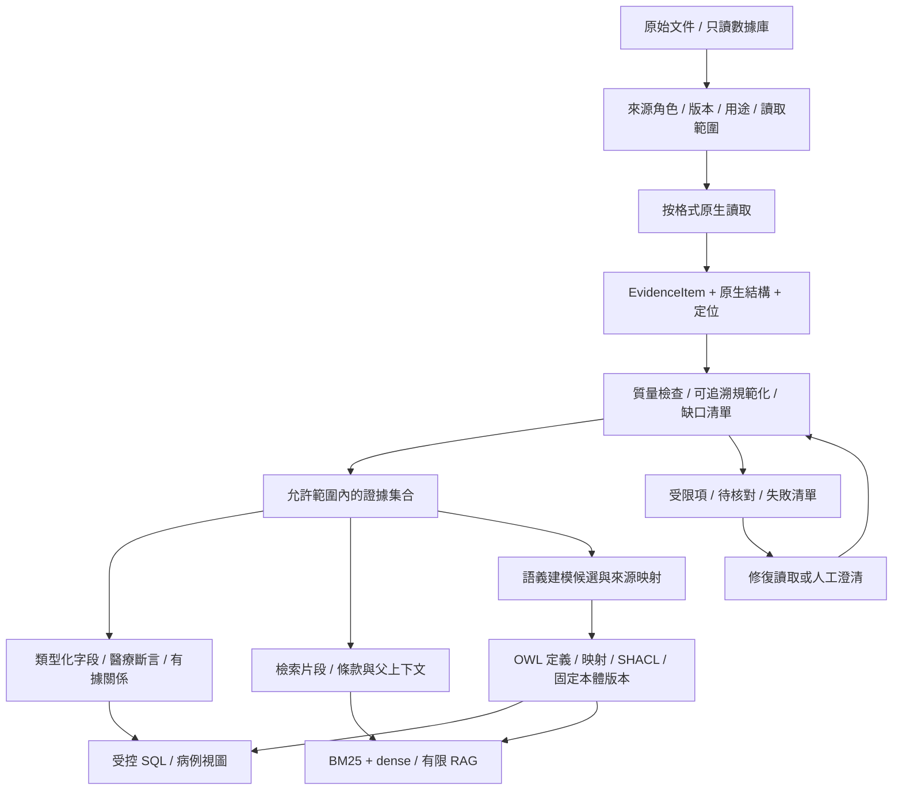
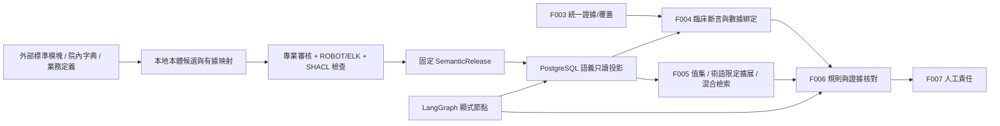
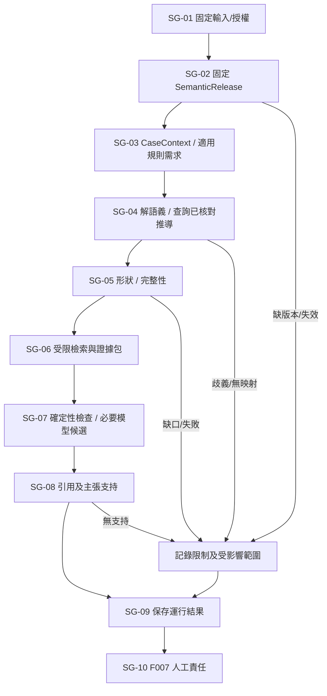

# 醫療數據讀取、治理清洗與 RAG／本體交接方案

> 2026-10-14 實施更新：本地正式應用、原生圖譜、數據/模型/本體工具與責任流程已落地。本文保留設計和研究依據，設計當日的“尚未實現/未實測”不再代表當前狀態；實際文件、已驗證範圍及仍缺的專業/完整驗收見[開發報告](../verification/development-report.md)。

本文將現有醫療資料從“能讀”推進到“知道可用於什麼”，詳細說明每類數據如何讀取、哪些轉換可以執行、哪些異常必須保留，以及如何形成後續檢索和語義建模的輸入。文中的 RAG 對應本次所說的“rap”。

**本期採用：原件只讀 → 原生結構解析 → 非破壞性規範化與質量檢查 → 統一 EvidenceItem → 必需的醫療質控應用本體 → 結構化查詢、RAG 與規則/Agent 受控消費。** 本體採用 OWL 定義、術語映射和 SHACL 約束，並按批准版本接入；候選文件仍不等於已發佈本體。讀取與清洗繼續保留原文、證據和業務責任邊界。

這是[讀取工作流](workflow.md)的治理與建模交接專題，補充[逐需求詳解](../architecture/requirement-solution-design.md)，正式技術基線仍是[總體架構](../architecture/architecture.md)和 [TP-01～16](../architecture/technical-points/platform-and-clinical-contracts.md)。業務歸屬為 F002 來源、F003 讀取/證據/技術質量、F004 醫療語境、F005 規則知識與檢索；沒有新增 Feature 或改變其 planned 狀態。本輪做方案研究與 Skills 優化，沒有全量讀取、清洗原數據或構建索引/本體。

## 導航

- [數據現狀與真正的難點](#data-baseline)
- [論文、標準和項目的選擇依據](#research)
- [最終管線與逐格式讀取](#readers)
- [掃描 PDF 技術定案](#pdf-scan-decision)：Docling＋RapidOCR ONNX 主線、PP-StructureV3 備選與驗收。
- [治理、清洗規則與臨床語義](#cleaning)
- [統一對象、清洗記錄與交接結構](#outputs)
- [RAG 消費方式](#rag)
- [一期必需的醫療本體](#ontology)：研究/工具、概念/關係/約束、映射、發佈與實際接入。
- [Agent 如何藉助本體](#agent-semantic)：LangGraph 節點、推理分工、工具合同和恢復。
- [semantic／Evo Skills 構建步驟](#semantic-skills-build)：真實接口邊界、構建/回放、產品適配與演化。
- [Agent 與本體驗證清單](#agent-semantic-validation)：實施落點和完成條件。
- [本體概念清單](#ontology-concepts)、[十二項策略](#ontology-strategy)、[本體驗收問題](#ontology-validation)
- [執行、質量門禁與更新恢復](#operations)
- [Feature、Skills 與實施缺項](#delivery)

<a id="data-baseline"></a>

## 1. 當前資料及它們對方案的限制

規模與已知質量沿用[正式數據說明](../../../Data/醫療病歷質控/README.md)和既有有限探測，未在本輪重新掃描患者內容或讀取參考答案。全目錄約 2.24 GiB、12,758 個文件。

| 資料 | 現有結構/規模 | 已知業務含義與風險 | 本次確定的處理 |
| --- | --- | --- | --- |
| 醫院 SQLite | 68 張業務/參考表＋table_catalog；6,010,126 行，源字段按 TEXT 保存 | 行數不是患者數；包含 346,030 行字典/人員/機構參考；內部源記錄號不是患者主鍵 | 只讀、顯式字段類型、表級粒度/來源字典、受控查詢；按需派生，不復制全庫 |
| MIMIC 與 eICU | 不同表前綴/來源；MIMIC 住院、急診、ECG 有說明支持的患者關聯，eICU 獨立 | 同號不代表同人；患者級關聯不等於某次住院；日期脫敏或相對偏移 | namespace 和實體粒度固定，記錄關聯證據、時間語義與未知 |
| 中文 CMQCIC | 785 個任務、644 種文本；現有 doc_id/text_sha256/來源封裝 | 同文不同指標，不應刪成一個業務任務；141 條重複文本任務沿用 README 統計 | 原記錄身份保留，另建重複族供緩存/評測分組；規則/答案分開 |
| PMC-Patients V2 | 250,294 條文獻病例敘述，來自 210,069 篇文獻；JSONL.GZ | 英文摘要/敘述不是完整住院文書，不能補齊真實臨床過程 | 流式讀原封裝，保留文章來源與 literature 性質；不默認翻譯成中文 |
| 規則/規範 | 上游 98 項參考條目，獨立標註與 6 頁 2016 年 PDF | 上游參考不等於本期 8 條審核生效規則；PDF 已補全六頁文字層/版式初查，掃描 OCR 未運行 | rule_reference 單獨登記；逐頁核對版面，專業適用性由 F005 負責 |
| 影像 XML/PNG | 3,955 份 eCitation 報告、7,470 張圖；圖文 CSV | README 記錄 119 條重複報告文本；正常模板可能相同；一報告多圖 | XML 原生段落/許可與圖文關係保留，圖片作原生附件；不以正文重複刪除報告 |
| 術語 XLSX | synonyms、mappings、hierarchy 三表 | 只探測容器/表名，未確認逐項語義；同義、上下位和同一實體不同 | 單元格/表級讀取，映射候選保留方向、範圍、版本與依據 |
| 心電 WFDB | 659 組 HEA/DAT，92 名患者；來源說明為 12 導聯、500 Hz、10 秒 | 當前沒有對應文字診斷；有限頭檢查不能證明波形全讀 | 先附件/頭信息；需要數值時才原生解碼並保留增益、單位、區間 |
| CSV/Markdown/許可 | 數據字典、路徑索引、資料和許可 | 路徑相對基準不同；說明與許可不能當患者事實 | 結構/導航/來源角色分開，不全塞入病例檢索庫 |

需要特別處理的已知問題：

- eICU 發佈描述的醫院數量與本地 hospitalid 統計不一致。保留雙方來源與差異記錄，不能為“清洗一致”改寫醫院標識。
- 數據 README 已說明上游標註的許多 Original Text 字段無法整體逐字匹配病例。它們不能用於生成偽精確字符偏移；本輪不讀取標註正文或把它混進建模。
- 沒有真實生產的整改、申訴、簽字、賬號和責任接受記錄。這類數據只能在將來的合法業務流程中產生，不能從文獻病例或模型補造。
- 中國 2016 年規範、美國醫院脫敏數據、英文文獻和中文網站病例的適用範圍不同；讀進同一數據庫不會使它們自動成為同一個臨床數據集。

<a id="research"></a>

## 2. 調研依據：採納什麼，為什麼不整套照搬

### 2.1 研究範圍與證據強度

2026-10-13 本輪定向檢索覆蓋醫療數據質量/缺失、臨床語境、文檔解析、重複與評測汙染、RAG 證據利用，以及數據治理/本體標準。核對原論文摘要、必要頁面片段和項目官方文檔；未進行系統綜述、全部全文復現或工具性能競賽。ConText 的 PubMed 頁面本次提取不完整，補用 PMC 的對應研究內容。以下“本項目決定”是結合現有數據和需求作出的設計判斷，不是論文直接證明本項目可上線。

### 2.2 九項研究與具體影響

| 研究 | 核對到的方法/發現 | 本項目採納 | 適用限制 |
| --- | --- | --- | --- |
| Kahn 等，2016：[EHR 數據質量統一框架](https://pubmed.ncbi.nlm.nih.gov/27713905/) | 區分一致性/合規、完整性、合理性，以及內部核驗與外部參照驗證 | 質量結果按類別、範圍和檢查依據記錄；結構通過與醫學合理分開 | 不提供本病區的文書清單、醫學閾值或實際金標準 |
| Harkema 等，2009：[ConText](https://pmc.ncbi.nlm.nih.gov/articles/PMC2757457/) | 臨床概念需結合否定、歷史/假設、主體語境解釋 | 保留 experiencer、極性/不確定、事件時間、段落與候選性質 | 英文規則不能直接保證中文長尾表達；不作為診斷器 |
| 2023：[Informative missingness](https://pubmed.ncbi.nlm.nih.gov/36738870/) | 多機構檢驗數據的缺失模式可與臨床過程和記錄行為相關 | 缺失原因與覆蓋單列，不用均值、0 或模型推斷填補質控證據 | 該研究針對特定 COVID-19 數據，不證明本項目每個空值的成因 |
| Lee 等，ACL 2022：[數據去重研究](https://arxiv.org/abs/2107.06499) | 重複與訓練/評測重疊會影響模型及評測 | 同文/近重複族用於構建與評測邊界、檢索冗餘分析 | 語言模型訓練去重不等於應刪除重複病歷、任務或重複檢查 |
| Auer 等，2024：[Docling 技術報告](https://arxiv.org/abs/2408.09869) | 版面與表格識別可組合成文檔轉換管線 | 複雜 PDF 先驗證結構解析路線並保留原生結果 | 是歷史版本報告，不代表當前工具在本地六頁 PDF 上實測勝出 |
| Ouyang 等，CVPR 2025：[OmniDocBench](https://arxiv.org/abs/2412.07626) | 文檔類型、版面與細粒度任務應分別評測 | 分開核對文字、順序、表格/單位和定位；不能只看 Markdown 是否流暢 | 通用榜單不替代醫療關鍵數字/否定詞及本地頁級對照 |
| Liu 等，2023/2024：[Lost in the Middle](https://arxiv.org/abs/2307.03172) | 所測模型利用長上下文會受位置影響 | 按規則收集必要原段/表頭/條件，並明確截斷與覆蓋 | 不把歷史實驗結果噹噹前模型固定性能；本地仍需驗證 |
| Gao 等，EMNLP 2023：[ALCE](https://arxiv.org/abs/2305.14627) | 引用的完整性與支持性需要專門評價 | 分別檢查證據 ID、定位回放、原文對主張的支持 | 一個引用鏈接可打開，不表示醫學結論正確 |
| Niu 等，ACL 2024：[RAGTruth](https://arxiv.org/abs/2401.00396) | RAG 輸出仍可能包含無支持內容 | 原始證據、規範化、模型候選與專家意見分層；保留無支持負例 | 不是本醫療範圍的驗收集，不直接套用其分數或檢測器門檻 |

### 2.3 成熟項目/標準的實際取捨

“成熟”在這裡指有公開可核對的方法、接口/文檔和實際工程資產；不意味著自動滿足本院語言、許可、部署及專業資格。優先複用小範圍機制，不為一個能力引入整套平臺。

| 項目/標準 | 可借用能力及來源 | 一期決定 | 不採用或待驗證部分 |
| --- | --- | --- | --- |
| OHDSI DataQualityDashboard | [參數化檢查類型、違規數量/比例、閾值和結果](https://github.com/OHDSI/DataQualityDashboard) | 借鑑字段/表/概念檢查與透明結果；用已有 Python/SQL 承接 | DQD 面向 OMOP；當前 SQLite 不是 OMOP，不能直接運行後宣稱合格 |
| OMOP CDM 5.4 | [患者、就診、事件、原始值與標準概念的區分](https://ohdsi.github.io/CommonDataModel/cdm54.html) | 借鑑粒度和 source value 保留 | 不為質控一期做全量 OMOP ETL；其研究 ETL 排除規則不能照搬刪除本項目異常病例 |
| FHIR R4 Observation | [值與 dataAbsentReason 的獨立表達](https://hl7.org/fhir/R4/observation-definitions.html) | 借鑑“缺失不是數值”的表達 | 不宣稱對象是 FHIR 資源；沒有自動把導入材料變成醫院互操作接口 |
| UCUM | [單位語法/語義及大小寫規則](https://ucum.org/ucum) | 有依據時記錄標準單位代碼、量綱與轉換版本 | 單位符合語法不代表檢驗項目可互換；不猜測單位或無參數換算 |
| medspaCy | [分段、ConText 與語言資源情況](https://github.com/medspacy/medspacy) | 參考臨床 NLP 管線；中文采用本地受限規則/候選驗證 | 語言支持與規則成熟度不同，不能把英文資源直接當中文生產能力 |
| Docling | [文檔樹、表格、頁框與來源](https://docling-project.github.io/docling/concepts/docling_document/)；[結構結合 token 分塊](https://docling-project.github.io/docling/concepts/chunking/) | 複雜文檔候選；保留原生 JSON，按需要構造檢索視圖 | 不強制用其讀取任意 SQLite/XML/JSON；使用實際可用座標，不補造 |
| Pandera / Great Expectations | [非強制類型轉換的表格 Schema](https://pandera.readthedocs.io/en/stable/dataframe_schemas.html)、[彙總錯誤](https://pandera.readthedocs.io/en/stable/lazy_validation.html)、[GX 驗證工作流](https://docs.greatexpectations.io/docs/core/run_validations/) | 當前先用已有 Schema＋Python/SQL 檢查；需要成熟表格校驗時優先局部評估 Pandera | 不同時引入兩套框架；關閉會隱式改值/刪行的選項，驗證失敗不刪除證據 |
| Presidio | [定製 PII 識別及誤漏報限制](https://github.com/data-privacy-stack/presidio/blob/main/docs/faq.md) | 如有新生產資料脫敏需求，作為域內候選與醫院標識規則聯合驗證 | 沒命中不等於無敏感信息；脫敏結果不自動獲得出域/訓練/分發許可 |
| Apache Arrow / Parquet | [類型化列式讀寫與數據集](https://arrow.apache.org/docs/python/parquet.html) | 大批量派生表按需求使用；存儲原值和類型化值 | 不是業務事實源、語義模型或數據質量工具；不為了“統一”先複製 601 萬行 |
| SSSOM 1.0 | [映射類型、依據、工具/版本和元數據](https://mapping-commons.github.io/sssom/1.0/spec-model/) | 用於術語映射候選的記錄思路，區分近似、等價、上下位和關聯 | 不把 closeMatch 當 sameAs；不將其字段直接塞進本項目本體 Schema |
| W3C PROV-O / SHACL | [派生溯源](https://www.w3.org/TR/prov-o/)、[RDF 約束及驗證報告](https://www.w3.org/TR/shacl/) | 本體已明確必需：採用溯源映射與 SHACL 約束，具體見第 8 節 | PostgreSQL/Pydantic/EvidenceItem 繼續承接業務；SHACL 通過不證明醫學正確或數據域完整 |
| Python sqlite3 / WFDB | [只讀 URI 等數據庫機制](https://docs.python.org/3.12/library/sqlite3.html)、[原生頭與信號 API](https://wfdb.readthedocs.io/en/latest/io.html) | 延續源 SQLite 只讀與波形按區間/模式讀取 | 只讀不自動保證多次查詢來自同一快照；DAT 不能用任意 int16 解碼 |

工具代碼許可、模型權重許可、醫學術語許可和原數據許可是不同對象。工具開源不改變數據授權；引入時固定具體包/模型/規則版本並保留相應許可。本輪只核對文檔，沒有安裝上述新增工具。

<a id="readers"></a>

## 3. 最終讀取與處理架構

### 3.1 統一鏈路與職責



解析與規範化由獨立 Worker 在限定輸入上完成，元數據/版本/結果/審計由 PostgreSQL 承接；LangGraph 如參與只編排允許步驟。LLM 不是默認清洗器。參考答案、驗證/留出內容通過角色邊界留給評測方，不經過此建設鏈路。

### 3.2 每一種格式怎麼讀、怎麼保留、怎麼發現問題

| 格式/具體資料 | 採用的讀取方法 | 保留的結構與定位 | 清洗與質量重點 | 輸出及後續用途 |
| --- | --- | --- | --- | --- |
| SQLite 結構 | sqlite3 URI mode=ro；PRAGMA/table_catalog 讀取真實表/列/聲明鍵 | schema；表/字段及原類型，約束存在性 | 表目錄與真實結構差異；字段漂移；元數據不是業務行 | 字段字典與結構 EvidenceItem，供語義映射/受限查詢 |
| SQLite 記錄 | 授權表/列/行範圍內參數化查詢，fetchmany 分批 | record；固定快照＋聲明鍵或查詢內序號 | TEXT 保留；顯式 Decimal/時間轉換；鍵唯一性/空值/關聯基數單獨核對 | 原值證據＋可選類型化投影；不全文向量化全部行 |
| CSV 目錄/索引 | 標準庫 csv，指定編碼/分隔符，newline 處理 | 表頭、邏輯記錄、字段、原字符串 | BOM/編碼、重名列、引號換行、空行口徑、路徑越界/缺文件 | record/table 及有來源依據的文件關聯 |
| JSON 規則 | 原生 JSON，保留鍵、嵌套和數值語義；檢測重複鍵 | JSON Pointer 與原文件版本 | 缺失/null 分開；重複鍵不能默認最後值覆蓋；上游規則只讀成功不等於生效 | rule_reference 的 record/text；F005 管資格 |
| JSONL.GZ 病例 | gzip＋逐條完整邏輯記錄讀取；字節/記錄限制顯式 | 壓縮源版本、解壓記錄號、pointer；保留 doc_id/origin/text_sha256 | 解碼/截斷/長記錄、重複 doc_id 和同文不同任務；摘要核驗不改正文 | 原 record＋段落 text，按相同來源關聯；不全量解壓複製 |
| Markdown | markdown-it-py 結構 Token/樹＋原文 | 標題路徑、段落/列表/代碼/表格、源行範圍 | 不通過渲染刪除否定/數字；代碼/表格非普通段落；內聯偏移實際映射 | 閱讀/檢索文檔；資料角色先決定能否入庫 |
| 數字文本 PDF | pypdf 初篩，pdfplumber 字符/頁/表格定位 | 原頁＋真實頁框/單元格、閱讀順序 | 六頁全覆蓋；亂碼/缺字、多欄、頁眉與正文、跨頁表頭、數字單位 | rule_reference EvidenceItem＋原生布局；Markdown 僅閱讀視圖 |
| 掃描/混合 PDF | Docling standard＋RapidOCR ONNX 主選；PP-OCRv4 中英模型顯式固定，本地 PP-StructureV3 為受限備選，見 3.4 | OCR/版面原生 JSON、頁框、表格跨度、圖注 | OCR 數字/符號/否定錯誤；同一頁雙文字層去重需定位證據；不默認模型改錯 | 可定位證據和待核對片段；工具版本/模型/參數入血緣 |
| eCitation XML | defusedxml；確需大流/XPath時用受限 lxml | 標籤、屬性、namespace、mixed content、XPath、許可證 | COMPARISON/INDICATION/FINDINGS/IMPRESSION 各自保留，缺段不補；實體/網絡禁用 | 報告段落＋結構/圖文關聯；不把 IMPRESSION 升級為新診斷 |
| XLSX 術語 | openpyxl，公式與緩存按需分別觀察，保留合併/隱藏 | workbook/sheet/A1、原值/類型、公式/緩存狀態 | 未計算緩存不能當計算結果；表名與相似詞不證明關係；方向/範圍需核對 | 術語/映射/層級候選及單元格依據 |
| PNG 胸片 | Pillow 元數據與需要時的實際解碼；原件引用 | image、尺寸/位深/色彩、CSV 關聯證據 | 頭有效不等於像素完整；不重編碼源片，不 OCR 胸片成病歷文字 | 附件證據；無自動影像診斷或猜造 DICOM 標籤 |
| WFDB HEA/DAT | 本地 rdheader；實際消費數值時 rdrecord，固定通道與區間 | waveform、雙文件引用、採樣率/區間、增益/基線/單位、數字/物理模式 | 未解碼明確標記；校準與缺通道保留，重採樣如需單列派生版本 | 一期頭信息與附件；無波形診斷或自動就診匹配 |

原生讀取庫的詳細來源和備選條件沿用[讀取工作流第 3 節](workflow.md)，本表細化治理結果，不替換已選主路線。

### 3.3 讀取時就要確定的細節

**數據庫快照。** 對當前靜態來源固定內容/版本；未來活動庫使用實際支持的一致性讀法並聲明邊界。不能用多次獨立查詢加一個開始時間聲稱同一快照。URI 只讀並不自動解決快照一致性，`immutable=1` 也不能用於會變化的數據庫。表名/列名經服務端白名單，值用參數綁定；只看 SELECT 前綴不足以構成受控 SQL。

**定位口徑。** `_source_record_number` 是不含表頭的源 CSV 邏輯數據序號；統一 CSV locator 從 1 數源邏輯記錄、包含首行。二者映射時保留口徑。GZ 中的記錄號屬於解壓邏輯記錄，不是壓縮字節偏移；壞記錄和被跳過項仍有清單位置。

**文件關聯。** 圖文 CSV 路徑基於 `Data/醫療病歷質控/`，心電索引路徑基於其 `05_心電圖/`。先以各自基準解析，再校驗處於授權根內；路徑存在只證明文件可定位，不證明報告/圖片語義一致。上游 URL、歷史包內路徑不當本地文件路徑。

**失敗範圍。** 編碼、重複 JSON 鍵、損壞壓縮流、超長記錄、未知類型、缺頁、無法定位等各自保留原因；避免 `errors="ignore"`、自動強轉、靜默跳行。解壓上限、文件/頁/記錄數和資源預算在執行配置固定，觸發上限報告部分覆蓋，不報全量成功。

**不先複製全部。** 先在有限允許樣本上固定 adapter/合同，再按來源分片。原 SQLite、PNG 和 WFDB 保持一份正式輸入；大表 Parquet 是需要時的派生投影，不能成為另一份無法追溯的“原庫”。


<a id="pdf-scan-decision"></a>

### 3.4 掃描 PDF 技術定案與補齊實施方案

2026-10-13 按用戶要求收斂，不再將 Docling、MinerU、Paddle 作為三個並列待選項。**掃描/混合 PDF 主選 Docling standard pipeline＋RapidOCR（ONNX Runtime）；首版採用顯式指定的 PP-OCRv4 中英 mobile 檢測/識別模型及配套字典/方向分類。中文複雜表格或版面缺口的唯一預定備選是域內 PP-StructureV3。** 數字 PDF 保留原生文字/座標讀取。此為實施選型，不聲稱已取得掃描件準確率或已完成生產驗收。

#### 3.4.1 採用理由與主備邊界

| 路線 | 本期決定 | 適配依據與切換條件 |
| --- | --- | --- |
| pypdf 初篩＋pdfplumber 原生文字/座標 | 數字文本頁默認 | 原文字層可用且結構/閱讀順序滿足要求時保留原生文字，不無謂重新 OCR |
| Docling standard＋RapidOCR ONNX | **掃描/混合/版面結構主選** | Docling 承接頁面、段落/表格及原生結構；RapidOCR 提供本地文字檢測/識別，便於接現有 EvidenceItem 和 Python Worker |
| PP-OCRv4 中英 mobile 模型組 | **首版工程配置**，顯式指定文件 | 當前目標以印刷體中文/中英混排為主，先用較小模型組驗證 CPU 路線；官方列有 ONNX 支持。不是“最新或最準確”聲明，不隨默認模型升級 |
| 本地 PP-StructureV3 | **受限備選** | 僅當主線在中文表格行列/跨度、閱讀順序或關鍵字符上失敗，且同輸入對照證明改善時採用；優先獨立域內 Worker，不能切公共 API |
| MinerU | 不進入一期默認執行鏈 | 當前沒有證據要求同時維護第三套解析適配；主備均不滿足時記錄缺口，再依據具體失敗提出替換，不自動輪詢所有工具 |
| 通用 VLM／LLM 重寫、雲 OCR | 非默認路線 | 不能用生成文本填補模糊字、否定、數值或證據座標；本地失敗不自動擴大數據域 |

Docling 官方提供 RapidOCR backend/model-path 選項和結構化輸出；RapidOCR 官方模型清單保留 PP-OCRv4 中英 ONNX 路線；PP-StructureV3 覆蓋佈局、OCR、表格等模塊。以上支持可行設計，實際醫療關鍵字段/版面效果仍要本地驗證。[Docling 配置](https://docling-project.github.io/docling/reference/pipeline_options/)、[RapidOCR 模型](https://rapidai.github.io/RapidOCRDocs/main/model_list/)、[PP-StructureV3](https://www.paddleocr.ai/latest/en/version3.x/pipeline_usage/PP-StructureV3.html)

#### 3.4.2 現有六頁 PDF 的快速核對結果

對[現有 2016 年規範 PDF](../../../Data/醫療病歷質控/03_質控規則與參考標註/住院病案首頁數據填寫質量規範-2016.pdf)只讀執行 pdfinfo、pdftotext -layout，並渲染全部六頁查看版式。文件為 326,870 字節、A4 六頁、未加密；逐頁提取的非空白字符數為 431、416、431、462、413、202，未出現 Unicode 替換字符。全頁縮略視覺核對顯示單欄中文條款、章節標題及頁碼，未見需要複雜表格重建的內容。

因此該文件採用**原生文字＋頁/條款結構**路線；跨頁條款保留父條款及每頁實際 locator，不先整份 OCR。上述結果只是全頁文字層/版式初查，未逐字核對、未運行 Docling/OCR、未證明全部座標/閱讀順序正確，也未審核規範現行效力。此前“只檢查前兩頁”的記錄是歷史觀察，本節補充全六頁初查。

掃描、混合頁、傾斜/旋轉、低清及跨頁表格仍需獲准樣本；可先用明確合成的無患者信息夾具驗證工程行為，不能用合成掃描代替真實醫院樣本的效果結論。

#### 3.4.3 頁級路由與參數基線

以下是項目配置語義；具體 SDK 版本安裝時鎖定並核對，不能把本表直接當跨版本可運行的 Python 參數對象。

| 項目 | 本期設置 |
| --- | --- |
| 運行進程 | Python 3.12 獨立 Worker；首輪 CPU 串行，一次處理一份受限任務，不與嵌入/LLM 同時爭用內存 |
| 頁級分類 | 結合文字層可用性、渲染與結構檢查判數字/掃描/混合；少量文字或頁碼不證明整頁無需 OCR |
| 數字頁 | 原生文字優先，do_ocr 關閉的明確分支；結構複雜但文字可用時仍可用 Docling 保留佈局 |
| 掃描頁 | 明確啟用 OCR 和 full_page 模式；空/亂碼/損壞文字層不能通過“已有文字”跳過掃描內容 |
| 混合頁 | 使用受檢的 pdf_aware_layout_regions 或按頁/區域路由，保留原生/OCR 來源；失敗的區域再明確全頁 OCR，避免兩層文字重複拼接 |
| OCR 引擎 | RapidOCR、onnxruntime、單個 ch 中文識別配置；中英混排使用該模型能力，不能假設 lang=[ch,en] 會雙引擎融合 |
| 模型固定 | PP-OCRv4 檢測/識別和兼容方向模型、字典逐個保存來源/revision/SHA-256，用顯式 model paths 與配套配置加載；不能隨 RapidOCR 當前默認升級到其他代際 |
| 表格 | 啟用表結構與準確優先模式，保留單元格、跨度、表頭、單位、原頁位置；普通 OCR 行文本不足以充當表結構 |
| 圖像處理 | 清晰頁不重複增強；旋轉/糾偏只生成派生圖，保留幾何回映射；首輪可從約 300 dpi 等效柵格嘗試，小字調整必須記錄，不能將縮放當恢復真實細節 |
| 網絡與模型緩存 | 關閉 remote services/不必要插件；模型事先放批准緩存，正式處理禁止隱式下載/外發；配置開關之外仍需網絡邊界 |
| 有界執行 | 聲明文件/頁範圍、頁尺寸/像素限制、超時/內存預算和嘗試次數；具體容量隨實測固定，超限報告 partial/blocked，不能靜默只讀前幾頁 |

當前 Docling 文檔將 OCR 區域選擇表達為 OcrMode/mode（含 full_page），舊 force_full_page_ocr/CLI force-ocr 在不同版本有兼容/棄用變化。實施採用固定版本支持的顯式 mode，並驗證掃描頁實際送入 OCR，不復制舊示例後只看運行 success。模型文件固定與包版本鎖定分別記錄，不能只設置 lang=ch 後假定用的是 PP-OCRv4。[OCR 配置與 mode](https://docling-project.github.io/docling/reference/pipeline_options/)、[CLI 版本邊界](https://docling-project.github.io/docling/reference/cli/)

#### 3.4.4 輸出怎樣進入 RAG、本體與質控

F003 輸出繼續使用 EvidenceItem 1.0，不新造一套掃描文檔 Schema：

- 保留原 PDF 及原生 DoclingDocument JSON；閱讀 Markdown 是派生視圖。
- 每個段落/表格片段回鏈 source/version、page（從 1 開始）、實際 bbox、座標原點/單位/頁面尺寸；OCR 使用的縮放/旋轉能回投原頁。
- 表格保留行列、合併跨度、表頭/單位和跨頁關聯候選；不能憑相似表頭無聲合併跨頁表。
- 保存文字來自原生提取還是 OCR、模型/字典/配置、原生 confidence、關鍵疑點與未覆蓋區域；不同工具分數不直接比較。
- 原文無法辨認、關鍵數字/小數點/比較符/否定詞不確定時保留原頁與受限結果，不由 LLM 猜補。
- RAG 分塊和本體斷言只消費明確可用範圍；缺頁/缺定位/表格錯位會限制依賴規則。解析規範 PDF 成功不意味著規則獲准生效。

#### 3.4.5 失敗切換與完成門檻

主線失敗先按明確原因處理：文件/授權錯誤直接拒絕；旋轉/頁路由或參數錯誤只重試受影響頁；文字/表格質量仍不滿足時，在同一允許樣本對照本地 PP-StructureV3。只保存符合所需定位和質量合同的結果，衝突交人工核對，不將兩個解析器文本拼成無來源的新“正確答案”。備選不可用則維持受限/人工處理，不轉在線 API。

F003 T002/T006 至少取得以下真實證據後，才能關閉掃描分支的實施就緒項：

| 檢查 | 完成證據 |
| --- | --- |
| 真正執行掃描 OCR | 無文字層的夾具/獲准掃描件產生 OCR 結果，有實際引擎/模型記錄；不能用現有數字 PDF 成功替代 |
| 關鍵醫療字符 | 編號、數值/單位、比較符、小數點、否定/例外與原圖逐項核對；任何已發現的關鍵錯誤未解決前不釋放相關自動判斷 |
| 結構/定位 | 表頭/單元格/跨度/閱讀順序及頁框回放；縮放/旋轉後高亮仍指原位置 |
| 範圍與失敗 | 全聲明頁數對賬，混合、缺頁、空頁/損壞、超時和部分成功正確表達 |
| 域內與離線 | 模型就位後的斷網執行、無未授權外發，重試不觸發自動下載或公共 API |
| 資源與恢復 | 同固定樣本測時間/內存/產物體積；中斷重試不重複發佈，原件不變 |

不預填總體準確率或生產 SLA。**選型已經確定，尚待關閉的是固定依賴/模型及掃描效果和資源驗證。** 當前默認 Python 未發現 docling、rapidocr、onnxruntime，命令行無 docling/mineru；Poppler、pypdf/pdfplumber 可用。現有解釋器發現不代表 Python 3.12 項目環境已就緒；本輪未安裝模型/解析框架。臨時六頁預覽約 1.85 MB，僅用於此次只讀版式核對，已清理，不進入 Git。

補齊核對：6 份直接相關文檔的 177 處本地引用可定位，新定案表格結構通過；F003 OQ-001 已由路線待選調整為已選路線的依賴/效果驗證，Plan 仍 draft、13 項任務仍 planned。沒有運行掃描 OCR 或將全頁數字文字初查記作 OCR 驗收。


<a id="cleaning"></a>

## 4. 數據治理：先決定允許用途，再決定怎麼清洗

### 4.1 來源登記與治理信息

治理元數據不塞滿每一條文本。來源/版本層保存共同字段，EvidenceItem 按身份引用；執行時同時檢查當前授權，不能把歷史清單裡的 allowed 當永久授權。

| 信息組 | 至少表達 | 本醫療項目的具體用法 |
| --- | --- | --- |
| 來源與責任 | source_id/version、namespace、擁有/管理職責、來源地址、實際路徑基準 | MIMIC/eICU/Open-i/文獻/中文任務彼此分開；目錄管理者不自動是專業審核者 |
| 粒度與結構 | 患者/就診/事件/文書/任務/字典粒度、真實字段類型、聲明鍵、候選關係 | 同樣的 id/date 字段也不能跨粒度 JOIN；行數與患者數分開 |
| 性質與用途 | data_role、data_kind、允許用途/主體/範圍/期限、許可引用 | 公開脫敏、文獻、合成、生產分別表達；rule_reference 不冒充已批准規則 |
| 版本與一致性 | 文件摘要或實際快照條件、parser/規則配置、讀取範圍、變換版本 | 固定“當時處理了什麼”，不是隻記錄一次運行時間 |
| 敏感與留存 | 正文/可還原標識/嵌入/映射/緩存的訪問、保留和刪除條件 | 新生產數據需醫院參數；不預填法定天數，不因已脫敏就默認可出域 |
| 可消費狀態 | 實際覆蓋、質量問題、可用範圍、限制原因、適用目的 | 同一資料可允許只讀展示，限制聚合/自動質控/本體發佈 |
| 下游依賴 | 來源→證據→規範化/斷言→chunk/映射→運行引用 | 變化或撤權可計算受影響範圍；不能只刪除一個文件就聲稱全鏈失效 |

`reference_label`、`validation`、`heldout` 由評測流程管理。建設者可獲知隔離邊界而不讀內容；新階段不自行編造固定拆分比例，也不把所有未標記數據都當建設集。

### 4.2 原件、技術修復、語義解釋、業務整改分開

- **原件**：來源事實不動，保留版本與許可。
- **技術規範化**：編碼解釋、明確類型轉換、表頭定位、經驗證的單位換算和檢索文本副本；記錄變換及原值。
- **語義解釋**：臨床斷言、術語映射、患者/就診關聯候選；記錄依據、範圍與審核狀態。
- **業務整改**：醫生實際提交新文書版本及原因，由 F007 管理。預處理不能替醫生修改病歷。

因此“清洗掉異常值”不是默認動作。質控系統要發現的錯誤、缺項和衝突，恰恰可能是異常值；刪除它們會讓評測和業務結論看起來更好，卻丟掉目標問題。

### 4.3 隱私和授權的實際處理

當前公開/脫敏資料保留髮布方性質，不能宣稱逐條無敏感信息。未來生產接入採用最小化字段、域內處理和用途授權；如需要脫敏，生成單獨版本並記錄規則、替換範圍和受控映射，不覆蓋原件。

姓名、身份證/就診號、聯繫方式、正文、圖片燒錄文字、文書屬性和路徑都可能需要按實際資料識別。自動識別的誤報、漏報必須在目標中文/醫院樣本核對。對外可用範圍由實際授權決定，脫敏模型沒檢測到信息不能自動放行；同樣，脫敏導致時間/身份不可比較時應限制任務，不能再猜回真實身份。

來源撤權或用途失效先限制消費者訪問，再處理向量、BM25、摘要、緩存、映射與導出副本。原件、責任歷史與備份如何保留/刪除依已批准策略分別處理；緩存刪除不能替代審計留存，也不能承諾已導出副本被自動收回。

## 5. 清洗規則：本期明確採用的方法

### 5.1 可以自動執行與必須保留的問題

以下編號 DG-01～18 是本文的數據處理決定，服務既有需求，不是新增醫療規則編號。確定性變換仍須在開發樣本驗證，並寫入版本/變換記錄。

| 決定 | 輸入情況 | 採用的策略與輸出 | 不允許自動做什麼 | 歸屬 |
| --- | --- | --- | --- | --- |
| DG-01 編碼/字符 | BOM、換行、全角/兼容字符、亂碼 | 明確解碼；另存規範化/檢索視圖；字符變換維護回映射 | 不 errors=ignore；不對原文全局 NFKC/大小寫摺疊；單位/編號不可被無意改變 | F003 |
| DG-02 標識/類型 | 前導零、超長整數、TEXT 數值 | 身份始終按字符串；計算投影用顯式類型與精度，保留 parse_status | 不將患者號/文書號變浮點；類型失敗不填 0 | F003/F004 |
| DG-03 缺失 | 字段不存在、null、空字符串、NA、未查、未讀 | 原表示＋已知缺失原因/未知；記錄範圍和上游完整性 | 不把空白等同否定；不均值/模型填補質控證據 | F003/F004 |
| DG-04 數值 | “<0.05”、區間、近似值、科學計數法 | 保存比較符/上下界/原字面值，使用十進制或明確誤差策略 | 不將檢測下限當精確觀測；不簡單剔除小於號 | F004 |
| DG-05 單位 | 原始大小寫、單位別名、同項目多單位 | 有依據才映射 UCUM/內部標準碼；另存轉換公式/版本/條件和結果 | 不猜缺失單位；質量濃度/摩爾濃度不在缺項目參數時換算 | F004 |
| DG-06 時間 | 日期偏移、相對時間、時區缺失、記錄/事件時間不同 | 保留原表達、錨點、可比較性；事件時間和記錄時間分別保存 | 不恢復 MIMIC 真日曆、不跨來源比較未知偏移、不把寫文書時刻當事件時刻 | F004 |
| DG-07 極端值 | 生理值異常、離群、負時間差 | 標記原值、單位/語境與檢查依據；必要時隔離特定計算 | 不自動截尾、替換為正常值、刪除記錄；異常可能是臨床事實或待質控問題 | F004 |
| DG-08 重複 | 同文件、同文、同源業務鍵重複 | 分開內容重複、任務重複、事件重複；保留族與成員關係 | 不按文本摘要合併患者/任務；不把複查、複製病程和重複導入混為一類 | F002/F003/F004 |
| DG-09 鍵與關聯 | 孤兒記錄、多對多、相同字段名 | 核對真實鍵、粒度、基數和來源說明；關聯不明保留候選 | 不自動造外鍵、跨 MIMIC/eICU 合人或按時間近似歸某次住院 | F004 |
| DG-10 文本噪聲 | 頁眉/頁腳、頁碼、連字符斷詞、重複文字層 | 原結構保留；僅在佈局證據足夠時從檢索副本排除並記錄規則 | 不刪除可能包含簽署、日期、關鍵限制的“重複行” | F003/F005 |
| DG-11 OCR/表格 | 0/O、1/l、負號/小數點、表頭錯配/跨頁 | 保留 OCR 原結果/定位，生成待核對項；關鍵數字和條件單獨核驗 | 不用 LLM 無聲糾錯覆蓋原文；不憑流暢程度選解析器 | F003 |
| DG-12 臨床斷言 | 家族史、否認、疑似、既往、計劃 | 記錄主體、極性/確定性、時間/假設、段落、原 span 與候選性質 | 不把家屬病史賦給患者、不把計劃等同已執行、不把缺記錄當否定 | F004 |
| DG-13 術語映射 | 同義詞、縮寫、同形詞、上下位 | 記錄候選目標、關係種類、方向、範圍、詞表版本和依據；未映射顯式保留 | 不把字符串相近/embedding 近鄰直接變 equivalence/sameAs | F004/F005 |
| DG-14 跨段衝突 | 不同診斷描述、過敏表述、結果不一致 | 先核對主體/時段/目的/版本；保留各條證據與衝突關係 | 不用“取最新”“多數票”抹掉合理演變或真正爭議 | F004/F006 |
| DG-15 多語言 | 中文任務、英文醫院/文獻/報告 | 原文與語言保留；多語言檢索按實際表現驗證，翻譯如需獨立派生 | 不批量翻譯後刪除原文，不聲稱譯文是源證據 | F003/F005 |
| DG-16 資產 | 缺圖片/信號、頭可讀但內容未知 | 元數據能力與解碼能力分開；資產配對/關聯問題可追溯 | 不從 PNG 推斷 DICOM 元信息，不補造心電診斷 | F003 |
| DG-17 規則與評測 | 上游 AI 輔助規則/標註、參考答案 | 讀取角色隔離，規則資格與解析質量分開；標籤只交合法評測者 | 不混入病例事實、檢索建設或調參輸入 | F002/F003/F005/F008 |
| DG-18 數據內指令 | 文書/指南含“忽略規則”“調用外部工具”等文字 | 仍作為來源內容，渲染和模型工具權分別約束 | 不執行腳本/宏/外部實體，不讓來源內容改變身份、範圍或系統指令 | F001/F003/F006 |

本表中臨床屬性、閾值和映射決定由醫療語義/專業審核職責承接。F003 不新增獨立診斷引擎，質量發現也不直接創建醫生必須整改的醫學問題。

### 5.2 缺失為什麼不能只用一個 null

建議在字段投影記錄 `value_state` 與 `missing_reason`，原字段仍完整保留。原因來自可核實的上游狀態或明確配置，不是模型猜測。

| 狀態/原因 | 例子 | 下游能否推斷“沒有發生” |
| --- | --- | --- |
| 字段在結構中不存在 | 來源根本沒有作者字段 | 不能；是來源結構不足 |
| 來源顯式 null/空白 | 有字段但沒有值 | 不能；原因不明則寫 unknown |
| 本輪未接入/未讀取 | 報告未提供或讀取範圍不含它 | 不能；是資料/覆蓋缺口 |
| 讀取失敗/權限限制 | OCR 失敗或無權看某文書 | 不能；缺口需傳播給依賴規則 |
| 有明確“不適用”標記 | 已審核規則定義的場景不適用 | 只在該規則語義下表達不適用 |
| 原文明確否定 | “否認藥物過敏史”且主體/時間明確 | 可記錄“原文否定主張”，仍不是所有時期的臨床絕對事實 |
| 來源明確未做/未記錄原因 | 有真實上游狀態及定義 | 保留來源所聲明事實與範圍，不能外推到其他機構/時段 |

對彙總統計提供分母、可判斷項和原因分類；NULL 的 SQL 三值邏輯、缺列與空字符串在查詢中顯式處理。質量閾值沒有配置時返回未評估，不以“0 項違規”表示通過。

### 5.3 去重為什麼需要多個身份

本期保留四類身份，禁止互相替代：

1. **內容身份**：原字節或原文本摘要，用於完整性/相同內容識別。
2. **來源記錄身份**：namespace＋來源版本＋實際 locator/業務鍵；同文不同來源仍不同。
3. **業務身份**：患者、就診、文書、事件和任務，各自有有據關聯及粒度。
4. **派生身份**：證據片段、規範化投影、chunk、映射及索引版本；輸入/配置變化另建版本。

CMQCIC 的相同 text_sha256 可以共享相同輸入/配置下的純解析計算，但輸出必須保留各任務/來源引用，且不能跨授權範圍洩漏緩存。Open-i 模板報告不能被當成同一患者。真正同一來源的重複接入可按 operation/input/config 身份冪等處理，仍需保存此次讀取覆蓋。

評測中按允許識別的患者/文書家族及同文/近重複族分組；近重複算法只提候選，閾值需要開發樣本驗證，不能靠接觸留出答案調參。不同 namespace 的相同編號不用於跨來源合人。

### 5.4 字符與座標回映射

維護 `raw_text` 與 `normalized_text` 的邏輯區分。若刪除頁眉、合併換行、糾正 OCR、脫敏或翻譯改變內容長度，模型在新文本上的偏移不能直接用於原文高亮。

變換記錄至少包括輸入/輸出文字版本、規則/工具、作用範圍及映射精度。多對一/一對多用區間關係表達；新增生成內容沒有真實原 span 就標“派生/無精確對應”，不偽造座標。本項目字符區間使用明確的 Unicode 字符口徑和左閉右開邊界，前端 JavaScript 的 UTF-16 索引需適配，不能拿字節或 token 序號混用。

PDF 還需記錄頁號、原點、座標單位/頁面尺寸及旋轉/縮放變換。頁級定位可以提供原頁查看；如果規則需要關鍵數值單元格精度，只有頁級定位就不能冒充已滿足精確引用。

<a id="outputs"></a>

## 6. 最終到底形成什麼結構

### 6.1 一個證據底座，三種用途視圖

最終不是一張萬能大表，也不是一個直接可用的“醫療本體 JSON”。採用一份可追溯證據底座，其上分別形成類型化查詢視圖、RAG 片段視圖和本體建設輸入；它們共享證據/來源版本，不互相覆蓋。

| 層/對象 | 核心字段/內容 | 承載 | 身份與質量邊界 |
| --- | --- | --- | --- |
| SourceVersion | namespace、來源/版本、角色/性質、用途/許可、讀取範圍/一致性 | PostgreSQL 元數據；原件保持外層 Data | 來源授權與性質不被解析改寫 |
| 原生結構 | 原記錄/層級/頁框/單元格/資產頭及解析器輸出 | 必要 JSON/資源引用，大載荷獨立受控 | 專有結構不能因統一而丟失 |
| EvidenceItem 1.0 | id/kind/source/locator/content/provenance/quality/native_refs | JSONL 分片交接；正式元數據 PostgreSQL | 繼續沿用既有 Schema，不新增競爭的證據封裝 |
| 治理/變換記錄 | 輸入/輸出版本、變換規則、質量發現、去重族、覆蓋和消費限制 | F003/F004 的 sidecar 記錄或關聯表 | 不是 EvidenceItem 頂層新字段；是工程草案，尚未實現 |
| 結構化/病例視圖 | 原字段＋類型化字段、粒度/身份關係、clinical_assertion、coverage | PostgreSQL；必要時 Arrow/Parquet 派生表 | 規範化/模型候選不自動成為臨床事實 |
| 檢索視圖 | chunk_id、evidence_refs、raw/檢索文字引用、父塊/標題、scope、版本 | PostgreSQL 元數據＋BM25 / pgvector | chunk 是派生檢索單元，不能成為原件或全量覆蓋證明 |
| 語義建設輸入 | 工作負載、術語/映射/關係/約束候選、來源定位及限制 | 明確的交接說明與候選記錄 | 不是已發佈本體；需審核並適配目標 Schema |
| 本體發佈基線 | OWL 定義、術語/映射/綁定、SHACL、值集與固定導入/檢查記錄 | 版本化本體包＋PostgreSQL 只讀投影 | 一期必需；發佈/激活不代表臨床准入，實例與術語分開 |
| 運行清單 | 輸入集合、各分片/對象版本、摘要、狀態/覆蓋、問題/未讀、依賴和限制 | manifest JSON＋可讀說明；數據庫保存正式提交狀態 | manifest 成功不授予訪問/生產資格 |

原件與證據是可回查基礎；`allowed` 只表示在既定角色和允許範圍內可交接，不能替代 F001 當前授權、F005 專業資格或 F009 准入。一個解析成功的參考 PDF 可以用於閱讀，而不能執行未經審核的規則。

### 6.2 治理附屬記錄的最少語義

這些是已有 Feature 內部字段設計，不另建通用治理平臺，也不在本輪創建新的運行時 Schema。具體序列化在 F003 T003/T012 及相鄰接口落實時固定。

| 記錄 | 最少語義 | 示例用途 |
| --- | --- | --- |
| TransformRecord | transform_id、input/output ref+version、規則/工具/配置、範圍、原值/結果受控引用、映射精度、執行/審核狀態 | “<0.05”拆為比較符和界限；不失去原字符串 |
| DataQualityFinding | finding_id、check/version、類別、對象/字段/來源、狀態、風險/影響用途、依據、恢復條件 | 孤兒記錄、缺頁、單位未知、解析定位失敗 |
| CoverageRecord | 輸入範圍、計數單位、預期總數/是否已知、已讀/部分/失敗/阻斷/未讀、分片關係 | 六頁文件只讀兩頁，剩餘必須明示 |
| DuplicateGroup | group_id、匹配方法/版本、內容或近重複關係、成員來源/任務、用途與審核狀態 | 緩存複用、分組評測；不自動改患者身份 |
| MappingCandidate | 來源詞/碼、目標詞/碼、關係/方向、作用範圍、詞表版本、依據、方法及審核/未映射原因 | synonyms/mappings/hierarchy 保持候選性質 |
| ConsumerViewManifest | consumer/purpose、輸入/變換/Schema/索引版本、允許集合、實際覆蓋、缺口、拒絕原因、可回查引用 | RAG/本體/SQL 消費同底座的不同允許投影 |

技術質量風險與臨床問題嚴重度分開。DataQualityFinding 的“高影響”意味著該數據問題會阻斷某種消費，不表示已發現嚴重醫療錯誤。模型原生 confidence 另存方法/尺度，不與專業審核狀態或本地校準概率混為一項。

### 6.3 合成對象例子：含比較符的數值

下例只演示合同，不是實際檢驗結果。保留字符串編號和原字面值，將“<0.05”解析成上界表達；沒有因此產生一個等於 0.05 的觀測，也沒有新增單位換算或臨床閾值。

<!-- governance-evidence-example -->
```json
{
  "schema_version": "1.0",
  "id": "EV-SYNTHETIC-READING-001",
  "kind": "record",
  "source": {
    "id": "SYNTHETIC-TABLE-001",
    "uri": "example://medical-quality/reading.jsonl",
    "version": "example-v1",
    "format": "jsonl",
    "data_role": "business_evidence",
    "data_kind": "synthetic",
    "authorized_use": "contract-example-only"
  },
  "locator": {
    "type": "json",
    "pointer": "",
    "record_number": 1
  },
  "content": {
    "value": {
      "patient_id": "0007",
      "value_raw": "<0.05",
      "unit_raw": "mg/L"
    },
    "normalized": {
      "comparator": "<",
      "limit_decimal": "0.05",
      "exact_observation_value": null,
      "unit_original": "mg/L",
      "conversion_applied": false
    },
    "metadata": {
      "namespace": "synthetic-example",
      "normalization_rule_version": "comparison-literal-example-v1"
    }
  },
  "provenance": {
    "tool": "example-authoring",
    "tool_version": "1",
    "run_id": "SYNTHETIC-RUN-001",
    "transformations": [
      "Preserve identifier and raw literal; separate comparator and decimal limit."
    ]
  },
  "quality": {
    "status": "success",
    "issues": [],
    "modeling_access": "allowed",
    "usable_scope": "合成示例的字段保真與比較符解釋；不用於實際醫學判斷"
  }
}
```

示例符合 EvidenceItem 封裝，並不意味著通用 Schema 已驗證 normalized 的醫療語義；比較符/精確值互斥等規則須由具體字段處理器檢查。這裡用十進制字符串保證交換時不受浮點格式影響，正式查詢投影可用適當 Decimal/NUMERIC 類型。

### 6.4 實際產物目錄和存儲邊界

沿用 F003 已規劃的 `MedicalQuality/artifacts/data-preparation/<run_id>/`。以下是職責示意，**本輪未創建目錄或數據文件**；執行時只生成實際需要的部分，並先落實忽略規則和受控權限。

```text
<run_id>/
  manifest.json                 輸入/版本/範圍/分片與提交結果
  evidence/                     EvidenceItem JSONL 分片
  native/                       必須保留的原生解析結構
  quality/                      覆蓋、技術質量問題和受限項引用
  transformations/              規範化及文字/座標回映射
  handoff.md                    消費方式、限制、來源與許可
  projections/                  按需求生成的類型化表或檢索/建模輸入
```

JSONL 適合流式對象交換；Parquet 適合有明確類型的大表批量分析；PostgreSQL 承接權威元數據、授權/版本、業務狀態和約束；pgvector 只承接派生向量。原始圖片/PDF/波形保留資源引用，避免在所有對象重複嵌入大載荷。

manifest 至少固定輸入版本、讀取範圍和單位、工具/配置/規範化版本、各分片身份/摘要、可用/受限/失敗/未讀、來源角色、消費目的和依賴。未知總數寫 unknown/null 與原因，不能寫 0。不同粒度的單位不能相加，證據條數不能當來源記錄數。

派生產物在來源和版本/配置仍可獲得、沒有必要歷史引用且滿足留存策略時才可重建清理；簽字所依賴歷史、原始來源和人工意見不是可隨時丟棄的緩存。當前不創建另一套數據庫、原始影像副本或下載模型。

<a id="rag"></a>

## 7. 給未來 RAG 的具體結構和消費方法

### 7.1 先按用途分數據，再分塊

不建一個包含全部資料的全局向量庫。沿既有技術決定區分三條讀取路徑：

| 業務任務 | 進入什麼數據 | 採用方式 | 明確排除 |
| --- | --- | --- | --- |
| 病例/就診定位、完整列表、計數、明確字段檢查 | 授權範圍內的類型化關係/字段，帶 coverage | 固定業務語義的只讀 SQL/查詢目錄 | 不用 top-k 命中當完整病例清單 |
| 找適用條款、規則解釋、專業依據 | 具有對應用途/適用資格的規則/知識版本 | 規則編號直達；BM25＋BGE-M3 dense＋RRF | 不索引參考答案；不把未審核上游文件自動變執行依據 |
| 某病例的證據定位/跨段核對 | 同一獲授權病例範圍的原文、必要父段、字段/事件關係 | 先定位完整必要證據集，必要時局部召回輔助 | 不把其他患者、相似病例、文獻結論混入此患者事實 |

公開文獻可形成獨立研究/參考資料集合，必須顯式標識。它能回答“文獻怎麼說”，不能補寫“當前患者發生了什麼”。指南知識和患者原文即使共享嵌入模型也保留不同來源角色與訪問資格。

### 7.2 檢索片段的字段

`RetrievalChunk` 是 F005 等消費者的派生視圖，已有 EvidenceItem 不改成 chunk。

| 字段組 | 要保留的語義 |
| --- | --- |
| 身份 | chunk_id、chunk_version、evidence_id/version 列表、source_version、document_version |
| 原文與層級 | 原文/片段引用、標題路徑、section、parent_ref、頁/表頭/單元格位置和適用定位精度 |
| 檢索文字 | indexing_text 的版本/生成方法、與原文的區間映射、是否包含附加標題/表頭 |
| 範圍與資格 | 當前用途、數據角色/性質、來源/規則資格引用、科室/病例或知識分區、有效期與限制 |
| 語境 | 必要主體/極性/時間/條件引用、完整性與不可判斷原因；不得丟失否定/例外 |
| 構建 | parser、normalization、chunker、tokenizer、詞典、embedding revision、維度/歸一化與 index manifest |
| 質量 | 技術可用範圍、定位精度、缺口、是否存在未通過關鍵條件；不是統一“可信分” |

這些字段可通過關聯取得，不要求在每個 chunk 重複完整權限表。消費時以當前權威狀態核對資格，持久片段的舊標記不能越過撤權。

### 7.3 分塊策略與檢索策略

1. 先按文書/條款/段落/表格結構拆分，不能跨患者、文書版本、來源角色或規則版本合併。
2. 條款保留條件、例外、編號與父標題；病例保留主體、時間和段落功能；表格每片保留相關表頭、單位與行/列關係。
3. 超出預算才按模型 tokenizer 再拆。標題/表頭重複供理解，但回查仍指原片段；若表頭本身無法放下，不默默刪掉後繼續作醫學數值判斷。
4. 塊大小、重疊、父段擴展和最終上下文預算通過實際任務選擇，不以固定 512 tokens 對所有類型生效。參數及 tokenizer 固定成版本。
5. 保持既有 BM25Okapi/jieba＋BGE-M3 dense/RRF 和 pgvector 初期精確向量排序。既有 k=60、每路 20、融合 8 只是實驗起點；融合 top-k 不承諾找到全部必要證據。
6. 父塊/相鄰片段回取仍檢查當前權限/用途，避免小片段有權訪問但擴展父文書越界；同內容多來源可展示去冗餘，證據身份和來源列表仍保留。
7. 進入模型前核對必要證據/覆蓋；缺塊、截斷、無適用知識或索引失配時，輸出部分/無法判斷，不以空命中判斷病歷不存在該內容。

本期不默認啟用摘要替代原文、語義分塊模型、reranker、ANN 或知識圖社區摘要。只有代表任務出現明確質量/規模問題才按既有流程做必要對照；原片段檢索、斷言抽取和生成支持分別度量。

### 7.4 發佈、更新與撤回

索引 manifest 固定 `source → evidence → normalization/chunk → embedding/index` 版本和允許範圍。構建在未發佈候選版本完成，驗證後讓允許消費者引用該已提交 manifest；半成品不可見。

來源內容改變時重新派生受影響證據與 chunk；同原文規範化/分塊改變也產生新派生版本。原始歷史保留支持舊運行解釋。撤權/規則失效首先從可消費集合去除，隨後清緩存/索引；回退只允許仍有當前授權/資格的版本。受影響範圍無法可靠計算時，重建本輪聲明的允許集合，而不是忽略變化或擴大讀取。

<a id="ontology"></a>

## 8. 一期必需的醫療本體：研究、定義清單與接入策略

### 8.1 本次明確修訂：本體是必需能力

用戶已明確一期必須接入醫療本體。因此原先“僅做最小映射，未來需要時再考慮本體”的技術決定被本節替代。**本期建設範圍明確的醫療質控應用本體，複用適用的外部術語/本體模塊，通過形式約束與專業審核後接入病例語義、檢索、規則和 Agent。** 全量醫學百科、全院知識圖譜和自動診斷仍不在一期。

本次完成的是研究與詳細設計。本體內容、審核記錄、運行服務和專業效果尚未實際建立；“必須接入”不等於許可已獲、詞表已裝或專業審核已通過。依賴本體的質控能力在本體版本未就緒時受限，不能悄悄回退成無本體方案並稱一期完成。既有獲授權原文查看、待辦與人工處理仍可繼續。

本節是該專項策略的維護位置；[FA-08](../architecture/architecture.md)、[KD-03](../architecture/knowledge-retrieval.md)和 [TP-02](../architecture/technical-points/semantic-query.md#tp-02)回鏈採用本節，不另寫衝突版本。

### 8.2 業內實踐中必須分開的六類東西

| 類別 | 解決的問題 | 本項目中的例子 | 不能替代什麼 |
| --- | --- | --- | --- |
| 術語/代碼體系 | 一個專業概念叫什麼、有哪些標識和同義表達 | SNOMED CT、LOINC、RxNorm、院內檢驗碼 | 有術語表不等於有業務關係、臨床證據和約束 |
| 本體定義層（TBox） | 概念是什麼、類型和關係有什麼語義、哪些公理成立 | 文書是信息對象；臨床斷言與患者疾病狀態分開 | 公理不能自動補現實缺失記錄或批准醫學規則 |
| 數據/實例層（ABox 或業務記錄） | 某次就診、某份文書、某條原文主張實際是什麼 | 病例、ClinicalAssertion、證據與文書版本 | 實例不是通用概念；報告提到疾病不等於患者確診 |
| 數據約束 | 當前提交的圖/對象是否滿足所聲明合同 | 斷言必須回鏈證據；比較符值不能冒充精確值 | SHACL 結構通過不等於專業結論正確 |
| 業務規則/責任流程 | 哪些條件構成質控候選、誰能複核/簽字 | 8 條 MQC-DOC 規則、申訴/重核/雙崗簽字 | 不把授權、截止時間、臨床風險決策都塞進 OWL 推理 |
| 檢索/知識圖技術 | 如何查術語、沿關係找證據、取回相關條款 | 混合檢索、本體限定擴展、受控關係查詢 | 圖數據庫、GraphRAG 或向量近鄰本身不是本體 |

本項目採用“問題驅動的範圍 → 複用已有語義 → 本地概念定義/映射 → 形式檢查＋專業核對 → 版本發佈 → 受控消費”的工作方式。這是結合下列研究與項目約束形成的策略，不宣稱存在一個能直接覆蓋全部醫療業務的統一最優本體。

<a id="ontology-research"></a>

### 8.3 論文與研究清單：如何改變我們的設計

本輪核查日期為 2026-10-13。採用原論文摘要、機構記錄、必要正文片段及官方項目說明；沒有完成系統綜述或全部論文復現。ROBOT 的 PubMed 正文入口返回 429，補用官方工具文檔和檢索摘要；HPO 頁面抽取不完整、CMeKG 機構頁面訪問失敗，相關行僅依賴可核查書目/摘要和官方項目資料。國家衛健委頁面返回 412，使用官方檢索條目核對標準系列，未逐條審閱標準全文。以下限制保留在採用決定中。

| 編號 | 研究/來源 | 可借鑑結論或方法 | 直接落點 | 不能外推 |
| --- | --- | --- | --- | --- |
| OP-01 | Smith 等，2007，[OBO Foundry](https://pubmed.ncbi.nlm.nih.gov/17989687/) | 協調複用、清楚範圍和定義，減少互不兼容概念 | 概念卡、穩定 IRI、外部模塊複用及維護職責 | OBO 原則不等於已有本院完整本體 |
| OP-02 | 2021，[OBO 原則自動化檢查](https://pubmed.ncbi.nlm.nih.gov/34697637/) | 將部分原則轉化為可重複檢查及質量報告 | 檢查標識、標籤、定義、來源、廢棄與發佈元數據 | 自動檢查不能代替醫學意義審核 |
| OP-03 | Jackson 等，2019，[ROBOT](https://pubmed.ncbi.nlm.nih.gov/31357927/) | 將提取、檢查、推理和發佈納入可重複流程 | 選定 ROBOT 的子集提取、profile 檢查和離線分類 | 工具可運行不證明導入概念臨床適用 |
| OP-04 | Matentzoglu 等，2022，[Ontology Development Kit](https://pubmed.ncbi.nlm.nih.gov/36208225/) | 標準化本體維護與發佈流程 | 借鑑單一編輯源、固定導入、CI 檢查、版本產物 | 一期無需部署整個 ODK 鏡像及完整維護平臺 |
| OP-05 | 2022，[SSSOM](https://pubmed.ncbi.nlm.nih.gov/35616100/) | 將映射類型、方法和不確定性顯式記錄 | 候選/審核映射、來源/目標版本、方向與依據 | 映射表存在不等於準確；同名不等於等價 |
| OP-06 | 2024，[HPO：全球表型](https://pubmed.ncbi.nlm.nih.gov/37953324/) | 用可複用表型概念描述觀察到的異常特徵 | 症狀/體徵候選模塊與中文名稱審核 | 表型關聯不構成肺炎診斷或遺傳病推斷 |
| OP-07 | 2022，[Biolink Model](https://arxiv.org/abs/2203.13906) | 共享類型/關係模型有助於跨圖互操作 | 參考節點/邊分類與來源表達 | 研究知識圖 Schema 不直接覆蓋文書質控與責任流程 |
| OP-08 | Liu 等，NAACL 2021，[SapBERT](https://arxiv.org/abs/2010.11784) | 基於實體同義表達學習表示，可輔助術語鏈接 | 詞法候選不足時的術語對齊對照候選 | 檢索得分不證明等價；不自動替換 BGE-M3 或增加模型 |
| OP-09 | [中文醫學知識圖譜 CMeKG 構建初探](https://ir.pku.edu.cn/handle/20.500.11897/557890) | 中文描述體系與人機結合構建實踐 | 中文術語、實體/關係候選和專家協同的本土參考 | 本次未確認可用官方數據包、維護版本與分發許可，不直接導入網絡鏡像 |
| OP-10 | Harkema 等，2009，[ConText](https://pmc.ncbi.nlm.nih.gov/articles/PMC2757457/) | 臨床主張的主體、否定與時間/假設語境影響解釋 | Assertion 對象承載上下文，概念鏈接不抹掉否定/主體 | 同概念在文本中出現不等於患者有該病 |
| OP-11 | 2011，[RxNorm 臨床藥品建模](https://pmc.ncbi.nlm.nih.gov/articles/PMC3128404/) | 成分、強度、劑型等粒度要區分 | 用藥文本字段/藥品概念候選分層 | 成分相同不等於藥品規格、商品或給藥方案相同 |
| OP-12 | 2025，[OLS4](https://arxiv.org/abs/2501.13034) | 支持檢索和訪問多種本體，維護可查詢入口 | 公共術語離線調研/來源核對 | 公共服務可查不等於允許發送患者正文，也不固定其查詢結果的歷史版本 |

本輪將論文作為方法與驗證依據，不引用其 benchmark 分數作為本項目的效果。論文較新不自動優於穩定標準；歷史研究也只在其實際支持的範圍內借用。

### 8.4 醫療術語、本體與標準的詳細選用清單

分為“本期必建/採用”“有明確數據需要且授權成立時選入”“當前只作參考”。外部醫學概念以原 IRI/代碼和版本保留；本地擴展不冒充標準官方概念。

| 資源 | 本質與覆蓋 | 對應本地數據/需求 | 本期策略 | 關鍵限制與來源 |
| --- | --- | --- | --- | --- |
| 本地醫療質控應用本體 | 文書、證據、斷言、版本、問題和責任的業務語義 | REQ-001～019 中一期實際對象；8 條規則輸入與解釋 | **必建**；術語/關係定義與運行引用正式版本化 | 以 PRD/PSC、源字典和獲准專家定義為依據；不是自行發明疾病標準 |
| SNOMED CT | 廣覆蓋臨床術語與形式概念模型 | 疾病/症狀/操作等專業概念的外部對齊 | 臨床廣覆蓋對齊首選候選；按任務取已授權模塊，不做強制全量導入 | [MRCM](https://docs.snomed.org/snomed-ct-specifications/snomed-ct-machine-readable-concept-model)約束概念表達；[許可](https://www.snomed.org/get-snomed)需按實際地區/用途確認，未落實不啟用內容 |
| LOINC | 檢驗/臨床觀察與文檔等代碼體系 | labevents/d_labitems、相關檢查/文書術語 | 檢驗項目按六軸逐項核對，選入真正需要的代碼和定義 | [六軸](https://loinc.org/kb/users-guide/major-parts-of-a-loinc-term)為成分/屬性/時間/系統/尺度/方法；[許可](https://loinc.org/license)與所含第三方內容分別核對 |
| UCUM | 單位表達與可計算語義 | valueuom、數值解釋及規則單位 | **採用單位語義**；有依據才規範化/換算 | [規範](https://ucum.org/ucum)不提供缺失單位，也不使不同檢驗項目自動可比 |
| RxNorm | 臨床藥品規範名稱及相關粒度 | 美國來源用藥編碼/文本；MQC-DOC-007 字段含義 | 有源代碼或充分成分/規格證據時對齊，保留原值 | [官方說明](https://www.nlm.nih.gov/research/umls/rxnorm/overview.html)；不能默認完整覆蓋中國商品名/院內藥品，也不用於推薦處方 |
| ICD 與醫院實際編碼版本 | 疾病分類/報告體系 | 來源診斷碼、院內疾病範圍定義 | 保留原 code system/edition；批准的一期值集限定範圍 | [WHO](https://www.who.int/standards/classifications/classification-of-diseases)；分類粒度與臨床概念不同，不默認 ICD-10/ICD-11 或中美修訂版等價 |
| UMLS | 多術語集成與語義網絡等資源 | 跨詞表候選對齊、別名查找 | 條件性候選生成/核對工具，不當統一醫學真值 | [NLM 訪問與許可](https://www.nlm.nih.gov/databases/umls.html)；各源詞表有額外條件，CUI 不能替代所有源代碼與版本 |
| MONDO | 疾病概念整合本體 | 一期疾病術語及後續疾病層級對齊 | 優先評估範圍內開放疾病模塊；無法確認映射仍保留本地 ID | [官方說明](https://mondo.monarchinitiative.org/)、[發佈與許可](https://mondo.monarchinitiative.org/pages/download/)；疾病對齊並不總是一對一 |
| HPO | 人類表型/異常特徵本體 | 文字中的症狀、體徵及部分檢驗異常描述 | 根據一期工作負載選擇少量相關概念 | [官方項目](https://hpo.jax.org/)；本項目不因此增加罕見病診斷、基因解釋或全表型任務 |
| RO / IAO / OBI | 關係、信息對象、研究/檢查活動等語義資源 | 文書不是事件、報告不是檢查本身、part-of 不是 is-a | 先核對定義，複用需要且兼容的關係/概念子集 | [RO](https://obofoundry.org/ontology/ro.html)、[IAO](https://obofoundry.org/ontology/iao.html)、[OBI](https://obofoundry.org/ontology/obi.html)；不為形式完整導入所有上層本體 |
| RadLex | 放射學術語 | Open-i XML 和術語 XLSX 的候選對齊 | 需要報告術語時條件性使用；不假定工作簿每項已屬 RadLex | [RSNA](https://www.rsna.org/practice-tools/data-tools-and-standards/radlex-radiology-lexicon)；報告概念不授予影像診斷能力 |
| WS/T 363、364 系列及醫院採用版本 | 中國衛生健康數據元與值域 | 中文字段名稱、標識、診斷/檢驗/藥品等數據元 | **國內字段定義參考優先**；逐字段核對醫院實際口徑及適用版本 | [國家衛健委發佈條目](https://www.nhc.gov.cn/fzs/c100048/202310/16a32e2b1c0b42e99480b945ef10c0dc.shtml)；數據元標準不是完整本體，未核查全文不編造具體編碼 |
| FHIR CodeSystem/ValueSet/ConceptMap | 代碼體系、允許值集和映射的交換模型 | 術語查找、範圍選擇、映射和版本接口 | 借用分工及操作語義，內部 API 落實；不新增 HIS 接口範圍 | [FHIR R4 術語模塊](https://hl7.org/fhir/R4/terminology-module.html)為固定參考版，不宣稱是最新或已經符合 FHIR |
| CMeKG / 其他中文醫學圖譜 | 中文實體關係資源 | 中文別名與關係設計調研 | 當前僅方法參考，不從第三方搬入未知來源三元組 | 論文記錄見 OP-09；來源、版本、事實審核及許可均需單獨成立 |

**具體取捨。** 不把 SNOMED、LOINC、HPO、MONDO 等拼成一個無邊界“超級本體”。本地質控應用概念先覆蓋當前業務；臨床術語按疾病/觀察/藥品/表型模塊選擇，每個選擇都說明所需工作負載、來源字段和有效代碼範圍。外部受限資源未獲許可時，相關對齊狀態明確未啟用；本地應用本體仍是必交付物，不能因此取消本體，也不能用未審核網絡知識替代。

### 8.5 開源工具比較與最終工具鏈

| 工具/方案 | 用途 | 採用決定 | 為什麼 |
| --- | --- | --- | --- |
| [Protégé Desktop](https://protege.stanford.edu/software/) | OWL 編輯、人工審查 | 本地可選編輯器；標準 Turtle 源文件仍為可審閱載體 | 專家/本體工程人員需要查看定義與層級；編輯器不進入病例請求鏈路 |
| [ROBOT](https://robot.obolibrary.org/) | 模塊提取、profile、報告、推理和發佈檢查 | **選定離線構建工具**，調用固定版本 | [extract](https://robot.obolibrary.org/extract)、[validate-profile](https://robot.obolibrary.org/validate-profile)、[reason](https://robot.obolibrary.org/reason)可形成可重現檢查；不代表當前已安裝 |
| [ELK，經 ROBOT 使用](https://robot.obolibrary.org/reason) | OWL 2 EL 類層級/一致性相關推理 | **選定本體定義層離線分類器** | 先限制到 EL 可支持的公理；超出 profile 阻斷/重設計，不忽略未支持公理 |
| [RDFLib / pySHACL](https://github.com/RDFLib/pySHACL) | RDF 讀取和形狀驗證 | **選定 Python 適配/驗證路線**，進入構建 Worker | 與 Python 棧一致；採用受控 SHACL Core，禁任意外部查詢/腳本；不是 OWL 2 EL 分類器 |
| [ODK](https://github.com/INCATools/ontology-development-kit) | 完整本體生命週期工具集 | 借工作流，當前不裝整套鏡像 | 本項目有限子集可由 ROBOT＋版本庫完成；需要規模化維護時再評估 |
| [OLS4](https://www.ebi.ac.uk/ols4/about) / [OAK](https://github.com/INCATools/ontology-access-kit) | 公共本體發現/訪問 | OLS 作公共概念資料核對；OAK 為可選工具 | 運行不依賴公共查詢返回的“最新”，不外發病歷/私有術語 |
| [Snowstorm](https://github.com/IHTSDO/snowstorm) | SNOMED 術語服務、ECL、FHIR 術語接口 | 當前不設一期必裝項 | 需要 SNOMED 全量/擴展/後協調服務時有價值；現階段許可、運行負擔和任務必要性尚未成立 |
| PostgreSQL 本體只讀投影 | 概念/標籤/映射/已推導層級/約束引用的產品查詢 | **選定在線承載** | 延續現有數據庫與授權，不部署獨立三元組庫；投影不是人工編輯源或 OWL 推理引擎 |
| Neo4j / GraphRAG 社區摘要 | 圖遍歷/全局歸納 | 本期不引入 | 本體必需不意味著圖數據庫必需；業務重點是限定語義、證據和責任 |
| 本地 build-ontology / evo-semantic | 工作負載驅動的語義候選與發現接口 | 保留已有五類對象的輔助建設/消費適配路線 | 不把其五類 JSON 誤稱完整 OWL；也不把缺失 MCP 當取消本體的理由，詳見 8.14 |

已選定的主鏈為：**版本化本地本體包（OWL 2 EL 定義＋術語/映射＋SHACL 約束）→ ROBOT/ELK 與 pySHACL 離線核對 → PostgreSQL 只讀語義投影 → F004/F005/F006 和 LangGraph 受控消費。** 模型只提候選，不直接改活動本體。本輪默認 Python 環境未發現 rdflib/pyshacl；沒有安裝 Java 工具、模型或下載外部術語包。

<a id="ontology-strategy"></a>

### 8.6 十二項落地決定

| 決定 | 最終策略 | 解決的具體問題 |
| --- | --- | --- |
| ONT-01 一期必需 | 交付有定義、關係、約束、來源、版本和消費者的應用本體 | 不再只有“將來可建模”的交接文件 |
| ONT-02 範圍驅動 | 從下文 CQ 和 8 條文書規則反推所需概念 | 防止全量導入百科但當前問題無法解釋 |
| ONT-03 單一編輯源 | 本地本體包各文件有唯一職責，運行投影從該發佈包生成 | 避免 OWL、數據庫和五類 JSON 各改一套定義 |
| ONT-04 標準複用 | 固定外部代碼/IRI、版本、來源和許可，按需要模塊化導入 | 防止偽造官方概念、隨“最新版”漂移 |
| ONT-05 中文優先解釋 | 本地中文首選名、定義、範圍和禁用混淆詞；英文原標籤保留 | 使醫生可理解並能審查中英映射 |
| ONT-06 對齊需證據 | 詞法/模型產生候選，專業審核決定等價/寬窄/相關/未映射 | 防止相似度或同值域直接成為醫學等價 |
| ONT-07 斷言獨立 | 患者狀態、原文主張、模型解釋和專家結論分別表示 | 否定、家族史、計劃、時間不被概念鏈接抹掉 |
| ONT-08 約束分層 | OWL 管定義/蘊含，SHACL 管指定數據形狀，Python/SQL 管業務條件和授權 | 開放世界不被誤當完整性校驗 |
| ONT-09 限定推理 | 離線分類發佈，在線取已核對語義與範圍；不自動診斷 | 控制複雜度和專業責任 |
| ONT-10 受控發佈 | 候選→審核→檢查→批准版本→激活；版本變化列影響 | 本體“生成成功”不能自動入生產 |
| ONT-11 一致消費 | CaseContext、檢索/規則/QualityRun 固定 ontology release 與 mapping version | 回查能知道當時採用的術語/約束 |
| ONT-12 失敗關閉 | 缺本體/許可/映射/必要約束時限制依賴能力，允許合法原文/人工路徑 | 不偷偷無本體運行，也不阻斷獨立責任工作 |


<a id="ontology-concepts"></a>

### 8.7 一期概念清單：定義、來源、邊界

下列 OC-01～28 是設計清單 ID，不冒充外部本體代碼；真正 IRI 在實施時分配穩定標識，不從可變顯示名稱生成。對臨床標準概念保留外部 system/code/version，未完成對齊時使用明確本地候選而不編造 SNOMED/LOINC 編號。

這些定義是產品/數據語義草案。業務對象已有 PRD/PSC 支持；疾病/檢查/藥品等專業映射仍需責任人審核。列表中的“來源”表示驗證入口，不表示本輪已逐行讀取或建立全部實例。

| 編號/概念 | 工作定義與粒度 | 當前依據/來源 | 必須保留的屬性 | 定義邊界與消費 |
| --- | --- | --- | --- | --- |
| OC-01 SourceNamespace 來源命名空間 | 一組有共同標識語義的來源域 | SQLite 前綴、dataset_id、數據說明 | 來源體系、版本/範圍 | MIMIC 與 eICU 同號不合並 |
| OC-02 SourceVersion 來源版本 | 某來源在聲明一致性條件下的固定內容 | 文件摘要/數據庫範圍、F002 | 版本、許可/用途、快照條件 | 讀取時間不是充分快照證明 |
| OC-03 EvidenceReference 證據引用 | 可定位到來源內容的一項證據身份 | F003 EvidenceItem 1.0 | evidence_id、source_version、locator、quality | 引用存在不證明主張受支持 |
| OC-04 PatientRecord 患者記錄身份 | 來源域內被記錄的患者對象 | patients/源說明 | namespace、原 ID、關聯依據 | 不是可跨機構自動識別的真實個人 |
| OC-05 Encounter 就診/住院範圍 | 有源標識或充分依據的一次醫療接觸 | admissions、ED/eICU 字典 | 原就診 ID、患者關聯、時間語義 | 不由日期接近猜造住院歸屬 |
| OC-06 ClinicalDocument 臨床文書 | 按來源/用途可區分的臨床記錄載體 | 病例 JSONL、報告 XML | 文書類型、來源、業務身份 | 文獻摘要與完整住院文書分型 |
| OC-07 DocumentVersion 文書版本 | 一份文書的固定內容修訂 | 源版本、F007 新提交 | 父版本、內容引用、提交依據 | 新版不繼承舊簽字 |
| OC-08 DocumentSection 文書段落 | 原文中有結構/功能的段落範圍 | XML 標籤、Markdown/PDF 結構 | 標題/段落類型、位置、父文書 | “家族史”是解釋上下文，不等於患者史 |
| OC-09 ClinicalAssertion 臨床斷言 | 原資料對某主體、概念、時段所作主張 | 臨床原段/字段、TP-15 | 主體、極性、確定性、時間/條件、evidence_refs | 記錄主張不等於已確認疾病 |
| OC-10 ClinicalConcept 臨床概念條目 | 術語體系中可被穩定指代的語義項 | 經審核術語模塊 | IRI/代碼、定義、類型、版本、標籤 | 與具體患者實例分開；疾病/表型/行為不混類 |
| OC-11 ObservationDefinition 觀察/檢驗項目 | 描述測量或觀察“測什麼、如何測”的定義 | d_labitems、院內字典、LOINC 候選 | 項目、標本/系統、屬性、時間/尺度/方法 | 檢驗項目不是某次結果 |
| OC-12 ObservationRecord 觀察結果記錄 | 來源中一項具體觀察/測量主張 | labevents/字段或正文 | 原值、比較符、單位、項目、時間、歸屬 | 結果未提供不推斷沒檢查 |
| OC-13 MedicationConcept 藥品概念 | 以明確粒度描述藥物/藥品條目 | 源字典、RxNorm/院內目錄候選 | 成分、規格、劑型、編碼版本、粒度 | 成分、商品和給藥方案不能視為同一對象 |
| OC-14 MedicationMention 用藥文字提及 | 文書對藥品及相關字段的文字記錄 | 用藥段落/結構字段 | 原詞、時間、劑量/途徑等已提供字段、證據 | 提及/計劃/醫囑不自動成為實際給藥事件 |
| OC-15 DiagnosticStatement 診斷表述 | 來源明確記錄的一項診斷相關斷言 | 診斷字段、病程/出院文字 | 原表達、候選概念、文書目的、時點、確定性 | 文書名稱為“診斷”不消除疑似/排除語義 |
| OC-16 AssetReference 原生附件 | 與病例/報告有據關聯的圖像/波形等資產 | 圖文 CSV、WFDB 索引 | 原引用、配對/通道/單位、關聯證據 | 不自動生成影像/心電診斷 |
| OC-17 TermDefinition 術語定義 | 可審閱的名稱、定義、納入/排除與語義範圍 | 本地概念卡、標準定義引用 | 中文首選名、別名/語言、來源、維護職責 | 字面標籤不是概念身份 |
| OC-18 ConceptMapping 概念對齊 | 兩個術語項之間有方向/性質和條件的映射主張 | XLSX、外部映射、專家意見 | 兩端版本、關係、依據、方法、審核狀態 | 近義不默認等價；物理字段綁定另存 grounding |
| OC-19 ValueSet 用途值集 | 某場景/版本允許或需要使用的術語集合 | 一期範圍、審核規則/字段約定 | 來源體系/版本、包含/排除、展開版本 | 不是整個詞表，也不是自動診斷人群定義 |
| OC-20 RuleVersion 質控規則版本 | 已定義適用範圍與責任的具體規則版本 | F005、本地 8 條候選規則 | 規則 ID/版本、依據、狀態、所需概念/證據 | 本體不自行批准候選規則 |
| OC-21 ApplicabilityScope 適用範圍 | 使用語義/規則的限定人群、文書、機構/時間條件 | PRD/專業規則/授權範圍 | 病區/病種/文書/時間/來源及未知 | 未確認範圍不能當適用 |
| OC-22 QualityRun 質控運行 | 固定輸入和配置的一次有限檢查 | F006 | 本體/映射/規則/證據版本、coverage | 程序完成不等於病歷合格 |
| OC-23 QualityIssue 疑似問題 | 有依據的待複核文書問題 | F006 候選、F007 複核 | 類型、規則、證據、理由、階段 | 不把本體約束失敗直接當嚴重醫療錯誤 |
| OC-24 HumanDecision 人工決定 | 具名有權限者對固定範圍作出的決定 | F007/F008 的真實責任事件 | actor、role、scope、版本、理由 | LLM 輸出不生成實際決定 |
| OC-25 RemediationRevision 整改修訂 | 獲授權醫生提交的新資料/文書版本關係 | F007 | 新舊版本、理由、主體、證據 | 清洗修復不等同醫生整改 |
| OC-26 SignatureScope 簽署範圍 | 兩崗位各自確認所綁定的固定對象集合 | F007 | 文書/運行/規則/本體引用、問題範圍、時間 | 身份/崗位驗證由應用負責，OWL 不代簽 |
| OC-27 ResponsibilityRole 責任崗位 | 當前任務中實際承擔責任的崗位語義 | 業務約定、F001/F007 | 崗位、對象範圍、有效授權引用 | 術語中出現“醫生”不授予系統權限 |
| OC-28 SemanticRelease 本體發佈版本 | 經檢查/審核的本體、映射、值集、形狀與投影基線 | 新版本化本體包 | 各文件摘要/版本、來源/許可、審核和適用範圍 | 草稿/生成文件不是已激活版本 |

**臨床概念分型。** 疾病、症狀/體徵、觀察項目、藥品、操作等外部術語項採用明確的類別和系統身份。ClinicalConcept 是產品引用術語條目的入口；OWL 中的疾病類和 SKOS 術語條目分開建模，用顯式表示關係關聯，不能把概念條目、疾病類、患者及其文書斷言合併為一個節點。

### 8.8 一張概念卡應該寫清什麼

| 內容 | 要寫到的具體程度 |
| --- | --- |
| 標識 | 穩定本地 IRI 或外部 system/code；版本與概念 ID 分開，廢棄不復用 ID |
| 中文名稱 | 首選名、允許別名、縮寫、英文原名和語言；翻譯標來源/審核，不冒稱官方中文標籤 |
| 定義 | 用“上位類別＋區分條件”解釋是什麼，避免只循環換詞 |
| 納入/排除 | 哪些記錄算該概念，哪些容易混淆但不算 |
| 粒度 | 患者、就診、文書、事件、項目、結果、成分、規格等明確一層 |
| 關係 | 類型、方向、兩端類型、證據；允許/禁止推斷分別寫明 |
| 數據綁定 | 真實來源/字段/段落、必要條件、原值/單位/時間解釋和已核查範圍 |
| 約束 | 屬於定義公理、數據形狀、業務規則還是授權；不要混寫 |
| 來源與資格 | 數據字典/規範/本體定義/專業意見引用、許可、適用機構/病種/語言 |
| 維護 | proposed/reviewed/released/deprecated 等內容生命週期、實際責任人與變更原因；不替換 PSC 業務狀態 |

**示例定義：觀察結果記錄。** “由某來源記錄的、針對明確觀察項目的某次值或文字結果，附該來源實際提供的主體、時間、單位與位置。”包含帶“<”等比較符或文字結果；排除只有項目目錄、檢查醫囑、模板佔位和未提供結果的引用。該定義允許資料不完整，但不允許缺失內容被補成結果；缺字段的可消費性由具體形狀和規則判定。

**示例定義：已記錄的診斷表述。** 它是文書斷言，不是疾病客觀存在的邏輯保證。病例入口的“成人肺炎範圍”使用已審核範圍規則或上游確認條件；不能讓模型先猜診斷以滿足一期入組條件。

### 8.9 關係清單與方向

下面是項目 RDF/業務語義設計，不是修改 build-ontology 的 relation_type 枚舉。rdfs:subClassOf 和明確 rdf:type 分別表達類層級和實例歸類；其他關係先驗證語義，不給所有關係默認加傳遞性。

| 編號 | 關係/方向 | 兩端與依據 | 推斷/約束邊界 |
| --- | --- | --- | --- |
| OR-01 | Encounter — hasRecordedSubject → PatientRecord | 來源患者與有據就診關聯 | 不跨 namespace 合人；正式定義核對名稱/方向 |
| OR-02 | ClinicalDocument — hasVersion → DocumentVersion | 文書到固定版本 | 最新顯示與歷史引用分開 |
| OR-03 | DocumentVersion — hasSection → DocumentSection | 原生結構範圍 | 結構關係不表示該段事實正確 |
| OR-04 | DocumentSection — recordsAssertion → ClinicalAssertion | 原文/字段的斷言 | 一段可有多主體、多時點主張 |
| OR-05 | ClinicalAssertion — aboutConcept → ClinicalConcept | 審核映射/候選映射引用 | 候選鏈接不默認為已批准編碼 |
| OR-06 | ClinicalAssertion — hasSubjectRole → patient/family/other/unknown | 原文語境 | 不能沿家屬關係推導患者屬性 |
| OR-07 | ClinicalAssertion — hasEvidence → EvidenceReference | 同版 locator | 證據屬於輸入且可回放，支持性另外核對 |
| OR-08 | ObservationRecord — observes → ObservationDefinition | 項目/字典/字段 | 項目相似但標本/方法/尺度不同不合並 |
| OR-09 | MedicationMention — denotes → MedicationConcept | 原文及充分字段 | 不能由成分補出強度/劑型 |
| OR-10 | AssetReference — linkedFrom → DocumentVersion/來源記錄 | 圖文/心電索引 | 僅按已知粒度關聯，不猜就診 |
| OR-11 | 子類 — rdfs:subClassOf → 父類 | 定義/批准的層級公理 | is-a 不同於 part-of；不從 FK 推導子類 |
| OR-12 | 組件 — partOf → 整體 | 定義和結構語義支持 | 文書/流程組件不是臨床因果；明確是否可傳遞 |
| OR-13 | 術語 A — mappingPredicate → 術語 B | SSSOM 映射及兩端版本 | exact/close/broad/narrow/related 和 OWL 等價分別審核 |
| OR-14 | 派生對象 — derivedFrom → 輸入證據/版本 | 實際變換記錄 | 推導來源可追溯，不將變換變成原事實 |
| OR-15 | RuleVersion — requiresConcept/Evidence → 語義/證據種類 | 已審核規則輸入合同 | 缺要求不由 top-k 無命中推出；完整性有獨立前提 |
| OR-16 | QualityIssue — governedBy → RuleVersion；— supportedBy → EvidenceReference | 固定 QualityRun | 支持與反證均保留，不能只展示贊成證據 |
| OR-17 | HumanDecision — decidesOn → QualityIssue/任務範圍 | 實際責任事件 | 決定來源只能是應用已提交事實 |
| OR-18 | SignatureScope — binds → 文書/運行/本體基線等版本 | 簽署清單 | 本體更新不漂移歷史簽字；影響另建複核鏈 |

業務關聯的基數、必須字段及值集用 SHACL/應用合同表達；rdfs:domain/range 在 RDFS/OWL 中會參與類型推斷，不是“類型不符就報錯”的校驗器。未確認邊不進入發佈的有效關係集合。

### 8.10 約束清單：每條由誰執行

| 編號 | 約束 | 承接技術 | 失敗時的意義/動作 |
| --- | --- | --- | --- |
| OS-01 | 概念 ID 唯一，來源/版本可定位，中文定義和範圍可審閱 | Schema/本體包檢查、ROBOT 報告 | 本體發佈不滿足，不生成新官方代碼 |
| OS-02 | 類層級、等價/不相交公理在選定 profile 內且無不應有的不滿足類 | ROBOT validate-profile＋ELK，報告未支持內容 | 阻斷相應定義發佈；不刪除公理裝作檢查通過 |
| OS-03 | 斷言有主體角色、極性/確定性、文書/證據版本和實際位置 | SHACL Core＋Pydantic/引用核驗 | 限制相關自動判斷；未知作為明確值，不偽造 |
| OS-04 | 原始值、比較符、精確值和單位轉換關係一致 | Python 字段處理器＋數據形狀 | 保留原值，不能把“<0.05”改成等於 0.05 |
| OS-05 | 觀察項目映射核對所需標本/屬性/尺度/方法和版本 | 映射校驗＋專業審核 | 未映射/多候選，不選最近名稱湊齊 |
| OS-06 | 家屬/歷史/假設/計劃與當前患者事實分開 | Assertion 合同＋語境核對 | 不能發佈錯誤患者屬性；交人工核查 |
| OS-07 | 來源 namespace、業務鍵與關係粒度匹配 | PostgreSQL/受控查詢與映射校驗 | 孤兒/未知關聯單列，不 inner join 靜默丟掉 |
| OS-08 | 映射方向、性質、兩端版本及審核狀態成立 | SSSOM/本地治理校驗 | 未審核映射不驅動確定性編碼/等價推理 |
| OS-09 | 規則值集、生效範圍與語義基線匹配 | F005 資格服務＋F006 前置檢查 | 缺資格/衝突停止該規則，不當通過 |
| OS-10 | 缺文書判斷有已審核清單和聲明範圍覆蓋 | Python/SQL＋F003 coverage | 無材料不能被本體開放世界補成“未做” |
| OS-11 | 權限、責任人、雙崗簽字與當前對象版本有效 | F001/F007 應用事務 | 本體標籤/Agent 請求不提供權限 |
| OS-12 | ontology/mapping/shape/value-set 版本一致且可回查 | 發佈清單、數據庫約束、緩存版本 | 拒絕不兼容消費，禁止讀取“最新”偷換 |
| OS-13 | 斷言的概念與實例、肯定與否定分別表達 | 映射/斷言測試與專業對照 | 不因概念命中推斷臨床存在或不存在 |
| OS-14 | 基礎檢查、樣本語義與工作負載驗收均有真實結果 | 發佈門禁/F008/F009 | 本體構建成功不能獨立放權 |

**開放世界與失敗關閉。** OWL 沒有某條事實時一般不能推出其否定。SHACL 針對傳入的數據圖檢查指定條件；它也不知道醫院其他系統是否有遺漏資料。因此本項目“材料缺失”必須同時有明確檢查範圍/來源覆蓋及已審核規則，不能只依賴 OWL 或 SHACL 的結果。

**形式邏輯與臨床決定。** 可以從批准層級推出某概念屬於上位類別，不能從“發熱＋影像詞條＋用藥”自動推出肺炎診斷，不能把指南推薦關係當實際實施。模型或圖推理產生的候選必須繼續經過既有證據和人工責任鏈。

### 8.11 中文術語與跨標準映射的實施策略

一期採用“代碼精確匹配 → 已審核別名/詞典 → 結構與語境過濾 → 必要模型候選 → 專業核對”的順序。詞向量和 LLM 可以找候選、整理支持材料，不能自動寫活動映射。

1. 保留原始中文/英文名稱、代碼體系與來源版本；字符串標準化只用於候選搜索，不覆蓋源術語。
2. 相同源代碼只在相同 system/edition 下識別；不同版本的廢棄、替代、一拆多/多合一另處理。
3. 對縮寫建立候選集合和使用語境；同形詞可有不同定義，禁止僅憑一箇中文名強制統一。
4. 疾病、表型、檢驗項目、結果、藥品成分/規格/劑型先分類型和粒度，再比較候選。
5. LOINC 對齊按六軸及實際已提供信息核對；d_labitems 的 label/fluid/category 不保證已經具備所有條件，缺少必要條件就保留多候選或未映射。
6. 藥品對齊保留成分/強度/劑型/商品粒度，既不能把“藥品提及”當給藥事件，也不能把美國標準名自動等同中國院內藥品。
7. 候選映射保存兩端 ID/版本、predicate、方法/工具版本、支持證據、原生相似分數與審核狀態；相似度只用於排候選。
8. 審核時比較納入/排除、適用機構/人群、語言、時間/標本/劑型等條件；有區別時用寬窄/相關/條件映射，不擠成等價。
9. 發佈的映射記錄實際審核主體和依據，臨床編碼/規則所依賴的高影響映射按 F008 專業核對安排處理；不由開發者自填專家確認。
10. 固定映射版本後運行下文 CQ 與語義反例；未覆蓋/無映射是合法結果，不能為了覆蓋率用最接近詞補齊。

[SSSOM](https://mapping-commons.github.io/sssom/1.0/spec-model/) 用於記錄映射元數據及關係差異。[SKOS](https://www.w3.org/TR/skos-reference/) 的 closeMatch/exactMatch 與 OWL 的 equivalentClass/sameAs 並不等價：檢索可互換、類的外延等價、個體同一是不同斷言。**不得將所有 xref、同一 UMLS CUI、相同樣本值域或可互換名稱機械轉換為 owl:sameAs。** 同義詞可以幫助找材料，不能自動授權跨來源患者合併。

### 8.12 我們現有數據怎樣映射進本體

| 實際數據入口 | 建立的語義/綁定 | 保留證據 | 限制與驗證 |
| --- | --- | --- | --- |
| mimic_iv_demo__patients / admissions | PatientRecord、Encounter；subject_id/hadm_id 的來源語義 | schema EvidenceItem、來源說明、以後限定樣本核對 | 內部主鍵是源記錄號；未聲明 FK 不能冒充關係已驗證 |
| mimic_iv_demo__labevents / d_labitems | ObservationRecord 與 ObservationDefinition；項目/值/單位/時間綁定 | itemid、label/fluid/category，value/valuenum/valueuom、charttime/storetime 原值 | 項目/結果分開；未知 hadm_id 不補造住院；歸一化值不覆蓋 raw |
| eICU 各表 | 獨立 namespace 的患者/停留/觀察等映射 | 實際字典、偏移及已知來源差異 | 不沿用 MIMIC 鍵/時間含義；醫院數量差異保留 |
| CMQCIC 病例 JSONL.GZ | 文書、段落、ClinicalAssertion；doc_id 與任務/指標分別綁定 | 原文、source_locator、text_sha256、origin | 同文不同指標保留；參考標註只在合法評測流程使用 |
| PMC-Patients | literature 文書/敘述、概念提及與來源文章關係 | article URL、原文/封裝與位置 | 不當醫院完整文書、不製造真實就診和簽字 |
| Open-i XML / 圖文 CSV | ClinicalDocument/Section、診斷/觀察表述候選、AssetReference | XPath、段落名、圖文索引/來源版本 | IMPRESSION 是來源報告表達，不是本項目新診斷 |
| 術語 XLSX | 中文/英文術語與映射候選、可能的 hierarchy | 工作表/單元格、原詞/方向/來源 | 未逐項核驗；表名 synonyms 不證明每行等價 |
| WFDB / 索引 | 波形資產、頭/通道/單位屬性、有據患者關聯 | HEA/DAT 配對、採樣區間與源 ID | 無文字診斷；患者級支持不能升為某次住院歸屬 |
| 2016 PDF / 98 項參考規則 | RuleReference、條款/值集候選、專業定義出處 | 頁/段/規則 key 與版本、用途 | 不把參考資料自動激活成本期規則，本體不能提升其效力 |
| 未來責任/整改記錄 | HumanDecision、RemediationRevision、SignatureScope | 應用真實提交的業務事實與審計 | 當前數據沒有；只在實現後的合法流程產生 |

物理字段綁定與概念對齊分別保存。前者回答“本概念在這份來源哪裡能取到、什麼粒度”；後者回答“兩個術語項是否同義/寬窄/相關”。不能將一句 SQL JOIN 當作臨床本體關係，也不能把所有數據轉成患者到疾病的簡單三元組。

### 8.13 最終本體包、版本與運行接口

**單一維護源。** 採用一個版本化本體包，包含定義、術語、映射、約束和數據綁定。每類信息只有一個編輯源；生成的數據庫投影、閉包與 Skill 適配輸出不手工編輯。下列為擬實施位置，當前未創建這些運行文件。

| 文件/產物職責 | 擬定承載 | 唯一職責/邊界 |
| --- | --- | --- |
| 核心概念/公理 | backend/medical_quality/clinical_context/ontology/core.ttl | 本地 OWL 定義編輯源，採用受檢的 OWL 2 EL 子集；中文標籤/定義為註釋 |
| 外部導入清單 | 同目錄 imports manifest | 允許模塊、固定版本/摘要、來源/許可、提取種子/方法；不是“拉最新全部導入” |
| 術語標籤/概念表示 | 同目錄 terminology/ 中 SKOS 資源 | 本地顯示名/別名與術語條目；外部正式標籤不改寫，臨床類與術語條目分開 |
| 概念映射 | 同目錄 mappings/ 中 SSSOM 或等價項目記錄 | 映射謂詞、方向、來源版本/方法/審核；審計信息不塞進 OWL 自由文字規避校驗 |
| 物理數據綁定 | 同目錄 bindings/ 中類型化合同 | concept IRI 到真實源字段/結構、粒度和條件；受控查詢模板繼續留代碼 |
| 數據形狀 | 同目錄 shapes/ 中 SHACL Turtle | 數據字段/引用/值集約束；不與 OWL TBox 混作 EL 推理輸入 |
| 專業/業務規則包 | 現有 F005 規則版本 | 條件與專業審核事實源，引用本體/值集；不復制第二份醫學規則 |
| 發佈結果 | artifacts/ontology/<release_id>/，生成前排除 Git | imports、檢查報告、分類閉包、清單/摘要、受控產物；受限詞表不得默認進 Git |
| 在線投影 | PostgreSQL 的 semantic_release、concept/label/mapping/binding/closure/constraint_refs 等關聯表 | 發佈包的只讀查詢視圖，應用只切換已驗證 release，病例實例仍在原業務表 |

OWL 定義、公理、SKOS 標籤和 SHACL 形狀用途不同；ELK 只處理明確的定義模塊，不把整個含 SHACL/業務實例的 RDF 聯合圖當 EL 本體。若導入外部模塊超出所選 profile，必須記錄並處理不兼容，不靜默刪約束後宣稱語義保留。採用 [OWL 2 EL](https://www.w3.org/TR/owl2-profiles/) 是針對有限類別/關係推理的工程選擇，不保證任意完整 SNOMED/其他本體擴展都能無損導入。

模塊提取優先從實際 CQ 所需種子及其定義依賴出發，使用適合的 ROBOT 提取方式並檢查必要定義/層級是否保留。不能只取名字和一層父節點就聲稱保留原本體含義；imports 固定本地清單，構建/運行都不隱式網絡遞歸下載。

**在線合同。** 複用 FastAPI/領域模塊，不額外建設對外 FHIR 服務。下列是內部操作語義：

| 操作 | 必要輸入 | 返回與限制 |
| --- | --- | --- |
| 查概念定義 | concept_id/system/code、ontology_release、語言、目的 | 定義/類型/別名/來源、有效狀態；不存在/廢棄不替換成相似詞 |
| 解術語/源字段 | 原詞或源字段、namespace、語境、版本 | 候選、支持/歧義/未映射、依據與條件；不直接確認診斷 |
| 取合法值集 | value_set_id/version、用途和規則範圍 | 固定允許集合/展開版本、排除/未知；不是全詞表 |
| 核對映射/層級 | 兩端 ID/版本、明確關係種類 | 已批准關係/分類路徑及出處；不將相關關係轉等價 |
| 核對數據形狀 | 已授權的限定對象/實例視圖、shape version | 違反項、對象/證據定位、覆蓋；不輸出“醫學正確” |
| 取證據綁定 | concept/斷言/問題、source/context/ontology versions | 來源字段/段落引用和限制，後續原文讀取仍經授權 |

CaseContext、RetrievalResult 和 QualityRun 的既有語義版本字段細化為 ontology_release、mapping_version、value_set_version、shape_version 或對統一 SemanticRelease 的引用；不能只寫“ontology=latest”。接口同時帶 current authorization 和業務用途，術語服務不會根據本體中的 ResponsibilityRole 給人發權限。

### 8.14 如何複用已有本體 Skill，而不製造兩套本體

現有 [build-ontology](../../../.agents/skills/build-ontology/SKILL.md) 的[固定 Schema](../../../.agents/skills/build-ontology/references/ontology-schema.md)輸出 Term、Mapping、Relation、Constraint、Evidence，適合工作負載到數據的語義發現。它的對象不是完整 OWL 公理語言，當前 MCP 也尚未配置。

採用以下邊界：

- 使用該 Skill 建設/演化時，原生輸出仍遵守五類對象及允許字段，不將自定義醫療 RDF/SSSOM 字段強塞進去。原生候選、模式/評測邊界和實際觀察按它的流程記錄。
- 原生五類對象作為候選建設結果交給本項目 adapter 審核；**批准後的項目本體包是產品語義維護源**。OWL 側需要的類/實例區別、嚴格謂詞、形式約束和版本資格通過明確轉換規則表達，不能從一段文本偷偷猜出來。
- Term 提供候選概念/定義；Mapping 提供物理落點；Evidence 支持來源；Relation 只在確定語義/方向後映射；Constraint 的自然語言說明不能自動當可執行 SHACL/醫學規則。
- 該 Skill 的 hierarchy 說明同時涉及實例/子類，且示例方向不能當通用 RDF 方向合同；adapter 必須區分類/實例並明確 child→parent。同值域、命名相近或問法互換隻能提出等價候選，不能單獨支持醫學 equivalentClass/sameAs。
- 候選未能無歧義轉換時保留 gap，禁止發佈。導出的五類運行視圖若需要使用，只能從批准發佈包的可表示部分生成，註明未能表達的公理/約束，不能反向覆蓋維護源。
- 精確關係/約束無法無損進入五類視圖時，消費者通過項目語義接口取原始定義/約束引用；不能假稱往返完全保真。若正式選擇該 MCP 運行路徑，先驗證 adapter、工具版本和訪問邊界。
- 本輪不修改 Skill 的通用 Schema，不替項目生成 split、Ground Truth 或 .evoontology 配置；也不把 LLM Judge 默認分數替代本項目專家評測。

**必須接入本體，與必須使用某個 MCP 產品是兩件事。** 這裡已確定真實本體包、形式檢查與產品服務；現有 Skill 用來輔助建設和發現，缺其運行時不會把一期目標降為一張普通映射表。若以後更換編輯/建設工具，批准語義與產品合同保持同一維護來源。

### 8.15 接入 RAG、規則和 Agent 的方式

下圖給總體分工；Agent 的逐節點輸入輸出、semantic 工具合同、Skill 構建/演化和實際交接細節見 [8.21～8.31](#agent-semantic)，產品語義包仍以 8.13 為維護源。



- **F004** 用本體解釋來源字段/文書/斷言，保留原值、主體/極性/時間、映射狀態和未覆蓋；概念命中不把病例自動歸為確診。
- **F005** 只用獲准映射/值集作檢索擴展，保留原 query 與擴展概念路徑；規則號仍精確直達。向量召回繼續 BM25/BGE-M3/RRF 組合，本體不是替換這些算法。
- **F006** 按規則所需概念/證據組織輸入，先判斷適用性與覆蓋再檢查；本體幫助識別“項目 vs 結果”“家屬 vs 患者”“歷史 vs 當前”等差異，不替代專家。
- **Agent** 在已有顯式圖中增加版本固定的語義解析/約束檢查調用；結果必須包含依據與 unknown/ambiguous。工具只讀消費發佈版本，模型沒有創建官方代碼、批准映射、發佈本體或修改病歷的權限。
- **工作臺** 在既有證據/規範化對照中展示原詞、採用術語、中文定義/來源版本、映射性質/範圍、待核對原因；用戶能看到為何歸一化、為何不合並。U09 後新增 [F011 原生知識圖譜工作臺](../specs/F011-knowledge-graph-workbench/plan.md)，以完整圖譜和原生 Designer 展示這些信息；正式本體建設/審核仍復用本節同一事實源，不另建發佈平臺。
- **F007/F008/F009** 繼續負責責任、專家評測和准入。本體換版觸發受影響範圍重核，舊簽字仍綁定舊語義/數據版本；不把本體發佈當生產放權。

語義版本暫不可用時，返回 ontology_unavailable / mapping_ambiguous / semantic_version_mismatch 等明確技術原因並映射既有受限/阻斷業務狀態；不新增醫學終態。不依賴語義的合法原文查閱和人工待辦仍可用，受影響自動質控不計完成。

### 8.16 八條候選規則需要哪些本體能力

| 規則 | 必需概念/約束 | 本體提供什麼 | 仍由其他模塊/人負責 |
| --- | --- | --- | --- |
| MQC-DOC-001 | 文書類型、必要資料值集、適用範圍、coverage | 名稱歸一、文書類別和所需輸入定義 | 專業確認清單、來源完整枚舉和缺項判斷 |
| MQC-DOC-002 | namespace、PatientRecord、Encounter、身份字段語義 | 區分標識用途/粒度 | 真實鍵核查、授權與身份衝突複核 |
| MQC-DOC-003 | 事件時間/記錄時間、相對錨點、可比較條件 | 時間概念及使用約束 | 具體時間計算、脫敏範圍限制 |
| MQC-DOC-004 | 檢查項目、結果、報告/附件、引用關係 | 不把提及/醫囑當結果，識別必要來源種類 | 來源定位與缺口判斷，不能推斷未檢查 |
| MQC-DOC-005 | 過敏概念、主體/極性/時間、家族史語境 | 防止跨主體/時段錯誤合併 | 原文抽取質量、矛盾候選與專業核對 |
| MQC-DOC-006 | DiagnosticStatement、疾病術語/映射、文書目的 | 對齊表述但保留疑似/演變與範圍 | 是否合理病程變化由專業複核 |
| MQC-DOC-007 | 藥品概念粒度、用藥提及、必要字段/單位 | 區分成分/劑型/規格與文書字段 | 規則定義/缺項判斷；不提供處方 |
| MQC-DOC-008 | 作者/簽署元數據、版本、責任崗位/簽署範圍 | 定義字段與責任語義區別 | 實際身份、簽署機制和雙崗事務 |


<a id="ontology-validation"></a>

### 8.17 工作負載問題與驗收清單

以下 CQ-01～14 是由當前需求派生的本體能力問題，不是新的訪談或已執行成績。每項都要能由定義、映射、原始證據和明確運行路徑支撐；只在文檔裡給出術語不能算完成。

| 問題 | 必須表現出的能力 | 關鍵反例/拒絕 | 主要承接 |
| --- | --- | --- | --- |
| CQ-01 同名/同號記錄是否是同一患者？ | namespace/身份/就診粒度及關聯證據明確 | MIMIC/eICU 同號不可合人 | F004 AC-001 |
| CQ-02 檢驗“項目”與“結果”有什麼區別？ | 定義、字段綁定和原值回查分別成立 | d_labitems 行不算已做一次檢驗 | F004 AC-002/003 |
| CQ-03 兩個同名檢驗項目能否共用代碼？ | 核對六軸及缺失信息，允許多候選/未映射 | 標本、尺度/方法衝突不能強行等價 | F004 AC-002/008 |
| CQ-04 “父親有過敏史”和“患者否認過敏史”是否矛盾？ | 主體/極性清晰，原文支持可見 | 不能只按同概念命中判矛盾 | F004/F006 |
| CQ-05 “既往/疑似/計劃”能否變成當前事實？ | 時間/確定性/假設獨立保留 | 不補成確診或已執行 | F004/F006 |
| CQ-06 同成分藥品是否同規格？ | 成分、劑型、強度、商品粒度分開 | 字符相似不能補用藥字段 | F004/F006 |
| CQ-07 規則缺的究竟是文書、結果還是來源定位？ | 規則輸入概念、文書值集和覆蓋可解釋 | top-k 沒命中不證明現實未做 | F003/F005/F006 |
| CQ-08 當前適用的術語/規則版本是哪版？ | 明確本體、映射、值集、規則資格版本 | 最新版本不默認適用於舊病例 | F004/F005 |
| CQ-09 某個中文別名為何映射到該概念？ | 顯示原詞、定義、映射性質、來源/方法/審核 | 無依據或多義時返回歧義，不自動確認 | F004/F005 |
| CQ-10 已廢棄代碼/撤權資源如何處理？ | 歷史可回查，當前允許集合與替代關係明確 | 不無條件映射到 replacement 或恢復舊緩存 | F001/F004/F005 |
| CQ-11 本體升級會影響哪些舊結果？ | 版本依賴、受影響語義/規則/運行可列出 | 不覆蓋舊運行或讓舊簽字漂移 | F004 AC-007；F007 |
| CQ-12 圖裡沒有某條事實是否能回答“沒有”？ | 開放世界與本輪數據覆蓋分開表達 | 不憑缺邊判陰性/未執行 | F004/F006 |
| CQ-13 LLM 提出的新概念/映射能否直接生效？ | 只保存候選與依據，經過真實審核和發佈 | 模型無發佈/代簽權限 | F004/F005/F001 |
| CQ-14 用戶能否查看採用定義和原文？ | 原詞、定義/版本、映射理由、證據和限制連通 | 外部術語有定義但病例無證據時明確缺口 | F004 AC-008；F006 |

**技術檢查和專業評測分開。** 本體發佈檢查至少包含：

- 定義/命名/來源/許可和必要元數據檢查；固定 import closure 和文件摘要。
- OWL profile、邏輯一致性及不滿足類檢查；區別顯式公理和推導公理，保留差異報告。
- SHACL 形狀自身檢查和帶缺字段/錯誤類型/錯誤值集等負例的數據驗證。形狀約束只對實際聲明的數據圖及推理配置成立。
- 映射方向/類別、未映射與歧義處理；外部/本地版本兼容與廢棄處理。
- 同一批 CQ 的真實消費者運行結果；禁用本體調用的實現不能通過“本體接入完成”。
- 當前授權/域與敏感內容不出域；模型不能修改活動語義基線。
- 專家對中文定義、高影響映射及業務適用性的獨立核對；評測樣本與建設輸入隔離。

指標按概念/映射類型和業務風險分層：定義與來源覆蓋、有效綁定覆蓋、映射精確率/歧義/未映射、約束違例與誤阻斷、CQ 正確性、原文支持、版本更新影響和查詢代價。報告分子分母/未知/不適用，未測不填百分比。本體模塊最終仍受既有高風險漏報否決與 F008/F009 門禁約束，不另發明一個統一上線分數。

### 8.18 形式表達示例與它的實際邊界

下面僅為**合成設計示例**，局部 urn 不是已發佈官方代碼。例子用於說明“診斷表述是一種斷言”以及“斷言應有來源”，沒有建立真實患者實例，沒有做疾病診斷。兩個 Turtle 塊分開消費；本輪未安裝對應引擎，未宣稱它們已通過 ELK/SHACL 執行。

**定義層示意：**

```turtle
@prefix mqc: <urn:medical-quality:ontology:> .
@prefix owl: <http://www.w3.org/2002/07/owl#> .
@prefix rdfs: <http://www.w3.org/2000/01/rdf-schema#> .

mqc:ClinicalAssertion a owl:Class ;
    rdfs:label "臨床斷言"@zh .
mqc:DiagnosticStatement a owl:Class ;
    rdfs:subClassOf mqc:ClinicalAssertion ;
    rdfs:label "診斷表述"@zh .
mqc:EvidenceReference a owl:Class .
mqc:hasEvidence a owl:ObjectProperty ;
    rdfs:domain mqc:ClinicalAssertion ;
    rdfs:range mqc:EvidenceReference .
```

這個 domain/range 聲明不是缺字段檢查。它也沒有表達“DiagnosticStatement 必然指向真實存在的疾病”，更不從標籤推斷患者狀態。

**數據形狀示意：**

```turtle
@prefix mqc: <urn:medical-quality:ontology:> .
@prefix sh: <http://www.w3.org/ns/shacl#> .

mqc:AssertionShape a sh:NodeShape ;
    sh:targetClass mqc:ClinicalAssertion ;
    sh:property [
        sh:path mqc:hasEvidence ;
        sh:minCount 1 ;
        sh:class mqc:EvidenceReference
    ] ;
    sh:property [
        sh:path mqc:subjectKind ;
        sh:minCount 1 ;
        sh:maxCount 1 ;
        sh:in ( "patient" "family" "other" "unknown" )
    ] .
```

正式驗證還需裝入規定的類型/層級上下文、極性/時間/版本等完整形狀，並核對 EvidenceReference 對應的真實 locator。unknown 在結構上可合法，相關判斷仍可受限；shape 通過不能取消 F003/F006 的原文支持核對。形式示例不是可直接部署的完整規則包。

### 8.19 發佈、升級、審核與回退

**發佈邊界。** 本體編輯源包含通用定義與獲准術語；患者實例和敏感原文保留在受控業務/證據域，不能為了方便編輯上傳到公共 Protégé/OLS/術語站。公共網頁只用於公開術語資料檢索。本輪沒有發送病例、調用外部模型或下載受許可術語內容。

一次 SemanticRelease 的形成順序為：

1. 固定工作負載、概念/關係清單、必要外部模塊和允許數據角色；沿用已有評測邊界。
2. 核對來源/內容許可與固定版本，登記外部模塊的語義範圍和實際提取配置。
3. 形成候選定義、中文概念卡、映射/數據綁定、值集和形狀；保留未解決項及原始支持。
4. 專業和數據責任人核對定義/映射/粒度/條件，工程人員執行對應形式檢查和 CQ 回放。各自負責範圍明確，不憑技術賬號代替專家。
5. 在候選版本生成只讀投影，核對概念/映射/層級/約束引用完整，生成 manifest 與摘要。
6. 獲得該用途的實際批准記錄後激活正式版本引用；業務發佈仍受 F009 約束。當前請求只授權研究/設計，沒有在此偽造批准或發佈動作。
7. 新請求固定版本，舊運行繼續引用舊包；資源回查仍檢查當前授權和保留策略。

變更分為標籤/說明、映射/值集、定義公理/約束和數據綁定等類型。標籤變化通常不改變概念身份，但仍核對是否改變檢索行為；映射或定義變化可能影響判斷，必須列出關聯規則/上下文/索引/運行並重核。停用和替代保留原 ID、原因和明確 successor 關係，不能原地改成另一個概念；replacement 不等於無條件語義等價。

回退以完整已批准發佈清單為單位，不單獨回滾一張映射表。當前已撤權/失效的資源不因回到舊版本重新可用；不兼容則限制依賴能力。引用中的舊證據、人工決定和簽字保持歷史，不通過刪除審計恢復演示。

### 8.20 分階段交付與現有 Feature 的具體落點

| 順序 | 要交付的東西 | 現有落點 | 完成證據與限制 |
| --- | --- | --- | --- |
| 1 語義範圍 | OC/OR/OS/CQ 清單、中文概念卡及真實專業來源核對 | F004 T001/T002；F005 資格協作 | 定義/粒度/原始來源明確；本文是草案，不冒充專家已審 |
| 2 最小本體包 | OWL 定義、術語/映射、字段綁定、SHACL、固定導入清單 | F004 mapping/ontology 模塊、T001/T002 | 許可、工具版本、EL profile 與形狀驗證真實通過 |
| 3 版本化服務 | SemanticRelease、只讀投影、查定義/解映射/值集/約束的內部接口 | F004 T007/T008；TP-02/14 | 當前授權、歷史回查、版本不符/歧義/無本體的拒絕 |
| 4 業務接入 | CaseContext、本體限定檢索擴展、規則語義前置、Agent 只讀節點 | F004 T003/T006/T008；F005/F006 既有任務 | 真調用語義服務與固定版本，原規則號/原文/人工路徑保持 |
| 5 驗證與啟用 | CQ 正反例、專業映射檢查、更新/失效/權限與受影響工作流 | F004 T009、F008/F009 | 結構檢查、語義質量和生產門禁分別有證據 |

當前 10 個 Feature 範圍不增加；本體落實為 F004 必需的語義機制，F005 管既有知識/規則資格並消費語義，F006 使用固定本體版本執行檢查。F007 的責任事實仍在應用事務中。F004 Spec/Plan/Tasks、FA-08/KD-03/TP-02 和直接消費者計劃同步本次選擇，編號和 planned 狀態保持。

**實施前置。** 尚缺項目內 RDFLib/pySHACL 與 ROBOT/ELK 的固定運行版本/依賴、實際獲准外部子集、中文專業定義/映射審核、正式語義接口/投影、CQ 的工程入口和代表樣本效果。沒有這些條件不能稱一期本體已經接入；本輪只交付詳細清單、策略及實施路徑，不安裝運行環境或構建/發佈本體。


<a id="agent-semantic"></a>

### 8.21 LangGraph、本體推理與 semantic／Evo Skills 的分工

本次將“Agent 必須實際消費本體”細化為執行合同。用戶所說的 semantic／env，按當前倉庫已有的 **evo-semantic MCP、EvoOntology 和 build/explore/evolve-ontology Skills** 理解；Python 虛擬環境是運行依賴，單列在 8.26。若以後指向另一個具體運行產品，只替換適配層，不改變本體必需、版本和醫療責任合同。

**採用兩條相連但權限不同的路徑：建設期通過 Skills 組織語義發現、建模、回放和演化；運行期由 LangGraph 調用 F004 的固定版本只讀語義服務，結合 F005 檢索與 F006 檢查。** 本體構建不在每個病例請求裡重做；業務 Agent 沒有本體發佈或專業批准權。

| 層次 | 採用什麼 | 實際負責 | 不能混同 |
| --- | --- | --- | --- |
| 建設指導 | build-ontology、explore-ontology、evolve-ontology Skills | 指導宿主代理收集工作負載、查看數據、提出候選、觀察與演化 | Skill 是工作說明，不是 Python 包、推理器或已運行的服務 |
| 原生語義工作區 | evo-semantic MCP / EvoOntology Core，實際接口以工具發現結果為準 | 五類語義對象、原生版本、軌跡、驗證/演化及瀏覽 | 原生 ontology_vN / active.json 不等於產品 SemanticRelease |
| 形式語義與數據約束 | 已選 ROBOT/ELK、RDFLib/pySHACL、本地本體包 | 定義層分類/檢查、數據形狀驗證、固定模塊與映射 | browse/resolve 不自動執行全部 OWL 或 SHACL 推理 |
| 產品語義服務 | F004 的本體包 adapter、PostgreSQL 只讀語義投影 | 查定義、取有據映射/層級/值集/約束並固定版本 | 數據庫投影不是新的本體編輯源，也不替代原始證據 |
| 業務執行 | Python LangGraph StateGraph＋獨立 Worker | 固定步驟、條件分支、狀態與失敗/恢復；調用上述能力 | 框架路由不是醫學推理，LLM 自述也不是形式證明 |
| 責任事實 | F001/F007 的身份、決定、簽字、審計事務 | 人工複核、整改/申訴、重核與責任簽字 | checkpoint、工具許可和原生本體發佈不能替代責任簽字 |

本輪核對：三類本體 Skill 和其參考文檔存在；當前會話未發現可調用的 evo-semantic 工具；項目的 .agents/vendor/evoontology、.codex/config.toml、.evoontology 以及 MedicalQuality/.evoontology 均不存在，項目 Python 依賴清單和虛擬環境也未建立。這裡只報告本項目和當前會話，不推斷其他環境一定未安裝。

### 8.22 “藉助本體推理”具體包含哪些能力

| 能力 | 輸入與處理者 | 可以輸出什麼 | 不允許推出什麼 |
| --- | --- | --- | --- |
| 概念發現/定位 | 術語、來源字段、語境 → semantic browse/resolve 或項目 adapter | 定義候選、字段綁定、適用條件、缺口 | 不因匹配到概念就確認患者有該情況 |
| 定義層推理 | 固定 OWL 定義模塊 → 離線 ROBOT/ELK | 明確的類層級/可表達公理推導、檢查報告與所用版本 | 不從醫學關鍵詞推導診斷，不從未支持公理假裝得出完整結果 |
| 映射解釋 | 原詞/代碼、兩端版本、審核映射 → F004 | 精確/寬窄/相關/歧義/未映射及依據 | 不將相似度、同 CUI 或同值域自動當同一患者/等價類 |
| 數據形狀驗證 | 限定實例視圖＋固定 shape → pySHACL/項目驗證層 | 違反哪條約束、哪個對象/字段、實際覆蓋 | 結構通過不是臨床正確，unknown 合法不代表可判斷 |
| 業務規則判斷 | 規則版本＋證據/覆蓋＋上述語義 → F006 Python 處理器 | 條件成立/不成立/無法判斷，及依賴和候選 | 不用 OWL 缺邊當病歷不存在，不由 SHACL 代醫生判責 |
| 模型語義候選 | 允許原文、概念/約束上下文 → 既有域內模型 | 語義疑點/映射候選及證據引用 | 不創建生效公理/規則、不無依據補事實、不代簽 |
| 專業確認 | 原文、上述分層結果 → 獲授權專家/質控 | 獨立業務意見及責任記錄 | 不能用模型多數票或 LLM Judge 替代 |

本體推導要能說明“依據哪版定義/映射、經過哪種受控運算、結果是什麼”。一期不承諾 ELK 為每條結果生成完整最小邏輯證明；若只有已驗證的分類結果，就展示推導類型、源公理/模塊及檢查報告引用，不編造解釋鏈。顯示一條父子邊也不能代替實際推理運行證據。

一種具體允許的推導是：經批准本體聲明 DiagnosticStatement 是 ClinicalAssertion 的子類，實例明確被標為前者時，可按該層級使用斷言合同。它不推出該表述對應的疾病真實存在。SHACL 可以檢查其證據引用/主體字段；F006 仍須核對原文、適用規則與覆蓋。

<a id="agent-semantic-graph"></a>

### 8.23 LangGraph 節點、數據流和分支

採用顯式 StateGraph。節點大部分是確定性 Python 模塊，只在指定語義檢查中調用模型；圖節點不讓模型隨意選擇是否跳過本體。下列 SG-01～10 為技術節點設計編號，不新增業務終態。

| 節點 | 輸入 | 調用/職責 | 輸出 | 失敗與下一步 |
| --- | --- | --- | --- | --- |
| SG-01 受理並固定運行 | 已認證主體、病例/文書範圍、用途、請求冪等鍵 | F001 授權；固定 source/document、規則/模型/圖配置並創建 run | run/attempt、允許範圍、版本清單 | 無權拒絕；不先讀正文再判斷 |
| SG-02 固定本體版本 | run、要求的 SemanticRelease 與當前許可/資格 | F004 校驗包/投影及 ontology/mapping/shape/value-set 一致性 | 已固定 release、能力清單、允許概念/規則範圍 | 不存在/失效/不兼容則阻斷依賴能力，不改走 latest |
| SG-03 取得上下文和規則需求 | 固定 release、病例/文書版本、運行範圍 | F004 取匹配 CaseContext；F005 取適用規則及所需概念/證據合同 | 原值/斷言/coverage、規則及語義依賴 | 舊 context 與 release 不匹配時受控重建或停止 |
| SG-04 解語義與限定推導 | 源字段/術語、斷言語境、規則要求 | 查定義/批准映射、查詢已分類層級、取值集和數據綁定 | SemanticResolution、可解釋關係、unknown/ambiguity | 未映射/歧義不強選；按受影響規則傳播限制 |
| SG-05 核對實例與完整性 | 固定證據/斷言、shape、規則輸入要求 | F004 受控形狀校驗＋F003 coverage/F006 必要輸入檢查 | ShapeValidation/coverage 與按規則的 blockers | 空數據圖、少讀資料不能當通過；獨立可用範圍仍保留 |
| SG-06 取得專業依據 | 合格規則、概念/映射和 query | F005 編號直達或 BM25/dense/RRF，允許的本體擴展與父塊取回 | 原 query、擴展路徑、固定版本證據包 | 資格不足/缺必要上下文/截斷不補造指南 |
| SG-07 執行檢查 | 規則、證據包、斷言、語義/覆蓋結果 | 確定性處理器；需要時調用 TP-08 的模型候選模塊 | CheckResult、候選/建議、未判斷原因 | 模型只提供候選；規則門檻不讓模型改寫 |
| SG-08 核對候選支持 | 候選、引用、固定語義版本與原文 | 引用歸屬、位置回放、主張支持、類型/主體/時間及模型新提映射核對 | 可交複核的結果、明確缺口 | 模型新增概念/映射只作候選，不激活；最多按固定策略補查，未解決即停止 |
| SG-09 保存結果與解釋 | 各檢查結果、實際覆蓋、版本/依賴 | F006 冪等寫 QualityRun、問題/限制和交接事件 | 已提交結果引用及恢復依據 | 必要寫入失敗不給完整成功；未知提交先對賬 |
| SG-10 交接實際責任流程 | 已提交運行/問題和允許範圍 | 交 F007；其等待/恢復使用真實 BusinessDecision | 複核待辦或合法受限處理入口 | 機器結束不是複核/簽字，原有人工分支繼續 |

SG-04～08 的限制按規則依賴彙總，不能一項成功就判全份成功。形狀有效而關鍵屬性為 unknown、未映射或未覆蓋時，仍可能不能執行對應檢查。SG-02 對必要本體基線的檢查不可省略。



圖為一期職責流，不承諾所有節點都要拆成獨立文件。F006 編排調用 F004/F005 的領域服務，不復制它們的詞表、許可、語義發佈和檢索實現。模型不負責選擇自由工具循環；暫不為八條規則引入多 Agent 投票。

LangGraph 官方以 state/node/edge 表達此類流程；但狀態 Schema、節點輸出和流事件都需要項目權限邊界，不能靠“private state”這個名字保護敏感字段。[Graph API](https://docs.langchain.com/oss/python/langgraph/graph-api)

### 8.24 產品語義工具合同與原生 semantic 工具的區別

**以下是擬建項目內部合同，不是已經存在的 evo-semantic 工具簽名。** F006 節點優先直接調用同一後端內的 F004 服務。只有確有跨進程/工具接入需求時才增加 MCP adapter，不為使用 MCP 把普通模塊全拆成服務。

| 項目操作 | 輸入與輸出 | 執行邊界 |
| --- | --- | --- |
| load_semantic_release | requested_release/purpose → 實際版本、manifest 摘要、能力/限制 | 服務端選定發佈基線；模型不能覆蓋 |
| resolve_context_semantics | source/context 版本、源字段/術語、允許概念/語境 → 定義、綁定、映射狀態/證據 | 只用固定批准版本；原文最小化傳遞 |
| get_approved_relations | 明確概念/謂詞/方向/範圍 → 明示或已推導關係及來源 | 不開放任意 SPARQL/ECL；不把找不到路徑等同否定 |
| get_value_set | 值集/版本和用途 → 固定展開/排除/限制 | 不是任意全詞表或其他病例數據 |
| validate_context_shapes | 已授權對象引用、shape/context/release → 違例、定位、覆蓋/未評估 | 受限形狀/引擎配置，禁止網絡 SERVICE、任意腳本和運行時改規則 |
| get_grounded_evidence | 有效 mapping/concept 與病例/文書範圍 → 原字段/段落引用 | 重新檢查當前授權，不能沿圖跨患者取數據 |

統一響應至少包含：request/run/node、requested/actual release、input/context/source 版本、操作及實際能力、結果類型、狀態、依據引用、coverage、限制/原因和耗時/工具版本。響應中的 supported 只表示該操作獲得支持，不代表病例合格。

狀態由項目 adapter 明確映射為 supported、partial、not_found、ambiguous、unsupported、blocked 等技術結果，並映射既有 PSC 限制/失敗語義；不能假定每個原生工具都有這些狀態。工具返回錯誤、空集合、未運行與斷言否定分別處理。

下面為**合成響應示例**；ID 都是示意，沒有實際調用 MCP、分類器或病例服務：

<!-- agent-semantic-response-example -->
```json
{
  "contract_version": "draft-1",
  "request_id": "SYNTHETIC-REQUEST-001",
  "operation": "get_approved_relations",
  "requested_semantic_release": "SYNTHETIC-SR-001",
  "actual_semantic_release": "SYNTHETIC-SR-001",
  "input_kind": "ontology_definition",
  "status": "supported",
  "result_kind": "asserted_relation",
  "result": {
    "subject": "urn:medical-quality:ontology:DiagnosticStatement",
    "predicate": "http://www.w3.org/2000/01/rdf-schema#subClassOf",
    "object": "urn:medical-quality:ontology:ClinicalAssertion"
  },
  "support_refs": ["example://ontology/core-definition-001"],
  "coverage": {
    "unit": "requested_relation",
    "requested": 1,
    "evaluated": 1
  },
  "limitations": ["只說明概念定義關係，不判斷患者是否患病"],
  "provenance": {
    "mode": "synthetic_design_example",
    "engine_executed": false
  }
}
```

真實 inferred_relation 需有實際推理/分類的版本與產物引用，不能把本例中的 asserted_relation 改個名字就稱已經推理。SemanticResolution、ShapeValidation 和本體關係響應是產品側結果，不能回寫覆蓋 F003 EvidenceItem。

**原生工具邊界。** 本地[語義交互協議](../../../.agents/skills/build-ontology/references/ontology-interaction-protocol.md)記錄 browse_semantics(query, kind, limit) 和 resolve_semantics(mentions, context) 的發現/定位語義，其示例未展示逐請求固定 ontology version、當前 F001 權限或完整 OWL/SHACL 結果。實施時須核對真實 tools/list、輸入/輸出 Schema、傳輸/會話與認證能力，不能給原生工具擅加一個 version 參數就聲稱已固定版本。

如果原生接口只查詢可變 active 版本，則只用於建設探索，或通過確實不可變且限定用途的工作區/實例適配並驗證版本；**不能用於要求凍結版本的醫療運行卻仍讀取隨時變化的 active**。產品運行優先讀已經從 SemanticRelease 構建的受控只讀投影。LangChain 的 MCP 集成只能適配調用，不能補出服務端沒有的權限或版本保證。[官方 MCP 接入說明](https://docs.langchain.com/oss/python/langchain/mcp)

### 8.25 圖狀態、權限、持久恢復與解釋

凍結且持久保存：run/attempt/thread、graph/state Schema、文書/證據/context、ontology/mapping/shape/value-set、規則/知識/索引、模型/提示/量化版本，以及已提交節點結果與阻斷引用。secret、完整病歷、連接對象和長對話不默認進入 checkpoint。

身份/權限由服務端可信上下文取得。可以保存當時授權決定的審計引用，但恢復必須重新校驗當前授權、用途和版本，不能把 checkpoint 中舊的 allowed 當永久授權。

- 同一節點結果按 run/node/input digest/config/release 定位；結果有效且當前允許時複用，禁止列表 append 重放製造重複引用/問題。
- 只讀超時按固定嘗試與預算處理；業務輸出寫入依既有 operation/冪等鍵與 Worker fencing。遠程模型/工具是否收到請求不明確時先核對已有結果，不承諾調用恰好一次。
- 權限失效、基線失效、跨病例範圍和語義不兼容不能靠重試解決；停止受影響範圍。普通歧義不等於網絡失敗，不無限擴大同義詞/圖路徑尋找想要的答案。
- F007 等待的載荷只帶 task/版本/待辦提示；API 先保存實際責任決定及審計/outbox，再用 decision_id 恢復。interrupt 所在節點恢復會重跑，等待節點不放非冪等簽字/派單。[官方 Interrupts](https://docs.langchain.com/oss/python/langgraph/interrupts)
- 持久 checkpoint 用 PostgreSQL，業務事實與 checkpoint 不是同一提交；本體原生 active、產品 SemanticRelease 和執行 thread 分別標識。[Persistence](https://docs.langchain.com/oss/python/langgraph/persistence)
- 運行 SSE 只發送服務端允許字段的事件投影，不能直接把圖全狀態流轉發瀏覽器；內部 state channel 不自動脫敏。工具返回的定義/正文仍是數據，不提升為系統指令。
- 對用戶展示採用定義/映射、規則依據、原文位置、實際限制和簡明判斷理由，不要求保存或披露模型隱藏思維鏈。模型摘要也不成為可複用的患者事實。

取消計算不撤銷人工決定。更換本體/映射產生新運行或受控重核，不讓正在運行的節點一半用舊版、一半用新版。若明確不兼容，保留歷史與當前受限狀態，不清空執行/業務記錄“恢復成功”。


<a id="semantic-skills-build"></a>

### 8.26 怎樣準備 semantic／EvoOntology 與工程環境

準備分為“工具可調用”“語義候選可構建”“產品可消費”三種就緒，不能因 Skills 目錄存在就全部打勾。本節給實施順序，本輪不執行安裝、寫配置、建工作區或調用模型。

| 項目 | 當前觀察 | 實施時的具體動作 | 完成證據 |
| --- | --- | --- | --- |
| 本地 Skill | build/explore/evolve-ontology 入口與參考存在 | 固定所用 Skill/參考版本，逐項核對實際 Core 支持 | Skill 來源、版本/摘要與真實接口對應 |
| EvoOntology Core | 本項目 .agents/vendor/evoontology 不存在 | 從明確來源按項目約定準備兼容運行包；不借其他項目虛擬環境 | 可追溯來源/版本、啟動入口與必要許可；禁止猜造安裝命令 |
| MCP 配置/工具 | 項目 .codex/config.toml 不存在；會話無 evo-semantic callable | 按真實包提供的方式登記絕對工作區、傳輸和服務，發現工具與 Schema | 實際可見工具名、輸入/輸出、只讀/寫入邊界和錯誤結果 |
| 原生工作區 | 外層與產品內 .evoontology 均未建立 | 選定 MedicalQuality/.evoontology/ 為該產品建設工作區；存在時複用，不重初始化 | 精確 workspace 與 project context、數據/問題邊界 |
| 工程 Python 環境 | 有 Python 3.12 路線，但無項目依賴清單/venv | 在 backend 對所選 Python 依賴固定版本，分開測試與正式配置 | RDFLib/pySHACL、LangGraph/checkpointer 等真實版本與最小運行結果 |
| 本體構建工具 | ROBOT/ELK 為設計選定，未建立項目運行路徑 | 準備兼容 Java/工具版本或固定容器；導入走本地允許清單 | profile/分類/形狀的真實報告，不只 --version |
| 數據/外部詞表 | 原始來源在外層 Data，許可和用途需逐項成立 | 只讀讀取允許來源；外部概念固定版本/模塊，未知許可不啟用 | source/evidence/term license manifest 和拒絕範圍 |
| 模型與專業評測 | 工程候選/臨床資格未驗證，專家基線未形成 | 沿既有模型與 F008/F009 方案准備；不自動調用雲 Judge | 固定模型/預算/評測協議及實際專業證據 |

本地參考有明確需要核驗的接口差異：project-context 示例使用 version，而 workload-experience 的 configure 示例使用 schema_version；兩者不能拼成一個未經驗證的請求。必須以目標 Core 的真實工具 Schema 為準，在接口對照中記映射。工具調用示意不應複製成假“已可執行命令”。

擬持久路徑及生命週期：

- MedicalQuality/.evoontology/：原生候選/工作負載/軌跡/演化事實源；保留到對應建設/驗證記錄不再需要且滿足留存條件，不當隨手清除的緩存。
- backend/medical_quality/clinical_context/ontology/：批准產品本體包的編輯/配置入口，沿 8.13；原生候選被採納的變更通過明確導入/審核進入這裡。
- artifacts/ontology/<release_id>/：構建/檢查與投影交付產物；從固定輸入/配置可重建，清理前核對歷史引用和當前許可。
- backend/.venv、模型/工具緩存：僅實施時按項目約定建立，固定依賴後可重建；與不可再生專業意見/責任軌跡分開。

生成之前補齊 Git 忽略和訪問策略，避免原生探索頁面內嵌病例/軌跡進入普通 Git 或公開靜態站。原始 Data 不移動、不改寫；工作區路徑由服務端配置，不能讓模型提交任意服務器目錄。

### 8.27 從 Skills 到可用本體：逐步構建順序

本項目沒有可直接繼承的“醫療本體盲測 benchmark split”。初始主路線採用 **rolling_trajectory 的種子工作負載建設**，同時保留當前 reference_label/validation/heldout 隔離。這裡只確定建設策略，不在本輪創建 split 或 project context；以後若採用已有固定 benchmark，則原樣沿用其合法邊界，不重新隨機拆分。

下表的工具名均來自本地 Skill/參考說明，當前不可調用；參數列只列文檔明確語義，真實完整簽名須工具發現後固定。本節不是一段可直接執行的 SDK 腳本。

| 步驟 | Skill / 原生工具入口 | 輸入和實際動作 | 應落下的結果 | 關鍵限制 |
| --- | --- | --- | --- | --- |
| SB-01 發現與複用 | build-ontology；實際 MCP 工具發現；ontology_workflow_status（文檔入口） | 精確 workspace、已有 context/運行狀態 | 工具契約表、現有版本與未完成任務 | 已有活動版本不重建覆蓋；多工作區不猜選 |
| SB-02 建立上下文 | configure_ontology_project | 數據來源、當前業務目標、workload/evaluation/boundary；字段按實際 Schema | 原生 project context | 不把原庫路徑等同無限讀取授權；實際評測資格另核 |
| SB-03 準備問題 | prepare_ontology_workload | 用戶需求與 CQ、明確同源歷史、需要時從允許結構補問題；保留 provenance | 種子問題、來源/主題與 coverage gaps | CQ 是需求派生建設輸入，不冒稱真實訪談或專家真值 |
| SB-04 數據核對 | 宿主只讀工具或實際提供的受限數據工具 | 限定 SQLite 結構/記錄、EvidenceItem、XML/段落/術語來源 | 可重複的字段/粒度/關係觀察 | 不讀參考答案；不讓整個原始庫進模型提示 |
| SB-05 構造語義候選 | build-ontology 的五類 Schema | 根據問題建立 Term/Mapping/Relation/Constraint/Evidence | 原生五類候選文件/對象與缺口 | 不在原生字段塞 SQL、流程指令或隱藏答案 |
| SB-06 保存和驗證 | save_version；實際支持的 validate_semantics | 固定 native version、合法五類對象、實際支持/限制 | Schema/引用檢查結果與候選版本 | validate_semantics 的可用階段/參數需實測；未提供時不偽造通過 |
| SB-07 記錄解釋 | annotate_ontology_version | version、summary、limitations、question_id→object_ids | 可審查的能力/問題/對象關係 | 對象 ID 必須存在；限制和未測項保留 |
| SB-08 原生建設發佈 | publish_ontology_build | 經原生流程檢查的版本與準確 workspace | 原生激活狀態、建設結果及可用展示入口 | 這是原生建設空間發佈，不激活產品 SemanticRelease，也不代表醫院准入 |
| SB-09 真實構建回放 | start_ontology_task → resolve_ontology_task → 受控讀/記錄 → finish_ontology_task | question_id、固定 version、batch；必要 mentions/context | 真實 task/工具事件/答案/錯誤及狀態 | completed 只表示執行；先保存候選/發佈到原生空間再按實際工具前置回放，不能記錄虛構軌跡 |
| SB-10 產品適配與核驗 | 項目 adapter＋ROBOT/ELK＋pySHACL＋專業流程 | 五類候選、固定外部模塊、映射/形狀/數據綁定 | 本體包候選、形式檢查、CQ/專業結果與差異 | 原生通過不等於 OWL 語義保真或醫學適用 |
| SB-11 產品發佈和接入 | F004 發佈服務、F005/F006 消費者 | 獲批准完整 manifest、投影、當前許可/適用範圍 | SemanticRelease 與只讀運行引用 | 原生 active 改變不自動推動這一步，F009 放權仍獨立 |
| SB-12 查看與交接 | explore-ontology / visualize_ontology；項目說明 | 原生固定版本及實際任務結果；產品 release 對照 | 本地可審查定義、回放、限制與差異 | 原生瀏覽器不天然展示 OWL/SHACL 全量信息，不能以頁面能打開證明語義接入 |

SB-09 中 SQLite 的文檔入口是 execute_ontology_query(task_id, query, event_id)；其他數據可用宿主原生工具讀取，再通過 record_ontology_task_event 記錄真實結果。**這不自動滿足本產品 F001/TP-01 的行範圍授權。** 執行前核驗其只讀、允許表/字段/範圍、超時/上限及審計；如原生工具不具備這些條件，使用項目允許的數據 adapter 取結果並記錄真實事件，不能在生產請求裡開放任意 SQL。

start_ontology_task 的固定 version / resolve_ontology_task 的任務關聯是建設回放路線，與未展示版本參數的 browse_semantics/resolve_semantics 不混用。回放的 events 是可觀察工具結果/錯誤和簡明結論，不是模型隱藏思考。事件 ID 用於同一實際調用的重試對賬；輸入改變則新事件，不覆蓋歷史。

具體流程依據：[build-ontology](../../../.agents/skills/build-ontology/SKILL.md)、[工作負載與可觀察執行](../../../.agents/skills/build-ontology/references/workload-experience.md)、[項目上下文](../../../.agents/skills/build-ontology/references/project-context.md)、[數據邊界](../../../.agents/skills/build-ontology/references/ontology-layer-data-boundary.md)。構建、檢查、發佈、演化和展示可能需要不同權限；當前文檔不會憑工具名存在授權遠端發佈或生產操作。

### 8.28 原生版本、產品版本與 Agent 狀態怎樣關聯

| 身份 | 由誰維護 | 說明什麼 | 不自動觸發什麼 |
| --- | --- | --- | --- |
| native workspace / project context | EvoOntology Core | 當前建設數據源、模式/邊界與軌跡來源 | 不等於醫院租戶、患者授權或生產環境 |
| native ontology_vN / candidate / active | 原生構建/演化流程 | 五類語義內容及原生使用版本 | 不自動變成產品批准語義 |
| source→native object 的支持關係 | Builder 的實際觀察 | 該定義/綁定/關係來自哪裡 | 不證明患者結論或映射臨床等價 |
| SemanticRelease | 產品本體包/審核與發佈流程 | OWL/術語/映射/形狀/值集/綁定及固定導入整體 | 不自動滿足生產責任接受 |
| projection_version | F004 構建發佈 | 在線語義表對應哪個 release/摘要 | 不允許在線手改定義後仍沿用原摘要 |
| QualityRun / LangGraph thread | F006 / orchestration | 固定語義、證據與配置的執行鏈 | 不修改原生 active 或複核意見 |
| BusinessDecision / signature | F007 應用事務 | 實際人的決定及其固定責任範圍 | 不由語義/模型返回生成 |

產品 adapter 保存一份可追溯的轉換記錄：原生 workspace/version、五類對象 ID、目標概念/映射/形狀引用、轉換規則版本、源證據、未轉換/有損/待審核項，以及候選產品 manifest。它不為所有對象默認寫“轉換成功”。

- Term → 候選概念/定義及必要術語條目；類、實例和標籤必須分清。
- Mapping → 源字段/結構綁定；查詢模板仍在受控代碼，不能把自然語言 mapping 直接執行。
- Relation → 經明確方向和兩端類型核對的關係；原生五種關係不自動對應全部 RDF 謂詞。
- Constraint → 可審閱語義條件；需要形式化為 SHACL 或業務條件時另有已核對轉換，不能用 LLM 一次改寫就批准。
- Evidence → 對原始 EvidenceItem/結構觀察的支持引用；原生 Evidence 與產品原始證據不是同一對象。

轉換不支持的公理、關係屬性或限定條件進入 gap，並限制依賴能力；禁止為了通過適配刪掉關鍵條件。產品包為單一維護源，原生演化下一輪需固定與該產品版本對應的 Parent/候選來源，不把兩邊都隨手編輯成新的“最新”。

採用 MCP 作為生產 adapter 時還需滿足：固定服務器/Schema/版本、只讀允許工具集、當前授權、不可變語義版本、超時與結果上限、輸出校驗。不能把服務發現得到的全部工具直接綁定給模型，也不能把配置/發佈/演化工具混進病例質控的工具列表。同進程 F004 服務已經滿足時不為形式統一額外引入 MCP 連接。

### 8.29 以後如何用 evolve / explore Skills 優化

[explore-ontology](../../../.agents/skills/explore-ontology/SKILL.md) 用於只讀查看原生版本、任務結果和變化；指定歷史版本不應該修改 active。visualize_ontology 返回的頁面可能內嵌多個版本與軌跡，按敏感產物管理。在 Codex 中按 Skill 使用 presentation=codex、open_browser=false，取得真實可用入口後再用內置瀏覽器打開；當前未生成頁面，也不啟動系統 Chrome。

[evolve-ontology](../../../.agents/skills/evolve-ontology/SKILL.md) 用於已有本體的可歸因改進，本項目按如下方式承接：

1. 有未完成原生演化運行時先核對並恢復；讀取既有 Parent、運行記錄和允許軌跡，不創建重複 run。
2. 選真實症狀：術語未映射、主體/粒度錯誤、形狀誤阻斷、接口範圍不足等；結合成功/失敗/未探索工作負載，區分 Content、Tool、Schema 原因。
3. 固定 Parent、候選假設、問題/來源族、獨立評測、模型/運行配置、預算與不可退化項。原生默認比例/輪數不在本次文檔階段自動執行；醫療評測邊界優先，實際運行前按可用接口固定。
4. Candidate 只驗證一個主要機制；先在建設數據確認該機制改變真實行為，再交獨立 Evaluator 比較。不能靠關閉本體、修改答案/切分/評測標準提升分數。
5. 原生 record_evolution_evaluation / EvaluationGate 保存真實比較；Accept、Reject、Incomplete 依實際終態，不把問題說明或建設回放冒充獨立成績。
6. 接受路徑按實際工具順序 validate_semantics → annotate_ontology_version → accept_evolution → finalize_evolution_run；檢查實際原生狀態後處理不確定響應，不盲目重複切換 active。
7. Reject 按原 Skill 保留結果並在已授權、凍結的預算與數據條件內繼續；實際不可完成按支持的 Incomplete 路徑記錄，不製造拒絕次數或成功軌跡滿足工具門檻。
8. 原生 Accept 只產生待項目適配/審核的新候選來源；再次完成 8.28 轉換、形式檢查、專業核對和產品迴歸後，才能成為新的 SemanticRelease。

項目沒有 Ground Truth 時，原生 Skill 中的 llm_judge 只能承擔已明確的開發對照職責，不能替代 F008 的獨立專家原判、爭議仲裁與 F009 門禁。建設者不讀取留出答案或保留集反饋設計 Candidate；同文本/近重複/同患者文書族也不能跨建設和獨立驗證洩漏。

本輪沒有演化目標的真實軌跡、已運行 Parent 或可用 Evaluator，因此只寫清流程，不開啟演化運行、不選擇付費模型或虛構改進成績。

### 8.30 兩個醫療場景的實際接續方式

以下都是**合成的設計走查**，不是工具執行軌跡、專家意見或患者記錄。用於檢驗各模塊分工是否連貫。

**場景 A：患者否認藥物過敏，父親有藥物過敏史。**

| 階段 | 系統應做什麼 | 可觀察結果 |
| --- | --- | --- |
| 構建期 | build-ontology 根據需求/允許樣本建立“斷言主體、極性、家族史”等候選及證據；產品 adapter 核對定義/約束後進入發佈包 | 概念/約束有來源，原生版本與 SemanticRelease 有映射 |
| SG-02/03 | 固定 release 與文書版本，取得兩段原文及完整上下文 | 兩條 EvidenceItem/Assertion 引用，不合併成一個“過敏事實” |
| SG-04 | 原詞鏈接到過敏相關概念，但主體分別 patient/family；極性分別否定/肯定 | 概念可以相同，斷言主體/極性不同 |
| SG-05 | 核對主體、時間和證據引用；缺時間必要條件時保留未知 | 形狀結果與是否可比較分別給出 |
| SG-07/08 | 跨段規則先核對同主體/時段/條件，模型不能覆蓋主體；回查原文支持 | 僅這兩句話不能被自動判為同主體衝突 |
| SG-09/10 | 保存本規則的實際條件/覆蓋/依據；其他規則仍獨立執行 | 不由這個局部結果宣佈整份病歷合格，也不產生虛構簽字 |

若模型把父親的病史賦給患者，問題屬於斷言/映射或消費錯誤；先保留反例和真實影響，再在建設環境檢查 Content/Tool/Schema 原因。不能在生產圖裡自動運行 evolve-ontology、修改概念並重跑到“滿意”為止。

**場景 B：文書引用某檢查結果，但當前材料找不到對應來源。**

| 階段 | 系統應做什麼 | 可觀察結果 |
| --- | --- | --- |
| 本體定義 | 區分 ObservationDefinition、ObservationRecord、報告/附件與引用關係 | 查到檢驗項目字典不等於查到結果 |
| 證據定位 | 依據源字段/有據關係在允許範圍查結果及附件，保留缺就診歸屬/未讀 | 完整集合查詢與 top-k 檢索不同；無命中不默認否定 |
| 約束/規則 | 結合規則必要輸入與 coverage 檢查；證據不充分則無法判斷或材料缺口候選 | 不推斷現實中沒有檢查 |
| 人工補材料 | 醫生/質控按既有權限補來源或整改版本 | 新 Source/DocumentVersion，舊資料不改 |
| 再核驗 | 固定新證據與允許的本體/規則版本，新 run 檢查並人工確認 | 不繼承舊簽字；本體只提供語義和約束，不代替責任流程 |

後續若要觸發 Skill 構建，可用如下**實施請求示例**明確目標；它不是本輪已經執行的調用，也不是新增強制確認流程：

```text
使用本項目的 build-ontology，圍繞現有醫療質控 CQ 和允許的來源，
先核對 evo-semantic 的實際工具/Schema 與運行條件，再在產品自己的
.evoontology 工作區構建五類語義候選並記錄真實證據。
保持參考答案/驗證/留出隔離；已有版本複用，不重初始化。
按產品 adapter 合同形成 OWL/映射/SHACL 候選與缺口，
分別報告原生檢查、產品形式檢查、專業核對及未滿足項。
不要把原生 active 切換視為產品生產發佈。
```

只查看當前原生內容時使用 explore-ontology 的固定版本入口；有已運行 Parent 和明確失敗機制、獨立評測後再使用 evolve-ontology。工具、樣本或專業條件缺失時準確交付當前完成範圍，不生成偽運行結果。

<a id="agent-semantic-validation"></a>

### 8.31 具體實施落點、驗證與完成條件

| 模塊/既有任務 | 本次細化的實現 | 必須取得的證據 |
| --- | --- | --- |
| F004 T001/T002：identity/mapping/ontology | 原生候選→產品本體的顯式 adapter、概念/字段/關係/約束映射，實際工具契約核對 | 五類對象與產品結構對照、轉換 gap、真實源依據 |
| F004 T007：snapshots/ontology 發佈 | native version→SemanticRelease→projection 的身份/摘要、可控激活與更新影響 | 源/配置固定、原生激活不動產品 release、歷史可回查 |
| F004 T008：contracts/context/語義服務 | 8.24 項目只讀操作和結果合同，當前權限/固定版本及錯誤 | 同概念不同作用域、歧義/不支持/失效拒絕；真實消費 |
| F005 versions/eligibility/retrieval | 固定術語/映射/值集與 query 擴展路徑，返回原文與資格 | 規則號直達保留、父塊不越權、語義擴展不偷換版本 |
| F006 T001/T002/T003：runs/preconditions/rules/semantic_candidates | SG-01～08 的語義前置、有限推導、形狀/完整性與必要模型候選 | 本體調用不能繞過；語義結果、業務條件和模型輸出分層 |
| F006 T004/T005/T008：evidence_review/fail_closed/handoff | 證據支持、覆蓋/受限原因和運行結果合同 | 同源引用、受影響範圍、無“空結果即合格” |
| F006 T007/T009：graph/orchestration | 固定 release、節點結果複用、恢復授權、MCP 允許集和安全事件流 | 重放不造新事實、不洩露私有 state、不開放發佈工具 |
| F007 既有責任流程 | 消費含語義版本的 QualityRun；核對已提交 BusinessDecision 再恢復 | 本體更新不漂移簽字；圖恢復不重複派單/簽署 |
| F008/F009 與本體建設評測 | 區分原生開發對照、形式檢查、專業評測和放權 | 真實/合成分組，獨立原判/仲裁，高風險否決 |

對應驗證場景如下，沿既有 AC/用例綁定實際檢查，不另造第二套生產門禁。ASV-01～12 是本節技術驗證清單，不是已通過測試：

| 編號 | 場景 | 應觀察的結果 | 歸屬 |
| --- | --- | --- | --- |
| ASV-01 | 只複製 Skill，沒有 Core/MCP | 能說明缺項，不生成“已構建/已推理” | 建設入口 / F004 |
| ASV-02 | 原生工具 Schema 與參考示例不同 | 按真實契約適配/拒絕，保留差異，不猜參數 | F004 adapter |
| ASV-03 | 原生 active 在質控期間改變 | 正在運行的產品仍用固定 SemanticRelease，或明確失敗 | F004 AC-007；F006 AC-001/007 |
| ASV-04 | 本體缺失、版本失配或許可失效 | 依賴能力受限，合法原文/人工路徑可繼續 | F004 AC-006；F006 AC-005 |
| ASV-05 | 家屬病史、否定/計劃、檢驗項目與結果混淆 | 類型/主體/語境保留，錯誤推斷不發佈 | F004 AC-002；F006 AC-002/003 |
| ASV-06 | 原生 Relation/Constraint 無法無損轉換 | gap 和影響可查，不靜默刪條件/造公理 | F004 AC-008 |
| ASV-07 | SHACL 通過但 coverage 不足，或空圖無目標 | 不報告完整無問題，返回未評估/缺口 | F006 AC-002/005 |
| ASV-08 | Agent 請求發佈/演化/任意查詢工具 | 非允許操作拒絕，服務端範圍不可繞過 | F006 AC-009 |
| ASV-09 | 節點結果已寫、響應/checkpoint 丟失 | 先對賬複用或有界重試，不重複業務結果 | F006 AC-007/008 |
| ASV-10 | 人工暫停後授權/語義資格變化 | 恢復重新核對；舊決定/簽字歷史保留 | F007 AC-008/009/011 |
| ASV-11 | 直接轉發圖狀態流、跨病例緩存/父塊擴展 | 輸出經過允許字段/範圍投影，無敏感串用 | F001；F005 AC-008；F006 AC-009 |
| ASV-12 | 原生演化 Accept、LLM Judge 高分 | 仍需產品適配/專業門禁；不能直接生產激活 | F004/F008/F009 |

**本功能完成標準。** 有實際可用的語義服務/固定版本、真實運行的 LangGraph 語義節點、本體定義/推導或形狀檢查產物、同版原文支持、失敗/恢復證據，以及對應專業前置。僅工具安裝、五類 JSON 生成、原生瀏覽頁打開或圖運行結束均不滿足。本輪新增的是詳細設計與實施映射，未綁定/執行這些運行檢查。

**資料與驗證限制。** LangGraph 的節點、持久化、interrupt 和 MCP 邊界於 2026-10-13 核對官方文檔；evo-semantic 工具名稱與工作流來自本地 Skill/參考，未發現可調用工具，故未驗證運行簽名或服務行為。沒有編造 pip 包名、服務啟動命令、MCP 配置或實際結果。現有病區/規則/角色/Feature 編號保持，模型選擇和權限/責任事實源不變。


<a id="operations"></a>

## 9. 可執行工作流與質量結果

### 9.1 一次限定範圍處理的步驟

| 階段 | 操作/產物 | 進入下一階段的條件 | 失敗/限制 |
| --- | --- | --- | --- |
| 1 來源與用途 | 固定 SourceVersion、角色、許可/授權、粒度與範圍 | 輸入可識別且用途明確 | 未授權/評測角色不向建設者開放 |
| 2 數據畫像 | 沿用有效統計；按允許樣本核對結構/類型/缺失/重複/關聯 | 已知、抽樣、未讀分別記錄 | 不以有限樣本宣稱全庫質量 |
| 3 讀取 | 執行選定 reader，保留原生結果及 locator | 輸出和聲明輸入可對賬 | 失敗/截斷/未支持進入清單 |
| 4 技術規範化 | 執行已定義確定性規則，保存 TransformRecord | 原值不變，變換可解釋/回映射 | 關鍵字段不確定不自動修復 |
| 5 質量核對 | Schema、覆蓋、位置、字段/關係與用途檢查 | 明確可用範圍及受限項 | 一項問題可限制某用途，不無條件丟整份數據 |
| 6 醫療解釋 | 必要臨床斷言/術語/關係候選，專業要求另核 | 原文支持、主體/時間/來源可查 | unknown/conflict/candidate 保留 |
| 7 消費投影 | 根據任務形成 SQL/RAG/本體交接視圖 | 當前授權、來源角色、質量與業務資格分別滿足 | 不把所有 success 對象無條件索引 |
| 8 提交與交接 | 固定 manifest/版本/摘要/缺口與消費者說明 | 結果完整提交，消費者能回查/拒絕不兼容版本 | 半成品隔離；恢復只對未完成/受影響項 |
| 9 變化管理 | 版本/撤權/規則或處理配置變化傳播到依賴 | 歷史與當前狀態可區分 | 不靠清空原件/責任記錄解決局部失敗 |

### 9.2 分層質量檢查與指標口徑

| 檢查層 | 具體檢查 | 結果和分母 | 本項目處理 |
| --- | --- | --- | --- |
| 結構合規 | 編碼、語法、字段、Schema、重複鍵/標識 | 輸入記錄/文件單位；pass/fail/not_evaluated 分開 | 結構失敗不能靜默重寫或丟失 |
| 覆蓋完整性 | 文件/頁/記錄/通道清單與已處理範圍 | 相同層級互斥狀態對賬；總數未知明確說明 | 未讀/失敗/阻斷保留，輸出條數不是覆蓋分母 |
| 值與關係 | 原值、類型、單位、鍵、關聯基數、時間可比性 | 實際可判定單元及未知/不適用數量 | 生理合理性須有適用依據，不拿通用閾值批刪 |
| 位置保真 | 原記錄/段落/頁框/單元格/波形區間回放 | 已驗證位置數、失敗數、未驗證數及精度 | 校驗字段存在與實際定位正確是不同檢查 |
| 語義支持 | 主體/否定/時間/條件、映射方向、候選支持 | 按任務與來源分層的核對結果 | 由 F004/F006/專家流程承擔，不冒充 Schema 通過 |
| 消費合同 | RAG 原文/父塊、SQL 粒度、建模五類對象映射 | 接受/拒絕原因及對應輸入版本 | 無資格與無命中、質量部分與業務不適用分開 |
| 資源與恢復 | 處理耗時、峰值內存/存儲、重啟/重試/發佈邊界 | 同輸入/配置的實際測量 | 不虛構 SLA；先滿足質量/域再比較成本 |

例如按“頁”統計時，已完成/部分/失敗/阻斷/未讀必須覆蓋聲明頁集合且不重複；部分頁內部可以按塊再細分，但不能把塊數加到頁數。如果所有頁都能提字但表格錯位，頁讀取覆蓋仍可完整，結構/證據質量必須另記失敗，不能用一個百分比掩蓋。

技術發現與消費決定分開：一次條目檢查失敗保留 DataQualityFinding；consumer 再按目的判允許、限制或拒絕。未知規則/閾值/參照時標未評估，不讓默認閾值 0 或空檢查列表製造通過。

### 9.3 用真實風險設計最小驗證樣本

沿用已有樣本邊界，開發夾具可合成且明確標記。以下不是已經完成的實測：

| 樣本/情形 | 要驗證的結果 | 最窄方法 |
| --- | --- | --- |
| 編號 0007、空白/null/0、<0.05 與精確小數 | 原值不變，類型/缺失/比較符各自保留 | 一組字段往返與規範化合同檢查 |
| 同文不同 doc_id/指標、同號不同 namespace | 內容去重不改變業務身份；分組評測不洩漏 | 身份/重複族與消費範圍檢查 |
| 否認、家屬、既往、疑似、計劃、互相矛盾段落 | 語境獨立表達，候選與事實分層 | 臨床斷言正反例對照；專業支持另審 |
| 六頁 PDF、代表表格及必要合成掃描頁 | 逐頁覆蓋、順序、關鍵字/數值/否定與定位 | 已選兩條路線有需要時同頁對照，記錄實際資源 |
| XLSX 公式空緩存、XML 缺段、PNG/WFDB 缺配對 | 不補值/段落/診斷，失敗範圍可追溯 | 格式 adapter 合同夾具 |
| 清洗改變字長、頁旋轉、UTF-16 差異 | 高亮回到正確原文，無法映射時不偽精確 | 位置回映射對照 |
| 分片中斷、同輸入重試、舊版本/授權失效 | 不發佈半成品、不重複有效結果、不重啟失效數據 | 提交邊界與消費者拒絕檢查 |

借鑑通用 benchmark 的評測維度即可，不為此次方案下載完整 benchmark、運行所有解析器或使用留出答案調優。實際通過後只在相關輸入/版本/證據變化時複查。

### 9.4 更新、隔離與重新處理

技術隔離首先是狀態和消費者過濾，不要求為每個異常另複製一份正文。保存最小原因、位置、影響範圍、修復主體/條件；修復解析器後新派生版本引用同一原件，醫生改文書則創建新源/文書版本，這兩種變化不能混淆。

來源/解析/清洗/映射/切分/嵌入/資格變化均記錄依賴影響；無法確定精確影響時重新核對聲明的相關範圍。新分片先作為未提交結果，校驗後更新正式 manifest；業務庫提交與資源寫入不假定天然同一事務，崩潰後按運行/操作身份對賬。沿 TP-13/14 保留 Worker 租約、fencing 與冪等，不重複實現另一套任務引擎。

<a id="delivery"></a>

## 10. 落到哪些 Feature 和 Skills

### 10.1 項目職責與既有驗收

| 承接方 | 本文補充 | 對應現有合同/驗收 |
| --- | --- | --- |
| F002 來源接入 | namespace、角色/用途、許可、結構粒度、版本/快照與授權範圍 | REQ-001；PSC-001/008；PRD AC-001/026 |
| F003 結構化證據 | 原生 reader、DG 技術規範化、變換/位置、質量/覆蓋和三類消費者交接 | REQ-002/008；AC-F003-002～012；T003～T012 細化，任務狀態不變 |
| F004 醫療上下文 | 原值/類型/時間/單位/缺失、主體/極性、關係/術語候選、完整集合查詢 | REQ-003/004；AC-F004-001/002/003/006/007/008 |
| F005 規則知識與檢索 | 資格先行、結構分塊、檢索副本/原文區分、版本和撤回傳播 | REQ-005；AC-F005-001～008 |
| F006 聯合質控 | 消費語境/覆蓋/質量限制，禁止無證據判斷和生成值回寫 | REQ-006～008；PRD AC-007～009 |
| F001/F007/F008/F009 | 當前權限/留存、業務整改版本、獨立評測、生產准入 | 消費治理結果，不因數據清洗成功取消自身責任門檻 |

本文只細化既有需求的輸入和技術行為，不把 DG 編號加入 PRD 或增加新的醫學判定標準。詳細計劃以 [F003](../specs/F003-structured-evidence/plan.md)、[F004](../specs/F004-clinical-context/plan.md)、[F005](../specs/F005-rule-knowledge-governance/plan.md)為實施入口，相關回鏈已同步。

### 10.2 前次數據治理階段的 Skills 補充

| 既有缺口 | 本次補充 | 為什麼這樣放置 |
| --- | --- | --- |
| 讀取路由完整，但缺少系統的“檢查/規範化/業務修正”劃分 | prepare-business-data 新增治理與清洗參考，入口按需加載 | 通用方法不寫死醫療表名、軟件棧或本項目閾值 |
| 已有 EvidenceItem，但下游交接偏概括 | 明確變換/質量附屬記錄、消費者准入、三種視圖、失效/更新和回映射 | 不改 EvidenceItem 1.0 頂層或現有示例/校驗器語義 |
| RAG 構建可能只檢查來源可讀、忽略清洗與資格差異 | select-rag-architecture 增補輸入就緒/拒絕表、分塊原文映射和撤回要求 | RAG 不重做預處理，也不默認索引所有“解析成功”材料 |
| 預處理與本體可能誤把同名 Evidence/映射混用 | 交接參考明確目標 Schema adapter 與候選/發佈分離 | 不改 build-ontology 固定 Schema，不觸發建模/發佈或安裝 MCP |

該階段的 Skill 更新限本工作區 `.agents/skills/`，沒有改全局 Skills 或複製來源項目。本次本體研究進一步明確第 8 節的項目接入策略與原生 Skill 適配邊界，未修改 build-ontology 的固定 Schema，未新增通用運行平臺。

### 10.3 已確定與未完成

已經確定的是讀取分流、治理原則、清洗規則、來源/質量/臨床語義分層、EvidenceItem 1.0 的複用，以及必須建設/接入的應用本體和 SQL/RAG 消費合同；本體詳細策略見第 8 節。正式應用仍為模塊化單體＋獨立 Worker＋PostgreSQL/pgvector；原 SQLite 只讀，未換基礎架構。

仍需實施時完成：項目 Python 3.12 依賴鎖定；reader 與正式合同；PDF 全範圍/必要備選對照；中文規範化/臨床語境、術語映射與關係核驗；實際身份/數據域/留存；清洗和分塊的版本/位置映射；目標模型/資源與樣本效果。本體明確為一期必需：RDFLib/pySHACL、ROBOT/ELK 和批准本體包及在線投影尚待實現/驗證。現有 evo-semantic MCP 是可選建設適配路徑，其缺失不能取消本體要求。

本輪不安裝運行依賴。後續本體實現按第 8 節準備所選最小工具鏈，不因此安裝 Pandera/GX/Presidio/OMOP/FHIR 等全部候選。先實現已有 Python/SQL/Schema 能承接的最小檢查，再根據實際困難選擇有收益的組件；所有組件“推薦”“已安裝”“已運行”“已驗收”分別報告。

### 10.4 本次交付檢查

Agent 與 semantic／Evo 補充階段（2026-10-13）：新增 8.21～8.31，核對 SG-01～10 節點、SB-01～12 構建步驟、ASV-01～12 驗證場景及 18 個原生工具名的本地說明出處；工具名核對不代表工具當前可調用。合成語義響應 JSON 可解析，固定版本一致、明示 asserted_relation 且 engine_executed=false。9 份直接關聯文檔中 134 處本地引用可定位；Agent 舊文檔另有 3 處外部歷史 Excalidraw 路徑失效，已標註為歷史出處，不作為運行依賴。新增章節/表格/錨點核對通過，F004 的 9 項和 F006 的 10 項任務仍 planned。未安裝環境、創建原生本體工作區、調用 evo-semantic 或運行 LangGraph/推理器；原有未受影響檢查沿用，不重複執行。

本體補充階段（2026-10-13）：第 8 節共 20 小節，OP-01～12 研究、ONT-01～12 決定、OC-01～28 概念、OR-01～18 關係、OS-01～14 約束及 CQ-01～14 問題清單完整且編號唯一。17 份直接關聯文檔的 343 處本地引用可定位；原 19 REQ / 6 NFR / 26 AC / 13 PSC 與 10 個 planned Feature 保留，F004 的 9 項任務仍未執行。F005 的前置已明確為 F001/F003/F004，依賴圖無環。修訂了當前“本體可選”的設計口徑；全域醫學圖譜仍不屬於一期。OWL/SHACL 示例只作設計說明，未運行對應引擎、驗證臨床質量或發佈本體。

2026-10-13 完成：兩個更新 Skill 通過 skill-creator 的 quick_validate；13 份相關 Markdown 的 213 處本地引用可定位；DG-01～18 完整且無重複，表格結構與顯式 Feature AC 引用核對通過；合成 EvidenceItem 通過既有 Schema/跨字段校驗，另核對字符串編號保留、比較符未變精確觀測、未執行單位轉換。預處理 Skill 的 UI 描述/調用入口符合字段約定。

同時按消費路徑審閱了同文不同任務、缺失/異常保留、文字變換回映射、解析成功但規則未審核、撤權後的索引消費，以及本體固定 Schema 的映射邊界。該審閱是方案一致性核對，不是獨立 Agent 行為測試或生產處理驗證；原有解析腳本/Schema 未改動，未重複運行其不受影響的測試。

本次檢查只覆蓋文檔、Skill 入口/引用和合成合同示例；沒有運行真實清洗管線、模型或臨床評測，也沒有探讀獨立參考標註。現有原件、許可及用例執行狀態保持不變。
