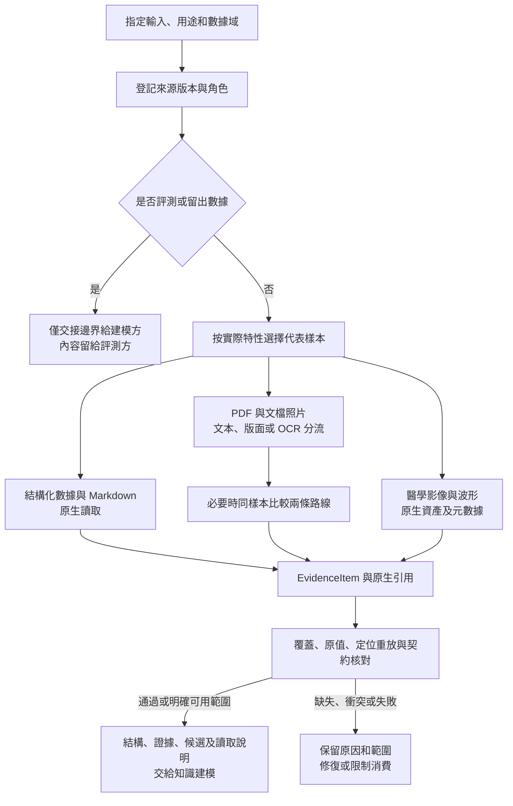

# 多源醫療數據解析與知識建模交接工作流

> 2026-10-14 實施更新：本地正式應用、原生圖譜、數據/模型/本體工具與責任流程已落地。本文保留設計和研究依據，設計當日的“尚未實現/未實測”不再代表當前狀態；實際文件、已驗證範圍及仍缺的專業/完整驗收見[開發報告](../verification/development-report.md)。

更新與官方資料核查：2026-10-13。適用工作區：`MedicalQualityCase/`。

採用“按特性選擇原生讀取器 → 保留原生結果 → 統一 EvidenceItem → 核對來源與質量 → 交給知識建模”的路線。數據庫、結構化文本、文檔、醫學影像和心電信號分別處理。統一的是證據接口、來源與定位，完整表結構、表格跨度、影像原字節和波形校準信息繼續保留。

本文件是當前數據的解析選型與執行工作流；通用選型入口為 [prepare-business-data Skill](../../../.agents/skills/prepare-business-data/SKILL.md)。2026-10-14 該 Skill 已同步用戶指定來源版本，醫療治理、證據契約及交接資源繼續保留，命令變化見第 9 節及[同步記錄](../verification/agents-sync.md)。它承接 [PSC-001 / PSC-002](../specs/product-spec.md#psc-001)，服務 [F002 來源接入、F003 多格式證據、F004 醫療上下文](../specs/feature-map.md)。掃描 PDF 的實施選擇為 Docling＋RapidOCR ONNX，PP-StructureV3 為受限備選，詳見[定案與驗證](governance-cleaning-handoff.md#pdf-scan-decision)；當前實施狀態以開發報告為準。

後續產品實施主入口為 [F003 詳細計劃](../specs/F003-structured-evidence/plan.md)，配套 [業務規格](../specs/F003-structured-evidence/spec.md)與[任務清單](../specs/F003-structured-evidence/tasks.md)。本文件繼續維護調研和通用讀取流程；具體文件影響、接口、實現順序及驗收映射以 F003 文檔為準，來源登記留在 F002、醫療語義留在 F004、規則資格留在 F005。

治理與消費細節見[醫療數據讀取、治理清洗與 RAG／本體交接方案](governance-cleaning-handoff.md)：補充九項研究與官方項目/標準對照、18 項清洗決定、變換/質量記錄、原文回映射以及 SQL/RAG/本體三類視圖。讀取路線繼續以本文為入口，治理策略在專題維護；本輪沒有全量清洗或建模。

## 1. 現有輸入與已觀察範圍

來源清單、固定版本、字段含義和許可沿用[醫療數據 README](../../../Data/醫療病歷質控/README.md)。目錄共 12,758 個文件、2,403,402,120 字節，約 2.24 GiB；下列觀察區分目錄統計、來源說明和本輪有限探測。

| 輸入 | 現有規模 | 本輪已觀察 | 尚未據此證明的內容 |
| --- | --- | --- | --- |
| SQLite | 1 個，約 605.6 MiB | 目錄元數據確認 69 張表，含 68 張業務/參考表及 table_catalog；代表列含 TEXT 和內部記錄號 INTEGER | 未讀取業務行，未重算全部行數或檢查每張表約束；6,010,126 行沿用數據 README |
| CSV | 4 個 | 表目錄、字段目錄、圖文關聯和心電記錄索引；路徑基準見下一節 | 目錄表和關聯表職責不同，不能統一當病歷正文 |
| JSONL.GZ | 2 個 | 每份最多讀取 65,536 解壓字節及 3 條完整記錄；已有 doc_id、text、source_locator、text_sha256、origin 等字段 | 樣本通過不代表全量語法/內容通過；不重複生成原文或文檔身份 |
| JSON 規則 | 1 個 | 完整語法與根對象數量核對，98 個頂層條目 | 未審核規則適用性、版本效力或醫學結論 |
| JSONL 參考標註 | 1 個 | 只登記文件與角色，沒有探讀標註正文 | 不作為普通建模樣本；數據 README 已說明它不是本項目專家金標準 |
| PDF | 1 個，6 頁，326,870 字節 | 此前 pypdf 兩頁初篩；現補 pdfinfo/pdftotext 全六頁及渲染版式核對，均有文字，單欄條款為主 | 原生路線適用；未逐字/座標驗收，未運行掃描 OCR，不能以此代替掃描件效果 |
| XML 報告 | 3,955 個 | 代表文件 `報告/1.xml`：eCitation 根、79 個元素，段落標籤含 COMPARISON / INDICATION / FINDINGS / IMPRESSION | 未遍歷所有 XML 的缺段、嵌套與內容正確性 |
| XLSX 術語表 | 1 個 | 容器元數據含 synonyms、mappings、hierarchy 三個可見工作表 | 未逐單元格讀取或核驗同義關係；工作表名不是已確認的本體關係 |
| PNG 胸片 | 7,470 個 | 代表圖的 IHDR 為 512×624、8 位、RGB；它們是醫學影像資產 | 未解碼所有像素，也未做醫學識別；圖像頭可讀不等於圖片完整可用 |
| WFDB | 659 組 HEA / DAT | 一個頭聲明 12 通道、500 Hz、每通道 5,000 樣本；有限檢查 I/II/III 等前三通道及配對文件存在 | 未解碼信號，未完整核對 12 條通道描述；頭採樣仍標記部分覆蓋 |
| Markdown / 輔助文件 | 數據 README、許可、RECORDS、.gitignore；工程另有 Markdown 文檔 | Markdown 標題僅作有限結構初篩；RECORDS 是記錄索引 | 未解析全部 Markdown AST；許可與忽略規則不轉作患者事實 |

原初始化已核對 7,470 條圖文文件引用和 659 組心電配對，本輪沿用該結果；它只證明當時文件存在，不等於內容解析或醫學驗收。實際數據來自不同來源、語言和業務範圍；這些資料支持接入與建模研究，不自動成為一期成人肺炎規則的臨床驗收集。

## 2. 來源角色與讀取邊界

先登記來源角色，再選樣本。來源清單至少記錄 `source_id`、路徑、內容/快照版本、原數據集、用途與許可、讀取範圍、內部相對路徑基準、數據角色及下游訪問邊界。

| 來源角色 | 本項目輸入 | 下游處理 |
| --- | --- | --- |
| business_evidence | 醫院記錄、病例文本、XML 報告、圖像和心電附件 | 按聲明範圍進入可用證據；保留公開脫敏、文獻等來源性質 |
| schema_reference | 表/字段目錄、數據庫結構、索引結構 | 用於理解字段與讀取，不將字段字典當患者記錄 |
| rule_reference | CMQCIC 規則、2016 年 PDF | 作為有版本的規則參考，適用範圍和專業審核另行確認 |
| terminology | 術語工作簿 | 作為來源提出的同義/映射/層級候選，不自動進行全局實體合併 |
| reference_label | 獨立 CMQCIC 參考標註 | 僅評測方可用；builder/evolver 不讀取其正文設計模型 |
| validation / heldout | 後續明確分配的評測或留出範圍 | 交接清單登記範圍；不作為解析路線調參或知識建設輸入 |

一次性同版本文件可用內容哈希固定；後續持續變化的數據庫需聲明一致性讀取範圍。只有讀取時間、沒有一致性保證時，不能聲稱整庫同一時刻快照。來源版本與運行版本分開，原始資料不回寫。

當前數據有兩種必須保留的路徑基準：`圖文關聯.csv` 的 report_path / image_path 相對於 `Data/醫療病歷質控/`；`record_list.csv` 的 path 相對於 `Data/醫療病歷質控/05_心電圖/`。數據庫 table_catalog.source_file 為上游地址，source_member 為歷史包內位置；它們都不能冒充本地文件路徑。

本輪以本地只讀準備為執行範圍。處理路線需要外部服務時，另行明確服務、提交文件、費用與授權；本地路線失敗不自動轉為雲端上傳。現有許可和用途限制仍以來源說明為準。

## 3. 各類型的主選方案與原生產物

“主選”表示按當前特性優先採用或驗證的方案。確定性格式優先原生讀取；效果依賴版面的格式通過同樣本比較決定。沒有本項目實測支持的工具不標為準確率冠軍。

| 當前類型 / 特性 | 主選讀取方式 | 最適合保留的解析結果 | 備選觸發條件與關鍵核對 |
| --- | --- | --- | --- |
| SQLite / 數據庫結構 | sqlite3 只讀 URI、PRAGMA；先表/列/鍵，再讀取授權記錄範圍 | 結構對象 + 保持類型/原值的記錄；大批量派生表可用 Arrow / Parquet | 接更多數據庫用 SQLAlchemy 反射；持續增量接入才考慮 dlt。缺少外鍵聲明時保持未知，不憑同名字段造關係。[SQLite](https://www.sqlite.org/pragma.html)、[SQLAlchemy](https://docs.sqlalchemy.org/en/20/core/reflection.html) |
| 4 類 CSV 目錄/索引 | 標準庫 csv，明確編碼、分隔符和表頭；標識先保留字符串 | 行列結構 + 邏輯記錄號/字段；索引關聯保留來源 | 大批量分析再用 Polars/Arrow；檢查前導零、空值、帶引號換行和路徑基準。無需先轉文檔表格。[Polars 類型控制](https://docs.pola.rs/api/python/stable/reference/api/polars.read_csv.html) |
| JSON / JSONL.GZ | json + gzip，按完整邏輯記錄流式讀取；需要小數精確保真時顯式使用 Decimal 或保留源數字字面值 | 原嵌套對象 + JSON Pointer + 解壓邏輯記錄號；沿用現有 doc_id、origin、text_sha256 | 不預先全量解壓落盤；保留 null、缺失、數組順序及原始嵌套，不經 LLM 重寫。[gzip](https://docs.python.org/3/library/gzip.html)、[JSON](https://docs.python.org/3/library/json.html) |
| Open-i eCitation XML | defusedxml；需要複雜 XPath/大批處理時用禁用實體、DTD 加載和網絡的 lxml | 帶標籤/屬性的樹、段落文字與 XPath；保留逐份許可和 mixed content | 該 XML 不是任意文檔工具默認支持的 JATS；缺段保持缺失，不把 IMPRESSION 改寫成診斷事實。[defusedxml](https://github.com/tiran/defusedxml) |
| Markdown | 保留源文；markdown-it-py 產生 Token/語法樹 | 標題路徑、段落、列表、代碼塊、表格及行範圍；精確字符位置需額外映射 | 簡單標題探測不代替完整 AST；內聯 Token 未必帶行映射。[markdown-it-py](https://markdown-it-py.readthedocs.io/en/latest/using.html) |
| 規範 PDF：數字文本 / 簡單條款 | pypdf 初篩；需要字符和表格定位時用 pdfplumber | 頁級/塊級文字和實際可取得的位置；原 PDF 為回查依據 | 若層級、表格或閱讀順序不滿足消費要求，與 Docling 對照；逐頁覆蓋後才決定是否無需 OCR。[pdfplumber](https://github.com/jsvine/pdfplumber) |
| PDF：掃描 / 混合 / 複雜表格 | **Docling standard＋RapidOCR ONNX**；PP-OCRv4 中英模型與字典顯式固定 | 原生結構 JSON＋頁/框、單元格/跨度、圖像關聯，適配 EvidenceItem | **本地 PP-StructureV3** 僅在中文表格/文字/順序缺口且同樣本改善時切換；MinerU 不在一期默認鏈。參數、模式、離線和驗收見[定案](governance-cleaning-handoff.md#pdf-scan-decision) |
| XLSX 術語 / 映射表 | openpyxl，按需要讀取單元格、公式與可用緩存；大表可用 read_only | 工作表、單元格範圍、原值/類型、合併與隱藏信息；候選術語關係單列 | openpyxl 不計算公式；只讀模式與維度聲明有邊界，需要合併等元信息時另行讀取。不能只導 CSV 丟掉其他工作表。[openpyxl](https://openpyxl.readthedocs.io/en/stable/optimized.html) |
| 胸片 PNG | Pillow 元數據與實際解碼檢查；原圖 + 圖文關聯 CSV | 原資產引用、尺寸/位深/色彩、報告關聯；不重編碼原圖 | 只有文檔照片才路由 OCR。胸片圖像不轉為“識別到的患者事實”，PNG 也不能補回不存在的 DICOM 標籤。[Pillow](https://pillow.readthedocs.io/en/stable/reference/Image.html) |
| WFDB HEA / DAT | WFDB SDK 本地 rdheader / rdrecord；不設置遠程 pn_dir | 原始頭/信號引用 + 通道、採樣率、樣本區間、增益/基線、單位和數字/物理模式 | 不能將 DAT 直接視為通用 int16 數組。下游只需附件時停在元數據，確需數值才按區間解碼。[WFDB API](https://wfdb.readthedocs.io/en/latest/io.html) |

數據庫原源字段以 TEXT 保存，計算時另建有依據的規範化值；`_source_record_number` 是原 CSV 不含表頭的數據記錄號。統一 locator.csv.record_number 則按源文件邏輯記錄計數、包含表頭：映射時明確口徑，保留原字段，不能靜默混用。

現有 JSONL 的 doc_id 是文檔身份，應保留在內容和來源映射中。新的 EvidenceItem.id 可按來源身份、版本、內容分型及定位穩定構成；文檔片段不復用整個文檔 ID。不同記錄即使 text_sha256 相同，也可能對應不同任務，不能自動去重成同一業務對象。

通用工具路由與官方鏈接見 [providers.md](../../../.agents/skills/prepare-business-data/references/providers.md)，包括後續可能新增的 DOCX / PPTX / HTML。醫療格式的具體選擇以本節及治理專題為準，本項目無需為不存在的輸入安裝工具。

## 4. 已有項目和 Skills 的複用方式

| 現有能力 | 本項目如何使用 | 本輪優化 / 注意點 |
| --- | --- | --- |
| prepare-business-data | 通用格式初篩與路線選擇；醫療契約及交接沿用本項目資源 | 2026-10-14 同步來源版：腳本不再包含舊醫療格式擴展或 `--no-preview`；證據 Schema、校驗器、治理和交接參考保留，正式讀取仍由產品適配器承擔 |
| docling | 文檔結構解析候選 | 保存 DoclingDocument JSON，不把 Markdown 當唯一事實源；支持的 Docling JSON 和 XML 子類型不能外推為任意業務 JSON/XML。[格式](https://docling-project.github.io/docling/usage/supported_formats/)、[序列化](https://docling-project.github.io/docling/concepts/serialization/) |
| mineru | 已調研工具；不進入一期默認主備鏈 | 當前官方 4.x 接口與舊快照可能不同；命令響應 JSON 不等於 MiddleJson。交互入口默認前 10 頁的行為需顯式覆蓋，生產版本、schema 和實際頁數要記錄。[遷移說明](https://opendatalab.github.io/MinerU/reference/migration_4/) |
| paddleocr-doc-parsing | 已有的在線解析 Skill，條件允許時才使用 | 它不是本地 PP-StructureV3 運行環境；本輪未調用服務、讀取令牌或上傳文件。[官方 Skill](https://github.com/PaddlePaddle/PaddleOCR/blob/main/skills/paddleocr-doc-parsing/SKILL.md) |
| langextract-usage | 後續文字上的候選實體/關係抽取 | 可選語義步驟；原文定位或 char_interval 可缺失，缺失時保留待核對，定位存在也不代表關係正確。[官方項目](https://github.com/google/langextract) |
| build-ontology / evolve-ontology | 在預處理交接後，依據實際任務啟動 | 不在本輪創建本體、分割策略或 MCP 配置；評測答案不進入 builder/evolver |
| dlt 官方 AI harness | 未來持續數據庫/文件接入的參考 | 已找到可複用的 SQL、文件與數據質量 Skills；一次本地 SQLite 讀取無須引入整個工具包。[官方倉庫](https://github.com/dlt-hub/dlthub-ai-harness) |

沒有新裝全套解析框架或複製新的上游 Skills；現有官方 Skill 的導入版本與許可保持原樣，快照見 [upstream-skills.json](../../../.agents/skills/prepare-business-data/references/upstream-skills.json)。此次更新的是本地總工作流及其配套資源。

## 5. 可重複執行的工作流



| 步驟 | 操作與產物 | 完成條件 |
| --- | --- | --- |
| 1. 登記 | 明確輸入文件/查詢範圍、來源角色、版本、許可、允許的數據域及消費任務 | 參考標註與建模輸入分開；不掃描整個用戶目錄 |
| 2. 分層探測 | 對每類實際特性選代表文件，記錄完整統計、樣本觀察、未檢查項和截斷 | 前幾個文件不能冒充全格式覆蓋；本輪探測結果見第 1 節 |
| 3. 路由選擇 | 按第 3 節選擇原生路線，效果未知的文檔最多先比較兩條有實質差別的路線 | 明確主選、回退觸發條件、運行環境和輸出；不以覆蓋後綴數量排名 |
| 4. 讀取與保留 | 原值/原文和原生解析結果保留；規範化、OCR 或清洗均記變換 | 原始來源不變，成功/部分/失敗均能對回本次輸入範圍 |
| 5. 統一 | 按六種 kind 生成 EvidenceItem，小對象用 JSONL，大表/數組用引用 | 對象結構與格式定位可校驗，原生專有信息不被封裝丟棄 |
| 6. 核對 | 檢查覆蓋、關鍵原值、定位重放、契約、角色隔離及必要的語義抽樣 | 機器結構通過和來源正確分開記錄；失敗對象不從分母消失 |
| 7. 交接 | 給出可用證據、結構字典、參考規則/術語、可選候選、讀取說明與未解決項 | 建模方可按允許範圍回查；沒有標註洩漏或憑相似度合併患者 |

解析失敗只重試受影響部分。缺少位置或定位不可靠時使用 unavailable 並限制消費；部分成功註明可用範圍。不能為讓 Schema 通過而補造頁碼、座標、單位或臨床內容。

## 6. 統一模式：EvidenceItem 1.0

本工作流採用 [JSON Schema](../../../.agents/skills/prepare-business-data/references/evidence-item.schema.json)；完整字段語義見 [EvidenceItem 契約](../../../.agents/skills/prepare-business-data/references/evidence-contract.md)。這是工作流可校驗的交接格式，正式產品實現可做明確適配，不能靜默改寫 PSC 語義。

| 信息層 | 字段 / 分型 | 給知識建模保留什麼 |
| --- | --- | --- |
| 身份 | schema_version、id、kind | kind 為 schema / record / table / text / image / waveform；證據身份和患者身份分開 |
| 來源 | source.id / uri / version / format / data_role / data_kind / authorized_use | 來源版本、讀取用途及原始性質，宜補充實際內容 SHA-256 |
| 定位 | locator | 數據庫表/記錄鍵或快照序號；CSV 邏輯記錄；JSON Pointer；XML XPath；文本行/字符；PDF 頁/框；XLSX 單元格；圖像幀；波形採樣範圍 |
| 內容 | content | 按分型保留 text / value / columns / rows / metadata；大內容使用 payload_ref，規範化值另放 normalized |
| 原生關聯 | native_refs | 原文檔與解析器結構、圖像、頭文件和信號文件；避免複製大資產 |
| 過程 | provenance | 工具/版本、run_id、必要配置和實際變換；不存憑據 |
| 質量 | quality.status / issues / usable_scope / modeling_access | 成功、部分、失敗、阻斷與問題；allowed / evaluator_only / restricted 分開 |

統一對象的承載分三層：原始文件繼續是事實來源；必要時保留解析器原生 JSON、類型化表或數值資產；EvidenceItem 提供統一訪問與追溯封裝。JSONL 適合分批讀寫對象，[Arrow](https://arrow.apache.org/overview/) / [Parquet](https://parquet.apache.org/docs/overview/)用於確有需要的類型化大表，不強制把幾百萬行、胸片像素或完整波形放入一個 JSON。

PDF 框採用 `[x_min,y_min,x_max,y_max]` 並聲明座標單位、原點和頁面尺寸；只有頁級位置時如實保留頁級。波形保留左閉右開的樣本區間、通道次序及單位，數字值與物理值模式明確區分。只讀取頭文件的對象應記錄 `values_decoded=false`，成功僅指已聲明的元數據讀取範圍。

參考標註、validation 和 heldout 對象不能標為允許建模輸入；失敗、阻斷和無法定位的對象也不能進入可用集合。Schema 校驗的是字段約束，不驗證真實文件或臨床正確性。

[12 條契約示例](../../../.agents/skills/prepare-business-data/references/evidence-examples.jsonl)使用 `example://` 來源和合成內容，覆蓋各類定位與隔離情況，僅用於校驗接口，不能作為本地醫療數據已完成解析的證明。

## 7. 如何確定哪條路線最合適

優先滿足當前消費任務的質量門檻，再比較運行複雜度、資源、耗時和費用。採用[通用質量核對](../../../.agents/skills/prepare-business-data/references/quality-gates.md)，本項目最小驗證如下。

| 對象 | 下次實際執行時的核對重點 | 影響路線的判定 |
| --- | --- | --- |
| SQLite / CSV / JSONL | 原編號、空值、數值精度、嵌套與數組、邏輯記錄定位；數據庫聲明與業務類型分開 | 原生讀取保真且定位成立即可，不必跑 LLM 對照 |
| XML / XLSX / Markdown | XML 段落標籤與 XPath 回查；工作表/單元格/公式/隱藏；Markdown 標題、嵌套和行範圍 | 保留原生語義即可；不能用扁平正文替代需要的結構 |
| 6 頁規範 PDF | 已完成全六頁文字層/版式初查，後續對關鍵條款核對原生文字與真實 locator | 數字頁保留原生路線；掃描分支另以 Docling＋RapidOCR 的獲准掃描/合成夾具驗證，備選僅 PP-StructureV3 |
| PNG / WFDB | 實際圖像可解碼、索引關聯；完整頭與選定信號區間、通道順序、單位/增益和原始值模式 | 只做資產交接時不開展診斷；數值消費需先跑 WFDB 解碼樣本 |
| EvidenceItem | 全批次結構、ID、角色；從對象位置回放到同版本來源 | Schema 通過後仍需位置重放；分片處理另核對跨片身份和清單覆蓋 |

若比較文檔解析器，固定同一原文件/頁、工具與模型版本、參數及本地環境，分別記錄文字差錯、關鍵條款/表格保持、位置回查、實際覆蓋、耗時、峰值資源和產物大小。未測量項寫“未測”；不把不同模型 confidence 當作可直接比較的準確率，不預設醫學驗收閾值。

當前位置：已完成格式/來源初篩、統一接口與輔助腳本驗證，並補六頁 PDF 的文字層/版式觀察；掃描主選/備選已經確定。尚未運行掃描 OCR、完成模型效果/資源驗證、真實位置回放或醫學驗收；定案不等於實測通過。

## 8. 交給知識建模的材料與邊界

實際執行後按 [建模交接約定](../../../.agents/skills/prepare-business-data/references/modeling-handoff.md)提供一份交接說明，指向：來源/版本與覆蓋清單、結構/字段字典、可用 EvidenceItem、規則與術語參考、可選候選實體/關係、原生資產及讀取辦法、失敗/未解語義和訪問邊界。

建模階段再定義患者、就診、文書、診療事件、規則、問題與證據之間的業務關係。每個關係回鏈到 EvidenceItem；缺少證據的關聯保留候選。MIMIC 與 eICU 身份不能合併；ECG 的 subject_id 關聯不證明屬於某次住院；XML 段落、規則和術語不能被當作專家已簽字的結論。

若使用現有本體 Skills，由該階段選擇實際建設模式，遵循其[數據邊界](../../../.agents/skills/build-ontology/references/ontology-layer-data-boundary.md)。當前不選擇 fixed_split / rolling_trajectory、不設拆分比例，不創建本體配置或最終圖譜。EvidenceItem 也不提前等同於 FHIR 資源或圖數據庫節點。

真實運行產物放在來源與 Skill 目錄之外；建議正式確定架構時使用 `MedicalQuality/artifacts/data-preparation/<run_id>/`，按職責保存 manifest、evidence 分片、必要 native/payload 和 handoff。此路徑尚未創建。生成前先加忽略規則；保留原始來源版本、工具配置及可重建說明，替代運行已核驗且無下游引用後可清理派生產物。原始 `Data/` 是正式輸入，不能按緩存清理。

## 9. 可用命令、依賴與本輪驗證

以下命令從工作區根目錄執行，使用項目自帶合成契約示例驗證通用初篩，不讀取真實病例或參考標註。當前來源版腳本可能輸出正文預覽；它不支持舊 `--no-preview` 參數，也不承接舊版 SQLite、JSONL.GZ、XML、PNG、WFDB 特性探測。真實醫療資料按前文來源角色和範圍，通過產品讀取適配器處理。

```bash
cd MedicalQualityCase

python3 -B .agents/skills/prepare-business-data/scripts/inspect_inputs.py \
  .agents/skills/prepare-business-data/references/evidence-examples.jsonl \
  --max-files 1 --sample-bytes 65536 --sample-rows 3

MedicalQuality/backend/.venv/bin/python -B .agents/skills/prepare-business-data/scripts/validate_evidence.py \
  .agents/skills/prepare-business-data/references/evidence-examples.jsonl

MedicalQuality/backend/.venv/bin/python -B -m unittest discover \
  -s .agents/skills/prepare-business-data/scripts/tests -v
```

保留的校驗器默認最多 10,000 項、每行最多 4 MiB；超過範圍返回非零且聲明截斷，不可當成全量通過。它不讀取 native_refs、不檢查位置實際回放或醫學正確性。

下表及其後的“本輪”結果是 2026-10-13 研究快照，記錄當時擴展腳本和 Python 環境；不作為此次同步後腳本能力或當前依賴狀態。現有環境見[運行手冊](../development-runbook.md)，此次腳本驗證見[同步記錄](../verification/agents-sync.md)。

| 能力 | 當前狀態 | 實際採用時尚需什麼 |
| --- | --- | --- |
| 標準庫探測 / SQLite / CSV / JSON / GZ / XML 初篩 | 默認 Python 3.9.6；只讀探測已運行 | 正式處理需固定讀取範圍、版本和適配代碼 |
| 契約驗證 | Python 3.9 環境已有 jsonschema 4.25.1；校驗器與示例已運行 | 正式輸出與真實來源的定位回放仍待執行 |
| 原生文檔/表格/圖片工具 | Python 3.9 可發現 pypdf 6.14.2、openpyxl 3.1.5、Pillow 11.3.0、markdown-it-py 3.0.0、defusedxml 0.7.1 | 發現包不等於所有讀取鏈路實測；pdfplumber 路線尚未驗證 |
| 數據反射/列式工具 | Python 3.9 可發現 SQLAlchemy 2.0.51、PyArrow 21.0.0；Polars 未發現 | 只在實際多庫/大表需求下加入所選項目環境 |
| 文檔模型解析 | Docling、MinerU、PaddleOCR 運行包未發現；已有 pdftotext / Tesseract 命令 | 選定兼容解釋器、依賴、模型和配置後再測；本輪沒有安裝或下載 |
| 心電數值解碼 | 兩個已檢查 Python 環境均未發現 wfdb | 所選項目環境安裝 WFDB 後核對本地樣本 |
| 後續 Python 環境 | Python 3.12.13 可用，尚無項目虛擬環境 | 3.9 的包不能當成 3.12 已有；此次在 3.12 檢查的 jsonschema、docling、mineru、wfdb、polars、pyarrow 均未發現 |
| 候選語義抽取 / 本體 | 有本地 Skills，沒有已跑通的模型與本體服務 | 依實際路線準備；本輪不以其缺失阻塞工作流交付 |

本輪完成條件及結果：

- 數據特性與來源角色已經映射到讀取路線、原生產物、定位和回退條件；明確記錄樣本範圍與未知項。
- 優化現有 prepare-business-data，補齊 Schema、12 條契約示例、質量核對與建模交接說明；官方導入 Skill 未改動。
- 22 項腳本測試通過，覆蓋原有入口、只讀與採樣邊界、新格式探測、對象約束、角色隔離、位置語義和截斷報告。
- Skill 的 quick_validate 校驗通過；真實 GZ / XML 的受限 CLI 探測通過，輸出省略正文預覽。12 條契約示例通過校驗，不表示醫療數據轉換完成。

交付停在可複用工作流、工具路線與可校驗交接模式。原始醫療數據保持原樣，未建立全量派生庫、安裝模型、外發數據或啟動知識建模。
