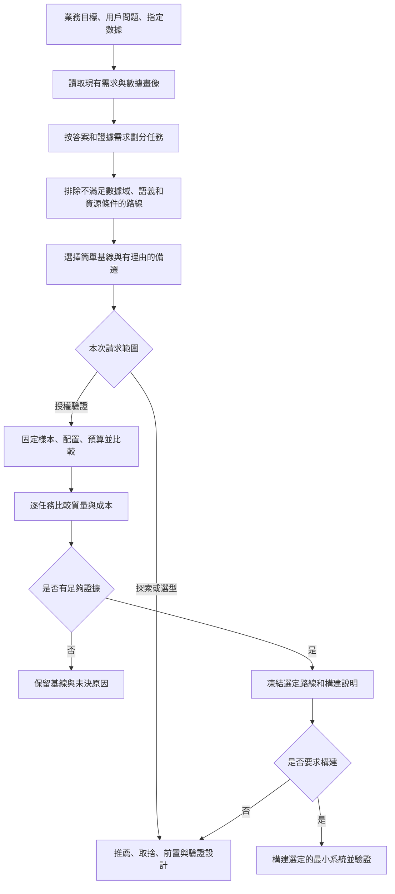

# 基於業務任務的 RAG 選型與構建 Skill：探索稿

日期：2026-10-13。狀態：探索基線。下文保留當時的調研、建議與驗證邊界；依據為官方文檔/論文檢索，以及當前項目需求、數據工作流和本地 Skills；沒有進行性能或答案質量比測。

後續已按用戶要求沉澱 [select-rag-architecture](../../../.agents/skills/select-rag-architecture/SKILL.md)，實際使用與維護以 Skill 及其配套資源為準。本項目的檢索系統、索引和本體尚未構建，探索建議沒有自動成為產品選型決定。

## 1. 探索結論

值得做。建議將新 Skill 定位為：**從業務問題與證據要求出發，推薦可解釋的檢索架構，通過小樣本檢驗，並在用戶授權範圍內組織最小可運行構建。**

用戶不需要先知道 Naive RAG、GraphRAG 或本體術語。Skill 應主動讀取已有需求與數據說明，判斷任務需要哪種能力，展示主選、備選、適用條件及尚缺證據，再銜接實際實現。

不能只按 PDF / 數據庫 / Markdown 後綴決定 RAG 形式。同一批病歷資料可能同時承擔原文查找、精確統計、關係追溯和質控解釋；這些任務需要的查詢方式不同。也不能將 Naive → Hybrid → Graph → 本體當作固定升級階梯，默認複雜方案更好。

擬用名稱：`select-rag-architecture`，中文顯示名“知識檢索選型與構建”。先實現“有證據的選型與最小驗證”，再逐步增加經過驗證的構建路線；沿用項目已有運行框架，不默認更換技術棧。

## 2. 先統一術語與技術層次

### Nav RAG 的歧義

用戶提到的“Nav RAG”尚待術語澄清。探索中保留兩個獨立分支：

- **Naive RAG**：基礎的分塊、索引、檢索、生成範式，可作低複雜度基線。Naive / Advanced / Modular 是文獻中的範式分類。[RAG 綜述](https://arxiv.org/abs/2312.10997)
- **NavRAG 專名**：檢索到的同名論文用於具身視覺語言導航中的用戶需求指令生成，不能直接當作通用企業知識檢索路線。[NavRAG 論文](https://arxiv.org/abs/2502.11142)

若實際指按目錄逐步找內容，應稱文檔樹/導航式檢索，並按具體項目討論。下文將基礎分塊檢索稱 Naive RAG，文檔樹另列，暫不推定兩者就是用戶原詞的含義。

### 選型需要分別作出的決定

| 層次 | 要回答的問題 | 可能的選擇 |
| --- | --- | --- |
| 任務與證據 | 要找一句原文、算一個數、解釋關係，還是綜合全庫主題？需要怎樣證明答案？ | 查找、聚合、文檔比較、多實體追溯、範圍內總結、確定性檢查 |
| 知識表示 | 怎樣組織內容和業務含義？ | 原文片段、關係表、文檔樹、實體關係圖、術語/映射/約束語義層 |
| 檢索與執行 | 怎樣取得所需證據或計算結果？ | 精確鍵查找、SQL、全文/BM25、向量、融合/重排、圖遍歷、樹導航 |
| 查詢編排 | 一次讀取夠不夠，需要哪些順序與停止條件？ | 單次檢索、按任務路由、有限的查詢分解和多步工具調用 |
| 回答與驗收 | 如何引用、表達缺口和核驗？ | 證據 ID/版本回鏈、結果對照、拒答或部分回答、專家複核 |

**GraphRAG、混合檢索與本體可以組合。** Neo4j 的官方檢索器就同時提供向量、全文融合、圖擴展和 Text2Cypher；選擇其中一種檢索器不等於完成業務本體設計。[Neo4j 檢索器指南](https://neo4j.com/docs/neo4j-graphrag-python/current/user_guide_rag.html)

“本體”也應說明具體含義。OWL 2 是帶形式語義的知識表示語言；SHACL 用於校驗 RDF 圖是否滿足條件，不能將兩者統稱為向量檢索替代品。OWL 的開放世界語義也不等同於缺字段校驗，缺少陳述不能自動推出其為假。[OWL 2](https://www.w3.org/TR/owl2-overview/)、[OWL 與數據庫的區別](https://www.w3.org/TR/owl2-primer/)、[SHACL](https://www.w3.org/TR/shacl/)

本項目已有 build-ontology 使用 Term / Mapping / Relation / Constraint / Evidence 表示有證據的分析語義層；它不是天然等同於 OWL 推理器，也不保證自動建立 GraphRAG 的實體索引。新 Skill 必須識別實際系統契約。

## 3. 按業務任務選擇候選路線

下表是本輪建議的篩選規則，不是已經跑出的排名。先滿足任務與來源約束，再用代表問題比較候選；簡單方案達到要求時就停止增加組件。

| 業務任務與數據信號 | 首先考慮 | 何時增加能力 | 不適合直接採用的做法 |
| --- | --- | --- | --- |
| 明確 ID、條號、字段值、少量固定資料 | 精確查找、全文查詢或直接讀取；必要時才生成自然語言 | 表述變化使精確查詢漏檢時加入語義檢索 | 每個任務都先建向量庫或圖譜 |
| 以單段事實問答為主，知識範圍明確 | Naive 向量 RAG 與全文基線 | 實測出現編號/專名漏檢或語義改寫問題時比較混合檢索 | 將“入門方案”視為無須評測，或默認不配引用 |
| 問法多樣，同時有規則號、縮寫、術語、專名 | 關鍵詞/全文 + 向量融合；有證據需要時加入重排 | 根據失敗樣本調整分塊上下文、召回池、融合和重排 | 直接相加未經校準的不同檢索分數；無條件堆所有組件 |
| 已結構化的計數、分組、時間篩選、精確列表 | 受控 SQL/結構化執行；字段含義不清時補語義映射 | 問題還需要條文解釋時再並行或順序檢索文本 | 用相似片段抽樣來聲稱全量計數；任由模型執行任意查詢 |
| 長手冊、條款層級、跨章節引用 | 保留層級的父子塊/文檔樹檢索 | 導航上下文確實優於平鋪檢索時增加 PageIndex 類樹導航或摘要樹 | “有 PDF”就默認導航式檢索；從摘要引用冒充原文引用 |
| 明確實體及跨實體關係，問題需要多段路徑 | 圖檢索 + 原文回鏈，先複用已有可信關係 | 實測關係擴展能找回漏掉證據時採用 GraphRAG 路線 | 數據庫有外鍵就必須遷移圖數據庫；LLM 抽取的邊直接當事實 |
| 跨大量文檔的主題概括、群體議題與探索 | 集合級摘要/層級檢索；可比較 Microsoft GraphRAG Global | 確有全局歸納任務且能承擔圖/摘要更新成本 | 將社區摘要當精確統計、患者級事實或臨床判斷 |
| 多系統概念不一致、指標口徑/單位/身份/適用條件需要穩定解釋 | 最小語義層或本體 + SQL/全文/圖等執行能力 | 簡單映射不足且有可維護概念/約束證據時增加建模深度 | 只憑字段名生成完整本體；有醫療詞彙就導入龐大領域圖譜 |
| 同一問題必須組合多個來源並在中途決定下一步 | 在已有有效檢索器上增加有預算和停止條件的查詢路由/Agent 編排 | 固定流程無法滿足真實任務，且逐步調用有可觀察收益 | 把 Agentic RAG 當成第一個必選項；失敗後無限檢索或自動越域 |
| 圖片或波形本身需要專業解釋 | 先確定專門任務、模型和驗證；文字報告與資產引用可先接入 | 專業多模態任務獲得明確範圍與評測後再擴展 | 以文件數量或 PNG/DAT 後綴推定應做多模態診斷 RAG |

混合檢索的常見實現是全文與向量結果融合，例如 RRF；“混合”也可能表示不同層級/圖路徑的組合，必須展開實際組件，不能只寫 hybrid。[Elastic 混合檢索](https://www.elastic.co/docs/solutions/search/hybrid-search)、[RRF](https://www.elastic.co/docs/reference/elasticsearch/rest-apis/reciprocal-rank-fusion)

Microsoft GraphRAG 區分 Local、Global、DRIFT 和 Basic 查詢。Local 結合實體鄰域與原文，Global 利用社區報告回答集合級問題；它們回答的任務不同，Global 不能替代逐記錄聚合。本段最後一項是本輪據機製作出的選型判斷。[查詢模式](https://microsoft.github.io/graphrag/query/overview/)、[Global Search](https://microsoft.github.io/graphrag/query/global_search/)

父子塊、文檔目錄樹和 RAPTOR 摘要樹也不能混稱一種技術。RAPTOR 通過遞歸聚類與摘要形成不同抽象層級；PageIndex 探索按文檔結構導航。摘要仍須回鏈到原始證據，使用哪一類應由實際問題確定。[RAPTOR 論文](https://arxiv.org/abs/2401.18059)、[PageIndex](https://github.com/VectifyAI/PageIndex)

## 4. Skill 如何讓非技術用戶完成選型

### 先從已有材料推導，少量提問補齊

讀取當前項目的需求/規格、實際用戶問題、數據說明、prepare-business-data 結果、現有檢索代碼和運行約束。沒有這些標準文檔的項目也可從用戶描述與指定樣本開始，不強迫用戶先補一整套 PRD。

| 要提取的信息 | 可自動觀察的依據 | 只在影響決定時向用戶確認 |
| --- | --- | --- |
| 真實工作負載 | 用戶問題、業務痛點、已有查詢/失敗案例 | 主要要查事實、算數、找關係還是做總結？結果用於什麼動作？ |
| 證據要求 | 產品 AC、來源版本/locator、審核流程 | 必須定位到哪種精度？沒證據時應停止還是允許有限回答？ |
| 數據特性 | 結構、粒度、實體標識、層級、語言、更新/刪除、覆蓋 | 身份/指標口徑存在多個解釋且材料不能解決時確認 |
| 運行限制 | 既有框架、部署域、可用模型/數據庫與預算說明 | 允許哪些服務或數據域？未明確的費用和資源上限是多少？ |
| 維護能力 | 已有語義模型、規則責任人、更新與索引機制 | 誰維護業務定義和關係，變更後怎樣驗證？ |

不讓用戶在術語菜單裡先選 GraphRAG 或本體；先展示“你要解決的三類問題分別是什麼”，再說明系統建議及依據。未知項保持未知，不以默認值偽裝客戶決定。

### 可重複工作流



探索、驗證和構建是同一 Skill 隨用戶意圖推進的範圍，不要求用戶重複批准已經授權的可逆工作。只有缺失關鍵業務信息、需要新的服務/數據訪問或費用權限時，才詢問具體缺項。

### 選型依據應能被反駁

每個推薦記錄：目標任務 → 已觀察信號 → 最小主方案 → 一個有實質差別的備選 → 不選擇其他方案的原因 → 驗證辦法 → 推翻推薦的條件。例如：

- “規則號與同義表述共存，因此比較混合檢索；若全文基線已達到全部證據要求且成本更低，就保留全文方案。”
- “多實體關聯是核心問題且有可靠關係來源，因此比較圖擴展；如果邊質量差或普通 SQL 關聯已滿足任務，就不建新圖索引。”
- “跨系統指標口徑導致錯誤，因此增加語義映射；如果問題只是 OCR 錯字，先修 F003 解析，不靠本體掩蓋。”

不要以‘數據越多越該用圖’、‘醫療場景必須本體’或固定加權評分直接裁決。硬約束先過濾，再按同一任務的質量、更新代價、延遲和成本比較；預算或指標無依據時標未定，不宣稱全局最優。

## 5. 自動構建應該做到什麼

Skill 負責理解任務、選路、調用已有能力及驗收；檢索索引、數據庫和模型仍需要實際運行時。寫出 SKILL.md 不代表已經擁有可運行系統。

| 階段 | 應交付 | 狀態邊界 |
| --- | --- | --- |
| 推薦 | 工作負載摘要、逐類任務路由、主備方案、前置、官方依據和驗證設計 | 推薦不等於效果驗證 |
| 驗證 | 凍結樣本/來源、版本與預算；實際檢索/答案/引用及對照結果 | 未運行項標未運行；局部通過不等於所有任務通過 |
| 構建 | 項目內最小模塊與配置、必要索引、增量/刪除處理、查詢入口和可復現檢查 | 只構建選定路線，不同時安裝全部候選框架 |
| 交接 | 啟動方法、構建/更新來源、限制、驗證範圍和產物清理辦法 | 成功啟動與業務驗收分開；不自動部署或升級生產範圍 |

建議首版可自動構建的範圍先覆蓋：既有框架上的單路全文/向量基線、關鍵詞與向量融合、受控結構化查詢與文本檢索路由。它們是可複用起點，不是強制的默認三件套。

圖檢索、目錄導航和本體在首版都可以選型；執行適配只承諾已經完成真實測試的路線。選中了尚無構建適配器的方案時，輸出準確的缺項和實施計劃，不能靜默降成基礎 RAG 後宣佈目標達成。已有合適的框架或 Skill 時優先複用，無需重新實現整套平臺。

自動構建仍需處理幾個與結果直接有關的條件：

- 權限先於檢索結果進入模型；圖邊、摘要、緩存和索引也要保持來源訪問邊界，不能只過濾最終答案。
- 來源、索引、嵌入模型、抽取/摘要配置、語義定義和查詢版本可追蹤；刪除/更新的影響範圍明確。
- 分開真實事實、抽取候選、圖關係、生成摘要與人工確認，不把中間推斷寫回原始證據。
- 本地代碼/索引不代表模型調用也在本地；涉及外部模型時仍須核對實際數據流與既有授權。
- 憑據按環境既有規則處理；沒有運行條件時完成可用的設計/代碼部分並指出實際缺項，不製造執行記錄。

檢索後端的交接也應統一：每次結果註明查詢身份、實際路線、證據 ID 與來源版本、命中範圍、原生分數/尺度、失敗或受限原因。圖路徑與摘要返回其依賴的證據引用，結構化計算保留查詢範圍和結果來源；不把不同後端的分數當統一置信度。原始 EvidenceItem 繼續承擔證據定位，檢索命中與派生摘要另記，避免改寫原始證據對象。

## 6. 可複用的項目與 Skills

以下是本輪查到的官方實現或維護者資料，作為構建候選和設計參考；未下載、安裝或執行。

| 資源 | 可複用部分 | 選用前要核對的區別 |
| --- | --- | --- |
| [Microsoft GraphRAG](https://microsoft.github.io/graphrag/) | 實體/關係索引、社區摘要及多種查詢方式 | 更適合相應實體或集合級任務；抽取、摘要、更新與調用代價必須實測；不保證患者級事實正確 |
| [Neo4j GraphRAG Python](https://neo4j.com/docs/neo4j-graphrag-python/current/user_guide_rag.html) | 向量/全文融合、Cypher 圖擴展、Text2Cypher | 適合明確需要圖存儲/查詢的工程；圖模式、可信邊和查詢權限仍由項目保證 |
| [LightRAG](https://github.com/HKUDS/LightRAG) | 圖與文本結合的查詢模式及工程實現 | 其 hybrid 是 local + global，mix 還結合 naive；不能把名稱等同於 BM25 + dense。官方效率描述不能替代本地比測 |
| [PageIndex](https://github.com/VectifyAI/PageIndex) | 文檔樹和推理式導航 | 當前官方區分本地文本 PDF 與雲端 OCR/圖像能力；本地索引仍需核對 LLM 是否遠程。不能將廠商 FinanceBench 成績外推到本項目 |
| [LlamaIndex](https://developers.llamaindex.ai/python/framework/understanding/rag/querying/) | 索引/檢索/後處理/回答的組合接口 | 是實現工具箱，不替用戶決定圖、本體或向量哪種更合適；複用已有框架優先 |
| [Haystack ConditionalRouter](https://docs.haystack.deepset.ai/docs/conditionalrouter) | 按明確條件連接多條處理分支 | 條件路由本身不等於業務選型能力；需要顯式條件與兜底，不用問題長度冒充任務複雜度 |
| [Ragas](https://docs.ragas.io/en/latest/concepts/metrics/available_metrics/) | 檢索與回答的分層度量 | 不同指標需要不同參照；LLM Judge 可能產生調用費用，評分不是專家責任簽字 |
| [Memgraph 官方 GraphRAG Skill](https://github.com/memgraph/skills/blob/main/skills/memgraph-graph-rag/SKILL.md) | 圖模式、混合檢索、工具契約與評測的構建藍圖 | 已以 Memgraph/GraphRAG 為前提，不是跨 RAG 範式的中立選型器；有運行依賴，先選路再考慮使用 |
| [LangChain framework-selection Skill（benchmark 倉庫）](https://github.com/langchain-ai/skills-benchmarks/blob/main/skills/benchmarks/framework-selection/SKILL.md) | 分層框架選擇的表達方式 | 面向 LangChain / LangGraph / Deep Agents；選擇編排框架不等於選擇 RAG 形式，benchmark 中存在不代表已驗證可直接安裝 |

另可參考 [Contextual Retrieval](https://www.anthropic.com/engineering/contextual-retrieval)對分塊上下文、關鍵詞/向量與重排的實測比較方法；其結果限定於報告裡的數據和配置，不將其 top-k 或效果百分比寫成 Skill 通用規定。[Self-RAG](https://arxiv.org/abs/2310.11511)涉及專門的學習與反思機制，不能把普通提示詞裡的“自查一下”宣傳為復現該方法。

本輪檢查的官方資料中，已經有“選定技術後怎麼搭”的豐富資源；尚未核實一個能直接替代本需求、橫跨基礎檢索/圖/本體並帶業務驗證的成熟通用 Skill。這是本輪檢索範圍內的判斷，不是宣稱全網不存在。

### 與本地 Skills 的銜接

| 已有 Skill | 繼續承擔的職責 | 新 Skill 接收或傳出的內容 |
| --- | --- | --- |
| [prepare-business-data](../../../.agents/skills/prepare-business-data/SKILL.md) | 按格式讀取、保留來源位置、統一證據、數據角色與覆蓋 | 接收數據畫像 / EvidenceItem / 限制，解析問題回到該 Skill |
| [build-ontology](../../../.agents/skills/build-ontology/SKILL.md) | 已選擇本體路線後的工作負載與證據驅動建設 | 傳入有依據的語義建模需要；不一開始就調用，不另造其五類對象契約 |
| [evolve-ontology](../../../.agents/skills/evolve-ontology/SKILL.md) | 已有本體的診斷、候選改進與獨立評測 | 已有版本時明確改善目標，不以重新構建覆蓋當前本體 |
| [feature-spec-planning](../../../.agents/skills/feature-spec-planning/SKILL.md) | 將已明確方案落實到產品 Feature 規格和任務 | 交付技術決定、依賴和證據；不讓調研自動改變已確認產品合同 |
| [project-evals](../../../.agents/skills/project-evals/SKILL.md) | 根據真實 AC 設計/綁定/執行驗收 | 交付工作負載類別、失敗樣本、路線檢查與證據；不另造互相競爭的驗收體系 |

當前項目的 EvoOntology 運行包/MCP 尚未就緒；本地有 Skill 文件不代表可執行。本輪只檢查其職責和契約，沒有調用構建/演化工具，也沒有讀取任何評測答案正文。

## 7. 如何判斷自動選型選得對

需要分別驗證 **Skill 的決策行為** 和 **所生成系統的業務效果**。

### 決策行為的代表場景

下面是未來 Skill 的行為測試設計，尚未運行，不是固定唯一答案表。允許合理備選，但必須解釋關鍵取捨。

| 輸入場景 | 合格決策必須體現 | 典型錯誤 |
| --- | --- | --- |
| 少量固定 FAQ，預算低 | 比較簡單基線，說明是否真需向量/模型 | 默認安裝圖數據庫和多 Agent 框架 |
| 精確編號 + 口語改寫的規則查找 | 考慮關鍵詞與語義互補，保留版本與原文 | 只按文件後綴選工具 |
| 數據庫中的精確月度計數 | 結構化執行及正確口徑 | 用召回的前 k 條記錄估計總數 |
| 長手冊跨章節問題 | 比較保留層級/導航路線並回查葉子證據 | 將摘要正確等同原文引用正確 |
| 已有可靠實體關係且需跨實體追溯 | 比較圖擴展與已有查詢能力 | 重新抽取一套無來源關係替代可信數據 |
| 語義定義混亂但沒有實體關係證據 | 先澄清/建最小映射，保留未知 | 自動生成完整本體並當事實 |
| 已有本體與良好檢索，只出現 OCR 錯字 | 定位解析問題，複用原路線 | 無理由重建整個知識系統 |
| 敏感域禁止外發且本地模型不可用 | 明確可執行的局部範圍與缺項 | “本地代碼”調用遠程模型後宣稱離線 |
| 資料含矛盾、權限受限、無答案 | 可拒答/部分回答，不擴大權限或掩蓋缺口 | 無限檢索直到湊出答案 |
| 同庫既有查找又有聚合、總結 | 按任務分流，解釋為什麼組合 | 強制整項目只用一種 RAG |

### 系統效果的最小比較

先用業務用戶給出的真實問題；缺少覆蓋時，從已有需求和允許的數據中推導少量問題，標明“需求派生”，再補顯式合成反例。問題集不是臨床金標準；未獲授權的標註/驗證/留出正文不得給構建者設計系統。

採用簡單基線與一個有明確改善假設的候選，固定來源快照、問題、模型與預算。對分塊/圖/本體這種架構差異記錄真實必要成本，不以偷偷換更強模型的結果證明架構勝出。

| 觀察層 | 最窄的有效檢查 | 不能替代什麼 |
| --- | --- | --- |
| 任務路由 | 問題是否走正確來源與操作，未知意圖能否受限退出 | 能生成流暢答案不代表路由正確 |
| 檢索 | 基於已知證據 ID 的覆蓋、排序與噪聲 | 沒有參照時不能聲稱測出全量 Recall |
| 查詢/關係 | SQL 結果與獨立結果對照；邊/路徑有來源及身份依據 | 圖路徑存在不代表業務關係成立 |
| 回答 | 主張是否被檢索證據支持，是否回答目標任務 | Faithfulness 不保證來源真實或醫學正確 |
| 引用 | 回到正確版本與片段，引用確實支持對應說法 | 顯示一個文件鏈接不代表精確證據 |
| 不確定與權限 | 無答案、衝突、權限拒絕、過期資料、部分覆蓋 | 平均分不能覆蓋越權或關鍵錯誤 |
| 運行與維護 | 實際延遲、調用/索引費用、更新/刪除重建範圍 | 論文效率或廠商演示成績不能作為本項目結果 |

例如 Ragas 的 Context Recall 需要參照，LLM 版本以 reference 近似相關證據；有證據 ID 時可採用 ID 對照，避免把沒有真值的評分包裝成客觀召回率。[Context Recall](https://github.com/vibrantlabsai/ragas/blob/main/docs/concepts/metrics/available_metrics/context_recall.md)

驗收閾值來自業務合同；沒有閾值時報告差異和限制，不自定 95% 通過線。調試結果與獨立驗證分開，失敗記錄保留；選定候選需達到必要質量且無不可接受回退，再在可行方案中比較成本與維護複雜度。

## 8. 在醫療病歷質控項目中的初步應用

以下為結合現有 [PRD](../PRD.md)、[Feature Map](../specs/feature-map.md)和[數據工作流](../data-preparation/workflow.md)作出的設計建議，未運行，不改變已確認產品合同。

| 業務問題示例 | 建議先驗證的路徑 | 證據與能力邊界 |
| --- | --- | --- |
| “某條規則的原文及適用版本在哪裡？” | 規則 ID/版本過濾 + 全文/向量混合檢索；按需要重排 | 必須返回同版本條款，F005 決定是否生效，檢索命中不等於適用 |
| “這次住院哪些文書存在，哪些必要項缺記錄？” | 病例/就診範圍內結構化查詢 + 已批准的確定性規則 | 依賴真實完整性和規則；沒有記錄不等於未實施診療，不通過向量 top-k 證明缺失 |
| “哪些段落關於同一檢查的時間或描述不一致？” | 有據病例/事件映射 + 限定範圍檢索 + 候選語義比較 | F004 保留身份/時間未知，F006 輸出候選，不能先合併跨來源患者 |
| “這個問題對應哪份文書、哪個規則版本和整改意見？” | 基於已有責任/版本關係查詢 + 原文回鏈；必要時圖遍歷 | 有關係查詢需求，但不因此必須採用社區摘要式 GraphRAG |
| “某範圍內有多少任務待處理？” | 在真實業務任務記錄形成後做受控聚合 | 現有公開醫療數據沒有完整整改/簽字記錄，不能憑它構造真實運營統計 |
| “這些資料跨文檔有哪些共同主題？” | 範圍明確的文檔集合摘要；可比較 GraphRAG Global | 這是候選研究工作負載，不自動擴展一期正式功能或成為臨床質量結論 |

推薦首先探索的組合是：**EvidenceItem → 最小業務語義映射 → 按任務路由到精確/SQL 與文檔混合檢索 → 原文回鏈與缺口反饋。** 圖擴展針對有依據的關係任務再加入；全庫社區圖和完整領域本體的收益目前未證明。

這裡的“最小語義映射”服務患者/就診身份、文書/事件粒度、術語、單位、時間與規則適用範圍，不自動選定 OWL 或現有 EvoOntology 的所有運行能力。確定性規則和人工責任繼續屬於原產品流程。

與 Feature 的位置關係：

- F003 提供可定位、帶質量與來源角色的證據，不負責選擇整個產品的 RAG 架構。
- F004 承接醫療語義和有據關聯；F005 承接規則/知識版本與檢索條件；F006 組合規則、檢索和模型。
- 新 Skill 是開發選型與構建助手；在本項目使用時，決定應進入這些 Feature 的局部設計和共享架構，不為“裝一個 RAG”新增通用平臺 Feature。

## 9. 首版 Skill 的建議結構與交付

以下是探索時提出的結構，已用於後續 Skill 沉澱；實際文件以 Skill 入口為準，不預建全部框架的模板。

```text
select-rag-architecture/
├── SKILL.md                      # 觸發、探索/驗證/構建範圍、核心決策步驟
├── agents/openai.yaml            # 用戶可理解的名稱與調用說明
├── references/
│   ├── strategy-selection.md     # 任務信號、主備路線、反例與官方依據
│   ├── evaluation.md             # 同任務比較與決策行為測試
│   └── build-handoff.md           # 已驗證構建路線、依賴與已有 Skill 對接
└── assets/
    └── decision.template.md       # 一份項目選型決定與驗證狀態的模板
```

首版不需要一個靠人為權重算分的選型腳本。只有要重複驗證的固定邏輯，例如來源/配置完整性、真實運行證據或預算統計，在行為需求明確後再增加腳本。也不復制已有解析 Skill 或本體 Schema。

項目產物優先維護一份中文選型決定，至少包含：

1. 用戶目標、任務類別和代表問題，區分真實/需求派生/合成。
2. 數據與來源角色、可用範圍、權限/部署/成本約束。
3. 按任務選擇的知識表示、檢索與查詢編排；主選及反證條件。
4. 備選與未選原因；現有系統/Skill 的複用方式。
5. 最小構建範圍、依賴與執行步驟；已授權部分和仍缺條件。
6. 驗證設計或真實結果、未通過項、更新/刪除與交接辦法。

只有後續執行器確實要消費機器配置時，才增加 JSON/YAML；它記錄運行配置，不能另造一套與中文方案矛盾的產品規格。推薦、樣本驗證、已構建和已驗收分別表述，不能用一個“完成”掩蓋差異。

## 10. 本輪完成情況與下一步

已核對主流機制的官方資料，找到了可複用項目和兩類官方 Skill 參考；已明確業務驅動的路線選擇、驗證方法、自動構建邊界與現有 Skills 分工，並用當前醫療需求推導了一組可討論的任務路由。

探索階段未做新 Skill 創建/行為測試、模型/索引構建、真實問題比測或產品選型定案；後續 Skill 沉澱進展見文首入口。Nav RAG 術語仍保留澄清入口，不影響其他路線探索。

探索時建議先實現 Skill 的首版入口、選型參考和交付模板，再以代表場景核對決策，後續接入最小檢索構建路線；自動化目標不意味著一次構建所有 RAG 體系。
