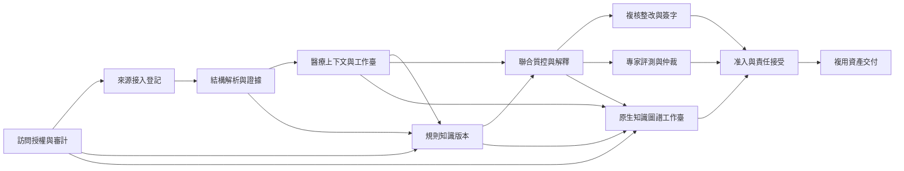

# FF - 醫療病歷質控 Feature Map

## 拆分原則

本 Map 基於 [PRD v1.1](../PRD.md)與 [Product Spec v1.1](product-spec.md)，按“處理階段 + 可獨立驗證的業務能力”拆分。產品範圍及共享語義沿用上述合同，未按 14 行需求看板或 5 個原型頁面直接拆成 Feature。

用戶此前委託完成到 Feature 拆分，本 Map 據此完成邊界判斷並標為 `confirmed`。U08 已展開原十個 Feature；U09 明確新增完整原生圖譜，並委託落盤設計，因此本 Map 新增 F011 及其 Spec / Plan / Tasks 與用例，既有 ID 保持；技術決定見[知識檢索](../architecture/knowledge-retrieval.md)和[Agent 編排](../architecture/agent-runtime.md)。U10 已授權並完成正式軟件實現與代表性工程檢查。十一個 Spec/Plan 為 ready，完整驗收和真實專業條件尚未全部滿足，F001/F002/F003 已完成本輪驗收，其餘 Feature/Tasks 按專業或依賴前置保持 in-progress；各條結果見[開發報告](../verification/development-report.md)。Map 的 confirmed 只確認邊界和依賴。

- 接入登記、結構解析、醫療上下文分別有可檢查產物和下游消費方，可以獨立優化；它們不是同一文件轉換動作的重複命名。
- 規則/知識治理與質控執行分開：前者提供可用版本與適用性，後者輸出固定依據的候選問題。
- 複核、醫生處理、爭議、再核驗和簽字保持一個責任閉環，由一個主責 Feature 維護一致狀態，複用既有質控能力。
- 專家評測生成證據，准入能力據此及其他前置作出放權決定；兩者不能以同一個“通過”狀態替代。
- 權限審計服務於明確的當前消費方；資產固化在已有結果上形成交付基線，不另建通用平臺。Feature 不是部署單元或技術層。

## Feature Map

| Feature ID | 目錄 | Feature | 可驗證結果與產物 | 來源合同 | 依賴 | 優先級 | 狀態 |
| --- | --- | --- | --- | --- | --- | --- | --- |
| F001 | `F001-access-audit` | 訪問授權與責任審計 | 對角色和對象範圍作出可解釋的授權決定，並保留關鍵責任事件 | REQ-015, REQ-016, NFR-001, NFR-004, NFR-005, PSC-008, PSC-009 | 無 | P0 | completed |
| F002 | `F002-source-registration` | 多源資料接入與版本登記 | 形成有用途、授權、來源版本和覆蓋信息的資料清單及數據庫結構目錄 | REQ-001, NFR-001, NFR-002, NFR-005, PSC-001, PSC-008, PSC-009 | F001 | P0 | completed |
| F003 | `F003-structured-evidence` | 結構解析與統一證據輸出 | 將多格式內容轉為可定位、保留原結構與失敗覆蓋的統一證據對象 | REQ-002, REQ-008, NFR-001, NFR-002, NFR-003, NFR-005, PSC-001, PSC-002, PSC-005, PSC-008 | F002 | P0 | completed |
| F004 | `F004-clinical-context` | 醫療上下文與病例工作臺 | 接入必需應用本體並形成可回到原文的病例語義視圖，並讓使用者連續定位與接續同一任務 | REQ-003, REQ-004, REQ-014, NFR-001, NFR-002, NFR-003, NFR-005, NFR-006, PSC-001, PSC-002, PSC-003, PSC-006, PSC-008, PSC-013 | F003 | P0 | in-progress |
| F005 | `F005-rule-knowledge-governance` | 規則與知識版本治理 | 提供帶來源、適用範圍、審核/生效條件及版本歷史的規則和知識基線 | REQ-005, NFR-001, NFR-002, NFR-003, NFR-004, NFR-005, PSC-001, PSC-004, PSC-008, PSC-009, PSC-012 | F001, F003, F004 | P0 | in-progress |
| F006 | `F006-quality-evidence-review` | 聯合質控與證據解釋 | 輸出分層且可追溯的候選問題，並對缺證據或不適用條件停止自動推進 | REQ-006, REQ-007, REQ-008, NFR-001, NFR-002, NFR-003, NFR-005, PSC-001, PSC-002, PSC-004, PSC-005, PSC-008 | F004, F005 | P0 | in-progress |
| F007 | `F007-remediation-accountability` | 複核整改與責任簽字閉環 | 使同一處理範圍有明確的複核/爭議結論、整改版本、再核驗及分崗位責任簽字 | REQ-009, REQ-010, REQ-011, REQ-012, REQ-013, REQ-014, NFR-001, NFR-003, NFR-004, NFR-005, NFR-006, PSC-001, PSC-005, PSC-006, PSC-007, PSC-008, PSC-009, PSC-013 | F006 | P0 | in-progress |
| F008 | `F008-expert-evaluation` | 專家評測與分歧仲裁 | 形成固定樣本/版本、保留雙人原判與仲裁、含分母和風險分層的評測證據 | REQ-017, NFR-001, NFR-002, NFR-003, NFR-004, NFR-005, NFR-006, PSC-001, PSC-008, PSC-009, PSC-010, PSC-011, PSC-013 | F006 | P0 | in-progress |
| F009 | `F009-release-gates` | 上線准入與責任接受 | 對固定版本/範圍給出有依據的批准或阻斷，並規定階段放權與回退 | REQ-018, NFR-001, NFR-003, NFR-004, NFR-005, NFR-006, PSC-001, PSC-008, PSC-009, PSC-011, PSC-013 | F007, F008, F011 | P0 | in-progress |
| F010 | `F010-reusable-delivery-assets` | 醫療資產固化與複用交付 | 按單一版本基線交付規則、權限、專家評測及責任流程資產，且保持使用與驗證邊界 | REQ-019, NFR-001, NFR-002, NFR-004, NFR-005, NFR-006, PSC-001, PSC-008, PSC-009, PSC-012, PSC-013 | F009 | P1 | in-progress |
| F011 | `F011-knowledge-graph-workbench` | 知識圖譜工作臺 | 完整原生圖譜及設計器，三種醫療視圖、固定證據回查、候選審核與受控導出 | REQ-020, NFR-001, NFR-002, NFR-003, NFR-004, NFR-005, NFR-006, PSC-001, PSC-003, PSC-004, PSC-005, PSC-008, PSC-009, PSC-013, PSC-014 | F001, F004, F005, F006 | P0 | in-progress |

目錄列保留穩定名稱，當前 F001～F011 均已有完整三件套。P0 均有安全/可追溯/一期閉環上的必要性；P1 的資產複用仍在一期範圍內，按前置結果成熟程度推進。

### 已展開 Feature 與技術歸屬

| Feature | 詳細計劃 | 技術點及結果 |
| --- | --- | --- |
| 授權審計（F001） | [Plan](F001-access-audit/plan.md) | TP-13/14：實際身份、角色/對象範圍、同事務審計與撤權 |
| 來源（F002） | [Plan](F002-source-registration/plan.md) | 來源/快照/讀取句柄、角色/許可/覆蓋及 F003 接入 |
| 解析（F003） | [Plan](F003-structured-evidence/plan.md) | 原生解析、EvidenceItem 與覆蓋；向下遊提供固定證據，不承擔 RAG 總體選型 |
| 上下文（F004） | [Plan](F004-clinical-context/plan.md) | TP-01/02：SQLite 受控查詢、必需應用本體/語義版本、病例與工作臺；消費 TP-09 的固定運行結果 |
| 規則知識（F005） | [Plan](F005-rule-knowledge-governance/plan.md) | TP-03～06：規則資格、條款索引、BM25/BGE-M3、RRF、索引/權限失效與歷史基線 |
| 聯合質控（F006） | [Plan](F006-quality-evidence-review/plan.md) | TP-07～10/12：有限規則、域內候選、證據、失敗關閉及 LangGraph 執行恢復 |
| 人工責任（F007） | [Plan](F007-remediation-accountability/plan.md) | TP-11/12：業務狀態源、決定事務、人工等待、冪等恢復和責任簽字 |
| 專家評測（F008） | [Plan](F008-expert-evaluation/plan.md) | TP-16：凍結樣本、雙人原判/仲裁、分母/風險指標和報告 |
| 准入（F009） | [Plan](F009-release-gates/plan.md) | 階段/範圍門檻、責任接受、實際能力控制及停用/重驗 |
| 交付（F010） | [Plan](F010-reusable-delivery-assets/plan.md) | 固定資產/許可/依賴、生成/下載/完整性和資格保真 |
| 圖譜（F011） | [Plan](F011-knowledge-graph-workbench/plan.md) | [TP-17/18](../architecture/ontology-playground-integration.md)：固定原生工作臺、醫療顯示投影、候選/格式適配和詳細產品操作 |

技術點統一維護在[技術決定及專題](../architecture/knowledge-retrieval.md)，沒有新增一個泛化 RAG 平臺 Feature。下表補列的授權、覆蓋、版本等合同是既有跨 Feature 約束的顯式承接，不改變原職責和依賴。

U06 的[基礎架構 FA-01～12](../architecture/architecture.md)補齊正式應用棧和 PostgreSQL/pgvector；[TP-13～16](../architecture/technical-points/platform-and-clinical-contracts.md)細化 F001 的權限、F002/F003 的任務、F004～F007 的臨床/事務合同及 F008/F009 的驗證。它們仍按原 Feature 承擔，不新增平臺 Feature；本輪全量規劃仍不視為功能已實現。[實施合同](../architecture/implementation-contracts.md)固定模塊交接，[評估計劃](../evaluation-plan.md)固定全需求的驗證方式。

## 拆分依據與交付順序

### 各 Feature 的輸入、輸出與獨立邊界

#### F001 訪問授權與責任審計

- **職責與納入範圍：** 實際身份、角色動作、科室/責任病例/任務目的/期限校驗；域內邊界、訪問/導出拒絕及關鍵變更審計。提供其他能力可使用的授權結果和責任記錄約定。
- **輸入與前置：** 目標環境的身份與授權範圍、調用崗位、業務對象/版本、動作及必要理由；未配置或過期條件必須明確。
- **輸出與消費方：** 允許或拒絕及原因、授權適用範圍、關聯業務操作的審計結果；由資料接入、所有責任動作、評測准入和導出消費。
- **明確不含：** 不負責解析病歷、醫學判斷、替業務模塊決定狀態；不選擇身份協議、網關、日誌數據庫或部署方式。
- **獨立驗收：** 以跨崗位、跨責任組/科室、過期授權和審計保存失敗樣本，驗證無正文洩漏、無越權動作、關鍵變更無假成功；組合敏感鏈路再驗 PG-003。
- **獨立迭代與影響：** 身份接入與審計實現可獨立優化；授權對象語義、關鍵記錄字段或失敗結果變化會影響直接消費方。對象身份來自 PSC，不依賴其他 Feature 先實現其全部業務。

#### F002 多源資料接入與版本登記

- **職責與納入範圍：** 登記文件和只讀數據庫來源，讀取聲明範圍內的結構元信息與記錄定位；保存來源類別、文件/快照版本及接入成功/失敗信息。重複輸入可識別，不靜默跨來源合併。
- **輸入與前置：** 已獲授權的來源及聲明讀取範圍、文件/數據庫可訪問性、用途與來源類別；消費 F001 的授權及審計結果。
- **輸出與消費方：** 來源版本、結構目錄、原始文件/記錄的可回查入口、接入覆蓋和失敗項；供 F003 解析，供後續整改版本登記複用。
- **明確不含：** 不做版面解析、OCR、字段語義抽取或病例身份融合；不修改原庫/原件，不建立通用跨組織數據集成平臺。
- **獨立驗收：** 對數據庫結構/記錄、文件和重複/不可讀來源，核對來源版本、結構目錄、覆蓋與失敗項且無寫入原源；由 F003 接續驗證統一結果。
- **獨立迭代與影響：** 連接和讀取方式可單獨替換；來源身份、快照一致性、主鍵缺失與覆蓋語義必須保持，並驗證 F003 的輸入可消費。

#### F003 結構解析與統一證據輸出

- **職責與納入範圍：** 分別讀取數據庫結構/記錄、文本與掃描 PDF、Markdown、CSV、JSON/JSONL；輸出 EvidenceItem 的共同身份、來源、定位、內容類型、解析過程與質量狀態，保留原生結果引用。
- **輸入與前置：** F002 登記的來源版本、讀取範圍、結構目錄與原始內容入口；沿用授權域，不在解析失敗時擅自更換域外服務。
- **輸出與消費方：** 可用/部分成功/失敗/阻斷結果、統一證據對象、格式專有結構和定位缺口；供 F004 醫療上下文、F005 知識依據及質控/評測消費。
- **明確不含：** 不把數據庫關係或統一對象直接當作醫療事實，不合並患者，不判定醫學正確性。工具、序列化與運行條件在 F003 局部架構和 Plan 中具體化；待比測候選不能寫成已經驗證勝出。
- **獨立驗收：** 用所列格式的代表輸入及損壞、缺定位、跨頁表格/嵌套/空值樣本，核對原值、結構、定位重放、覆蓋與重試；不以生成文本或 JSON 文件作為充分通過。
- **獨立迭代與影響：** 各解析器與路由可獨立優化；EvidenceItem 類型、定位、質量狀態或原生結構引用變化需同步 F004/F005 及直接消費者。

#### F004 醫療上下文與病例工作臺

- **職責與納入範圍：** 建設/接入必需的醫療質控應用本體、映射/約束及版本化語義服務，組織病例/就診、文書、字段、時間線、檢查與事件；保留未關聯、未知與衝突。提供同一授權結果集的搜索、篩選、排序、瀏覽、詳情入口及返回上下文，消費下游處理結果更新狀態和責任節點。
- **輸入與前置：** F003 的 EvidenceItem 與質量狀態、已知身份/關係依據、崗位授權範圍；質控和工作流狀態由對應主責 Feature 提供。
- **輸出與消費方：** 固定本體語義基線、統一病例/文書上下文、可回查關聯及工作臺能力；F005 消費本體/映射/值集，F006/F007 消費上下文及固定版本，並展示其共享結果。
- **明確不含：** 不把相似內容自動視為同一患者，不覆蓋原值；不負責計算質控結論或執行簽字，任務狀態語義以 PSC 為準。
- **獨立驗收：** 通過缺失/相對時間/跨段矛盾與身份衝突樣本驗證上下文；在多頁記錄中完成查找、進入、返回和處理後的狀態一致性，組合 PG-001/002。
- **獨立迭代與影響：** 語義映射與界面佈局可分別優化，前提是病例身份、證據關聯、任務狀態和返回語義不變；不承諾以原型會話存儲實現正式數據一致性。

#### F005 規則與知識版本治理

- **職責與納入範圍：** 管理 8 條文書候選規則及知識依據的版本、用途、適用範圍、審核與生效/失效；固定運行所用版本並識別變更影響，向交付能力提供規則基線。
- **輸入與前置：** 規則定義、專業審核責任及依據，F003 解析的知識來源與定位，F001 的發佈/變更權限，以及 F004 已批准本體/映射/值集的語義基線。
- **輸出與消費方：** 特定用途下可選擇或被拒絕的規則/知識版本、適用性信息與變更影響；供 F006 質控、F008 評測和 F009 准入消費。
- **明確不含：** 不由系統編造專業指南或審核意見，不直接決定患者結論；具體檢索與版本存儲方案在局部 Plan 落實，不能因技術選定產生專業批准。
- **獨立驗收：** 對候選/生效/失效/衝突版本驗證用途和適用範圍；舊結果仍回查舊依據，變更隻影響相應當前判斷和新運行。
- **獨立迭代與影響：** 規則組織、檢索與版本實現可獨立改進；適用性、審核、生效與版本引用的語義變化會影響質控、評測、准入和導出。

#### F006 聯合質控與證據解釋

- **職責與納入範圍：** 協調確定性規則、知識依據與跨段語義候選；輸出問題、風險建議、理由、整改建議和證據鏈；固定運行輸入版本，報告阻斷與恢復前提。接收整改後的新版本重新執行檢查。
- **輸入與前置：** F004 的病例/文書上下文、F005 的適用規則/知識版本、允許的運行用途與範圍。
- **輸出與消費方：** 候選問題集合、事實/規則/模型層次、證據定位、運行覆蓋、阻斷或再核驗結果；供 F007 人工責任流程和 F008 專家評測消費。
- **明確不含：** 不自動診斷、不修改原病歷、不替專家裁決，不將風險分數或規則執行結束當專業確認；不負責業務簽字。
- **獨立驗收：** 使用可枚舉條件、跨段疑點、證據缺失/衝突和範圍外樣本，核對四層判斷的產生來源、定位及阻斷；人工確認由 F007 組合驗收。
- **獨立迭代與影響：** 規則執行、檢索或模型可以獨立替換；必須保持問題身份、證據契約、失敗和版本語義，不能單憑本模塊效果宣稱臨床或全流程驗收。

#### F007 複核整改與責任簽字閉環

- **職責與納入範圍：** 質控確認/駁回、派發與期限、醫生整改/申訴、專家裁決/升級、受影響範圍再次核驗、退回與雙崗位簽字；同步當前責任與病例彙總，舊版本和簽字歷史不漂移。
- **輸入與前置：** F006 固定版本的候選/阻斷結果、F004 病例上下文、F001 授權與責任事件能力；補充文書通過已有接入/解析契約形成新版本。
- **輸出與消費方：** 可追溯的新文書、意見、任務流轉、簽字範圍及完成/未完成狀態；供工作臺展示、審計與 F009 流程驗收/責任接受消費。
- **明確不含：** 不把所有病例終態統一叫合格，不替他人簽署；不回寫 HIS/原庫；核驗算法由 F006 負責，不在本 Feature 複製另一套規則判斷。
- **獨立驗收：** 完成正常閉環、誤報撤銷、整改失敗退回、爭議升級、雙崗位簽字、新版本重核、重複/過期提交與改派/延期分支，檢查所有相關視圖和責任記錄一致，組合 PG-002/003。
- **獨立迭代與影響：** 保持一個責任閉環，避免複核/整改/簽字各自維護互不一致狀態；可優化交接與表單，但處理範圍、允許轉換、凍結版本與責任條件變化需上提 PSC。

#### F008 專家評測與分歧仲裁

- **職責與納入範圍：** 分層抽樣與批次凍結、兩個獨立身份的原判、分歧仲裁、原始一致性、規則召回/誤報、證據/解釋/建議可用性和未判斷/覆蓋；輸出高風險缺陷及未解決項。
- **輸入與前置：** F006 的質控結果與證據，原始/規範化輸入和版本、專業參照、採樣與指標口徑、F001 的評測身份權限。
- **輸出與消費方：** 可回查的評測批次、原判/仲裁、指標口徑與分母、未完成項和高風險信號；供 F009 准入與 F010 資產固化消費。
- **明確不含：** 不把模型輔助標註直接變成金標準，不用仲裁覆蓋原始一致性；不自行批准上線或制定缺依據的生產閾值。
- **獨立驗收：** 通過雙人相同/分歧、同身份重複、仲裁、無法判斷、無效輸入和高風險漏報樣本，核對原判保留、指標/覆蓋及版本凍結；准入決定由 F009 驗證。
- **獨立迭代與影響：** 抽樣和指標計算可分別優化，樣本身份、參照/口徑版本、原判仲裁及風險信號語義保持穩定；不依賴 F007 完成全部業務事項即可評測質控能力。

#### F009 上線准入與責任接受

- **職責與納入範圍：** 彙集專業評測、規則/數據授權、流程驗收、關鍵崗位簽字及責任接受條件；高風險漏報和未解分歧否決；管理離線、影子、人確認輔助階段及範圍變更的重新評估。
- **輸入與前置：** F008 的評測證據，F007 閉環與責任條件的驗收證據，F001 授權域/實際身份及 F005 正式依據；生產量化與目標環境配置按 OQ 落實。
- **輸出與消費方：** 版本/範圍固定的准入決定、未滿足項、批准條件、關鍵人責任接受及停止/回退記錄；供運行控制和 F010 交付基線消費。
- **明確不含：** 不將文檔或原型通過當作生產批准，不承擔實際部署操作；不憑固定開關繞過缺失參數/證據，也不擴大一期醫院接入範圍。
- **獨立驗收：** 構造高風險漏報、待仲裁/未判斷、合成樣本、未生效規則、授權/閾值/簽字缺失和範圍變更條件，驗證阻斷與有效條件下的限定放權及失效回退，組合 PG-004。
- **獨立迭代與影響：** 門禁呈現與證據彙集可優化；批准範圍、否決、責任接受或回退語義變化需同步上游證據消費者與 Product Spec。

#### F010 醫療資產固化與複用交付

- **職責與納入範圍：** 彙集 F001/F005/F007/F008/F009 的既有產物，標明來源、版本、通用/醫療域/醫院定製、許可授權、專業審核/驗證狀態及消費者所需信息，形成結構化可接手資產。
- **輸入與前置：** 已經形成的各類產物及同一交付基線，F009 的准入決定或明確未放行狀態，以及導出權限。
- **輸出與消費方：** 規則包、權限模板、專家評測資產、責任流程及交付範圍說明；供後續維護、其他項目或業務責任人接手。
- **明確不含：** 不開發另一個通用資產平臺，不重複生成專業結果，不把導出變成批准；無授權不攜帶原始敏感病歷或擴大分發許可。
- **獨立驗收：** 從導出物回查各資產版本與狀態，檢查消費完整性、敏感數據篩除、重複導出基線一致及未批准資產不被升級，組合 PG-005。
- **獨立迭代與影響：** 包裝和消費方式可優化；版本、語義、來源及權限不變時無需改其他模塊內部實現，跨基線變動必須顯式記錄。

#### F011 知識圖譜工作臺

- **職責與納入範圍：** 用戶明確新增的可獨立驗證模塊。完整原生圖譜/Designer，承接本體、病例證據和規則影響三個視圖，中文定義/語境/來源/版本詳情、業務導航、候選交審核與受控導出。
- **輸入與前置：** F001 當前授權、F004 正式語義/病例上下文、F005 規則知識、F006 問題及引用；F003 證據沿既有定位消費。
- **輸出與消費方：** 只讀顯示投影、同版本證據/原任務落點、F004 可接手的候選。病例/規則頁面與專業維護者消費；F009 需本 P0 模塊真實驗收證據。
- **明確不含：** 不建立另一套專業發佈流程或患者事實庫，不自動診療，不向公共站點/倉庫分享病歷，不把圖連通視為專業結論。
- **獨立驗收：** 原生 OP 能力逐項對照與 AC-F011-001～012；實際組合 PG-006 驗證同版本原文、授權、候選和返回任務。固定示例通過不能冒充真實臨床驗證。
- **拆分理由：** F004 提供本體/上下文語義事實，F011 提供完整可視化工作能力；可在固定合同下分別迭代。追加穩定 ID，不重拆原十個 Feature，也不將龐大工作臺塞入 F004 而隱藏新增範圍。

### 前置關係及原因

| 能力 | 必要前置及所用產物 | 與業務反饋的區別 |
| --- | --- | --- |
| 授權審計 | 無其他 Feature 前置；依據已凍結身份/對象/責任事件語義，可用固定對象驗證 | 不要求先有全部病例業務才能驗證授權結果 |
| 接入登記 | F001 的訪問決策、數據域和審計結果 | 不依賴解析已完成才能登記原始輸入 |
| 結構解析 | F002 的穩定來源、讀取範圍、結構目錄和原件入口 | 只輸出規範化證據，不承擔醫療身份確認 |
| 醫療上下文 | F003 的結構、位置與覆蓋結果 | 工作臺展示後續任務結果屬於消費已定義接口，不反向增加建設前置 |
| 規則治理 | F001 權限、F003 知識來源/定位；完整語義消費需要 F004 本體基線 | 規則候選登記可獨立推進；只要求 F004 語義能力而非其所有界面，不依賴 F006 判斷結果 |
| 聯合質控 | F004 的病例上下文及 F005 的適用規則/知識版本 | 可以用固定輸入先驗證，不等待責任流程完成 |
| 責任閉環 | F006 的問題/證據和再核驗能力，沿傳遞依賴複用 F001～F005 | 整改觸發上游重新登記/解析/核驗是已存在能力的再次消費，不是上游依賴 F007 才能建設 |
| 專家評測 | F006 的固定輸入/版本與質控輸出，以及繼承的授權/證據能力 | 不要求全部病例先完成 F007 才能評測，避免將專業評測綁到整改終態 |
| 上線准入 | F007 閉環/責任條件、F008 評測結果及 F011 圖譜驗收證據，加上傳遞依賴中的授權和正式依據 | 准入可給出未滿足結果；尚未具備生產條件時不能晉級 |
| 知識圖譜 | F001 授權、F004 語義/病例、F005 規則、F006 問題引用 | 候選送回既有 F004 流程不構成 F004 對 F011 的反向建設依賴 |
| 資產固化 | F009 確定交付基線中的准入/未放行狀態，以及前置各能力的規則、權限、評測與流程結果 | 導出不改變原有審核/驗證狀態，不構成新批准 |

### 推薦推進順序

1. **F001 → F002 → F003**：先得到有授權邊界、來源和覆蓋的標準證據結果，直接回答數據庫/PDF/Markdown/CSV/JSON 如何讀取與統一的問題。首批只證明數據鏈，不宣稱完成醫學質控。
2. **F004 語義基線 → F005 完整消費 → F006**：F004 建立本體/病例語義，F005 固定適用規則知識與本體引用後，驗證聯合質控；F005 來源/候選登記可按合同先行，不等待 F004 全部工作臺頁面完成。
3. **F007 與 F008**：分別貫通責任閉環與專家評測；可按明確契約獨立推進，不強迫所有環節串成單一隊列。
4. **F011**：F004/005/006 合同成立後集成完整圖譜，工程復現可用明確合成夾具先做；F007 真實返回在 PG-006 組合驗證，不新增反向建設依賴。
5. **F009 → F010**：包含 F011 必需驗收後，以實際證據形成准入/責任決定，再固化可接手資產。

前置表示當前結果成立所必需的能力；以上順序不規定團隊、工期或並行人力。每步使用有代表性且獲授權的樣本，保留失敗/部分成功條件，不要求先接完全部數據或搭建通用平臺。

### PRD 驗收責任歸屬

每條 AC 有一個主責 Feature，其餘為必要參與/消費方。主責不等於能獨自證明端到端結果；以下歸屬供 Feature AC 與組合評測承接，具體用例定義放在對應套件，Map 不重複定義。

當前 F001～F011 共 108 條局部 AC、119 項任務，局部正式用例 117 條；[產品套件](../../evals/product.json) 16 條，聲明全部 14 PSC 並顯式覆蓋全部 29 PRD AC。合計 133 條用例已綁定實際工程檢查與人工核對入口；通過、未運行和專業受阻分別記錄，不宣稱全套驗收完成。對應技術清單與分母見[評估計劃](../evaluation-plan.md)。

| PRD AC | 主責 | 參與/消費方 | 承接邊界 |
| --- | --- | --- | --- |
| AC-001 | F002 | F001、F003 | F002 主責來源/結構登記，F001 授權，F003 接續保留證據 |
| AC-002 | F003 | F002 | 統一結果與格式專有結構由 F003 驗證 |
| AC-003 | F003 | F006、F007 | 解析覆蓋由 F003 保證，下游尊重失敗/缺口 |
| AC-004 | F004 | F003 | 上下文與原值、身份關聯一起驗證 |
| AC-005 | F004 | F007 | 工作臺定位主責 F004，處理狀態由 F007 提供並組合核對 |
| AC-006 | F005 | F006 | 治理版本主責 F005，運行固定版本由 F006 消費驗證 |
| AC-007 | F006 | F001 | 聯合判斷職責與授權條件同時成立 |
| AC-008 | F006 | F003、F004、F005 | 報告由 F006 主責，來源/上下文/規則提供證據 |
| AC-009 | F006 | F003、F005、F007 | 質控阻斷決定與下游禁止推進組合驗證 |
| AC-010 | F007 | F001、F004 | 任務結論由 F007 主責，權限/審計和工作臺呈現配合 |
| AC-011 | F007 | F002、F003、F004 | 醫生提交與新版本由 F007 發起，複用上游登記/結構/病例合同 |
| AC-012 | F007 | F001 | 專業爭議結果與實際身份授權組合驗證 |
| AC-013 | F007 | F006 | F006 執行檢查，F007 承接新版本和人工確認 |
| AC-014 | F007 | F001 | 簽字准入、身份與範圍固定共同成立 |
| AC-015 | F007 | F004、F006 | 舊簽字保留，當前工作臺與新核驗結果不繼承舊完成狀態 |
| AC-016 | F001 | F002、F006、F007、F010 | 授權主體結果由 F001 主責，敏感入口逐一遵守 |
| AC-017 | F001 | F005、F007、F008、F009 | 審計可用性與發起業務變更的結果共同檢查 |
| AC-018 | F007 | F001、F004 | 責任交接與期限語義同步到審計和工作臺 |
| AC-019 | F008 | F001 | 雙人原判與實際不同身份共同成立 |
| AC-020 | F008 | F006 | 評測不剔除上游失敗、棄答與未覆蓋結果 |
| AC-021 | F009 | F008 | F008 提供高風險/爭議信號，F009 執行否決 |
| AC-022 | F009 | F001、F005、F007、F008 | 各項前置與責任證據共同決定階段准入 |
| AC-023 | F010 | F001、F005、F007、F008、F009 | 各資產主責生產者提供結果，F010 保證交付基線和使用邊界 |
| AC-024 | F007 | F001、F006、F010 | 以核驗/簽字鏈路為主責驗收重複與過期操作，審計、運行和導出各守同一版本語義 |
| AC-025 | F004 | F005、F007、F008、F009 | 主工作入口主責 F004；規則、責任處理、評測及准入場景組合走查 |
| AC-026 | F001 | F002、F003、F006、F010 | 數據域由 F001 主責，接入/解析/模型與導出失敗路徑共同驗證 |
| AC-027 | F011 | F004 | 原生能力完整與產品桌面體驗，語義輸入仍由 F004 主責 |
| AC-028 | F011 | F003、F004、F005、F006、F007 | 同版本圖/證據、分層與返回原任務組合成立 |
| AC-029 | F011 | F001、F004、F005 | 當前授權、候選審核、格式損失和導出許可共同約束 |

### 組合驗收安排

- PG-001：F001～F004 組合證明多格式資料到可追溯病例，而非僅各自成功產生文件。
- PG-002：F001、F004～F007 組合證明授權範圍內的質控、責任閉環和新版本恢復。
- PG-003：F001 與具體敏感輸入/操作/導出消費方組合檢驗越權、越域和責任記錄失敗。
- PG-004：F005～F009 組合證明規則適用、專業評測、流程責任和放權門禁。
- PG-005：F010 與資產生產者 F001/F005/F007/F008/F009 組合核對交付版本、狀態及權限邊界。

## 範圍外與延期項

沿用 PRD 第 6 節：不自動診斷，不無人確認改寫原始病歷；不在一期實施 HIS 內嵌、API/SDK 接入、原庫回寫、全院全病種或影像/心電自動診斷。

本 Map 無延期或刪除 Feature，11 項軟件均已落地；其餘行 in-progress 表示專業或整鏈驗收前置，P1 資產交接也已實現。未滿足條件保留在各 Feature 臺賬。

PRD OQ-003～006 的樣本、規則審核、工具/部署、指標閾值與目標環境條件繼續保留；它們不改變本 Map 的職責邊界，相關啟用/准入仍按 PSC 限制或阻斷。詳細設計開始時必須落實影響本次實施的技術與運行條件，不能憑本文猜選工具或把候選解析器寫成已選型。

**當前停止點：一期全部 10 個 Feature 的詳細規劃、實施合同與評估設計已齊。** 真實身份/數據/專業資格、工具/資源/接口和運行證據仍按 Plan 前置落實；未安裝、開發、運行模型或部署生產。

## 變更記錄

| 日期 | 變化 | 影響 | 確認依據 |
| --- | --- | --- | --- |
| 2026-10-13 | 初始化空白 Map，未定義 Feature | 歷史初始化狀態保留 | 項目骨架與草稿授權 |
| 2026-10-13 | 基於 PRD v1.0 與 Product Spec v1.0 形成 10 個結果清楚的 Feature，固定覆蓋、輸入輸出與依賴 | F001～F010；全部 planned | PRD U02 / DEC-004：用戶明確要求直接做到拆分完 Feature，然後停止 |
| 2026-10-13 | 將數據解析工作流歸入 F003，展開三件套與驗收設計；為其補顯式繼承的 NFR-001 / PSC-008 數據域約束 | F003 與 F002/F004/F005 交接說明；無邊界、優先級或依賴變化，全部仍 planned | PRD U03 / DEC-006：用戶要求結合業務痛點寫入 Feature 詳細計劃；數據域約束原已由 AC-026 指定 F003 參與 |
| 2026-10-13 | 落盤檢索技術決定與 TP-01～09，展開 F004～F006，補列各自實際消費的授權/覆蓋/版本/責任合同與用例 | 新增 25 條 Feature AC、28 項任務；原 10 個 Feature 的邊界、優先級和依賴不變，全部仍 planned | PRD U04 / DEC-007：用戶要求按技術選型落盤並補充對應 Feature 到具體技術點 |
| 2026-10-13 | Agent 選型採用 LangGraph 顯式編排，落 TP-10～12，補 F006 恢復路徑並展開 F007；補顯式繼承的來源/證據/授權合同 | F007 新增 11 條 AC、12 項任務；F006 保留編號，product 追加 2 條；未新增 Feature/改變依賴 | PRD U05 / DEC-008：用戶要求按業務選 Agent 技術、沉澱 Skill 並落盤 Feature |
| 2026-10-13 | 基礎架構確定應用棧/正式庫，新增 TP-13～16；細化既有 F004/F006 語境 AC 與組合用例，Plan 對齊存儲/接口 | Feature 數、依賴、局部 AC 編號/數量與任務數不變；product 追加 2 條，未運行 | PRD U06 / DEC-009 |
| 2026-10-13 | 本體調整為一期必需，F004 承接定義/映射/約束和語義發佈，F005/F006 固定消費 | F005 增加 F004 語義基線前置；10 個 Feature、原編號/數量與 planned 狀態不變 | PRD U07 / DEC-010 |

| 2026-10-13 | 補齊 F001/F002/F008/F009/F010 三件套及全部評估；F004/F006 增補本體局部 AC/任務 | 10 Feature 原邊界/優先級/依賴保持；F008～F010 顯式繼承已存在的域/責任/版本/界面共同約束；96 局部 AC、106 任務、117 用例未執行 | PRD U08 / DEC-011 |

| 2026-10-14 | 按 U10 實施 11 項正式軟件、實際依賴/模型/數據庫與原生圖譜，綁定全部用例並保存真實結果 | 編號/業務邊界保持；工程任務與完整驗收分開，Feature 為 in-progress | PRD U10 / DEC-013；[開發報告](../verification/development-report.md) |

### U09 圖譜增量確認

2026-10-13 依據用戶明確的完整採用/新增詳細模塊及落盤委託，確認 F011 為一期 P0；F009 增加 F011 為必要驗收前置，依賴仍無環。原生渲染不替換既有 OWL/SHACL 與臨床責任事實源。詳見[原生集成決定](../architecture/ontology-playground-integration.md)。

